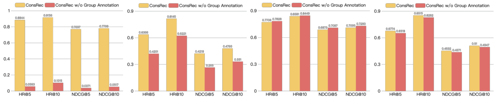
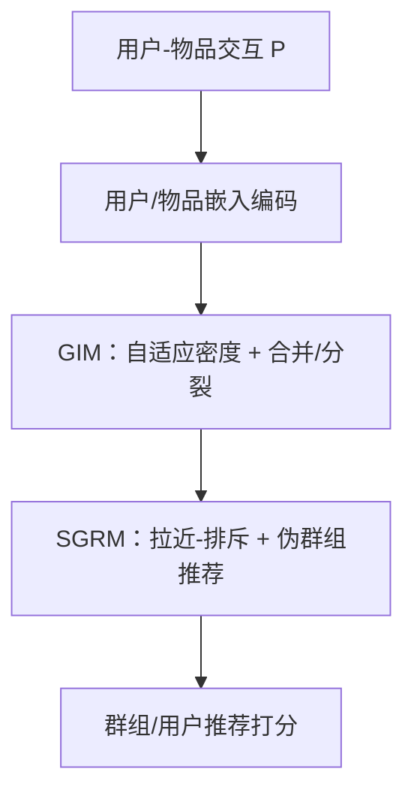

# Identify Then Recommend: Towards Unsupervised Group Recommendation (先识别后推荐：面向无监督群组推荐)

- **会议/期刊**: NeurIPS 2024
- **作者与机构**: Yue Liu, Shihao Zhu, Tianyuan Yang, Jian Ma, Wenliang Zhong（Ant Group / NUS）
- **推荐链路定位**: 重排（工业直播场景）；学术实验覆盖群组推荐与用户推荐
- **研究方向**: 社交与群组推荐 / 自监督与交互去噪
- **论文原文**: [https://arxiv.org/abs/2410.23757v1](https://arxiv.org/abs/2410.23757v1)
- **开源代码**: [https://github.com/yueliu1999/ITR](https://github.com/yueliu1999/ITR)

## TL;DR (1分钟核心速览)

群组推荐长期依赖预定义组数和昂贵的用户-群组/群组-物品标签。ITR 先以自适应密度估计与启发式合并-分裂无监督发现群组，再用“拉近-排斥”和“伪群组推荐”两个自监督 pretext 联合优化。在 Mafengwo/CAMRa2011 的 HR/NDCG@5/10 上，群组推荐 NDCG@5 绝对提升最高 0.2295，用户推荐 NDCG@5 绝对提升 0.2222，并已在工业直播推荐 A/B 中平均提升约 2.45%。

## Background & Motivation (背景与核心矛盾)

- **主流范式**: 现有 GR 多用注意力聚合、超图/GNN 建模高阶协同信号，或用对比学习对齐多视图；但训练均需给定用户-群组分布 $A$与群组-物品交互$Q$。
- **前人局限**: ① 群组数 $k$ 预定义且固定，无法适配实时系统中动态漂移的群组分布；② 监督训练依赖昂贵标签，工业日更数据下标注几乎不可行。
- **核心洞察 (Key Insight)**: 用户嵌入空间中“高密度区域”更可能是群组中心，“低密度区域”更可能是决策边界；因此可不预设 $k$，通过密度与合并-分裂一次性发现群组。
- **本文切入点**: 将任务拆为“先识别群组、再自监督推荐”，用无监督聚类替代组标签，用伪交互替代群组-物品监督。

<figure class="paper-figure" markdown="span">
  <figcaption>图1：在两个数据集上的动机实验。“GR”和“UR”分别表示群组推荐和用户推荐。</figcaption>
</figure>

图 1 的动机实验直接支撑矛盾：Mafengwo 上 ConsRec 去掉组标注后 HR@5 从 0.8844 跌至 0.0563，群组推荐几乎失效。

## Method (核心方法设计)

### 1. 整体框架 (Overall Architecture)

ITR 先用用户-物品交互学习用户/物品嵌入，并将用户嵌入初始化为群组候选中心；GIM 对每个候选估计自适应密度与半径，按密度降序执行“探索-利用”的合并/分裂，动态得到群组集合 $G'$与群组嵌入。SGRM 以拉近-排斥损失优化用户-群组分布，并以伪群组-物品交互$Q'$ 做群组推荐自监督；最终与用户侧 BPR 联合训练。推理时群组嵌入直接用于群组打分，用户嵌入仍可做用户推荐。

### 2. 关键设计拆解 (Key Designs)

1. **自适应密度 + 启发式合并-分裂（免预设 $k$）**：针对 DBSCAN/DeepDPM 仍需半径或密度阈值、k-means 需给定$k$的问题，对候选群组$g'_i$先算$r_q=d_{\min}+(d_{\max}-d_{\min})q$，再取密度$\mu_i=\max_q \frac{\sum_j \mathbb{I}(dis(i,j)\le r_q)}{\pi r_q^2}$。高密度区作中心、低密度区作边界；随后按$\alpha=\exp(-s_{\text{explore}}^2/(s_{\text{all}}+1))$ 控制探索率，前期探索新群组，后期合并相似群组并分裂孤立密度峰。直觉是“密度峰值+动态边界”比固定半径更适应群组漂移。

2. **拉近-排斥与伪群组推荐（无组标签自监督）**：拉近项把用户拉向所属群组，排斥项推开不同群组中心：$\mathcal{L}_{\text{PAR}}=\frac{1}{nk'}\sum_i\sum_j\|\tilde{u}_i-\tilde{g}'_j\|_2^2-\frac{1}{k'(k'-1)}\sum_i\sum_{j\ne i}\|\tilde{g}'_i-\tilde{g}'_j\|_2^2$。伪群组任务先以$d_{ij}=\|\tilde{u}_i-\tilde{g}'_j\|_2$、$a'_{ij}=\mathbb{I}(d_{ij}<\frac{1}{nk'}\sum D)$估$A'$，再令$Q'=(A')^{\top}P$，并以$\mathcal{L}_{\text{PGR}}=\frac{1}{k'm}\|G'I^{\top}-Q'\|^2$监督群组-物品匹配。这样在不访问真实$A,Q$ 时仍能构造群组推荐信号。

3. **训练目标、负采样与推理效率**：总损失 $\mathcal{L}_{\text{ITR}}=a\mathcal{L}_{\text{PAR}}+b\mathcal{L}_{\text{PGR}}+\mathcal{L}_{\text{U2I}}$，其中$\mathcal{L}_{\text{U2I}}$沿用 ConsRec 的 BPR，正样本为已交互物品，负样本从缺失数据随机采样。整体复杂度$O(nk'+k'^2)$，对用户数线性；一次前向即可确定群组数，避免对未知$k$ 多次聚类搜索。

## Experimental Setup & Evaluation Protocol (实验设置与评估协议)

- **数据集与预处理**: 原文未复列统计表；下表为公开基准常用规模，仅作参考。未见 `5-core` 过滤细节。

| 数据集 | #Users | #Items | #Groups | #Interactions | 特征/场景说明 |
| :--- | :---: | :---: | :---: | :---: | :--- |
| Mafengwo | 5,282 | 15,562 | 995 | 393,705(U-I) / 2,621,584(G-I) | 旅游群组、用户行程 |
| CAMRa2011 | 6,140 | 7,710 | 1,049 | 123,798(U-I) / — | 家庭群组、电影评分 |

- **数据划分与防穿越 (Splitting Strategy)**: 正文未明确 `Leave-One-Out` 或全局时间戳切分，实验沿用 ConsRec 的公开处理与划分；因此跨论文比较需谨慎。
- **排名评测协议 (Ranking Protocol)**: 采用 HR@5/10、NDCG@5/10；正文未明示无偏 `Full-Ranking`，训练按 ConsRec 随机未交互负例做 BPR，更接近 `Sampled Ranking`。结果取 3 次运行，未报告标准差/显著性检验。
- **对比基线与超参设置**: 对比 Pop、NCF、AGREE、GroupIM、HyperGroup、HCR、CubeRec、ConsRec、CoHeat 等 12 个 SOTA；$a=0.01$（Mafengwo）/10（CAMRa2011），$b=10$，$q\in\{0.1,0.2,0.3\}$，学习率 1e-4/1e-3。

## Key Experimental Results (实验关键数据)

### 1. 主实验对比 (Main Results)

群组推荐（GR）核心结果，`Δ` 为相对该数据集最优基线的绝对提升：

| 数据集 | 方法 | HR@5 | NDCG@5 | NDCG@10 | Avg. |
| :--- | :--- | :---: | :---: | :---: | :---: |
| Mafengwo | GroupIM | 0.7377 | 0.6078 | 0.6330 | 0.6987 |
| Mafengwo | HCR | 0.7759 | 0.6611 | 0.6852 | 0.7431 |
| Mafengwo | CubeRec | 0.8613 | 0.7574 | 0.7708 | 0.8230 |
| Mafengwo | ConsRec | 0.8844 | 0.7692 | 0.7794 | 0.8372 |
| Mafengwo | CoHeat | 0.8992 | 0.7924 | 0.8172 | 0.8573 |
| Mafengwo | **ITR** | **0.9337** | **0.8761** | **0.8775** | **0.9062** |
| Mafengwo | Δ | +0.0345 | +0.0837 | +0.0603 | +0.0490 |
| CAMRa2011 | GroupIM | 0.6552 | 0.4310 | 0.4914 | 0.6046 |
| CAMRa2011 | HyperGroup | 0.5890 | 0.3856 | 0.4538 | 0.5568 |
| CAMRa2011 | ConsRec | 0.6407 | 0.4358 | 0.4945 | 0.5990 |
| CAMRa2011 | CoHeat | 0.6204 | 0.4284 | 0.4820 | 0.5821 |
| CAMRa2011 | **ITR** | **0.6952** | **0.6653** | **0.6985** | **0.7146** |
| CAMRa2011 | Δ | +0.0400 | +0.2295 | +0.2040 | +0.1100 |

用户推荐（UR）上 ITR 同样最优：Mafengwo NDCG@5 0.7569（vs. MeLU 0.7095），CAMRa2011 NDCG@5 0.6790（vs. ConsRec 0.4568），绝对提升 0.2222。

### 2. 消融实验 (Ablation Study)

下表为 Avg. 指标；Base 为带组标注的基线，PAR/PGR 为两个 pretext：

| 任务/数据集 | Base | +GIM+PAR | +GIM+PGR | ITR |
| :--- | :---: | :---: | :---: | :---: |
| GR-Mafengwo | 0.8372 | 0.8639 | 0.8436 | **0.9062** |
| GR-CAMRa2011 | 0.5990 | 0.7026 | 0.6559 | **0.7146** |
| UR-Mafengwo | 0.7503 | 0.7643 | 0.7755 | **0.7997** |
| UR-CAMRa2011 | 0.6215 | 0.7146 | 0.6774 | **0.7249** |

### 3. 关键实验发现 (Key Findings)

1. **无监督群组识别是主增益来源**：去掉组标注会让 ConsRec 在 Mafengwo HR@5 从 0.8844 崩到 0.0563；ITR 以 GIM 替代标签后反升至 0.9337，说明密度中心+合并分裂能补回大量监督信号。
2. **PAR 对 CAMRa2011 更关键，PGR 对 Mafengwo 用户推荐更稳**：CAMRa GR 上 +GIM+PAR 达 0.7026，远高于 +PGR 的 0.6559；Mafengwo UR 上 +PGR 0.7755 高于 +PAR 0.7643，组合后均最优，二者互补。
3. **Top-5 精度强、Top-10 召回仍有短板**：CAMRa2011 上 ITR HR@5 0.6952 高于 GroupIM 0.6552，但 HR@10 0.7993 低于 GroupIM 0.8407，NDCG@5/10 却大幅领先，表明其排序头部更准但长尾覆盖不足；工业 A/B 中 uvctr +2.37%、pvctr +2.09%、交易 pv +1.76%，平均约 +2.45%。

## Highlights & Limitations (亮点、对比与审稿批判)

- **与代表作对比 (vs. Prior Work)**: 相比 ConsRec 的多视图聚合，ITR 不需 $A,Q$标签且不预设$k$；相比 GroupIM 的互信息最大化，ITR 用密度聚类显式发现群组；相比 DBSCAN/DeepDPM，ITR 免半径阈值并用一次前向确定群组数。
- **可迁移亮点**: ① 密度峰值作中心、低密度作边界，可用于动态用户分群/流量场景；② $Q'=(A')^{\top}P$ 的伪群组交互构造，可迁移到缺失群组标签的多任务推荐；③ 拉近-排斥损失可稳定聚类嵌入。
- **审稿级局限批判**: ① 仅两个公开数据集，未报告显著性/方差，且划分与 Full-Ranking 协议不透明，结论强度受限；② $q,\alpha,a,b$ 与全局均值阈值较敏感，CAMRa2011 HR@10 落后 GroupIM，说明长尾召回和群组数稳定性仍不足；③ BPR 仍依赖用户-物品交互，未真正解决零交互冷启动。

## Rating (四维评分)

- **方法创新性 (Novelty)**: ⭐⭐⭐⭐ （将自适应密度聚类与群组自监督 pretext 结合，免 $k$ 免标签的“先识别后推荐”范式清晰）
- **评估协议与实验扎实度 (Protocol & Experiments)**: ⭐⭐⭐ （两数据集+12 基线+消融较完整，但缺数据统计、划分说明、显著性与方差）
- **写作与数学规范度 (Clarity & Rigor)**: ⭐⭐⭐⭐ （核心公式与两阶段流程清楚，复杂度分析完整；部分符号与阈值定义可更严谨）
- **工业落地与复现价值 (Industrial & Practical Value)**: ⭐⭐⭐⭐ （代码开源，工业直播 A/B 有正向收益，复杂度对用户数线性，具备重排侧落地价值）

