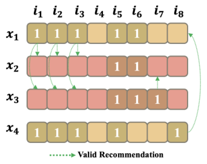
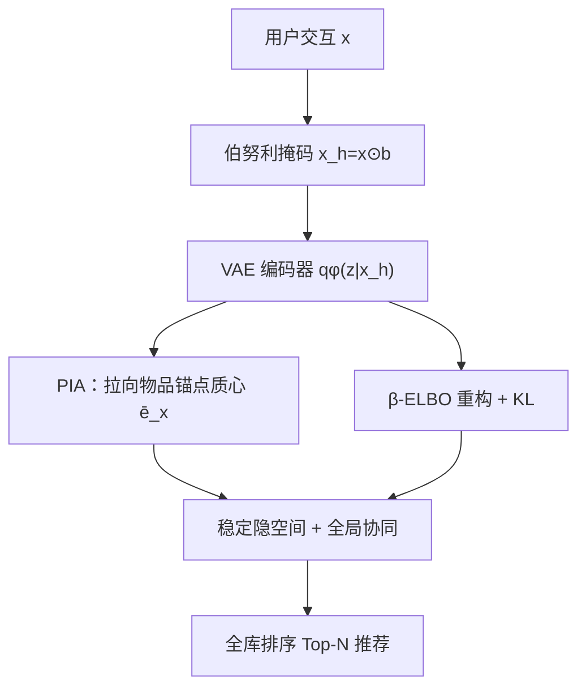
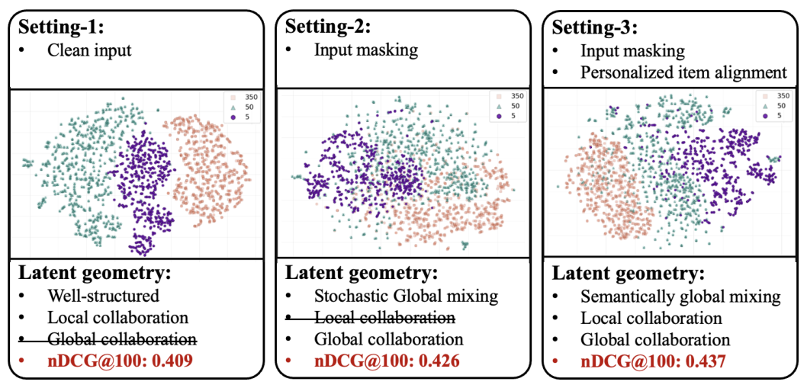

# On the Mechanisms of Collaborative Learning in VAE Recommenders (VAE 推荐器中协同学习机制研究)

- **会议/期刊**: ICLR 2026
- **作者与机构**: Tung-Long Vuong, Julien Monteil 等；Amazon、UT Austin、Monash University
- **推荐链路定位**: 召回 / Top-N 排序
- **研究方向**: 协同过滤 / 自监督与交互去噪
- **论文原文**: [论文原文链接](https://arxiv.org/abs/2511.06781v2)
- **开源代码**: [开源代码仓库链接](https://github.com/amazon-science/PIAVAE)

## TL;DR (1分钟核心速览)

本文追问 VAE-CF 中“输入 masking 为何有效”这一黑盒：作者证明跨用户协同受隐空间 $W_1$ 邻近半径支配，clean 输入偏向局部协同，masking 通过随机几何收缩/扩张注入全局信号但会带来邻域漂移。为此提出训练期锚点正则 PIA，将 masked 后验拉向用户正物品锚点质心；在 ML-20M、Netflix、MSD 上稳定提升，Amazon 流媒体 A/B 点击率提升 117%–267%。

## Background & Motivation (背景与核心矛盾)

- **主流范式**: VAE-CF（MultVAE/RecVAE）用伯努利 mask 破坏用户交互向量，再从部分历史重构全量交互，已成为协同过滤的强基线。
- **前人局限**: ① masking 长期被视为经验性 trick，缺乏“何时、为何发生跨用户知识迁移”的理论；② clean 输入下模型只利用输入近邻的局部协同，对“输入远但共享正物品”的全局协同利用不足。
- **核心洞察 (Key Insight)**: 协同不是由输入 $\ell_1$距离直接决定，而是由后验分布$q_\phi(z|x)$的隐空间邻近性决定；masking 和$\beta$-KL 都能压缩隐空间距离，但前者随机、后者均匀，副作用不同。
- **本文切入点**: 不改推理、不改先验，仅在训练时用可学习 item anchors 稳定 masking 诱导的随机几何，保留全局混合同时抑制邻域漂移。

<figure class="paper-figure" markdown="span">
  <figcaption>图1：局部与全局协同信号示例。</figcaption>
</figure>
图1：局部（输入近邻）与全局（远但共享正物品）协同信号示例。

## Method (核心方法设计)

### 1. 整体框架 (Overall Architecture)

输入用户二值交互 $\mathbf{x}\in\{0,1\}^I$，采样 mask$\mathbf{b}\sim\mathrm{Bernoulli}(\rho)^I$得到$\mathbf{x}_h=\mathbf{x}\odot\mathbf{b}$；编码器输出对角高斯后验$q_\phi(\mathbf{z}|\mathbf{x}_h)$，解码器重构$\mathbf{x}$。训练目标在标准$\beta$-ELBO 外增加 PIA：把 masked 后验均值拉向该用户正物品锚点的质心$\bar{\mathbf{e}}_x$，锚点矩阵$E$与 VAE 联合学习。推理时仍只用$q_\phi(\mathbf{z}|\mathbf{x})$，不增加任何测试开销。

### 2. 关键设计拆解 (Key Designs)

1. **隐空间共享半径（Latent-$W_1$Sharing Radius）**：前人只知 SGD 共享参数，却不知一次用户$v$的更新何时能降低用户$u$ 的损失。本文给出
$D_{u,v}=L_{\theta z}W_1(q_u,q_v)+\Delta_x(u,v)<\|g_u(\theta)\|$时，$v$的 SGD 步严格降低$L_u$，对应半径
$r_{\text{share}}(u,v;\theta)=\frac{[\|g_u(\theta)\|-\Delta_x(u,v)]_+}{L_{\theta z}}$。
直觉是：协同只在隐空间邻域内传播，远端但相关用户必须先被映射到同一邻域。

2. **Masking 的随机收缩/扩张与 $\beta$-KL 的取舍**：Theorem 2.6 证明 mask 可使两个输入距离为$h$、共享正物品数为$s$的用户以一定概率收缩到$\delta$ 内：
$\Pr[\|\mathbf{x}'_u-\mathbf{x}'_v\|_1<\delta]\ge(\rho^2+(1-\rho)^2)^s\sum_{k=0}^{\min(h,T_\delta)}\binom{h}{k}\rho^k(1-\rho)^{h-k}$，
也可能扩张、把真邻居踢出共享半径，造成 neighborhood drift。$\beta$-KL 则通过收紧信息瓶颈均匀压缩后验距离，过大时易 posterior collapse。本文选择“修 masking 的副作用”，而非继续调$\beta$。

3. **PIA 锚点正则与训练目标**：令 $S_x=\{i:x_i=1\}$、锚点$\mathbf{e}_i\in\mathbb{R}^d$，定义
$\mathcal{L}_A=\frac{1}{|S_x|}\sum_{i\in S_x}\mathbb{E}_{z\sim q_\phi(z|x_h)}\|z-\mathbf{e}_i\|_2^2$，
总损失 $\mathcal{L}_{\text{PIA}}=\mathbb{E}_b[\mathcal{L}_{\text{VAE}}]+\lambda_A\mathbb{E}_b[\mathcal{L}_A]$。
对对角高斯后验，Proposition 3.1 将其化为
$\mathcal{L}_A=\|\mu_\phi(\mathbf{x}_h)-\bar{\mathbf{e}}_x\|_2^2+\mathrm{tr}\,\Sigma_\phi(\mathbf{x}_h)+\text{const}$，
即同时对齐均值、收缩方差。Proposition 3.2 进一步给出有效 Hessian $H+2\lambda_A I$与收缩因子$\tau=\frac{L}{L+2\lambda_A}$，使$\mathrm{Var}_b[\mu^{(A)}]\preceq\tau^2\mathrm{Var}_b[\mu^{(0)}]$，解释其稳定 masked 表示、减少 drift 的机制。训练采用$\rho=5$、$\lambda_{\text{scale}}=2$的动态$\lambda_A$ 调度；VAE 重构本身无需负采样，推理对全物品打分。

## Experimental Setup & Evaluation Protocol (实验设置与评估协议)

- **数据集与预处理**: 沿用 MultVAE 协议；ML-20M/Netflix 保留至少 5 条评分、评分 $\ge4$ 为正；MSD 保留至少 20 首歌的用户与至少被 200 人听过的歌。

| 数据集 | #Users | #Items | #Interactions | 稀疏度/密度 | 特征/场景说明 |
| :--- | :---: | :---: | :---: | :---: | :--- |
| MovieLens-20M | 136,677 | 20,108 | 10.0M | 0.36% | 电影隐式反馈，10k held-out 用户 |
| Netflix Prize | 463,435 | 17,769 | 56.9M | 0.69% | 电影评分转隐式，40k held-out 用户 |
| Million Song | 571,355 | 41,140 | 33.6M | 0.14% | 音乐收听，50k held-out 用户 |

- **数据划分与防穿越**: 采用 per-user holdout：训练用户用全历史；验证/测试用户用 80% 历史作为输入，预测剩余 20%，属于比例划分而非全局时间切分。
- **排名评测协议**: 沿用 MultVAE 的测试用户留出协议，对候选物品排序并报告 Recall@20/50/100 与 NDCG@100；未额外采用采样负例排序。
- **对比基线与超参**: 覆盖 MF/WMF/GRALS、EASE/PLRec、CDAE/RaCT/MultiVAE/RecVAE；batch size 500、200 epochs、Adam $lr=1\times10^{-3}$；$\lambda_A$由验证集 NDCG@100 选择，$\rho=5$、$\lambda_{\text{scale}}=2$；在线 A/B 报告$p$ 值与 Bayesian prob。

## Key Experimental Results (实验关键数据)

### 1. 主实验对比 (Main Results)

| 模型 | ML R@20 | ML R@50 | ML N@100 | Netflix R@20 | Netflix N@100 | MSD R@20 | MSD N@100 |
| :--- | :---: | :---: | :---: | :---: | :---: | :---: | :---: |
| EASE | 0.391 | 0.521 | 0.420 | 0.362 | 0.393 | 0.333 | 0.389 |
| MF | 0.367 | 0.498 | 0.399 | 0.335 | 0.369 | 0.258 | 0.314 |
| PLRec | 0.394 | 0.527 | 0.426 | 0.357 | 0.390 | 0.286 | 0.344 |
| LambdaNet | 0.395 | 0.534 | 0.427 | 0.352 | 0.386 | 0.259 | 0.308 |
| MultiVAE | 0.395 | 0.537 | 0.426 | 0.351 | 0.386 | 0.266 | 0.316 |
| RecVAE | 0.414 | 0.553 | 0.442 | 0.361 | 0.394 | 0.276 | 0.326 |
| MultiVAE+PIA | 0.408 | 0.546 | 0.437 | 0.360 | 0.392 | 0.275 | 0.326 |
| RecVAE+PIA | **0.417** | **0.556** | **0.446** | **0.365** | **0.396** | **0.278** | **0.329** |
| **Improv.% (MultiVAE+PIA)** | +3.29 | +1.68 | +2.58 | +2.56 | +1.55 | +3.38 | +3.16 |
| **Improv.% (RecVAE+PIA)** | +0.72 | +0.54 | +0.90 | +1.01 | +0.51 | +0.72 | +0.92 |

### 2. 消融实验 (Ablation Study)

| 变体 | ML-20M NDCG@100 | 相对 mask-only | 关键观察 |
| :--- | :---: | :---: | :--- |
| w/o mask（clean） | 0.409 | -4.0% | 仅利用局部协同 |
| mask only | 0.426 | — | 全局混合有效但存在 drift |
| mask + PIA | **0.437** | +2.6% | 稳定几何并保留全局信号 |

### 3. 关键实验发现 (Key Findings)

1. **PIA 的增益在弱骨干上更明显**：MultiVAE+PIA 在 ML-20M/Netflix/MSD 的 NDCG@100 相对提升分别为 2.58%/1.55%/3.16%，而 RecVAE+PIA 仍有 0.51%–1.01% 提升，说明锚点正则与更强 VAE 骨干互补而非替代。
2. **masking 的收益与副作用被拆开验证**：ML-20M 上 clean 0.409 → mask 0.426 → mask+PIA 0.437；图2 的 t-SNE 显示 clean 按活跃度分离、mask 后 cohort 纠缠、PIA 后 5/50/350 交互组呈平滑过渡，对应“全局协同增强且局部结构不崩”。
3. **稀疏与高活用户同时受益**：分桶 NDCG@100 中，[5–10] 组 0.317→0.323，[100+] 组 0.474→0.486；Amazon 在线 Home Card 点击率 4.4%→9.5%（+117%/view），Movie Card 3.4%→12.5%（+267%/view），播放时长最高 +509%，验证全局协同对冷启与长尾的工业价值。

<figure class="paper-figure" markdown="span">
  <figcaption>图2：ML-20M数据集中按交互次数区分的三个用户组的潜在表示的t-SNE可视化。紫色、青色和橙色分别表示具有5、50和350次交互的用户，对应不同的VAE模型配置。我们选择具有5、50和350次交互的用户组，因为它们在输入空间上明显分离（即L1）。</figcaption>
</figure>
图2：ML-20M 三组活跃用户的 t-SNE；clean 分离、mask 纠缠、PIA 平滑过渡。

## Highlights & Limitations (亮点、对比与审稿批判)

- **与代表作对比 (vs. Prior Work)**: 相比 MultVAE/RecVAE 只把 masking 当训练技巧，本文首次给出“共享半径 + 随机收缩/扩张”的机制解释；相比 $\beta$-KL/灵活先验路线，PIA 不改先验、不收紧信息瓶颈，直接修 masking 引发的 drift，避免 collapse 风险。
- **可迁移亮点**: ① 用 $W_1$共享半径诊断任意双塔/VAE 召回中的跨用户梯度共享；② item anchors 可作为 training-only 语义锚点，迁移到冷启动或多模态召回；③ 按验证集停滞动态放大$\lambda_A$ 的调度简单有效。
- **审稿级局限批判**: ① 理论依赖 encoder/decoder Lipschitz、指数族与二次近似等较强假设；② 收益仍受 Bernoulli mask 设计制约，mask 过强时锚点也难救；③ 训练开销约 +15.9%，离线仅三数据集且未报告显著性检验，在线仅一个平台一周，外推需谨慎。

## Rating (四维评分)

- **方法创新性 (Novelty)**: ⭐⭐⭐⭐ （首次把 VAE-CF 协同机制归因到隐空间共享半径，并给出 masking 收缩/扩张概率与 PIA 稳定化，理论链条新颖）
- **评估协议与实验扎实度 (Protocol & Experiments)**: ⭐⭐⭐⭐ （三大基准 + 分桶消融 + t-SNE + Amazon 在线 A/B 较完整；离线全库排序细节与显著性报告略欠）
- **写作与数学规范度 (Clarity & Rigor)**: ⭐⭐⭐⭐ （定理—直觉—算法闭环清晰，但假设较多、部分证明依赖附录，工业读者门槛偏高）
- **工业落地与复现价值 (Industrial & Practical Value)**: ⭐⭐⭐⭐ （推理零额外开销、训练仅 +15.9%，已开源并在 Amazon 流媒体上线，工程迁移性强）

