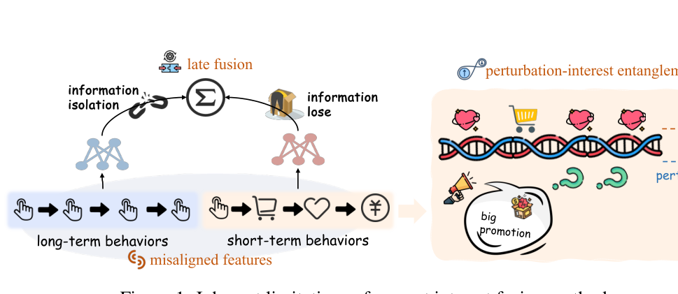
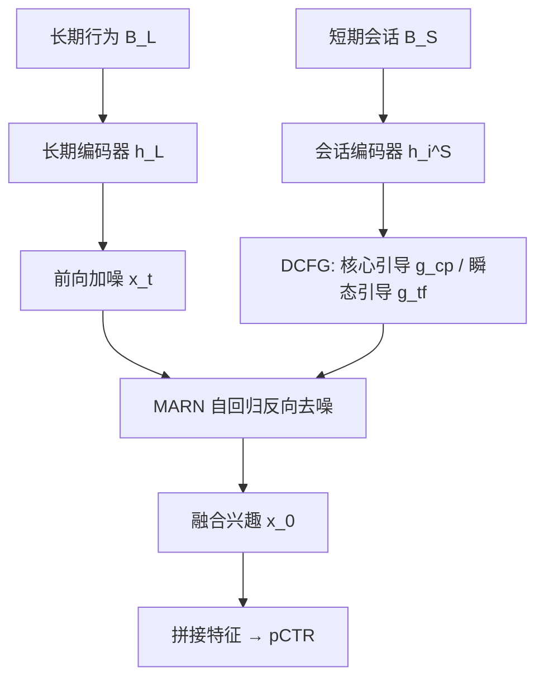
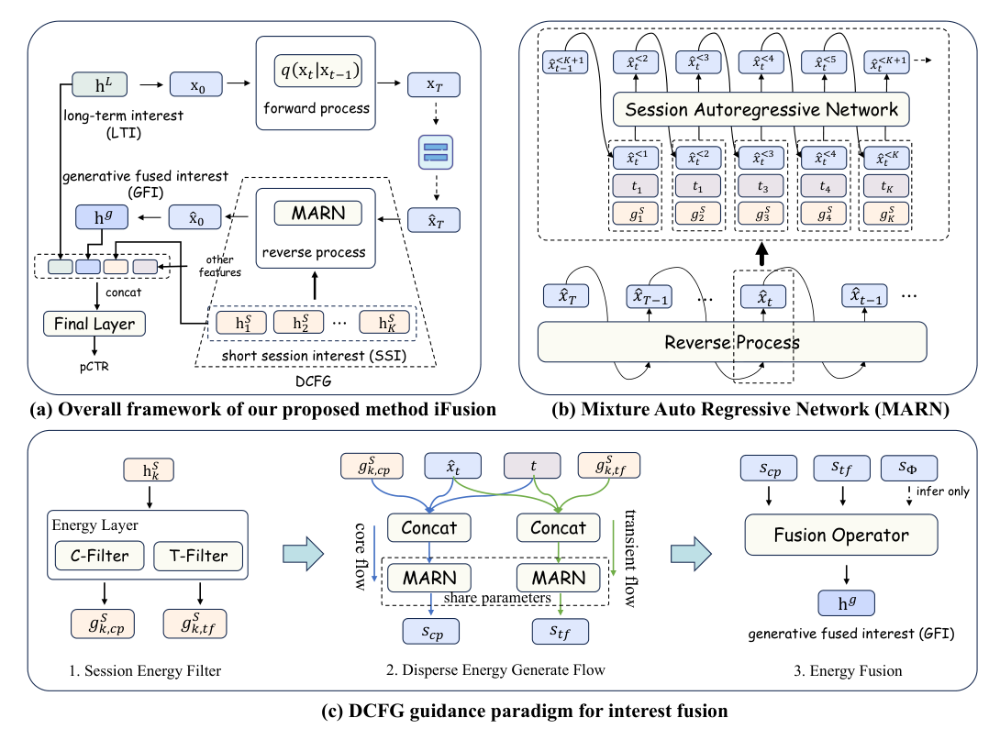

# iFusion: Integrating Dynamic Interest Streams via Diffusion Model for Click-Through Rate Prediction (基于扩散模型整合动态兴趣流的点击率预测)

- **会议/期刊**: ICLR 2026
- **作者与机构**: Ziheng Ni, Congcong Liu, Yuying Chen, Zhiwei Fang, Changping Peng, Zhangang Lin, Ching Law, Jingping Shao；京东、香港科技大学
- **推荐链路定位**: 精排 / CTR 预估
- **研究方向**: CTR预估与特征交叉 / 生成式推荐
- **论文原文**: [论文原文链接](https://proceedings.iclr.cc/paper_files/paper/2026/file/1d051fb631f104cb2a621451f37676b9-Paper-Conference.pdf)
- **开源代码**: 暂未开源

## TL;DR (1分钟核心速览)

针对长短期兴趣融合中特征空间错位、后融合割裂与短期噪声纠缠，iFusion 把融合改写为以长期兴趣为 $x_0$、短期会话为条件的扩散生成，并用 DCFG 解耦核心/瞬态引导、MARN 自回归去噪。四数据集 AUC 全胜，工业集 RelaImpr +6.89%，线上 CTR +2.44%、eCPM +2.61%（$p<0.001$）。

## Background & Motivation (背景与核心矛盾)

- **主流范式**: 将用户行为切为长期/短期序列，分别用 DIN/DIEN/SIM/TWIN 等编码后，以拼接、注意力或门控做确定性融合。
- **前人局限**: ①长期点击日志与短期多行为（点击/购买/搜索）特征空间错位；②后融合把行为建模与兴趣融合割裂，跨序列归纳偏置不足；③线性融合无法区分稳定偏好与短期随机波动，噪声会污染长期表征。
- **核心洞察 (Key Insight)**: 兴趣融合不应是“对齐后加权”，而可视为在短期会话条件下，从长期兴趣分布中逐步去噪生成融合兴趣；生成过程天然允许非线性、多会话条件与不确定性建模。
- **本文切入点**: 用扩散模型把融合变成条件生成，并以 DCFG 分离核心偏好/瞬态波动、MARN 建模多会话兴趣演化。

<figure class="paper-figure" markdown="span">
  <figcaption>图1：当前兴趣融合方法的固有局限性</figcaption>
</figure>
图1：现有兴趣融合的三类局限（特征错位、后融合割裂、扰动-兴趣纠缠）。

## Method (核心方法设计)

### 1. 整体框架 (Overall Architecture)

长期编码器 $f_L$将$B_L$编为$h_L$，短期会话编码器$f_S$将每个 session 编为$h_i^S$。前向过程以$h_L$为$x_0$加噪；反向过程以$\{h_i^S\}_{i=1}^K$为条件，经 DCFG 分解出核心偏好引导$g_{cp}$与瞬态波动引导$g_{tf}$，再由 MARN 按 session 顺序自回归去噪，生成融合兴趣$\hat{x}_0$。最终与候选物品及其他特征拼接，经 MLP 输出 pCTR；一致性损失将多步去噪压缩为少步/单步推理。

<figure class="paper-figure" markdown="span">
  <figcaption>图2：我们提出的方法 iFusion 的框架</figcaption>
</figure>
图2：iFusion 整体框架：DCFG 引导 + MARN 自回归去噪 + 一致性加速。

### 2. 关键设计拆解 (Key Designs)

1. **DCFG：解耦式无分类器引导**：普通 CFG 用单一 $\gamma$均匀放大条件信号，但短期兴趣信噪比低，会把瞬时波动当稳定偏好注入。DCFG 将引导拆成低通的核心偏好$h_{cp}=\mathrm{AvgPool}(\mathrm{Enc}(g))$与高通的瞬态波动$h_{tf}=\mathrm{Attn}(\mathrm{Enc}(g))$，并分别调节：
   $\hat f_\theta(x_t,t,g)=f_\theta(x_t,t)+\sum_{j\in\{cp,tf\}}\gamma_j(f_\theta(x_t,t,g_j)-f_\theta(x_t,t))$。
   直觉上，平均池化提供强正则的全局吸引子，注意力保留局部扰动；二者在能量函数中近似正交，从而“去噪不去信号”。

2. **MARN：多会话自回归去噪**：NAR 把多个 session 池化/拼接成单向量，丢失 session 间依赖，且平均场近似会错配权重。MARN 按链式法则逐 session 注入条件：
   $p_\theta(\hat x_{t-1}\mid \hat x_t,\{h_i^S\})=\prod_{k=1}^K p_\theta(\hat x_{t-1}\mid \hat x_t,s_k,s_{1:k-1})$。
   每个 session 的输出作为下一 session 的噪声表征，使兴趣演化逐步被吸收；理论上下界更紧、梯度方差更低，且 session 越多优势越明显。

3. **训练目标、负采样与推理效率**：CTR 采用曝光样本二分类交叉熵，未使用额外负采样：
   $\mathcal{L}=\mathcal{L}_{CE}+\lambda_1\mathcal{L}_{Evol}+\lambda_2\mathcal{L}_{Dist}+\lambda_3\mathcal{L}_{cons}+\beta\|\Theta\|^2$，
   其中 $\mathcal{L}_{Dist}=\|g_{cp}^{\top}g_{tf}\|_2^2$强制引导解耦，$\mathcal{L}_{cons}=\mathbb{E}_{t_1,t_2}\|f_\theta(x_{t_1},t_1)-f_\theta(x_{t_2},t_2)\|^2$ 支持少步推理。线上采用 cosine 噪声调度与单步推理，工业 TP99 仅 +0.302%。

## Experimental Setup & Evaluation Protocol (实验设置与评估协议)

- **数据集与预处理**:

| 数据集 | #Users | #Items | #Interactions | 稀疏度/密度 | 特征/场景说明 |
| :--- | :---: | :---: | :---: | :---: | :--- |
| Amazon Books | 75,053 | 358,367 | 未披露 | 未披露 | 评论序列；最近10短/前90长，1,583类 |
| Taobao | ≈1M采样 | 未披露 | 未披露 | 未披露 | 2017-11-25至12-03全行为；短16/长256 |
| Ali Ads | 未披露 | 未披露 | 未披露 | 未披露 | 22天展示广告点击日志 |
| Industrial | 未披露 | 未披露 | 10B训练+0.5M测试 | 未披露 | 180天长/60天短，搜索+点击+购买异构 |

- **数据划分与防穿越 (Splitting Strategy)**: 公开集按用户行为时间序构造长/短序列；工业集前32天日志训练、次日0.5M样本测试，属全局时间戳切分，避免未来信息穿越。
- **排名评测协议 (Ranking Protocol)**: 采用 CTR 二分类 AUC，非 Full-Ranking；辅以 $\mathrm{RelaImpr}=(\frac{\mathrm{AUC}_{m}-0.5}{\mathrm{AUC}_{b}-0.5}-1)\times100\%$。论文未报告负采样比例/全库候选排序协议。
- **对比基线与超参设置**: 对比 DNN、DIN、DIEN、SIM、ETA、SDIM、TWIN、TWIN-V2、MTGR、DiffuRec、DreamRec、DiffuMIN；hidden size 64、4 heads、Adam $10^{-3}$，batch 512（工业）/256（公开）；离线3次运行 std≈$10^{-3}$，线上$p<0.001$。

## Key Experimental Results (实验关键数据)

### 1. 主实验对比 (Main Results)

| 方法 | Amazon AUC | Taobao AUC | Ali Ads AUC | Industrial AUC | Ind. RelaImpr |
| :--- | :---: | :---: | :---: | :---: | :---: |
| DNN | 0.7689 | 0.8539 | 0.6352 | 0.7512 | 0.00% |
| DIN | 0.8162 | 0.8995 | 0.6422 | 0.7564 | +2.07% |
| DIEN | 0.8377 | 0.9222 | 0.6431 | 0.7611 | +3.94% |
| SIM | 0.8420 | 0.9268 | 0.6587 | 0.7625 | +4.50% |
| TWIN | 0.8431 | 0.9288 | 0.6601 | 0.7630 | +4.70% |
| TWIN-V2 | 0.8433 | 0.9289 | 0.6607 | 0.7634 | +4.86% |
| MTGR | 0.8440 | 0.9296 | 0.6615 | 0.7648 | +5.41% |
| DiffuMIN | 0.8427 | 0.9288 | 0.6595 | 0.7623 | +4.42% |
| **iFusion** | **0.8512** | **0.9347** | **0.6652** | **0.7685** | **+6.89%** |

iFusion 相对最强基线 MTGR：Amazon +0.0072（+0.85%）、Taobao +0.0051（+0.55%）、Ali Ads +0.0037（+0.56%）、Industrial +0.0037（+0.48%）；工业 RelaImpr 较 DNN +6.89%。

### 2. 消融实验 (Ablation Study)

| 组件 | 配置 | AUC | 说明 |
| :--- | :--- | :---: | :--- |
| DCFG | w/o guidance / CFG / DCFG | 0.7607 / 0.7663 / **0.7685** | DCFG 较 CFG +0.0022 |
| MARN | NAR-MLP / NAR-Att / AR-Att / MARN | 0.7644 / 0.7650 / 0.7689 / 0.7685 | MARN 较 NAR-MLP +0.0041，与 AR-Att 差 0.0004（std≈1e-3） |
| Consistency | w/o / w/ | 0.7686 / 0.7685 | 吞吐 12.9→16.2 batches/s（+25.6%） |

### 3. 关键实验发现 (Key Findings)

1. 四数据集 AUC 全部最优，工业集 0.7685 较 MTGR 0.7648 提升 0.0037，线上 CTR +2.44%、eCPM +2.61%（$p<0.001$），说明生成式融合增益可转化为真实业务收益。
2. DCFG 较普通 CFG +0.0022 AUC，去掉引导仅 0.7607；证明短期波动若被均匀注入会污染长期兴趣，核心/瞬态分离是主要增益来源。
3. 一致性损失几乎不掉点（0.7685 vs 0.7686），却把推理吞吐从 12.9 提到 16.2 batches/s；MARN 较 NAR-MLP +0.0041，且 session 数增加时优势扩大，支撑低延迟在线部署。

## Highlights & Limitations (亮点、对比与审稿批判)

- **与代表作对比 (vs. Prior Work)**: DIN/DIEN 强在行为注意力/演化，但仍是确定性后融合；SIM/TWIN 解决长序列检索压缩，未处理融合噪声解耦；DiffuMIN/DreamRec 将扩散用于序列推荐/兴趣增强，而非 CTR 场景下的 DCFG+MARN 融合。
- **可迁移亮点**: DCFG 的“低通核心 + 高通瞬态”双引导可迁移到多源信号融合；一致性损失可把扩散排序模型压到单步，适合精排低延迟约束。
- **审稿级局限批判**: ①依赖长/短序列与 session 切分规则，$\gamma_{cp}=2,\gamma_{tf}=1$ 经25组搜索得到，跨场景敏感度未充分展开；②离线仅报 AUC，缺少校准、负采样/全库排序与冷启动分桶；③单步推理可能牺牲生成多样性，且暂未开源，复现成本较高。

## Rating (四维评分)

- **方法创新性 (Novelty)**: ⭐⭐⭐⭐ （把兴趣融合重构为条件扩散生成，DCFG 解耦与 MARN 自回归有明确增量，但建立在 CFG/扩散基础上）
- **评估协议与实验扎实度 (Protocol & Experiments)**: ⭐⭐⭐⭐ （四数据集+工业+线上A/B+3次运行，但仅AUC、未披露负采样/全库排序协议）
- **写作与数学规范度 (Clarity & Rigor)**: ⭐⭐⭐⭐ （公式、定理与附录推导完整；个别推理起点与符号可更统一）
- **工业落地与复现价值 (Industrial & Practical Value)**: ⭐⭐⭐⭐ （线上TP99仅+0.302%、吞吐+25.6%，落地证据强；但未开源）

