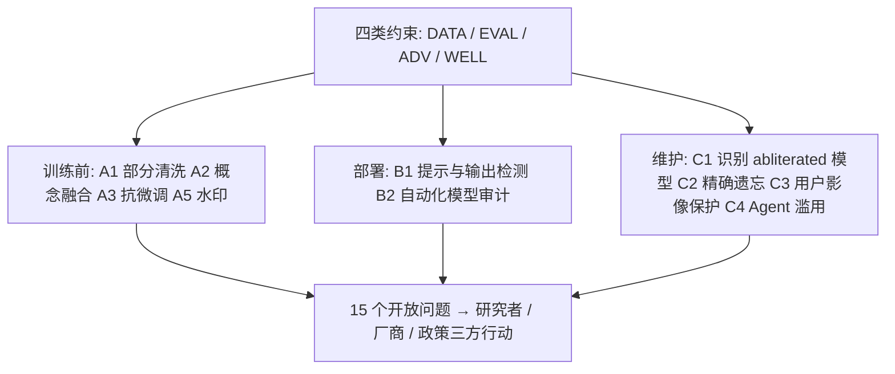

# Preventing AI-Generated CSAM Necessitates New Approaches to AI Safety (防止 AI 生成 CSAM 需要全新的 AI 安全范式)

> **领域适配声明（必读）**：本文是一篇 ICML 2026 Position Paper Track 的**政策立场论文**，研究主题为 AI 生成儿童性虐待材料（AIG-CSAM）的治理，**不属于推荐系统任一细分方向**。指定的 `collaborative_filtering` 分类与本文内容无任何交集（无用户-物品交互、无召回/排序建模）。为免误导检索系统，frontmatter 主分类取最接近的 `debias_fairness_industrial`（可信 AI 与安全治理），并将「推荐链路定位」标注为不适用。相应地，模板中的「主实验对比 / 消融 / 数据集统计」在本笔记中被替换为原文真实存在的 **概念融合 proxy 实验** 与 **开放问题-约束映射表**，**未虚构任何推荐系统 baseline 或指标数值**。

- **会议/期刊**: ICML 2026 (Position Paper Track, Spotlight)
- **作者与机构**: Neil Kale, Rebecca Portnoff, Pratiksha Thaker, Michael Simpson, Robertson Wang, Kevin Kuo, Chhavi Yadav, Virginia Smith（Carnegie Mellon University / Thorn）
- **推荐链路定位**: 不适用（AI 安全治理与模型生命周期防护）
- **研究方向**: 可信 AI、隐私与安全治理 / 生成模型滥用防护
- **论文原文**: [arXiv:2607.05407v1](https://arxiv.org/abs/2607.05407v1)
- **开源代码**: 暂未开源

## TL;DR (1分钟核心速览)

本文指出：CSAM 在多数国家属于**持有与生成皆违法**的材料，这使主流 AI 安全技术赖以成立的「数据可访问、可审计、可红队」三个前提全部崩塌。作者据此提出 15 个横跨**训练前 / 部署 / 维护**三阶段的开放问题，并用 CelebA 的「金发 × 眼镜」代理实验证明：即使两组概念的训练样本零重叠，扩散模型仍能合成二者组合（组合生成成功率随样本量从 9% 升至 27%），从而说明「部分数据清洗」不足以构成安全保证。

## Background & Motivation (背景与核心矛盾)

- **主流范式**: 当前 AI 安全依赖四条技术线——训练数据过滤（黑名单站点 + 哈希匹配 + NSFW 分类器）、红队测试、部署侧安全分类器、内容溯源（C2PA / 水印）。
- **前人局限①（数据不可得）**: 这些方法普遍要求直接访问有害数据或其在分布内的样本以训练/验证检测器；但 AI 开发者法律上无法持有 CSAM，只能通过 NCMEC/IWF 获取哈希值，无法获取原始样本。
- **前人局限②（评估不可行）**: 红队依赖「主动生成有害内容」来探测模型能力，而美国法律下生成 AIG-CSAM 本身即违法，标准化评测集也不存在，导致安全能力无法被证伪。
- **核心洞察 (Key Insight)**: 危害可以来自**两个各自合法的概念组合**（儿童图像 + 成人内容），因此「把 CSAM 从数据集里删掉」在原理上不足以阻断危害——需要的是对**概念组合能力**的干预，而非对**数据条目**的删除。
- **本文切入点**: 不做新算法，而是把「儿童安全」重构为 AI 安全的一等公民，用一张「谁有权访问什么」的权限表去定位每项技术失效的具体环节，并给出研究者 / 厂商 / 监管者三方行动清单。

**表 1：生态角色与 CSAM 访问能力（原文 Table 1 精简）**

| 角色 | 可合法访问 | 可获取哈希 | 可训练于其上 | 可生成 |
| :--- | :---: | :---: | :---: | :---: |
| 公众 | ✗ | ✗ | ✗ | ✗ |
| AI 开发者/提供方 | ✗（少数例外） | ✓ | ✗ | ✗ |
| 举报热线（NCMEC/IWF） | ✓ | ✓ | ✓ | ✗ |
| 执法机构 | ✓ | ✓ | ✓ | ✓ |

该表直接说明：**唯一既能训练又能生成的两个角色中，执法机构往往缺乏预算与技术能力**，而具备工程能力的开发者却被禁止接触数据——这正是所有技术方案的结构性瓶颈。

## Method (核心论证结构)

### 1. 整体框架 (Overall Architecture)

论文将 AIG-CSAM 防护拆为四类约束（DATA 数据限制 / EVAL 评估限制 / ADV 对抗与不透明环境 / WELL 处置者心理健康），再沿 AI 开发生命周期三段（训练前设计、部署、维护）展开为 15 个开放问题，每个问题标注其受哪几类约束支配，并对应给出「研究方向 / 厂商动作 / 政策工具」三列行动项。全文不含新模型，其贡献是把一个模糊的社会议题转化为可被技术社区逐条攻克的工程任务列表。

### 2. 关键设计拆解 (Key Argument)

1. **A2 概念融合（全文最硬的技术论点）**：危害不需要 CSAM 样本存在。设训练集 $\mathcal{D}$中两概念$c_{\text{child}}$与$c_{\text{NSFW}}$从未共现，即$\{(x,y): c_{\text{child}}\in x \wedge c_{\text{NSFW}}\in x\} = \varnothing$，模型$p_\theta$仍可能满足$p_\theta(c_{\text{child}}\oplus c_{\text{NSFW}}) \gg 0$。这意味着安全保证不能建立在「数据集中 CSAM 占比$<\epsilon$」之上，必须约束**概念空间的组合算子**本身。作者指出可行路径包括概念级可解释性（稀疏自编码器定位对应神经元子图并降权）与可撤回的外部敏感数据存储检索架构。
2. **A1/A3 从「清洗」到「抗微调」**：即使基座模型安全，开源权重可被 GUI 化的 LoRA 工具（ComfyUI、Ostris）在本地微调出违规能力。原文给出的技术方向不是更强的过滤，而是**自毁式模型**——对「成人内容 + 儿童」联合微调触发性能退化，同时保留单一概念的良性微调能力；难点在于这类方法通常需要在被阻断任务上训练，而 CSAM 数据不可得。
3. **C2 从「近似遗忘」到「精确遗忘」**：现有概念擦除（ESD、MACE）只提供概率性保证，且对对抗提示脆弱。作者主张 CSAM 场景需要**严格保证**——即证明某批图像对模型输出无任何影响，等价于要求可验证的精确遗忘（如 SISA 式分片重训），但重训成本对已部署大模型不可承受，形成成本-保证的两难。

## Experimental Setup & Evaluation Protocol (原文唯一的定量实验)

- **实验性质**: 这是 **proof-of-concept 代理实验（proxy study）**，目的仅是证明「零重叠训练数据的组合泛化」存在，**不是**安全方法的性能评测；原文明确说明完整细节见附录 C.1.1，且**未提供任何 baseline 对比、显著性检验或标准评测集**。
- **数据集与预处理**: CelebA 人脸属性数据集，选取两个属性作为高风险概念的合法代理——**金发（blonde）** 代理「儿童」类概念、**眼镜（glasses）** 代理「NSFW」类概念。
- **数据划分与防穿越**: 两组概念图像**完全不相交**（zero overlap），分别在各自子集上训练独立的条件扩散模型；测试时以组合提示采样，考察是否生成「金发 + 戴眼镜」的联合概念。
- **评测协议**: 人工/视觉判定组合图像生成成功率（%），并在第二个实验中做**训练样本量扫描**（64 → 4K）。
- **超参设置**: 原文未在正文披露扩散模型架构、采样步数与训练轮次，均指向附录；这也构成本文可复现性的短板。

## Key Experimental Results (关键数据)

### 1. 代理实验：概念融合临界阈值

| 训练配置 | 眼镜类样本数 | 组合生成成功率 | 说明 |
| :--- | :---: | :---: | :--- |
| 金发 + 眼镜（零重叠） | — | > 0（可稳定生成） | 无任何共现样本仍发生融合 |
| 黑发 + 眼镜（低数据） | 64 | 9% | 低于临界点 |
| 黑发 + 眼镜（临界后） | 250 | **27%** | 约 3 倍跃升 |
| 黑发 + 眼镜（充足） | 4K | 未单独披露 | 上界参考 |

> 说明：原文仅明确给出 64→9%、250→27% 两个数据点及「4K 上界」的设置，其余中间点未披露数值，此处不作外推。

### 2. 约束-问题映射（原文 Table 3 中 9 个正文问题的精简重构）

| 开放问题 | DATA | EVAL | ADV | WELL |
| :--- | :---: | :---: | :---: | :---: |
| A1 部分数据清洗 | ✓ | ✓ | ✗ | ✗ |
| A2 概念融合阻断 | ✓ | ✓ | ✓ | ✗ |
| A3 抗有害微调 | ✓ | ✓ | ✓ | ✗ |
| B1 提示/输出检测 | ✓ | ✓ | ✓ | ✓ |
| B2 自动化模型审计 | ✗ | ✓ | ✓ | ✓ |
| C1 识别 abliterated 模型 | ✗ | ✓ | ✓ | ✗ |
| C2 鲁棒精确遗忘 | ✓ | ✗ | ✓ | ✗ |
| C3 用户影像保护 | ✗ | ✓ | ✓ | ✗ |
| C4 AI Agent 滥用防护 | ✓ | ✗ | ✓ | ✓ |

### 3. 关键实验发现 (Key Findings)

1. **零重叠也能融合**：金发与眼镜两组训练集完全不相交，模型依然能生成组合概念，直接证伪了「删除共现样本即可阻断危害」这一隐含假设。
2. **存在数据量临界点**：眼镜样本从 64 增至 250，组合成功率由 9% 跃至 27%（约 3 倍），说明融合能力对少数类样本量高度非线性——这与 Okawa et al. 关于组合能力「乘法式涌现」的理论一致。
3. **94% 移除仍不安全**：作者引用 Cretu et al. (2025) 的平行实验——即便移除 94% 的儿童图像，模型仍能生成「儿童 + 眼镜」组合，从数量级上说明**高比例过滤并不等于安全保证**。

## Highlights & Limitations (亮点、对比与审稿批判)

- **与代表作对比 (vs. Prior Work)**: 与 Thiel (2023) 侧重「用标注流水线改进数据清洗」不同，本文主张清洗在原理上不可能完备；与 Cretu et al. (2025) 侧重「量化过滤防御的失效比例」不同，本文把失效原因归到**法律层面的数据不可得**；与 Casper et al. (2025) 的开源权重风险清单相比，本文聚焦儿童安全这一唯一「数据连持有都违法」的极端约束场景，因而结论不可直接套用其他安全域。
- **可迁移亮点**: ①「代理概念实验」范式——用合法代理属性（金发/眼镜）研究非法概念的组合泛化，可迁移到其他无法直接取数的有害内容研究；②「约束 × 生命周期」二维问题矩阵，可作为任何高风险 AI 应用的 gap analysis 模板。
- **审稿级局限批判**: ① **无方法贡献、无标准评测**——代理实验仅 2 个数据点，无 baseline、无方差、无显著性检验，作为技术论文证据强度偏弱；② **视角偏窄**——作者自陈全文以美国法律与图像模态为中心，文本性诱导、语音克隆、视频深伪仅作展望，跨国监管差异未展开；③ 提出的「精确遗忘」「自毁式模型」均缺乏可行性成本分析，与工业界实际部署之间存在明显落差。

## Rating (四维评分)

- **方法创新性 (Novelty)**: ⭐⭐⭐ （无新算法，但「组合概念不可由数据删除消除」的论证框架具有真正的视角创新）
- **评估协议与实验扎实度 (Protocol & Experiments)**: ⭐⭐ （仅一组 CelebA 代理实验、两个数据点，无 baseline 与显著性检验，远低于技术论文标准）
- **写作与数学规范度 (Clarity & Rigor)**: ⭐⭐⭐⭐ （四类约束、三阶段、15 问题的分类体系清晰可执行，问题-约束映射表组织严谨；但形式化程度很低）
- **工业落地与复现价值 (Industrial & Practical Value)**: ⭐⭐⭐ （给出可立即采纳的厂商动作清单与政策建议，但无代码、无实现细节，技术落地仍需后续工作补齐）

