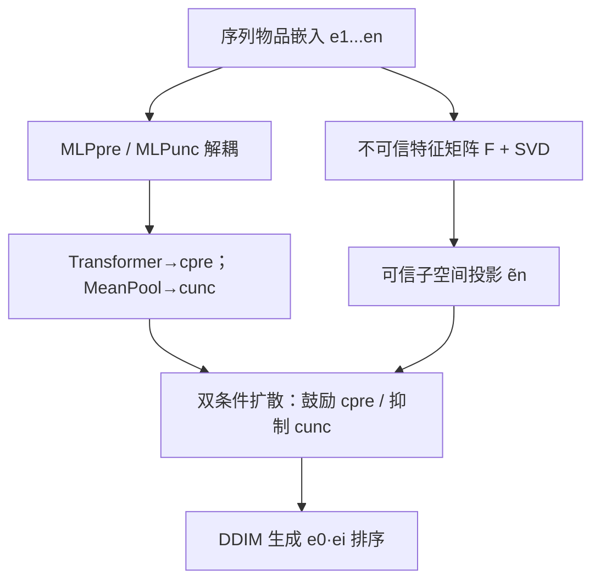
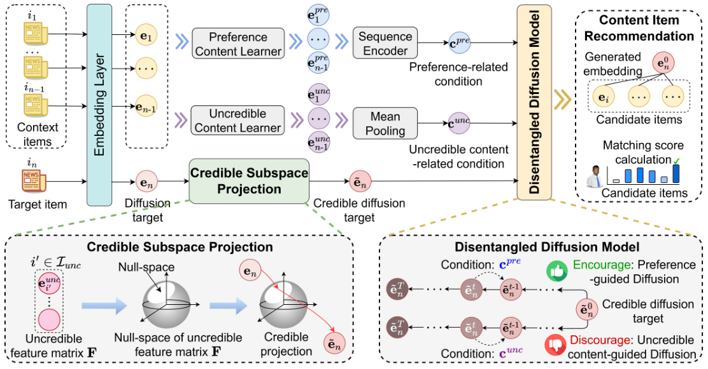

# Steering Diffusion Models Towards Credible Content Recommendation (引导扩散模型走向可信内容推荐)

- **会议/期刊**: ICLR 2026
- **作者与机构**: Zhuo Cai, Shoujin Wang, Jin Li, Peilin Zhou, Victor W. Chu, Fang Chen, Tianqing Zhu, Charu C. Aggarwal；UTS、HKUST(GZ)、City University of Macau、IBM T.J. Watson
- **推荐链路定位**: 端到端生成式召回/排序（序列 next-item）
- **研究方向**: 生成式推荐与离散语义ID / 去偏公平、可信隐私与工业架构
- **论文原文**: [论文原文链接](https://proceedings.iclr.cc/paper_files/paper/2026/file/45ecdd6cf1f507d378a3442ed89e580b-Paper-Conference.pdf)
- **开源代码**: [Disco 仓库](https://github.com/iamZhuoCai/Disco)；数据来自 [FakeNewsNet](https://github.com/KaiDMML/FakeNewsNet)

## TL;DR (1分钟核心速览)

针对扩散推荐只追准确率、易放大假新闻/误导内容的问题，Disco 将物品嵌入解耦为偏好与不可信信号：用偏好条件鼓励生成、不可信条件抑制生成，并把扩散目标投影到不可信特征零空间；仅 20% 不可信标签下，在 PolitiFact/GossipCop/MHMisinfo 的 Top-K 排序中同时提升 HR/NDCG/CR/HC，最高 HR@5 相对提升 12.2%。

## Background & Motivation (背景与核心矛盾)

- **主流范式**: 扩散推荐先编码前 $n-1$个上下文物品为条件$c$，再对第$n$个目标物品嵌入$e_n$ 做加噪—去噪生成。
- **前人局限**: 一是上下文含不可信物品会形成“不可信条件”；二是目标物品本身可能不可信，导致扩散目标被污染。现有可信推荐多假设不可信标签完整，只给 20% 标签时分类器/删除法显著失效；直接删物品又会丢掉用户真实偏好。
- **核心洞察 (Key Insight)**: 不可信内容与偏好信号在嵌入空间中可分离，且假新闻等不可信内容具有共享特征，可用相似度发现未标注的潜在不可信物品。
- **本文切入点**: 让扩散模型自身成为解耦器，并用渐进增强的零空间投影同时净化条件与扩散目标。

## Method (核心方法设计)

### 1. 整体框架 (Overall Architecture)

输入用户序列物品嵌入；两个 MLP 分别提取偏好嵌入 $e^{pre}$与不可信嵌入$e^{unc}$，前者经 Transformer 得$c_{pre}$，后者经 MeanPool 得$c_{unc}$（可信度无时序依赖）。扩散目标先经不可信特征矩阵的 SVD 零空间投影并与原嵌入残差融合；共享 MLP$f_\theta$在双条件下训练。推理只用$c_{pre}$做 DDIM 生成$e_n^0$，与候选物品内积排序。

<figure class="paper-figure" markdown="span">
  <figcaption>图2：Disco的整体框架。为简洁易懂，图中未展示可信子空间的渐进增强过程。</figcaption>
</figure>

### 2. 关键设计拆解 (Key Designs)

1. **双通道解耦扩散**：原扩散只用单一条件 $c$，偏好与不可信信号混杂。Disco 将目标函数改为最小化$c_{pre}$下的变分下界、最大化$c_{unc}$下的变分下界，并用余弦误差$S=(1-\cos)^2$稳定训练：$\mathcal{L}_{\text{dis}}=\mathbb{E}[S(\tilde e_n^0,f_\theta(\tilde e_n^t,c_{pre},t))]-\mathbb{E}[S(\tilde e_n^0,f_\theta(\tilde e_n^t,c_{unc},t))]$。直觉是同一目标在两种条件下的预测差形成“去污染”梯度，使$f_\theta$ 仅保留偏好方向。

2. **可信子空间投影 + 渐进增强**：目标物品可能不可信。将已知不可信物品的 $e^{unc}$堆成$F$，对$F^\top$做 SVD，丢弃大奇异值方向$U_1$、保留$U_2$，再投影并残差保留信息：$\tilde e_n=e_nU_2U_2^\top$，$\bar e_n=(\tilde e_n+e_n)/2$。标签少时，以$UD(i)=\frac{1}{|\mathcal I_{unc}|}\sum_{i'\in\mathcal I_{unc}}\cos(e_i^{unc},e_{i'}^{unc})$衡量未标注物品不可信度，按$\min(\gamma,j\gamma/m)$比例逐步扩增$\mathcal I_{unc}$，使零空间越来越完整。

3. **训练目标、负采样与推理效率**：总损失为解耦项加偏好对比项，负例从用户未交互物品中随机采样：$\mathcal{L}_{Disco}=S(\bar e_n^0,f_\theta(\bar e_n^t,c_{pre},t))-S(\bar e_n^0,f_\theta(\bar e_n^t,c_{unc},t))+w[S(\bar e_n^0,f_\theta(\bar e_n^t,c_{pre},t))-S(e_{neg}^0,f_\theta(e_{neg}^t,c_{pre},t))]$。所有项共享 MLP$f_\theta$，无需额外解耦网络；推理采用 DDIM，开销主要受扩散步数与嵌入维度影响。

## Experimental Setup & Evaluation Protocol (实验设置与评估协议)

- **数据集与预处理**:

| 数据集 | #Users | #Items | #Interactions | 稀疏度/密度 | 特征/场景 |
| :--- | :---: | :---: | :---: | :---: | :--- |
| PolitiFact | 原文附录 B.1 | 同左 | 同左 | 同左 | 新闻交互，假新闻=不可信 |
| GossipCop | 原文附录 B.1 | 同左 | 同左 | 同左 | 娱乐新闻，假新闻=不可信 |
| MHMisinfo | 原文附录 B.1 | 同左 | 同左 | 同左 | 心理健康视频错误信息，文本描述作内容 |

- **数据划分与防穿越 (Splitting Strategy)**: 按序列 next-item 协议，前 $n-1$项为上下文、第$n$ 项为目标；训练仅随机 20% 不可信物品标签可用，测试使用完整可信标签；具体切分细节见附录 B.1。
- **排名评测协议 (Ranking Protocol)**: Top-K next-item 排序，$K=5,10$；报告 HR、NDCG、可信率 CR、组合指标 HC。正文未显式声明 Full-Ranking 或 Sampled Ranking，候选集与采样负例细节需以附录 B.1/B.3 为准；训练负例为未交互物品随机采样。
- **对比基线与超参设置**: 基线含传统 GRU4Rec/SASRec/Bert4Rec/LRURec，对比学习 CL4SRec/ContraRec，可信推荐 Rec4Mit/HDInt/PRISM，扩散推荐 DreamRec/DiffuRec/PreferDiff。超参 $w\in\{0.5,1,1.5,2,5\}$、$\gamma\in\{0.1,0.2,0.3,0.4,0.5\}$、$m=10000$、SVD 阈值 3；AdamW，5 次运行取均值并报告方差，表 1 给出 p-values（多数$<0.05$）。

## Key Experimental Results (实验关键数据)

### 1. 主实验对比 (Main Results)

| Dataset | Method | HR@5 | NDCG@5 | CR@5 | HC@5 |
| :--- | :--- | ---: | ---: | ---: | ---: |
| PolitiFact | SASRec | .2158 | .1386 | .9059 | .2929 |
| | LRURec | .2168 | .1443 | .8976 | .2924 |
| | HDInt | .2153 | .1272 | .8944 | .2906 |
| | PRISM | .1927 | .1348 | .9335 | .2727 |
| | DreamRec | .2416 | .1767 | .8620 | .3054 |
| | DiffuRec | .2606 | .1894 | .9265 | .3334 |
| | PreferDiff | .2531 | .1818 | .8925 | .3228 |
| | **Disco** | **.2678** | **.1983** | **.9823** | **.3466** |
| GossipCop | SASRec | .3078 | .1607 | .8743 | .3612 |
| | LRURec | .3316 | .1697 | .8544 | .3732 |
| | HDInt | .3407 | .1748 | .8986 | .3875 |
| | PRISM | .2948 | .2301 | .8806 | .3531 |
| | DreamRec | .4619 | .3415 | .8464 | .4415 |
| | DiffuRec | .4571 | .3887 | .8313 | .4354 |
| | PreferDiff | .4969 | .3655 | .8307 | .4523 |
| | **Disco** | **.5236** | **.3996** | **.9277** | **.4918** |
| MHMisinfo | SASRec | .1485 | .0826 | .8839 | .2190 |
| | LRURec | .1571 | .0877 | .8359 | .2283 |
| | HDInt | .1471 | .0852 | .8306 | .2168 |
| | PRISM | .1700 | .1181 | .8398 | .2418 |
| | DreamRec | .1819 | .1313 | .9002 | .2633 |
| | DiffuRec | .1402 | .0919 | .8976 | .2128 |
| | PreferDiff | .1974 | .1389 | .8693 | .2713 |
| | **Disco** | **.2215** | **.1580** | **.9305** | **.3000** |

相对最强基线：PolitiFact 的 HR@5/NDCG@5 较 DiffuRec 提升 2.8%/4.7%，CR@5 较 PRISM 提升 5.2%；GossipCop 的 HR@5/HC@5 较 PreferDiff 提升 5.4%/8.7%，CR@5 较 HDInt 提升 3.2%；MHMisinfo 的 HR@5/NDCG@5/HC@5 较 PreferDiff 提升 12.2%/13.8%/10.6%，CR@5 较 DreamRec 提升 3.4%。

### 2. 消融实验 (Ablation Study)

| PolitiFact | HR@5 | NDCG@5 | CR@5 | HC@5 |
| :--- | ---: | ---: | ---: | ---: |
| Disco | **.2664** | **.1975** | **.9835** | **.3455** |
| w/o Dis | .2273 | .1605 | .9121 | .3033 |
| w/o CSP | .2575 | .1809 | .9431 | .3331 |
| w/o PERS | .2651 | .1919 | .9423 | .3393 |
| w/o PC | .2637 | .1934 | .9677 | .3413 |
| w/o CE | .1034 | .0622 | .7600 | .1626 |
| w/ DDT | .2609 | .1899 | .9499 | .3368 |

### 3. 关键实验发现 (Key Findings)

1. **解耦模块是准确率与可信度的共同支点**：去掉 Dis 后，HR@5 从 .2664 降至 .2273（-14.7%），CR@5 从 .9835 降至 .9121，说明偏好与不可信信号确实可分离，简单单通道扩散会同时污染两端。
2. **投影与渐进增强主要买“可信度”**：w/o CSP 与 w/o PERS 分别使 CR@5 降至 .9431/.9423，而 HR@5 仅小幅下降，验证零空间投影对抑制不可信目标有效，渐进伪标签缓解了 20% 标签不足。
3. **损失稳定性与负偏好项不可省**：以 MSE 替代余弦损失（w/o CE）时 HR@5 崩至 .1034、CR@5 仅 .7600；去掉偏好对比项（w/o PC）GossipCop HR@5 从 .5236 降至 .4643（-11.3%），说明稳定的余弦 ELBO 与未交互负例共同支撑准确率。

## Highlights & Limitations (亮点、对比与审稿批判)

- **与代表作对比 (vs. Prior Work)**: DreamRec 为单通道 ELBO；DiffuRec 用交叉熵把扩散变成判别式；PreferDiff 为 ELBO+BPR，三者均无显式可信度控制。Rec4Mit/HDInt/PRISM 依赖完整不可信标签，Disco 则以双条件解耦、零空间投影和渐进增强适配部分标签。
- **可迁移亮点**: 双条件“鼓励-抑制”目标可用于任意生成式推荐中的噪声/偏差信号剥离；SVD 零空间投影 + 相似度伪标签扩增可迁移到曝光偏差、流行度偏差与违规内容抑制。
- **审稿级局限批判**: 仍需较大嵌入维度，训练时间偏高；可信度标签为二值、数据集集中于新闻/视频错误信息，缺少工业级在线 A/B 与延迟评估；$\gamma$、SVD 阈值及标签比例敏感，跨域稳健性待验证。

## Rating (四维评分)

- **方法创新性 (Novelty)**: ⭐⭐⭐⭐ （首个面向部分标签的可信内容扩散推荐，双通道解耦目标与渐进零空间投影有明确增量）
- **评估协议与实验扎实度 (Protocol & Experiments)**: ⭐⭐⭐⭐ （三数据集、四类指标、5 次运行与 p-values/消融完整；候选排序细节在正文略欠透明）
- **写作与数学规范度 (Clarity & Rigor)**: ⭐⭐⭐⭐ （ELBO 改造、投影与损失推导清晰，附录补充充分；部分符号与实现细节依赖附录）
- **工业落地与复现价值 (Industrial & Practical Value)**: ⭐⭐⭐ （代码与数据开源，组件共享 MLP 易落地；但大维度训练成本与二值可信标签依赖限制线上即插即用）

