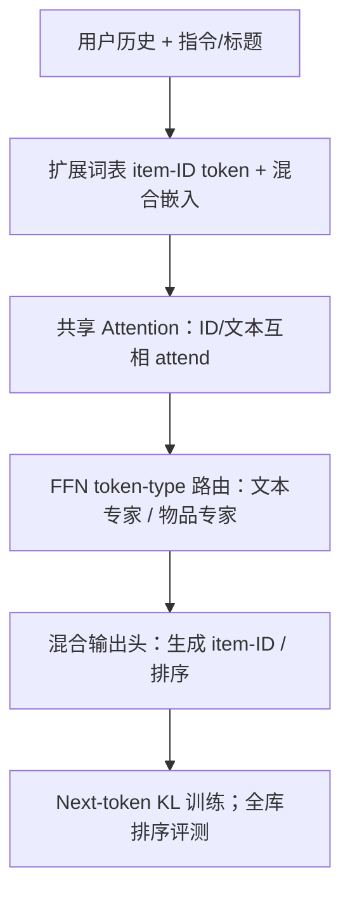
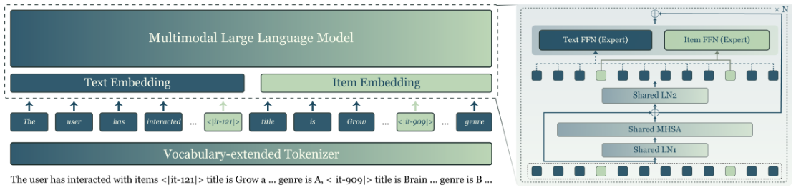

# Catalog-Native LLM: Speaking Item-ID Dialect with Less Entanglement for Recommendation (以物品ID方言实现低纠缠的目录原生LLM推荐)

- **会议/期刊**: ICLR 2026
- **作者与机构**: Reza Shirkavand 等；University of Maryland, Roblox, University of Cambridge
- **推荐链路定位**: 端到端生成式
- **研究方向**: 大语言模型推荐 / 生成式推荐
- **论文原文**: [论文原文链接](https://arxiv.org/abs/2510.05125v2)
- **开源代码**: 暂未开源

## TL;DR (1分钟核心速览)

针对LLM推荐中物品ID协同信号与自然语言文本共享FFN导致的知识纠缠，本文提出IDIOMoE：扩展item-ID词表，将每层FFN拆为文本专家与物品专家，用静态token-type gate路由，共享Attention以保留跨模态交互。在Amazon小库/2023大库全库排序与工业50k候选数据上取得最优LLM推荐结果，工业相对SASRec NDCG@10 +27.1%，并保持语言理解。

## Background & Motivation (背景与核心矛盾)

- **主流范式**: 一路是CF/序列模型，ID高效但语义不透明；另一路是LLM4Rec，用文本提示或扩展ID词表注入推荐能力。
- **前人局限**: ①把ID token与文本token塞进同一套FFN，协同信号与语言语义互相干扰；②只用文本或文本偏置虽能提升推荐，却牺牲对话与解释能力，或使输入冗长。
- **核心洞察 (Key Insight)**: 物品交互历史可视为语言空间中的“原生方言”，应共享Attention以互相attend，但分开存储ID与文本知识。
- **本文切入点**: 不在单模型里强行混合，而是按token类型把FFN分成文本专家与物品专家，避免破坏性干涉。

<figure class="paper-figure" markdown="span">
  <figcaption>图 1：使用 Transformer/LLM 进行推荐的四类设计。(a) 仅 ID 的 Transformer：在物品 ID 序列上从零训练，不涉及预训练 LLM。(b) 文本派生偏置：在 ID 上使用预训练 LLM，并由外部文本编码器提供侧特征以偏置物品分数。(c) 显式文本 token：预训练 LLM 直接在同一序列中同时消费物品 ID token 和（可能有的）文本 token。(d) 显式文本 token + 额外容量：与 (c) 类似，但增加物品特定参数以更好地处理 ID。IDIOMoE 是 (d) 的一个特例。</figcaption>
</figure>

## Method (核心方法设计)

### 1. 整体框架 (Overall Architecture)

输入把用户历史物品替换为扩展词表的新item-ID token；物品token用“冻结文本嵌入+可训练物品表”混合嵌入。所有token共享每层Self-Attention与归一化，使ID、标题、指令可互相关注；FFN按token类型静态路由到文本专家（原LLM FFN）或物品专家（新增、可缩小）。输出头复用混合参数化，可直接生成item-ID。训练用next-token KL，推理按候选item-ID概率排序。

<figure class="paper-figure" markdown="span">
  <figcaption>图 2：我们提出的 IDIOMoE 概览。我们用新的“item-id”token 扩展 LLM 分词器，并引入专用的物品嵌入层。归一化层和 Attention 层在所有 token 类型间共享，token 则根据其类型路由到不同的 FFN 层。</figcaption>
</figure>

### 2. 关键设计拆解 (Key Designs)

1. **原生Item-ID方言与混合头**：解决文本描述冗长、ID语义不透明。扩展tokenizer加入item-ID token，输入/输出头采用文本嵌入与可训练物品表混合参数化，使模型能像生成词一样生成ID，同时保留显式文本token以支持对话与解释。
2. **FFN双专家静态门控**：解决ID与文本共享FFN的纠缠。每层仅拆FFN：$E_{\text{FFN}}(x_t)=\mathrm{FFN}_{\text{item}}(x_t)$若$t\in\mathcal{V}_{\text{item}}$，否则$\mathrm{FFN}_{\text{text}}(x_t)$。共享Attention让ID与文本仍可交互，分离FFN避免存储干涉；静态路由比动态路由更稳定。物品专家可按$1/2$、$1/4$缩小以控算力。
3. **训练目标、负采样与推理效率**：总损失为生成式next-token KL，无显式负采样；每个token仅激活一个FFN专家，FLOPs接近基座。Amazon/消融用Qwen2.5-0.5B，工业主结果用1.5B。推理直接对候选item-ID打分/生成，天然支持端到端排序。

## Experimental Setup & Evaluation Protocol (实验设置与评估协议)

- **数据集与预处理**：Amazon小库与2023大库均做`5-core`过滤；工业库为百万级用户、数万物品。历史按时间倒序，最大50个物品，总token长度1024，先截文本再截物品。

| 数据集 | #Users/序列 | #Items | #Interactions | 稀疏度/说明 |
| :--- | :---: | :---: | :---: | :--- |
| Amazon小库(6个) | 17,112–42,259 | 6,250–18,357 | 未报告 | Games/Instruments/Arts/Sports/Beauty/Toys |
| Amazon 2023大库(3个) | 432,264–776,370 | 162,035–495,063 | 未报告 | Beauty/Books/Toys |
| 工业私有库 | 百万级 | 数万 | 未报告 | 50k候选评测 |

- **数据划分与防穿越**: 每用户按时间`leave-last-k`：最后1个测试、前1个验证、其余训练；评测取最后一个未padding位置。
- **排名评测协议**: Amazon为无偏`Full-Ranking`全库未交互排序；工业为50k候选采样排序。指标NDCG@10、HR@10、MRR。
- **对比基线与超参**: 覆盖GRU4Rec/BERT4Rec/SASRec/HSTU、TIGER/VQ-Rec/MISSRec/MQL4GRec、P5/VIP5/E4SRec/ReAT/CoVE，以及同骨干的ID Transformer、Item-LLM、Text-Attr LLM。AdamW、batch 128、bf16、A100；未报告显著性检验。

## Key Experimental Results (实验关键数据)

### 1. 主实验对比 (Main Results)

表中为NDCG@10/HR@10；工业列为相对SASRec的ΔNDCG/ΔHR/ΔMRR。

| 方法 | Amazon-Arts | Amazon-Beauty(23) | Amazon-Books(23) | Amazon-Toys(23) | Industrial Δ |
| :--- | :---: | :---: | :---: | :---: | :---: |
| SASRec | .0927/.1290 | .0051/.0101 | .0064/.0128 | .0122/.0245 | 0 |
| HSTU | .0941/.1301 | **.0130/.0247** | .0211/.0410 | .0149/.0332 | 未报告 |
| TIGER | .0806/.1167 | - | - | - | - |
| VQ-Rec | .0844/.1386 | - | - | - | - |
| Text-Attr LLM | .0938/.1374 | .0105/.0163 | .0195/.0290 | .0164/.0300 | - |
| Item-LLM | .0901/.1272 | .0082/.0119 | .0174/.0261 | .0079/.0148 | - |
| **IDIOMoE** | **.1029/.1409** | .0119/.0228 | **.0224/.0419** | **.0186/.0361** | **+27.1/+16.6/+31.2** |

IDIOMoE相对本表最佳基线：Arts +9.4%/+1.7%，Books +6.2%/+2.2%，Toys(23) +24.8%/+8.7%。Beauty(23)上HSTU整体最高，IDIOMoE为最强LLM。

### 2. 消融实验 (Ablation Study)

下表为相对Item-LLM的提升%；IDIOMoE与各变体参数/FLOPs匹配。

| 设置 | Beauty ΔNDCG/ΔHR | Industrial ΔNDCG/ΔHR |
| :--- | :---: | :---: |
| Item-LLM | — | — |
| LoRA-LLM | +21.5/+7.9 | -79.1/-76.3 |
| Wide-FFN | +27.0/+24.9 | +3.8/+1.3 |
| Append-blocks | -87.8/-90.3 | -5.5/-5.3 |
| Prepend-blocks | -97.2/-95.9 | -15.3/-16.2 |
| MoA | +48.3/+46.2 | +20.9/+27.1 |
| MoT | +49.3/+51.1 | +22.5/+24.8 |
| **IDIOMoE** | **+48.1/+49.6** | **+24.1/+28.9** |

### 3. 关键实验发现 (Key Findings)

1. **收益来自路由而非单纯加参**：匹配容量Wide-FFN在工业仅+3.8/+1.3，Append/Prepend甚至负增长；IDIOMoE达+24.1/+28.9，说明专家分工与静态路由是关键。
2. **静态路由与深层插入更有效**：Dynamic routing在工业降至-24.2/-24.4；MoE放最后8层较前8层工业HR +9.0，深层任务表征最受益。
3. **容量需匹配数据规模**：Beauty上物品专家shrink=4最佳(+41.8/+26.6)，但工业shrink=2/4分别-2.0/-3.1 NDCG；FFN key-value分析也显示MoE物品专家类别纯度更高、亲和更平衡。

## Highlights & Limitations (亮点、对比与审稿批判)

- **与代表作对比 (vs. Prior Work)**: 相比Item-LLM/Text-Attr LLM，本文不拼长文本、不让ID与文本共享FFN；相比URM/CoVE类ID扩展，保留显式文本token，兼顾对话解释与语言能力；相比MoA/MoT，仅expertize FFN，更简单且工业规模更稳。
- **可迁移亮点**: 静态token-type FFN路由可迁移到多模态/多域token混合；混合嵌入/输出头适合大目录生成式检索。
- **审稿级局限批判**: 无开源代码；工业数据私有且仅50k候选采样；未报告显著性检验；静态路由假设token类型清晰，混合属性token可能不适用；仅在0.5B/1.5B验证，语言保持缺乏对话级评测。

## Rating (四维评分)

- **方法创新性 (Novelty)**: ⭐⭐⭐⭐ （首次以token-type MoE分离协同ID与文本语义，思路简洁但机制新颖）
- **评估协议与实验扎实度 (Protocol & Experiments)**: ⭐⭐⭐⭐ （Amazon全库+工业50k，基线与消融充分；缺显著性检验与工业全库）
- **写作与数学规范度 (Clarity & Rigor)**: ⭐⭐⭐⭐ （框架与FFN记忆分析清晰，公式克制；部分工业结果仅给相对值）
- **工业落地与复现价值 (Industrial & Practical Value)**: ⭐⭐⭐⭐ （FFN-only MoE共享Attention、算力近基座；但无代码且依赖LLM继续预训练）

