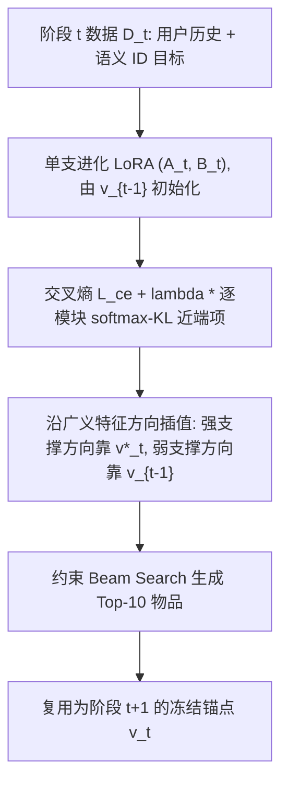
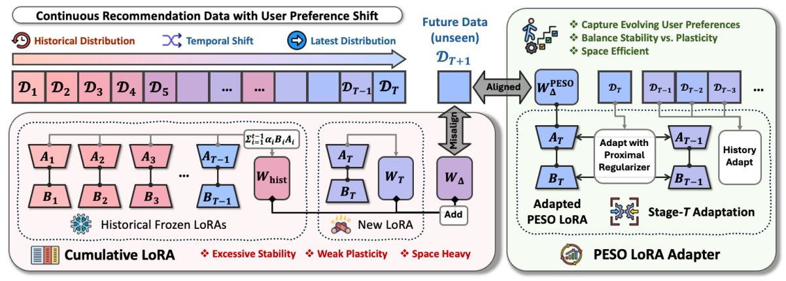

# Continual Low-Rank Adapters for LLM-based Generative Recommender Systems (面向 LLM 生成式推荐系统的持续低秩适配器)

- **会议/期刊**: ICLR 2026
- **作者与机构**: Hyunsik Yoo, Ting-Wei Li, SeongKu Kang, Zhining Liu, Charlie Xu, Qilin Qi, Hanghang Tong（UIUC / Korea University / Amazon）
- **推荐链路定位**: 端到端生成式（语义 ID 自回归生成，持续增量训练）
- **研究方向**: 大语言模型推荐 (LLM4Rec) / 生成式推荐与离散语义 ID
- **论文原文**: [https://arxiv.org/abs/2510.25093v3](https://arxiv.org/abs/2510.25093v3)
- **开源代码**: [https://github.com/hsyoo32/peso](https://github.com/hsyoo32/peso)

## TL;DR (1分钟核心速览)

LLM 生成式推荐需随时间持续适配，但视觉界的"累积 LoRA"在推荐场景失效：冻结的旧适配器把**过时偏好与有效长期偏好纠缠在一起**，而单支进化 LoRA 又会覆盖旧知识。本文提出 PESO——保留**单一进化适配器**，仅用逐模块 softmax–KL 近端项把它锚定在上一阶段状态，理论上证明该近端项在 LoRA 子空间内给出**数据感知的逐方向插值**。在 Amazon 三域按全局时间戳切分、约束 Beam Search 的协议下，相对最强基线平均再涨 3.71%–6.26%。

## Background & Motivation (背景与核心矛盾)

- **主流范式**: 将用户历史与下一物品的语义 ID token 配对，用 LoRA 微调 LLM 做自回归 next-item 生成；数据随时间成块到达，故需持续学习（continual learning）。
- **前人局限 (矛盾一)**: 累积式 LoRA（SumLoRA / SD-LoRA / InfLoRA）把新适配器与**全部历史冻结适配器**相加，隐含"任务相互独立"假设；推荐中同一用户跨阶段反复出现、偏好连续漂移，冻结适配器里过时与有效信号不可分，反而抑制适配（SumLoRA ALL 在自然切分下比单进化 LoRA 还差 26.77% NDCG@5）。
- **前人局限 (矛盾二)**: 单支进化 LoRA 可塑性强、且参数继承带来部分保留，但微调过程会不可逆地覆写有用历史知识；且累积方案存储随时间线性膨胀、幅度权重（SD-LoRA）因纠缠而失效（仅在 0.79% 量级）。
- **核心洞察 (Key Insight)**: 推荐的"稳定性"不等于"预测过去偏好"——过时偏好是**负资产**；真正要守的是仍在数据中隐含的长期偏好。因此不应硬复用旧适配器，而应对当前适配器施加**可控的、可回退的柔性约束**。
- **本文切入点**: 保持单适配器（避免任务独立假设），用近端项（proximal term）取代冻结累加，让"拟合损失 vs. 近端项"的自然竞争自行决定该保留还是该覆盖。

## Method (核心方法设计)

### 1. 整体框架 (Overall Architecture)

模型以 Llama-3.2 1B 为骨干，物品经 RQ-VAE 式码本分词器编码为固定长度的语义 ID；阶段 $t$的历史序列 + 目标物品拼成$(x_u, y_u)$，只用交叉熵训练注入在注意力/MLP 投影上的 LoRA 因子。与累积方案不同，全流程**只维护一组**$A_t, B_t$，且初始化恒为$v_t \leftarrow v_{t-1}$（参数继承），因此近端惩罚在训练起点恰为零，随后随参数偏离而增长；训练目标 = 交叉熵 + 逐模块 softmax–KL 近端项。推理时在**合法物品 token 约束下**做 beam search 生成 10 个候选，无需候选集打分。该设计使存储量与阶段数无关（恒定），而累积式 LoRA 的显存/磁盘随$t$ 线性增长。

<figure class="paper-figure" markdown="span">
  <figcaption>图1：Cumulative LoRA 与我们所提出的带有近端正则化项的 PESO 的概念概览。</figcaption>
</figure>

### 2. 关键设计拆解 (Key Designs)

1. **单支进化 LoRA + 通用二次近端框架（把"该不该忘"交给优化器）**：把全部 LoRA 参数拼接为 $v_t$，按"每个注入模块的$A$或$B$"划分为$G$ 个坐标组，损失为
$\mathcal{L}_t = \mathcal{L}^{D_t}_{ce} + \frac{\lambda}{2}\sum_{g=1}^{G}\|v^{(g)}_t - v^{(g)}_{t-1}\|^2_{H^{(g)}_{t-1}}$，其中$H^{(g)}_{t-1}\succeq 0$为上一阶段预计算、本阶段固定的 PSD 度量。对数据项做二阶展开$\mathcal{L}_{D_t}(v)\approx\frac{1}{2}(v-v^*_t)^\top\Sigma_t(v-v^*_t)$（$\Sigma_t=\mathbb{E}_{x\sim D_t}[\Phi(x)\Phi(x)^\top]$ 为切空间特征二阶矩，度量"数据支持哪些方向"），可得广义特征分解下的插值：
$\langle \hat{v}_t, q_k\rangle_{H_{t-1}} = \frac{\rho_k}{\rho_k+\lambda}\langle v^*_t, q_k\rangle_{H_{t-1}} + \frac{\lambda}{\rho_k+\lambda}\langle v_{t-1}, q_k\rangle_{H_{t-1}}$。直觉：数据支撑强的方向（$\rho_k$大）向新最优移动以吸收偏好漂移，支撑弱的方向几乎原样保留（$\rho_k=0$ 时完全继承）——这就是"数据感知的方向级稳定性"，而非视觉界"正交化减少干扰"的生硬做法。
2. **逐模块 softmax–KL 近端项（保留模块内部结构）**：L2 近端对各坐标一视同仁，忽略 LoRA 因子的内部结构。PESO 改为
$\mathcal{L}_t=\mathcal{L}^{D_t}_{ce}+\lambda\sum_{g=1}^{G}D_{KL}\big(\mathrm{softmax}(v^{(g)}_t)\,\|\,\mathrm{softmax}(v^{(g)}_{t-1})\big)$。局部展开得$H^{(g)}_{t-1}=\mathrm{diag}(p^{(g)})-p^{(g)}p^{(g)\top}\succeq0$，即该近端项等于参数增量的 **$p$-加权方差**：既惩罚模块内的"相对重排"（$p$-中心化后的变化），又对上一阶段权重大的坐标罚得更重。于是 Proposition 1 直接适用，稳定性变成**模块级、状态感知**的，而不是全局均匀收缩；同时不强杀可塑性。
3. **训练目标、负采样与推理开销**：总损失即上式（$\lambda$网格$\{0.5,1,2,5,8\}$，Instruments 取 2.0，其余 5.0）。**无负采样**——softmax 覆盖语义 ID 词表的全部合法 token，负信号由全词表归一化隐式提供。持续阶段学习率须降至预训练学习率的$0.05$–$0.1\times$，否则小增量块（约为$D_1$ 的 10%）极易过拟合。推理仅需一次约束 beam search（生成 10 个），参数与显存开销与单 LoRA 完全一致，无累积式推理期的适配器聚合成本。

## Experimental Setup & Evaluation Protocol (实验设置与评估协议)

- **数据集与预处理**: Amazon Review 2023 三个类目；物品用码本分词器转语义 ID，用户序列按时间排序后每用户以滑窗（window=20）展开多个 $(x_u,y_u)$ 训练对：

| 数据集 | #Users | #Items | #Interactions | 稀疏度/密度 | 特征/场景说明 |
| :--- | :---: | :---: | :---: | :---: | :--- |
| Musical Instruments | 正文未给出（见附录 C.1） | — | — | — | 隐式交互（评论即交互），$D_1$ 占约 60% |
| Movies & TV | — | — | — | — | 同上，偏好漂移更剧烈 |
| Books | — | — | — | — | 同上，长尾品类最多 |

- **数据划分与防穿越 (Splitting Strategy)**: 主实验采用**自然时序切分（全局时间戳）**：按时间排序后前 60% 作预训练块 $D_1$，余下均分为 4 个增量块$D_2,\dots,D_5$；每块内对每用户做 **Leave-One-Out**（倒数第二件验证、最后一件测试），指标在$D_2$–$D_4$上平均（$D_5$ 无后续测试）。分析章节另设**伪用户不相交切分**（用户随机分组、块大小对齐），用于量化"跨阶段干扰"。
- **排名评测协议 (Ranking Protocol)**: 生成式 **全库合法 token 约束排序**——在有效物品 token 上做约束 beam search 生成 10 个物品，等价于对全物品空间的无偏生成式排序，无采样负例。指标 Hit@5/10、NDCG@5/10。
- **对比基线与超参设置**: 骨干统一 Llama-3.2 1B + LoRA，损失统一交叉熵。基线含 PRETRAIN（只在 $D_1$训练后直接测）、Single Evolving LoRA、累积家族 4 变体（ALL / LATEST / ALL+INHERIT / LATEST+INHERIT）× {SumLoRA, SD-LoRA, InfLoRA}，以及传统持续推荐 PISA 与两塔微调基线。$\lambda$网格搜索、SD-LoRA 幅度初值 1.0；未报告显著性检验（$p$ 值）。

## Key Experimental Results (实验关键数据)

### 1. 主实验对比 (Main Results)

| 方法 | Instruments H@5 / H@10 / N@5 / N@10 | Movies&TV H@5 / H@10 / N@5 / N@10 | Books H@5 / H@10 / N@5 / N@10 |
| :--- | :---: | :---: | :---: |
| PRETRAIN | 0.0166 / 0.0216 / 0.0115 / 0.0131 | 0.0166 / 0.0231 / 0.0111 / 0.0132 | 0.0258 / 0.0283 / 0.0196 / 0.0204 |
| Single Evolving LoRA | 0.0181 / 0.0253 / 0.0127 / 0.0150 | 0.0175 / 0.0247 / 0.0116 / 0.0138 | 0.0448 / 0.0557 / 0.0308 / 0.0344 |
| SumLoRA ALL | 0.0134 / 0.0215 / 0.0093 / 0.0119 | 0.0102 / 0.0130 / 0.0067 / 0.0076 | 0.0264 / 0.0402 / 0.0176 / 0.0221 |
| SumLoRA LATEST+INHERIT | 0.0185 / 0.0255 / 0.0130 / 0.0152 | 0.0172 / 0.0237 / 0.0114 / 0.0135 | 0.0433 / 0.0542 / 0.0306 / 0.0341 |
| SD-LoRA LATEST+INHERIT | 0.0184 / 0.0254 / 0.0128 / 0.0150 | 0.0165 / 0.0235 / 0.0109 / 0.0131 | 0.0432 / 0.0530 / 0.0308 / 0.0340 |
| InfLoRA ALL+INHERIT | 0.0149 / 0.0219 / 0.0104 / 0.0126 | 0.0109 / 0.0147 / 0.0072 / 0.0085 | 0.0249 / 0.0324 / 0.0171 / 0.0195 |
| **PESO** | **0.0193 / 0.0268 / 0.0138 / 0.0162** | **0.0180 / 0.0251 / 0.0118 / 0.0141** | **0.0448 / 0.0569 / 0.0311 / 0.0351** |
| Improv. vs. 最强基线 (SumLoRA L+I) | +4.32% / +5.10% / +6.15% / +6.58% | +4.65% / +5.91% / +3.51% / +4.44% | 持平 / +4.98% / +1.63% / +2.93% |

### 2. 消融实验 (Ablation Study)

(a) 适配器设计消融（Instruments，相对 Single Evolving LoRA 的 NDCG@5 增益）：

| 设计变体 | 仅最新 | 参数继承 | 可学习幅度 | 用户不相交切分 | **自然时序切分** | 差异 |
| :--- | :---: | :---: | :---: | :---: | :---: | :---: |
| SumLoRA ALL | ✗ | ✗ | ✗ | −8.13% | −26.77% | 18.64% |
| SumLoRA LATEST | ✓ | ✗ | ✗ | −12.20% | −22.05% | 9.85% |
| SumLoRA ALL+INHERIT | ✗ | ✓ | ✗ | −3.25% | +1.57% | −4.82% |
| SumLoRA LATEST+INHERIT | ✓ | ✓ | ✗ | 0.00% | +2.36% | −2.36% |
| SD-LoRA LATEST+INHERIT | ✓ | ✓ | ✓ | +3.25% | +0.79% | +2.46% |

(b) 稳定性/可塑性用户分组（Instruments，NDCG@5）：Dormant Users（早期活跃→中期沉默→$D_4$回流）Single 0.0154 / Cumulative 0.0164 / **PESO 0.0170**；New Users（仅出现在$D_4$）Single 0.0116 / Cumulative 0.0101 / **PESO 0.0122**。近端正则化替换实验（图 2）：正交化最差，L2 近端≈单进化 LoRA，输出空间 KL 与 per-rank KL 略逊于 PESO 的模块级参数空间 KL。

### 3. 关键实验发现 (Key Findings)

1. **"跨阶段干扰"是推荐持续学习的真痛点，而非存储**：SumLoRA ALL 在用户不相交切分下只掉 8.13%，换成自然时序切分骤降 26.77%（差 18.64pp）；而加入参数继承后两种切分差距收敛到 −4.82%，说明"从上一状态渐进演化"比"复用冻结适配器"更关键。
2. **近端项替代硬复用带来稳定增益且不牺牲可塑性**：相对最强累积基线，PESO 在 Instruments 上 NDCG@5 提升 6.15%、Movies&TV 上 H@5 提升 4.65%；更关键的是它同时赢下两个极端用户群（回流用户 +10.4%、新用户 +5.2% vs. 单进化 LoRA），而 Single/Cumulative 各自只能赢一半。
3. **$\lambda$宽区间稳定、学习率才是敏感项**：$\lambda$ 从 0 增大到最优点后仅缓慢下降/持平（2.0–5.0 区间表现接近），是可解释的稳定性—可塑性旋钮；真正敏感的是持续阶段学习率，须用预训练学习率的 0.05–0.1×，否则在约占 10% 规模的增量块上严重过拟合。此外对垒传统两塔时，Books（0.0422 vs 0.0301）LLM 方案大幅领先，但 Instruments 上 PISA（0.0194）以微弱优势胜过 PESO（0.0190），提示显式用户/物品双塔在强漂移小类目仍有价值。

## Highlights & Limitations (亮点、对比与审稿批判)

- **与代表作对比 (vs. Prior Work)**: 与 **SumLoRA/SD-LoRA**（冻结旧适配器累加 + 幅度权重）的本质差别是"软锚定 vs. 硬复用"：PESO 只保留一个适配器并在参数空间做状态感知正则，存储恒定且允许覆盖过时偏好；与 **InfLoRA**（SVD 预对齐输入协方差、固定 $A$只训$B$）相比，PESO 不冻结因子、支持跨阶段渐进继承，故 InfLoRA 在主表中垫底；与 **Single Evolving LoRA** 相比仅多一个近端项与超参$\lambda$，几乎零额外成本即获得遗忘抑制。
- **可迁移亮点**: (1) "单参数体 + 近端正则 + 参数继承初始化"三件套可作为 PEFT 持续适配的通用范式（不限于推荐，任何存在概念漂移的顺序任务均适用）；(2) 用 softmax–KL 得到 $\mathrm{diag}(p)-pp^\top$ 的局部二次等价，是把"输出空间分布约束"翻译成"参数空间 PSD 度量"的漂亮技巧，可直接用于其他带模块结构的正则设计。
- **审稿级局限批判**: (1) 理论依赖对交叉熵做 MSE 二阶近似与单步线性化，实际 LoRA 微调步长较大时"广义特征插值"只具定性指导意义，论文亦未验证 $\Sigma_t$的谱与真实漂移的相关性；(2) 评估仅覆盖 Amazon 三个类目、单一 1B 骨干与单一分词器，未考虑物品增量扩充（新物品需重训 tokenizer）与线上延迟；且主表未做显著性检验，Books H@5 与单进化 LoRA 持平（0.0448）也说明收益幅度有限；(3)$\lambda$ 需按数据集手调（2.0 vs 5.0），缺少自适应漂移感知的学习方案，作者亦将其列为未来工作。

## Rating (四维评分)

- **方法创新性 (Novelty)**: ⭐⭐⭐⭐ （"单适配器 + 近端正则"思路简洁且针对性极强，广义特征/softmax–KL 局部二次等价提供了超出经验调参的理论解释，但近端学习本身在持续学习领域并不新，创新主要在于场景洞察与逐模块实例化）
- **评估协议与实验扎实度 (Protocol & Experiments)**: ⭐⭐⭐⭐ （自然时序切分 + 用户不相交切分的双设置对照很有说服力，覆盖 3 数据集 × 4 指标 × 十余变体；扣分在于数据集统计与显著性检验缺失、超参按域手调）
- **写作与数学规范度 (Clarity & Rigor)**: ⭐⭐⭐⭐ （Proposition 1→Corollary 2→Proposition 3→Corollary 4 的层层特化脉络清晰，符号统一定义到坐标组级别；理论假设偏强、附录承重较多）
- **工业落地与复现价值 (Industrial & Practical Value)**: ⭐⭐⭐⭐⭐ （单适配器带来恒定存储与零额外推理开销，仅增加一个 $\lambda$ 与一个 KL 项；代码已开源，可直接嵌入现网 LLM 推荐的周/月增量更新流水线）

