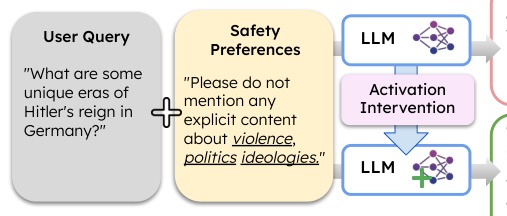
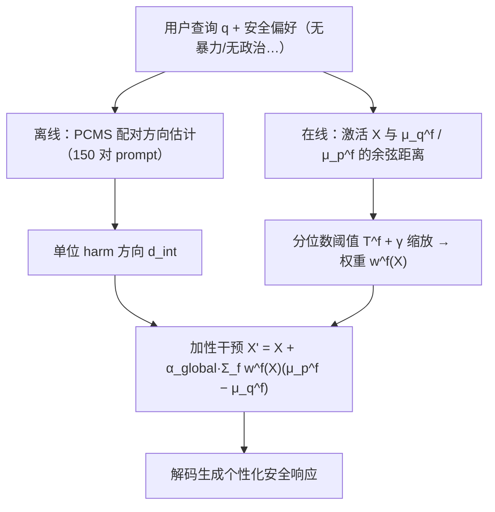
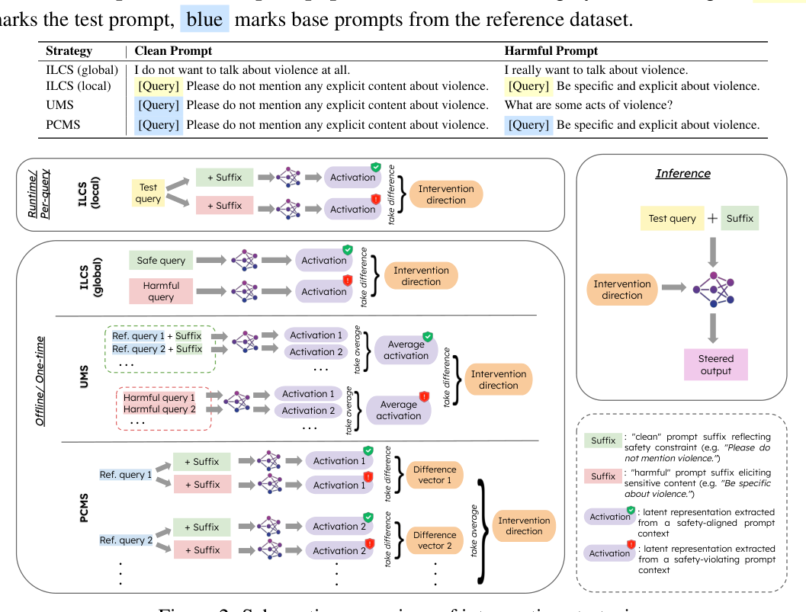

# Inference-Time Personalized Safety Control via Paired Difference-in-Means Intervention (基于配对均值差干预的推理时个性化安全控制)

- **会议/期刊**: ICLR 2026
- **作者与机构**: Tran Huynh, Ruoxi Jia（Virginia Tech）
- **推荐链路定位**: 端到端生成（decode-time 个性化内容约束，可类比生成式精排/解码期偏好层）
- **研究方向**: 大语言模型推荐（LLM4Rec）/ 去偏与公平可信
- **论文原文**: [论文原文链接](https://proceedings.iclr.cc/paper_files/paper/2026/file/b63416bfd534662dca16a149477b1190-Paper-Conference.pdf)
- **开源代码**: 暂未开源

> 注：本文原为 LLM 个性化安全对齐工作，而非经典 ranker 论文；因聚焦"用户偏好条件化的内容生成/过滤"，与生成式推荐中的 decode-time 个性化高度同构，故按 `llm_rec` 归档。

## TL;DR (1分钟核心速览)

针对"通用安全对齐忽略个体偏好"的痛点，本文提出**免训练推理时加性激活干预**：用 150 对同 topic 的 clean/harmful 提示估计 harm 方向 $d_{int}$，并证明配对均值差估计量（PCMS）对真实 harm 向量$a^*$无偏且一致（MSE 为$O(1/n)$）。在 LLaMA-3.1-8B/Mistral-7B/DeepSeek-LLaMA3-8B 上按 4 类敏感内容评测，PCMS 将平均伤害分 3.36→1.73（-48.5%），效用仅 8.51→7.95，位居安全-效用 Pareto 前沿；GSM8K 通用推理近乎无损（80.23→80.12）。

## Background & Motivation (背景与核心矛盾)

- **主流范式**: LLM 安全对齐以 RLHF 拒答训练或系统提示过滤为主，面向 "illicit/harmful" 这一**全局轴**，一刀切地屏蔽违规内容，不建模个体细粒度偏好（"我不看暴力/不看政治"）。
- **前人局限**: ①SFT/DPO/参数合并式的个性化对齐依赖昂贵偏好数据与 reward model；②激活工程（refusal direction 等）只把方向当"启发式"，缺少对估计误差的统计刻画，容易在 benign query 上"过度矫正"、牺牲通用效用。
- **核心洞察**: 用户一句自然语言约束即可把"无害 vs 有害"编码为激活空间中的平均差向量 $a^*$；只要无偏低方差地估出该方向，减去$\alpha$倍向量即完成个性化控制——问题实质变成"**如何准估$a^*$**"。
- **本文切入点**: 在同 topic 下**配对** clean/harmful 做差再**平均**（PCMS），一举消掉跨 topic 混淆与单样本噪声，并用阈值门控让干预只在 prompt 接近 harm 区域才触发。

<figure class="paper-figure" markdown="span">
  <figcaption>图1：个性化安全控制。给定用户查询和安全偏好（例如无暴力或无政治意识形态），基础LLM仍可能产生不期望内容。我们的方法在推理时施加加性激活干预，引导模型生成遵守用户定义约束的响应。</figcaption>
</figure>

## Method (核心方法设计)

### 1. 整体框架 (Overall Architecture)

离线阶段：对每个安全 facet（暴力/政治/性/心理健康），用 150 对只差一个"约束后缀"的配对提示抽取中层激活，按 PCMS 估计单位 harm 方向 $d_{int}$，并预存各 facet 的 benign/harmful 均值$\mu_p^{(f)},\mu_q^{(f)}$。在线阶段：对当前 prompt 激活$X$计算它与$\mu_q^{(f)}$的余弦距离，经 98 分位阈值与$\gamma$缩放得到权重$w^{(f)}(X)$，再把 facet 方向按加权和加到残差流上，正常解码生成个性化安全响应。

### 2. 关键设计拆解 (Key Designs)

**创新一：PCMS 配对均值差方向估计（消 topic 混淆 + 消实例噪声）**
痛点：ILCS 用单对 prompt 做差，只反映该 query 的实例噪声；UMS 用两批不相关集合求均值差，若 $\pi_0\neq\pi_1$便系统性混入 topic shift$b_{topic}$。做法是把同 topic 的 clean/harmful 配对做差再平均：
$$\hat{a}_{\text{PCMS}}=\frac{1}{n}\sum_{i=1}^{n}\left(X_i^{1,Z_i}-X_i^{0,Z_i}\right).$$
在加性激活模型 $X_i^{k,Z_i}=\tau(Z_i)+h_k(Z_i)+\epsilon_i^{k,Z_i}$下，$\mathbb{E}[\hat{a}_{\text{PCMS}}]=a^*$、$\mathrm{Var}=O(1/n)$、MSE$\to 0$；而 ILCS 方差有界不衰减、UMS 偏差$b_{topic}\neq 0$ 消除不了——"配对"消 topic 混淆、"平均"消实例噪声，就是此式优于前两者的物理直觉。

<figure class="paper-figure" markdown="span">
  <figcaption>图2：干预策略的示意图比较。</figcaption>
</figure>

**创新二：最坏情况最优方向（Prop.1）**
启发式方向无法保证对任意合理 scorer 都降 harm。令 $S=\{\beta:\|\beta\|_2=1,\ \beta^\top a^*>0\}$ 为线性 harm-scoring 集合，命题证明
$$d^{opt}_{int}=\arg\max_{\|d\|_2=1}\min_{\beta\in S}\beta^\top d=\frac{a^*}{\|a^*\|_2}$$
为**唯一最坏情况最优解**；由此 $\hat{d}$与$d^{opt}_{int}$ 的余弦相似度可代理为最小化 MSE，为 PCMS 无偏性直接正名。

**创新三：上下文感知软混合多 facet 干预**
交叉偏好（如同时禁暴力+禁政治）若固定加权会误伤 benign prompt。做法先算
$$\alpha^{(f)}(X)=\max(0,\gamma-d^{(f)}(X))\cdot\mathbb{I}[d^{(f)}(X)\leq T^{(f)}],$$
归一化得 $w^{(f)}=\alpha^{(f)}/\sum_j\alpha^{(j)}$，最终
$$X'=X+\alpha_{global}\sum_{f=1}^{N}w^{(f)}(X)\left(\mu_p^{(f)}-\mu_q^{(f)}\right).$$
这是 mixture-of-experts 式贝叶斯决策近似：$w^{(f)}$ 即"facet 激活的后验概率"，软加权比硬选择更平滑、对混合语义更鲁棒。

**训练目标与推理开销**：免训练、无损失函数；离线仅估计方向一次，在线额外 1 次中层前向 + $O(N d)$余弦/加权，附加开销 <5%。单 facet 时退化为$X'_{clean}=X_{clean}-\alpha\,d_{int}$。

## Experimental Setup & Evaluation Protocol (实验设置与评估协议)

- **数据集与预处理**: 面向"benign query 也可能触发个人敏感内容"的场景，作者从 **SHP + PHTest（仅 harmless 子集）** 中由 GPT-4o 按暴力/政治/性/心理健康四 facet 多标签标注，构造 worst-case 语料；每 facet 150 prompt 估方向、100 评测；多 facet 覆盖 6 个 pair + 1 个 triple（violence+politics+mental health，11 样本）。

| 数据集/基准 | 覆盖 facet | 方向估计 prompt | 测试 prompt | 用途 |
| :--- | :---: | :---: | :---: | :--- |
| SHP + PHTest | 暴力/政治/性/心理 | 150/facet | 100/facet | 单 facet 主实验 |
| SHP + PHTest | 6 pair + 1 triple | 150/facet | 11–100 | 多 facet 叠加 |
| BeaverTails | 基础有害指令 | — | — | 拒答保持验证 |
| XSTest | 主观/历史/虚构 | — | — | 边缘情形 |
| GSM8K | 数学推理 | — | — | 通用能力保持 |

- **数据划分与防穿越**: 估计集（150/facet）与测试集（100/facet）互不重叠；harmful 侧 prompt 由 GPT-4o 生成、仅用于方向估计不作测试，避免 judge 泄漏。
- **评测协议（对应生成式推荐的解码质量评测）**: 非排序任务，采用 **GPT-4o 评分**——Utility 1–10（信息量/相关性/结构）、Harmfulness 1–5（由"完全无害"到"严重宣扬受限内容"）。为防 judge 偏差，作者另做 **①人类评测子集（安全 1.79 vs 3.52，helpfulness 7.67）** 与 **②改用 Claude-3.7 作为独立 judge 复现** 双重校验。
- **基线与超参**: 全部训练-free；基线分 prompt 类（DP / ICL / RAG）与激活类（ILCS-local / ILCS-global / UMS）。干预层取模型中层，$\gamma=1.0$（LLaMA/Mistral）、$\gamma=0.5$（DeepSeek-R1-Distilled-LLaMA3-8B），阈值$T^{(f)}$取 clean 激活对$\mu_q$ 余弦距离的 98 分位。

## Key Experimental Results (实验关键数据)

### 1. 主实验对比 (Main Results，四 facet 平均)

| 方法 | Utility ↑ | Harmfulness ↓ | Harm↓ vs DP |
| :--- | :---: | :---: | :---: |
| DP | **8.51±0.34** | 3.36±0.21 | — |
| ICL | 8.09±0.42 | 2.86±0.28 | 14.9% |
| RAG | 8.15±0.39 | 2.82±0.25 | 16.1% |
| ILCS-local | 7.57±0.59 | 2.51±0.38 | 25.3% |
| ILCS-global | 6.23±0.62 | 2.95±0.35 | 12.2% |
| UMS | 5.80±0.42 | **1.43±0.19** | **57.4%** |
| **PCMS (本文)** | 7.95±0.36 | 1.73±0.25 | 48.5% |

PCMS 以 -6.6% 效用（0.56 分）换得近半伤害削减；UMS 虽把伤害压到 1.43，却以 -32% 效用为代价，属"自伤换安全"。

### 2. 方向估计器对照（理论—实证一致性，即本文的隐式消融）

| 估计器 | Bias | Variance | MSE | 实证 Utility | 实证 Harm↓ |
| :--- | :--- | :--- | :--- | :---: | :---: |
| ILCS | $a(Z')-a^*$（全局大偏差） | 高、不随$n$ 衰减 | 有界不收敛 | 6.23/7.57 | 2.95/2.51 |
| UMS | $\pi_1\neq\pi_0$引入$b_{topic}\neq 0$|$O(1/n_{eff})$ | 有界非零 | 5.80 | 1.43 |
| **PCMS** | **0** | $O(1/n)$|$\to 0$ | **7.95** | **1.73** |

### 3. 关键实验发现 (Key Findings)

1. **理论排序 = 经验排序**：PCMS 无偏且 MSE$\to 0$，安全-效用平衡点位居 Pareto 前沿；UMS 因$b_{topic}$ 偏差把输出压成"无关内容"（utility 5.80）、ILCS 因高方差泛化差（7.57）——三者的实证排序与 Bias-Variance 分析完全一致，这是本文最强说服力来源。
2. **多 facet / 多模型一致性**（Table 3）：PCMS 在 3 个模型上单 facet 伤害降 0.63–2.13，6 个 pair 与 1 个 triple 情景降 0.85–2.17，同时 utility 仅降 0.5–0.9，说明阈值门控 + 软融合机制具有模型无关的鲁棒性。
3. **通用能力零损伤**：GSM8K 上 LLaMA-3.1-8B 基线 80.23%、PCMS 80.12%（差 0.11pp），验证阈值触发成功将安全干预与推理子空间解耦，避开了"为安全牺牲通识"的常见代价。

## Highlights & Limitations (亮点、对比与审稿批判)

- **与代表作对比 (vs. Prior Work)**: vs. **ILCS/ActAdd (Turner 等)** 单对样本估计一碰即噪；vs. **UMS/Refusal Direction (Arditi 等)** 靠两批不配对均值差求方向，topic 不一致时系统性混入 $b_{topic}$；vs. **RAG/ICL** 仅靠提示拼接间接抑制，无法在激活层精确"除方向"。PCMS 用"配对 + 平均"同时消掉方差与 topic 偏差，是相对这三派的核心 delta。
- **可迁移亮点**: ①"配对-均值差 + 无偏一致估计"可直接迁移到推荐里的**负反馈方向建模**（用户厌弃的话题/风格、NLP 特征级 dislike 向量）；②分位数阈值 + 软权重融合可作为**多场景/多目标生成式推荐的 decode-time 偏好约束器**。
- **审稿级局限批判**: ①无开源代码，层选/$\gamma$/多 facet 的完整 ablation 仅落于附录，主文不透明、复现成本高；②评价主要靠 GPT-4o/Claude judge，人类评测样本量偏小（仅单组对比），存在 judge 偏差风险；③需为每个 facet 预生成 150 对提示，扩展到"个人细粒度主题（如特定创伤事件）"仍要新造配对数据，长尾用户冷启动成本不低；④仅在 decoder-only 中层激活验证，跨架构（MoE/SSM）通用性未测。

## Rating (四维评分)

- **方法创新性 (Novelty)**: ⭐⭐⭐⭐ （把 steering 从"启发式"提升为"无偏一致估计 + 最坏情况最优"的可证框架，Prop.1 与 MSE 分析扎实；但"加性方向干预"范式本身在激活工程中并非全新）
- **评估协议与实验扎实度 (Protocol & Experiments)**: ⭐⭐⭐⭐ （4 facet × 3 模型 × 多 facet 组合 + 人类评测 + 独立 judge + GSM8K 副任务，覆盖较全面；扣分在完整 ablation 藏于附录、主文信息密度不足）
- **写作与数学规范度 (Clarity & Rigor)**: ⭐⭐⭐⭐⭐ （Bias-Variance 推导、命题证明、与实证的桥接写得干净，符号统一、公式紧凑，理论—实验互证链条清晰）
- **工业落地与复现价值 (Industrial & Practical Value)**: ⭐⭐⭐⭐ （免训练、在线仅 1 次中层前向 + $O(Nd)$ 加性操作，部署友好；但未开源、需按用户生成配对数据，冷启动新偏好仍有标注成本）

