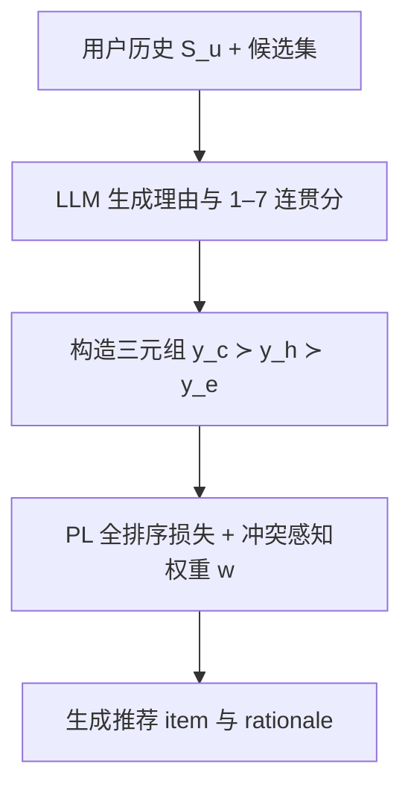

# More Than What Was Chosen: LLM-based Explainable Recommendation Beyond Noisy User Preferences (超越“被选中”：面向噪声用户偏好的LLM可解释推荐)

- **会议/期刊**: ICLR 2026
- **作者与机构**: Chung Park, Hyeongjun Yun, Taesan Kim 等；SK Telecom & KAIST
- **推荐链路定位**: 端到端生成式（候选列表重排 + 推荐理由生成）
- **研究方向**: 大语言模型推荐 / 隐式反馈去噪与鲁棒表征
- **论文原文**: [论文原文链接](https://proceedings.iclr.cc/paper_files/paper/2026/file/2a581c3f0fcaf50b6f87eac048f18369-Paper-Conference.pdf)
- **开源代码**: [C-APO](https://github.com/cpark88/C-APO)

## TL;DR (1分钟核心速览)

真实点击常含噪声，传统“揭示偏好”（RP）把 chosen 一律当正样本，导致 LLM-Rec 学到错误偏好且解释说服力弱。本文提出“连贯偏好”（CP），用 LLM 为 chosen/两个未交互物品生成理由与 1–7 连贯分，构造 $y_c \succ y_h \succ y_e$ 三元组，并用冲突感知权重调和 RP 与 CP。在 Amazon 五域 Leave-One-Out、30 候选排序协议下，HR@1 最高相对提升 61.43%，在线 A/B 的 CTR 相对 ML 基线提升 60.88%。

## Background & Motivation (背景与核心矛盾)

- **主流范式**: CF-Rec 与 LLM-Rec 均以 RP 为核心，DPO/S-DPO 只优化 chosen 高于 rejected 的 pairwise 排序。
- **前人局限**: ① 真实选择受共享账号、促销、瞬时情绪影响，约 30% chosen 与历史逻辑不一致；② DPO 只利用“chosen vs rejected”，浪费了 rejected 之间“谁更连贯”的细粒度信号，且会放大噪声正样本。
- **核心洞察 (Key Insight)**: 用户不仅“选了什么”，还会“在行为一致时会选什么”。未观测但与历史因果连贯的物品，可作为高质量 hard negative/软正例，补足 RP。
- **本文切入点**: 将 CP 作为第二排序信号，与 RP 组成统一全序，并按二者一致/冲突动态调权。

## Method (核心方法设计)

### 1. 整体框架 (Overall Architecture)

输入用户历史 $S_u$与候选集，SFT 阶段让 LLM 生成 `<think>` 理由与 `<item>` 推荐；C-APO 阶段对每个样本构造 chosen、hard rejected、easy rejected 三元组，每个元素附 LLM 生成的理由与连贯分。Plackett-Luce 将三元组建模为全序$y_c \succ y_h \succ y_e$：RP 约束$y_c$高于两者，CP 约束$y_h \succ y_e$；再由 SBERT 校准的冲突感知权重$w_{i,j}$ 调节每对比较的梯度。训练用 LoRA 微调 Gemma-3-4B，推理对 30 个候选打分并生成 top-1 及理由。

### 2. 关键设计拆解 (Key Designs)

1. **CP 数据构造与统一排序**：痛点是把 chosen 无条件当正例会拟合噪声。做法是随机采两个未交互物品，用 Gemma-3-27B 生成理由并打 1–7 分，高分者为 hard rejected、低分为 easy rejected；过滤同分后保留约 70%。统一排序为 $y_c \succ y_h \succ y_e$，当$s_c<s_h$ 时即 RP/CP 冲突。直觉是 hard rejected 更接近用户真实兴趣，迫使模型学习细粒度偏好而非记忆点击。

2. **Plackett-Luce 全排序目标**：DPO 只做 pairwise，无法利用 rejected 间的 CP 顺序。本文用
$p(y_c \succ y_h \succ y_e|x_u)=\frac{e^{g_c}}{e^{g_c}+e^{g_h}+e^{g_e}}\cdot\frac{e^{g_h}}{e^{g_h}+e^{g_e}}$，
$\mathcal{L}_{PL}=-\mathbb{E}\log p$。
它可分解为 RP 项与 CP 项，DPO 是其特例；全序保持排列一致性，避免多负样本比较时的概率质量泄漏。

3. **冲突感知自适应权重**：LLM 连贯分仍有噪声，且 RP/CP 冲突时不应继续推高 chosen。冻结 SBERT 编码 $(S_u,i,r)$得$z_u$，校准均值与方差：
$\mu_i=s_i+\mathrm{Gate}(z_u)\cdot FC_1(z_u),\quad \tilde{\sigma}_i=\mathrm{softplus}(FC_2(z_u))$，
$w_{i,j}=\Phi\left(\frac{\mu_i-\mu_j}{\sqrt{\tilde{\sigma}_i^2+\tilde{\sigma}_j^2}}\right)$。
代入 PL：
$\mathcal{L}_{C-APO}=-\mathbb{E}\left[\log\sigma\left(-\log(e^{w_{c,h}(g_h-g_c)}+e^{w_{c,e}(g_e-g_c)})\right)+\log\sigma\left(-\log e^{w_{h,e}(g_e-g_h)}\right)\right]$。
梯度上，$w$大则放大 chosen 奖励，冲突时$w$ 小则抑制噪声 chosen；Thurstone-Mosteller 直觉是把分数差视为高斯分布下的胜率。

**训练目标、负采样与推理开销**：SFT 用 causal LM；C-APO 每样本 2 个随机未交互负例，hard/easy 由 LLM 分定义，非 in-batch 负采样。每样本 3 个 response，复杂度 $O(B\cdot 3\cdot C_{LLM})$；比 DPO 慢 1.11×、S-DPO 慢 1.26×，但比 GRPO 快 3.14×；线上延迟 138ms/call。

## Experimental Setup & Evaluation Protocol (实验设置与评估协议)

- **数据集与预处理**: Amazon Review 2023 五域，未做 5-core 过滤；交互数按 #Users×Avg Length 估算。

| 数据集 | #Users | #Items | #Interactions(≈) | 稀疏度 | 场景 |
| :--- | :---: | :---: | :---: | :---: | :--- |
| Fashion | 11,028 | 59,004 | 72.1K | 0.9994 | 服饰 |
| Grocery | 11,334 | 6,149 | 122.0K | 0.9926 | 食品杂货 |
| Scientific | 18,275 | 7,053 | 122.3K | 0.9956 | 工业科学 |
| Clothing | 13,766 | 107,353 | 162.9K | 0.9994 | 鞋服珠宝 |
| Health | 21,152 | 74,784 | 179.6K | 0.9994 | 健康家居 |

- **数据划分与防穿越**: `Leave-One-Out`：最后一件测试、倒数第二件验证、其余训练。
- **排名评测协议**: **非 Full-Ranking**，而是候选集排序——ground-truth + 29 个随机未交互物品组成 30 候选并写入 prompt，正负比 1:29；报 HR@1、HR@5、NDCG@5，温度 0.7，k=5 时生成 5 个样本。
- **对比基线与超参设置**: 约 20 个基线，覆盖 CF-Rec（SASRec、GRU4Rec、BERT4Rec 等）与 LLM-Rec（S-DPO、Rec-R1、Rec-SAVER、GRAM、Intuitor、SLMRec、LLMEmb 等）。Backbone 为 Gemma-3-4B-it，LoRA $r=8$，$\beta=1$，SBERT 为 all-mpnet-base-v2，2×H100。

## Key Experimental Results (实验关键数据)

### 1. 主实验对比 (Main Results)

| 模型 | Fashion | Grocery | Scientific | Clothing | Health |
| :--- | :---: | :---: | :---: | :---: | :---: |
| SASRec | 3.47 / 10.39 | 4.22 / 11.20 | 3.15 / 9.50 | 3.37 / 9.89 | 2.67 / 8.15 |
| GRU4Rec | 1.63 / 4.85 | 3.82 / 10.28 | 3.13 / 9.30 | 3.12 / 8.12 | 3.88 / 10.84 |
| S-DPO | 5.22 / 14.38 | 6.57 / 12.91 | 7.57 / 14.84 | 4.16 / 11.75 | 2.76 / 9.28 |
| Rec-R1 | 8.43 / 18.80 | 5.65 / 11.94 | 4.82 / 13.44 | 5.62 / 14.06 | 2.33 / 8.03 |
| Rec-SAVER | 4.27 / 14.34 | 5.73 / 12.19 | 6.10 / 12.05 | 5.66 / 13.89 | 2.86 / 8.61 |
| SumRecDPO | 8.06 / 18.55 | 3.84 / 9.89 | 4.62 / 9.90 | 3.97 / 11.82 | 3.27 / 9.31 |
| GRAM | 5.88 / 11.54 | 1.75 / 3.52 | 4.26 / 8.11 | 3.34 / 7.54 | 4.55 / 9.00 |
| **Ours** | **9.47 / 18.87** | **6.90 / 13.62** | **12.22 / 17.97** | **7.11 / 15.09** | **4.83 / 11.73** |

格式为 `HR@1 / NDCG@5`。Ours 的 HR@1 相对次优模型提升：Fashion +12.34%、Grocery +5.02%、Scientific +61.43%、Clothing +25.62%、Health +24.48%；NDCG@5 五域均最优。

### 2. 消融实验 (Ablation Study)

| 变体 | 配置 | 关键观察（原文 Fig.5） |
| :--- | :--- | :--- |
| A | Base Gemma-3-4B | 五域普遍最差，需推荐领域训练 |
| B | +SFT | 优于 A，但弱于偏好对齐变体 |
| C | +SFT+DPO | 仅 RP，弱于引入 CP 的 F |
| D | +SFT+PL 全排序 | 多数域优于 C，但仍弱于 F |
| E | +SFT+C-APO w/o SBERT 校准 | 介于 D 与 F，说明原始 LLM 分有信号但需校准 |
| F | +SFT+C-APO | 多数域最优，冲突感知权重带来主要增益 |

### 3. 关键实验发现 (Key Findings)

- **CP 冲突普遍且 hard negative 最关键**：chosen 连贯分低于 hard rejected 的比例为 31.9%–40.3%，而低于 easy rejected 仅 5.2%–8.8%，说明 CP 的排序信息集中在 hard rejected；Scientific 上 HR@1 提升 61.43% 最大。
- **联合 CP 与冲突校准均有效**：DPO→PL→C-APO(w/o 校准)→C-APO 呈递增趋势，证明“全排序利用 CP”与“SBERT 校准权重”各自贡献增益；仅用原始 LLM 分的 E 介于 D/F 之间。
- **解释质量与线上收益同步**：理由质量 4 分制最高档占比 84.33%，较 Rec-SAVER 的 78.34% 提升 5.99%p；在线 CTR 15.03% vs SFT 13.56%（+1.47%p，$p<0.001$），相对 ML 基线 +60.88%，CVR 2.60% vs 2.01%，延迟 138ms。

## Highlights & Limitations (亮点、对比与审稿批判)

- **与代表作对比**: DPO 只用 chosen≻rejected；S-DPO 用 softmax 多负样本但仍 RP-only；Rec-R1 用 GRPO 点式匹配奖励，不约束解释质量。C-APO 首次把 CP 作为第二排序信号，并与 RP 冲突自适应融合。
- **可迁移亮点**: ① LLM-as-judge 的 1–7 连贯分可作软排序标签；② 用轻量文本编码器校准 LLM 评分，降低 judge 噪声；③ 三元组 PL 损失可直接迁移到多负样本精排。
- **审稿级局限批判**: ① 数据构造依赖 Gemma-3-27B，API/GPU 成本高且仅保留约 70%，重训频率受限；② 评测为 30 候选采样排序而非全库排序，HR 可能高估，且在线仅单业务 pilot；③ 仅文本域，权重校准可能继承 judge 偏差，多模态扩展未验证。

## Rating (四维评分)

- **方法创新性 (Novelty)**: ⭐⭐⭐⭐ （CP 概念与冲突感知 PL 目标新颖，且有梯度分析与 DPO 泛化推导）
- **评估协议与实验扎实度 (Protocol & Experiments)**: ⭐⭐⭐⭐ （五域约 20 基线 + 在线 A/B + 人评一致性 QWK=0.75，但候选集仅 30 且消融仅图无数值）
- **写作与数学规范度 (Clarity & Rigor)**: ⭐⭐⭐⭐ （PL 推导清晰、符号完整，附录充分；公式较密，冲突权重与校准模块需结合附录理解）
- **工业落地与复现价值 (Industrial & Practical Value)**: ⭐⭐⭐⭐ （代码与数据开源，线上 138ms/call、CTR +60.88%，但 LLM 评分数据构造成本是主要落地门槛）

