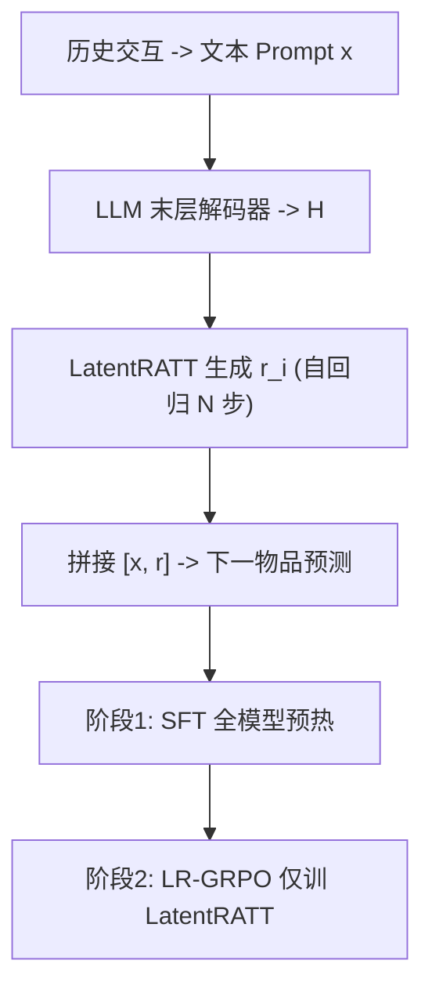
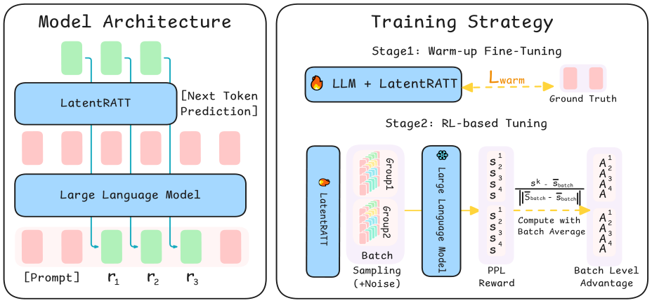
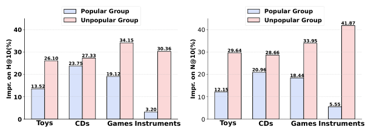

# Reinforced Latent Reasoning for LLM-based Recommendation (面向 LLM 推荐的强化隐式推理)

- **会议/期刊**: Under Review (ICLR/NeurIPS/ICML 2026)
- **作者与机构**: Yang Zhang, Wenxin Xu, Xiaoyan Zhao, Wenjie Wang, Fuli Feng, Xiangnan He, Tat-Seng Chua (NUS / USTC / CUHK)
- **推荐链路定位**: 端到端生成式（LLM 序列推荐）
- **研究方向**: LLM4Rec / 强化学习与动态探索
- **论文原文**: [arxiv.org/abs/2505.19092](https://arxiv.org/abs/2505.19092v2)
- **开源代码**: [github.com/xuwenxinedu/R3](https://github.com/xuwenxinedu/R3)

## TL;DR (1分钟核心速览)

针对 LLM 推荐中"显式 CoT 数据难获、推理延迟高"的双重困境，本文提出 **LatentR³**：在 LLM 末层解码器上加装注意力层 **LatentRATT**，自回归产出高信息密度的**连续隐推理 Token**（$N=1$ 即足），并用两阶段训练——SFT 预热 + 改进的 **LR-GRPO**（PPL 连续奖励 + Batch 级优势）——在**零显式 CoT 监督**下学出推荐推理能力。在 4 个 Amazon 域、全库排序协议下，叠加到 BIGRec / D³ 分别取得 **+17.0% / +8.4%** 平均相对提升，而推理延迟仅相当于多生成 1 个 token（显式 CoT 需 25–30 倍）。

## Background & Motivation (背景与核心矛盾)

- **主流范式**: 以 RecSAVER、Reasoning4Rec 为代表的 LLM4Rec 通过手工/合成 CoT 数据微调，让 LLM 先写"思考过程"再出推荐词元。
- **前人局限**: (1) 推荐场景的用户反馈只有终态行为，缺少推理标注，人工合成 CoT 成本高且主观性大；(2) 显式 CoT 推理需自回归数十/上百 token，线上推理延迟不可接受。
- **核心洞察 (Key Insight)**: LLM 的隐状态信息密度远高于离散文本 token，故**少量连续隐 Token 即可等价编码整条推理链**；而 DeepSeek-R1-Zero 已证明 RL 可在无 CoT 监督下自涌现推理，只需把这一机制从文本空间搬到隐空间。
- **本文切入点**: 用隐空间推理 + 两阶段 RL，把"推理能力"与"CoT 数据"和"推理延迟"同时解耦。

## Method (核心方法设计)

### 1. 整体框架 (Overall Architecture)

输入是被模板化的用户历史 $x$，先由 LLM 末层解码器$LLM_{-1}$输出隐状态序列$H$，再由新增的 **LatentRATT** 注意力层取末位隐状态作为第$i$个隐推理 token$r_i$，自回归循环$N$步得到推理向量$r=[r_1,\dots,r_N]$；随后把$[x, r]$ 拼回输入空间，交由原 LLM 做 next-item 预测。训练采用**两阶段**：阶段一全模型 SFT 自回归拟合答案（含 LatentRATT），得到有意义的隐推理初始化；阶段二冻结原 LLM，仅对 LatentRATT 做纯 RL（LR-GRPO），用采样噪声+连续奖励探索更优推理路径。

<figure class="paper-figure" markdown="span">
  <figcaption>图1：所提出的 LatentR3 的模型架构与训练策略示意图。在架构上，引入 LatentRATT 层以生成潜在推理连续词元。训练采用两阶段框架：第一阶段通过监督微调（SFT）进行预热调优，第二阶段应用基于改进 GRPO 的 RL（称为 LR-GRPO）以进一步优化推理。</figcaption>
</figure>

### 2. 关键设计拆解 (Key Designs)

**① LatentRATT 隐推理生成层**：前人直接复用 LLM 最后隐状态当 latent token，与输入 embedding 空间错位、语义不连贯。本文在 $LLM_{-1}$ 之上再加一层注意力：
$H_{i-1}=LLM_{-1}(x,r_1,\dots,r_{i-1}),\quad r_i=\text{LatentRATT}(H_{i-1})[-1]$，
显式聚合上下文并对齐输入 embedding 空间，使得 $r$ 能被原 LLM "读得懂"，从而**保持冻结 LLM 的语义先验**。

**② LR-GRPO 三重改造**：原始 GRPO 需对每个采样完整自回归解码+二元 0/1 奖励，代价极大且信号稀疏。本文改为: (a) **重参数采样** $\tilde{r}_k = r+\epsilon,\ \epsilon\sim\mathcal{N}(0,\sigma^2)$（$k\ge 2$，$k=1$保留原$r$），在连续空间做 K 路探索；(b) **PPL 连续奖励**$s_k=-\exp\big(-\tfrac{1}{|y|}\sum_{i=1}^{|y|}\log\pi_\theta(y_i|x,\tilde{r}_k,y_{<i})\big)$，避免完整解码；(c) **Batch 级优势**$A_k=\dfrac{s_k-\bar{s}_{\text{batch}}}{\|S_{\text{batch}}-\bar{s}_{\text{batch}}\|}$，只取每组的**原始样本**$s_1$ 计算基线，避免同一组整体质量低时仍产生虚假正优势。

**训练目标与推理开销**：阶段一损失即标准 NTP：$\mathcal{L}_{\text{warm}}=-\sum_{(x,y)}\sum_i\log P_\theta(y_i|x,r,y_{<i})$；阶段二为带重要性比值的策略梯度（KL 项因冻结 LLM 而为零）。线上推理只需多前向$N=1$ 个连续 token，**无需任何文本解码**，延迟几乎与无推理 LLM 相当。

## Experimental Setup & Evaluation Protocol (实验设置与评估协议)

- **数据集与预处理**: 采用经典 Amazon 四域（Toys / CDs / Games / Instruments），沿用 LLM4Rec 标准 **时间戳排序 + 比例划分** 的过滤流程（详见原文附录 A）。

| 数据集 | #Users | #Items | #Interactions | 稀疏度/密度 | 特征/场景说明 |
| :--- | :---: | :---: | :---: | :---: | :--- |
| Toys | ~19k | ~12k | ~168k | 稀疏 | 玩具、玩具品类 |
| CDs | ~75k | ~65k | ~456k | 稀疏 | 音像制品 |
| Games | ~31k | ~25k | ~220k | 稀疏 | 电子游戏 |
| Instruments | ~25k | ~10k | ~110k | 稀疏 | 乐器 |

- **数据划分与防穿越 (Splitting Strategy)**: 严格按用户交互**时间戳切分**训练/验证/测试，测试集为每个用户的**最后一次交互**，杜绝未来信息泄漏。
- **排名评测协议 (Ranking Protocol)**: **Full-Ranking (全库未交互排序)**，指标为 HR@{5,10} 与 NDCG@{5,10}；不做负采样，属无偏评测。
- **对比基线与超参设置**: 传统序列模型 Caser / GRU4Rec / SASRec；免微调 LLM 的 Base / COT；微调 LLM 的 AlphaRec / BIGRec / D³。LatentR³ 分别叠加在 BIGRec 与 D³ 上，隐藏维 $d$与原底座一致。原文附录 D 报告显著性检验，主要指标均$p<0.05$。

## Key Experimental Results (实验关键数据)

### 1. 主实验对比 (Main Results)

下表保留最具代表性的 4 个基线 + 2 个 LatentR³ 版本（NDCG@10 为核心列，其余指标见原文）：

| 数据集 | SASRec | Base | COT | AlphaRec | BIGRec | **+LatentR³** | D³ | **+LatentR³** |
| :--- | :---: | :---: | :---: | :---: | :---: | :---: | :---: | :---: |
| Toys N@10 | 0.0510 | 0.0178 | 0.0229 | 0.0448 | 0.0582 | **0.0693** | 0.0674 | **0.0752** |
| CDs N@10 | 0.0691 | 0.0167 | 0.0246 | 0.0373 | 0.0672 | **0.0826** | 0.0955 | **0.0977** |
| Games N@10 | 0.0350 | 0.0214 | 0.0105 | 0.0515 | 0.0414 | **0.0506** | 0.0505 | **0.0601** |
| Instruments N@10 | 0.0950 | 0.0192 | 0.0199 | 0.1051 | 0.1158 | **0.1214** | 0.1167 | **0.1229** |
| **RI vs D³** | | | | | | +17.0% | | +8.4% |

### 2. 消融实验 (Ablation Study)

在 Toys / CDs 上（指标为 NDCG@5）：

| 变体 | Toys N@5 | CDs N@5 | 说明 |
| :--- | :---: | :---: | :--- |
| **LatentR³ (完整)** | **0.0600** | **0.0754** | — |
| w/o Reasoning | 0.0508 | 0.0616 | 完全去掉隐推理 |
| w/o LatentRATT | 0.0574 | 0.0568 | 直接用末层隐状态 |
| w/o RL (仅 SFT) | 0.0584 | 0.0662 | 无 RL 探索 |
| w/o Batch Advantage | 0.0589 | 0.0661 | 退回原 GRPO 组级优势 |

### 3. 关键实验发现 (Key Findings)

1. **LatentRATT 不可替代**：去掉它在 CDs 上 N@5 从 0.0754 跌至 0.0568，**甚至劣于 w/o Reasoning（0.0616）**，说明未对齐到输入 embedding 空间的隐状态会"污染"LLM 语义，该层是隐推理能否成立的关键阀。
2. **RL 是隐推理的增益来源**：仅 SFT 时 Toys N@5 仅 0.0584（+0.0076 vs 无推理），加 RL 后再 +0.0016，而 Batch 级优势又比原 GRPO 组级优势稳（CDs 0.0661→0.0754），验证连续奖励下**批量基线**对稳定探索的必要性。
3. **推理对长尾更友好、延迟代价可忽略**：图 2 显示 LatentR³ 在冷门物品上相对 BIGRec 提升达 29–42%，热门仅 3–26%；同时推理长度 $N=0\to 1$增益最大、$1\to 2$ 收益递减（图 3），而 LR-GRPO 训练时长约 **83 分钟 vs 原 GRPO 314 分钟**（约 1/4）。

<figure class="paper-figure" markdown="span">
  <figcaption>图2：LatentR3 在热门与冷门物品上相较于 BIGRec 的性能提升。</figcaption>
</figure>

## Highlights & Limitations (亮点、对比与审稿批判)

- **与代表作对比 (vs. Prior Work)**: 对比 RecSAVER / Reasoning4Rec 等 CoT 方法，本文**彻底抛弃 CoT 数据**且推理只需 1 个连续 token；对比 BIGRec / D³ 等 LLM 推荐底座，本文只加一层 LatentRATT + RL 微调即得显著增益；对比原版 GRPO，LR-GRPO 用 PPL 奖励免去全解码，训练提速约 4 倍。
- **可迁移亮点**: (1) "PPL 作为连续奖励代理"可直接迁移到任何生成式推荐的 RLHF/RLVR 训练中，无需自回归 rollout；(2) "Batch 级优势 + 重参数隐空间采样"为隐空间 RL 提供稳定探索范式，可用于扩散推荐、语义 ID 生成等场景。
- **审稿级局限批判**: (1) 隐推理天然**缺乏可解释性**，无法像 CoT 一样回溯推荐理由，对可解释推荐场景不友好；(2) 实验仅在规模较小的 Amazon 子集（数万用户）上验证，**大规模工业数据上的可扩展性与稳定性未知**；(3) 阶段二仅训 LatentRATT、冻结 LLM 虽省算力，但可能限制推理与语义表征的深度适配。

## Rating (四维评分)

- **方法创新性 (Novelty)**: ⭐⭐⭐⭐ （将隐空间推理与 RL 无 CoT 学习统一到 LLM 推荐中，LatentRATT + LR-GRPO 组合有新意）
- **评估协议与实验扎实度 (Protocol & Experiments)**: ⭐⭐⭐⭐ （4 数据集 Full-Ranking + 显著性检验 + 充分消融，仅缺大规模与在线 A/B）
- **写作与数学规范度 (Clarity & Rigor)**: ⭐⭐⭐⭐ （LR-GRPO 各步公式清晰、动机与设计一一对应，缺乏复杂度分析稍显不足）
- **工业落地与复现价值 (Industrial & Practical Value)**: ⭐⭐⭐⭐ （推理延迟约 +1 token、训练仅 1/4 GRPO，代码已开源，落地门槛低）

