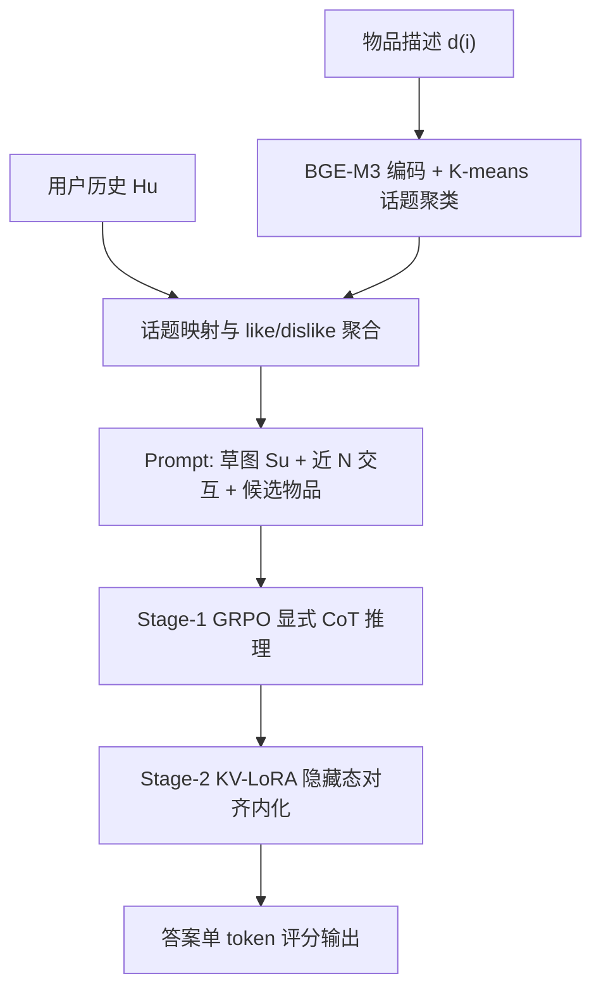
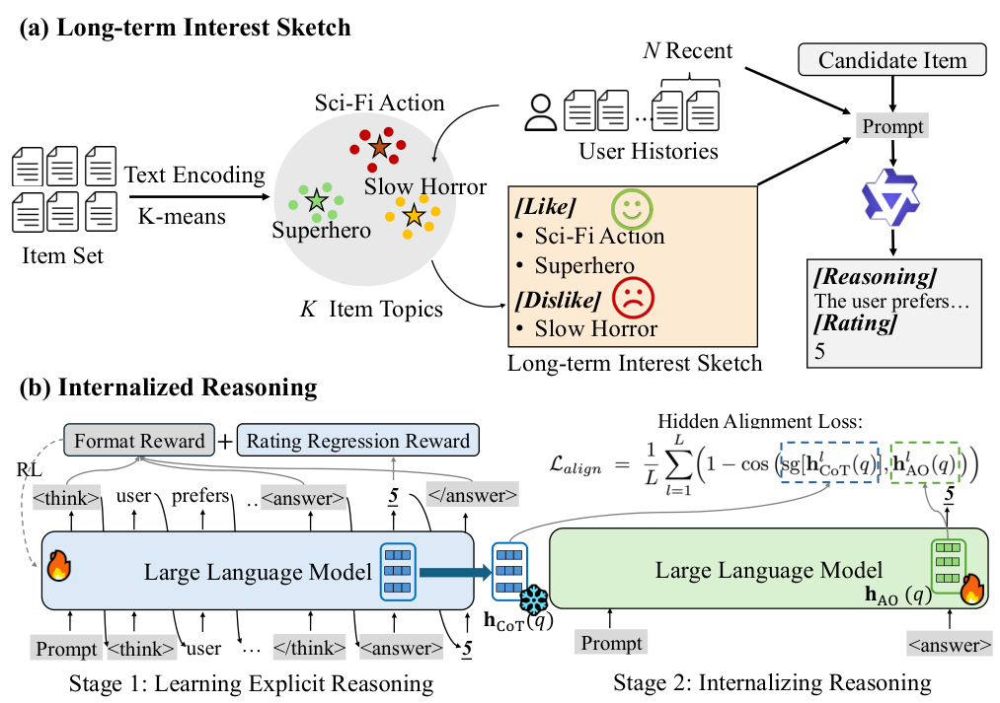
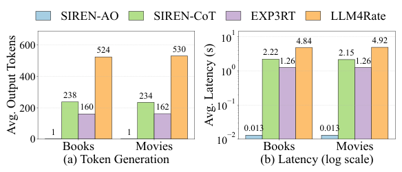

# Token-Efficient Long-Term Interest Sketching and Internalized Reasoning for LLM-based Recommendation（面向 LLM 推荐的 Token 高效长期兴趣草图与内化推理）

- **会议/期刊**: ICLR 2026
- **作者与机构**: Zhihao Ding, Jinming Li, Shuai Mu, Jieming Shi（香港理工大学 & 字节跳动）
- **推荐链路定位**: 精排（评分预测）/ 列表重排
- **研究方向**: 大语言模型推荐 / 序列与会话推荐
- **论文原文**: [论文原文链接](https://proceedings.iclr.cc/paper_files/paper/2026/file/c9b551a2e195a209fc0b280de2f7f781-Paper-Conference.pdf)
- **开源代码**: [SIREN](https://github.com/TommyDzh/SIREN)

## TL;DR (1分钟核心速览)

LLM 做评分预测面临两难：直接喂几百条原始历史会被噪声与长上下文拖垮（实验显示历史从 10 增到 50 条 MAE 反而变差），而 CoT 逐 token 生成 rationale 的延迟高出一个数量级。SIREN 用「语料级话题聚类 → 点赞/踩话题草图」把输入压到 token 预算内（输入 token −48.7%），再用 GRPO 显式推理 + 隐藏态对齐把 CoT「内化」进参数，使答案单 token 直接输出。在 Amazon Books/Movies（5-core、leave-last-out）上 MAE 0.3510/0.7603，超越 EXP3RT 等 7 个基线，延迟 0.013 s/样本，比 CoT 解码快 100 倍以上。

## Background & Motivation (背景与核心矛盾)

- **主流范式**: 以 LLM 为评分器/重排器，将用户历史 + 候选物品描述线性化为 prompt；提升精度主要靠更强 teacher 生成 rationale 微调小模型（Rec-SAVOR、EXP3RT），或直接 CoT 提示。
- **前人局限**: ①历史长且噪声密集，截断最近 $N$ 条会丢失长期偏好，而让 LLM 现场摘要仍需先读长历史、成本高且摘要不稳定；②显式 CoT 每个 rationale token 都要一次前向，实测延迟超答案直出 100 倍，无法上线。
- **核心洞察 (Key Insight)**: 图 1(a) 证明「历史越长、答案直出与 CoT 的 MAE 均单调变差」——瓶颈不是上下文容量而是**信号密度**；同时评分预测的最终输出只依赖 `<answer>` 位置的隐状态，因此若把 AO 的该隐状态对齐到 CoT 的该隐状态，就能在零 rationale token 下复现 CoT 效果。
- **本文切入点**: 用「全局话题草图」做无损压缩式用户表征，用「隐状态对齐」把推理搬到参数里，从而同时打掉输入侧与输出侧的开销。

## Method (核心方法设计)

### 1. 整体框架 (Overall Architecture)

离线阶段用文本编码器 BGE-M3 编码全库物品描述，K-means 得到 $K{=}20$个语料级语义话题并由 LLM 为每簇命名；线上为每个用户把历史映射到话题并按簇均分划为 like/dislike 列表，与最近$N$条交互（Books 30 / Movies 10）及候选物品描述拼成 prompt$\pi_u(i)$。训练分两段：Stage-1 以 GRPO 让模型在草图上学出显式 `<think>` 推理与评分；Stage-2 冻结推理目标，仅对 KV 投影加 LoRA，用隐藏态余弦对齐让 AO 解码的 `<answer>` 隐状态逼近 CoT 版本。推理时只生成一个评分 token。

<figure class="paper-figure" markdown="span">
  <figcaption>图 2：SIREN 概览。(a) 长期兴趣草图：对用户历史进行编码，聚类为语义主题，并聚合为紧凑的喜好与厌恶草图，再与近期交互和候选物品结合，用于基于 LLM 的评分预测。(b) 内化推理：第 1 阶段用强化学习（RL）训练显式 CoT 推理；第 2 阶段将仅答案解码的隐藏状态与 CoT 解码对齐，使仅答案推理具有接近 CoT 的质量但延迟低得多。</figcaption>
</figure>

### 2. 关键设计拆解 (Key Designs)

1. **Token 预算内的长期兴趣草图（Long-Term Interest Sketching）**：逐用户聚类在短历史上不稳定且跨用户不可比，故改为**全库一次性**发现话题：$e(i)=\mathrm{Enc}(d(i))$，$\{\mu_k\}=\mathrm{KMeans}(\{e(i)\})$，$c_i=\arg\min_k \lVert e(i)-\mu_k\rVert_2^2$。用户$u$在话题$k$上的均分$\bar r_{u,k}$决定归属：$T_u^{+}=\{\tau_k:\bar r_{u,k}\ge\theta\}$，$T_u^{-}=\{\tau_k:0<\bar r_{u,k}<\theta\}$（$\theta{=}4$），草图$S_u=(T_u^{+},T_u^{-})$。直觉是把上百条交互归并为 20 个话题下的可读偏好标签，既保留稳定长期信号，又把噪声（重复爆款、误点）在簇内平均掉。
2. **规则化 GRPO 奖励（无需 CoT 标注）**：推荐场景没有真值 rationale，无法做 SFT。作者用格式奖励 + 距离感知的回归奖励：
   $R(\hat r_{ui},r_{ui})=s_{\text{format}}+\Big(2-\frac{4}{E_{\max}}\lvert\hat r_{ui}-r_{ui}\rvert\Big)$，其中$E_{\max}=b-a$，$s_{\text{format}}\in\{-1,+1\}$。相较二值 exact-match（Movies MAE 0.8094），连续奖励提供更稠密、更平滑的梯度（0.7577），显著缓解评分分布偏正导致的「一律预测高分」。
3. **隐藏态对齐内化 + KV 适配定理**：AO 与 CoT 的预测都落在 `<answer>` 隐状态上，故最小化逐层余弦距离：
   $\mathcal{L}_{\text{align}}=\frac{1}{L}\sum_{l=1}^{L}\Big(1-\cos\big(\mathrm{sg}[h^{l}_{\text{CoT}}(q)],\,h^{l}_{\text{AO}}(q)\big)\Big)$。
   Theorem 1 给出动机：在一阶线性化下，存在 $(\Delta W_K^{l},\Delta W_V^{l})$使$\tilde h^{l}_{\text{AO}}(q)=h^{l}_{\text{CoT}}(q)$，即 CoT 的效果可完全由 KV 增量吸收——故 LoRA 只挂 KV（实验最优，Books RMSE 0.6949）。**训练/推理开销**：总损失即 GRPO 策略梯度 +$\mathcal{L}_{\text{align}}$（不加 CE，见消融）；推理无负采样、单 token 生成，vLLM 单卡 H20 batch=1 下 0.013 s/样本。

## Experimental Setup & Evaluation Protocol (实验设置与评估协议)

- **数据集与预处理**: Amazon Reviews 2023 的 Books/Movies，采用 `5-core` 迭代过滤，并对正（≥4）/负（≤3）样本做分层采样以缓解标签失衡：

| 数据集 | #Users | #Items | #Train | #Valid | #Test |
| :--- | :---: | :---: | :---: | :---: | :---: |
| Books | 10,440 | 9,753 | 94,075 | 12,222 | 11,708 |
| Movies | 2,629 | 10,874 | 22,097 | 2,629 | 2,629 |

- **数据划分与防穿越**: `Leave-Last-Out`——每用户最后两条交互分别作验证/测试，其余训练，严格按时间序构造 prompt 历史。
- **排名评测协议**: 主任务为评分回归，报告 `MAE / RMSE`（越低越好），无采样负例问题；重排泛化实验（IMDB）采用 LightGCN 召回 top-20 候选的**固定候选列表**重排，报 `Recall@3/5`、`nDCG@3/5`。
- **对比基线与超参**: 9 个基线分三类——统计（User/Item Avg. Rating）、传统（MF、P5）、LLM（LLM4Rate-R1/Qwen3-4B、Rec-SAVOR、EXP3RT）。Backbone Qwen3-4B（另测 Llama-3.2-3B），编码器 BGE-M3 $d_e$默认，$K=20$、$M=100$、$\theta=4$、LoRA 挂 KV，GRPO 用 VERL 实现，3 个随机种子取均值（未报显著性检验）。

## Key Experimental Results (实验关键数据)

### 1. 主实验对比 (Main Results)

| 方法 | Books MAE↓ | Books RMSE↓ | Movies MAE↓ | Movies RMSE↓ |
| :--- | :---: | :---: | :---: | :---: |
| User Avg. Rating | 0.4538 | 0.8396 | 0.9975 | 1.3419 |
| MF | 0.5740 | 0.7259 | 1.1604 | 1.3060 |
| P5 | 0.5591 | 0.7939 | 0.8655 | 1.3406 |
| LLM4Rate (DeepSeek-R1) | 0.4509 | 0.8329 | 0.9222 | 1.4047 |
| LLM4Rate (Qwen3-4B) | 0.4730 | 0.8916 | 0.7995 | 1.4797 |
| Rec-SAVOR | 0.4893 | 0.8902 | 1.0884 | 1.5183 |
| EXP3RT | 0.4001 | 0.7567 | 0.9521 | 1.4646 |
| **SIREN** | **0.3510** | **0.6887** | **0.7603** | **1.2924** |
| Improv. | 12.27% | 8.99% | 4.90% | 1.04% |

### 2. 消融实验 (Ablation Study)

| 变体 | Books MAE | Books RMSE | Movies MAE | Movies RMSE | 延迟 (s) |
| :--- | :---: | :---: | :---: | :---: | :---: |
| AO–SFT (Recent) | 0.3547 | 0.7131 | 0.7775 | 1.3635 | 0.011 / 0.012 |
| AO–SFT (+Sketch) | 0.3536 | 0.7114 | 0.7695 | 1.3556 | 0.013 |
| CoT–GRPO (+Sketch) | 0.3521 | 0.6977 | 0.7577 | 1.2821 | 2.20 / 2.15 |
| **AO–HA (+Sketch)** | **0.3503** | **0.6887** | 0.7603 | 1.2924 | **0.013** |

### 3. 关键实验发现 (Key Findings)

1. **草图是「提纯」而非「压缩损失」**：+Sketch 在几乎零延迟代价下稳定降 MAE/RMSE；而把预算填满更多原始历史（+More history）虽能小幅降 Books MAE（0.3535），Movies RMSE 却从 1.3556 恶化到 1.3723，LLM 现写 Profile（EXP3RT 式摘要）甚至不如近史（Books 0.3563、Movies 0.7779），说明噪声才是长历史的真实成本。
2. **内化优于蒸馏与 CE 微调，且能超过 teacher**：以同一 GRPO-CoT 模型为起点，HA 在 Books 达 0.3503（低于 teacher 的 0.3521，说明对齐保留推理结构而规避了 CoT 采样方差），而 KD 仅 0.7832/0.7995、HA+CE 退化到 0.7767——token 级 CE 会把表征拉向标签拟合，破坏 CoT 潜结构。KV 单独适配优于 all-linear（Books RMSE 0.6949 vs 0.6992），与 Theorem 1 一致。
3. **效率与泛化双赢**：AO 每样本仅 1 个输出 token，CoT 需 524/530 个；延迟 0.013 s vs 2.15–2.22 s（>100×）。在 IMDB 重排上，固定 top-20 候选下 Recall@5 相对 EXP3RT 提升 14.7%（0.0663 vs 0.0578），延迟 0.03 s vs 1.56 s（52×）。

<figure class="paper-figure" markdown="span">
  <figcaption>图 3：基于 LLM 的方法在平均延迟（s/样本）与平均生成输出 token 数（每样本）上的比较。</figcaption>
</figure>

## Highlights & Limitations (亮点、对比与审稿批判)

- **与代表作对比 (vs. Prior Work)**: EXP3RT / Rec-SAVOR 依赖强 teacher 生成 profile 与 rationale 做**外部蒸馏**，仍需读长历史且需生成中间 token；LatentR3、AtSpeed 走潜变量/投机解码，本质仍产出中间 token。SIREN 的差异在于 ①用户表征来自**语料级**话题（跨用户可比、可读、token 上界明确）；②推理**搬进参数**，输出侧零额外 token。
- **可迁移亮点**: 「全库聚类 → 用户话题直方图 → like/dislike 阈值化」是一套通用的、与 backbone 无关的长历史压缩器，可直接用于召回侧用户画像或生成式推荐的 prefix；「`<answer>` 隐状态余弦对齐 + KV-LoRA」可作为任何需要去掉 CoT 延迟的工业推理内化模板。
- **审稿级局限批判**: ①任务局限于**评分回归**，未验证 top-N 排序/生成式检索；IMDB 重排仅对固定 LightGCN top-20 候选，无法说明草图能改善召回上限。②$K$、$\theta$、近史长度$N$ 均为数据集相关超参（Books 30 / Movies 10），且 GRPO 两阶段训练成本不低，论文未给出训练开销与跨域迁移的敏感性分析；指标仅 3 seed 均值，无显著性检验。

## Rating (四维评分)

- **方法创新性 (Novelty)**: ⭐⭐⭐⭐ （语料级话题草图 + 隐状态内化 CoT 的组合较新，且给出 KV 适配等价性定理作为动机）
- **评估协议与实验扎实度 (Protocol & Experiments)**: ⭐⭐⭐ （5-core/leave-last-out 与三 seed 规范，消融链完整，但缺显著性检验、仅两个 Amazon 子集且主任务限于回归）
- **写作与数学规范度 (Clarity & Rigor)**: ⭐⭐⭐⭐ （奖励函数、对齐损失与定理表述清晰；但定理为一阶线性化近似，附录外未讨论误差阶）
- **工业落地与复现价值 (Industrial & Practical Value)**: ⭐⭐⭐⭐⭐ （开源完整，0.013 s/样本、1 token 输出、输入 token −48.7%，直接匹配线上延迟预算）

