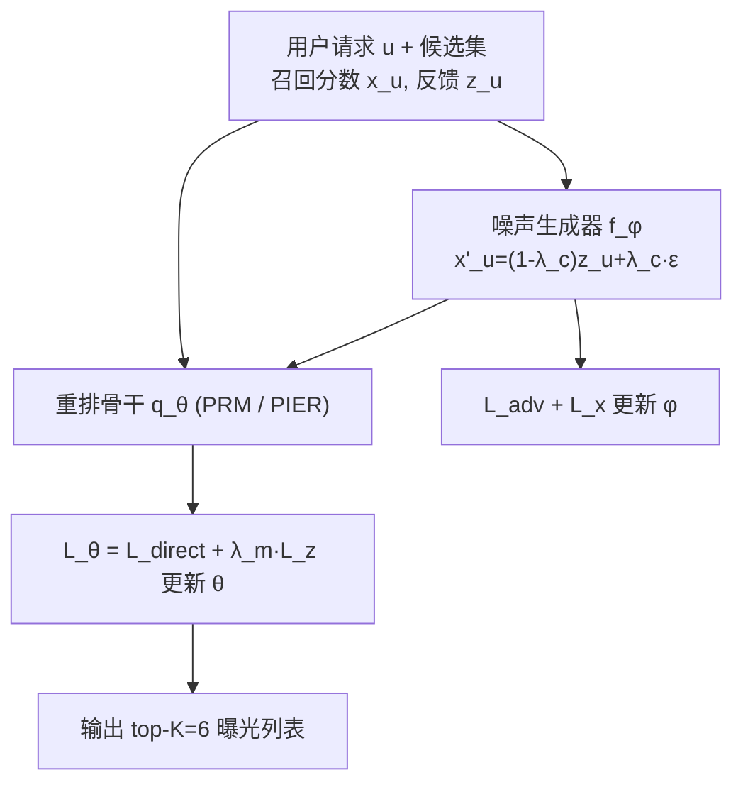

# Denoising Neural Reranker for Recommender Systems (面向推荐系统的去噪神经重排器)

- **会议/期刊**: ICLR 2026
- **作者与机构**: Wenyu Mao, An Zhang, Xiang Wang (USTC)；Shuchang Liu, Hailan Yang, Xiaobei Wang, Lantao Hu, Han Li, Kun Gai 等 (快手)
- **推荐链路定位**: 重排（多阶段级联的末级列表精排）
- **研究方向**: 多任务学习与列表级重排 / 自监督与交互去噪
- **论文原文**: [https://arxiv.org/abs/2509.18736v5](https://arxiv.org/abs/2509.18736v5)
- **开源代码**: [https://github.com/maowenyu-11/DNR](https://github.com/maowenyu-11/DNR)

## TL;DR (1分钟核心速览)

多阶段推荐中，"reranker-aware retriever" 已被大量研究，但"retriever-aware reranker"几乎空白：上一级召回打分被视为普通特征拼接使用。本文先从理论上证明直接优化 $L_{direct}=-\mathbb{E}_{x\sim p_x}[\log q_\theta(z_u|x)]$只是数据似然的一个**上界**，其中两项由召回器先验决定、重排器无法控制；由此把重排重新定义为"对含噪召回分数的去噪"，提出对抗框架 DNR：噪声生成器$x'_u=(1-\lambda_c)z_u+\lambda_c\epsilon$ 合成假分数，重排器在真实+合成分数上共同去噪，并加对抗探索项与分布对齐项。在 top-50 候选、@6 指标协议下，Kuaivideo 上 N@6 相对最强基线 PIER 提升 7.7%，线上 A/B realshow +1.089%（显著）。

## Background & Motivation (背景与核心矛盾)

- **主流范式**: 工业系统用召回（百万→50）→ 重排（50→6 曝光）级联；重排侧主流做法分四类：单点重打分、列表精炼（PRM/SetRank）、生成-评估（EGRank/PIER/NAR4Rec）、扩散生成（DiffuRec/DCDR），但都把召回分数当普通输入特征。
- **前人局限**: (1) 召回器为吞吐量而简化，其打分噪声显著大于重排器分数——直接把 $x_u$拼进模型，等于把"含偏噪声"当成偏好标签，无法对齐真实反馈；(2) 从似然分解看，$L_{direct}+L_1+L_2$中的$L_1$（$q_\theta$与真实反馈分布$p_{z|x}$的偏差）和$L_2=-D_{KL}(p_x\|p_{x|z})$完全由召回先验与用户决定，直接优化无从约束，故目标与$\max_\theta \log p(z_u)$ 存在系统性错配。
- **核心洞察 (Key Insight)**: 作者用三张经验图支撑"重排即去噪"：目标物品在召回 embedding 空间中被候选淹没、在重排空间中却可分；重排器误差密度更集中于 0（噪声更小）。同时发现"重排器分数已很高，但召回分数仍能再涨点"——分数是有用但未被榨干的信号。
- **本文切入点**: 既然重排器天职就是"降噪"，那就显式给它造噪声：学习一个能逼近"召回分数后验 $p_{x|z}$"的生成器，逼重排器在分布外噪声上也稳定去噪。

## Method (核心方法设计)

### 1. 整体框架 (Overall Architecture)

输入是用户请求 $u$与候选集$I(u)$的召回分数$x_u\in[0,1]^n$、真实反馈$z_u\in\{0,1\}^n$（重排未曝光项默认置 0）。框架含两支：重排骨干$q_\theta$（可为 PRM/PIER，模型无关）与噪声生成器$f_\phi$（2 层 MLP）。训练前$\lambda_e$个 epoch 用启发式噪声（Gaussian 或$Beta(\alpha,\beta)$）热身，保证重排器先具备基础去噪能力；之后切换为可学习生成器，进入"生成器造难样本、重排器去噪、KL 项把生成分布拉回真实召回分布"的极小极大循环。推理时生成器完全移除，开销与原始骨干一致。

### 2. 关键设计拆解 (Key Designs)

1. **去噪式似然分解（三项损失）**：把 $\log p(z_u)$ 拆成可控项与不可控项，得
$-\log p(z_u)=L_z+L_{adv}+L_x+\delta_x$，其中$L_z=-\mathbb{E}_{x\sim p_\phi}[\log q_\theta(z_u|x)]$、$L_{adv}=\mathbb{E}_{x\sim p_\phi}[\log\frac{q_\theta(z_u|x)}{p_{z|x}(z_u|x)}]$、$L_x=D_{KL}(p_\phi(x|z_u)\|p_x(x))$，残项$\delta_x=-D_{KL}(p_\phi\|p_{x|z})\le0$不可直接优化但期望被前三项推小。直觉：$L_z$让重排器在"合成但逼真"的分数上去噪；$L_{adv}$逼生成器找重排器去噪失败的分数区域；$L_x$防止生成器跑偏成不真实分数（否则$p_{z|x}$极小、$L_{adv}$ 反而变大）。
2. **重参数化噪声注入与生成器优化**：$x'_u=(1-\lambda_c)z_u+\lambda_c\epsilon,\ \epsilon\sim f_\phi$，以真实反馈为锚、按比例注入噪声，端到端可回传；生成器用$\min_\phi \log q_\theta(z_u|x'_u)$更新（固定$\theta$），即最大化重排损失的对抗样本。$\lambda_c$决定噪声比例，启发式分支取$Beta(0.5,0.5)$对应二值反馈的共轭先验，模型化分支因噪声可学而取$\lambda_c=1$。
3. **训练目标、采样与推理开销**：重排器总损失 $L_\theta=L_{direct}+\lambda_m L_z$，$L_{direct}$、$L_z$均为 BCE，**无需负采样**（候选内未曝光即负例）；生成器侧$L_{adv}+L_x$交替更新。三超参$\lambda_c\in[0.1,1]$、$\lambda_m\in[0.1,1]$、$\lambda_e\in[0,200]$。推理零额外成本；训练 ML-1M 每 epoch 1m01s→1m06s。

## Experimental Setup & Evaluation Protocol (实验设置与评估协议)

- **数据集与预处理**（过滤交互数 <20 的用户/物品，非 5-core）：

| 数据集 | #Users | #Items | #Interactions | 特征/场景说明 |
| :--- | :---: | :---: | :---: | :--- |
| ML-1M | 6,020 | 3,043 | 995,154 | 电影评分，重排序列 161,646 |
| Kuaivideo | 89,310 | 10,395 | 3,270,132 | 快手短视频，重排序列 513,010 |
| Amazon-Books | 35,732 | 38,121 | 1,960,674 | 图书评论，重排序列 311,386 |
- **数据划分与防穿越**: 召回阶段按 **8:2 比例随机划分**（MF 召回，AUC 79.20/89.62/88.82，训练中冻结）；重排阶段按**时间顺序**取每个用户最后 6 次交互作为"重排后曝光列表"，构成列表级样本。
- **排名评测协议**: 非全库 Full-Ranking，而是 **top-50 候选内的完整列表重排评估**（候选由 MF 给出，重排器选 top-$K=6$），未曝光候选按 0 标签处理；指标 H@6 / N@6 / M@6 / F1@6 / AUC。
- **对比基线与超参**: 四类共 14 个基线（SASRec/Caser/GRU4Rec/MiDNN；DLCM/SetRank/PRM/MIR；EGRank/PIER/NAR4Rec/MG-E；DiffuRec/DCDR）；隐藏维 $d=128$，学习率$\{10^{-2},10^{-3},10^{-4}\}$，显著性用 Student t-test$p<0.05$。

## Key Experimental Results (实验关键数据)

### 1. 主实验对比 (Main Results)

| 方法 (类别) | ML-1M H@6 | ML-1M N@6 | Kuai H@6 | Kuai N@6 | Book H@6 | Book N@6 |
| :--- | :---: | :---: | :---: | :---: | :---: | :---: |
| SASRec (序列) | 59.79 | 72.16 | 36.72 | 54.01 | 60.27 | 69.32 |
| DLCM (列表精炼) | 62.31 | 73.87 | 39.69 | 60.67 | 66.80 | 75.88 |
| PRM (列表精炼) | 60.09 | 72.85 | 39.92 | 55.93 | 67.86 | 76.88 |
| MIR (列表精炼) | 62.22 | 74.33 | 37.01 | 55.79 | 66.08 | 71.48 |
| EGRank (生成-评估) | 62.76 | 74.75 | 40.09 | 59.01 | 70.73 | 80.75 |
| PIER (生成-评估) | 62.74 | 75.99 | 45.35 | 65.11 | 71.14 | 80.22 |
| NAR4Rec (生成) | **62.81** | 75.01 | 44.31 | 63.83 | 70.08 | 79.46 |
| DiffuRec (扩散) | 62.16 | 75.80 | 40.78 | 61.16 | 58.62 | 68.77 |
| DCDR (扩散) | 60.79 | 73.21 | 43.86 | 63.52 | 65.84 | 70.36 |
| **DNR-G** | **64.89** | **77.67** | 49.61 | 69.60 | 74.83 | 82.57 |
| **DNR-B** | 64.23 | 77.12 | **50.30** | **70.15** | **75.50** | **83.53** |
| **Improv.% (DNR-B)** | +2.26% | +2.21% | **+10.92%** | **+7.74%** | **+6.13%** | **+3.44%** |

### 2. 消融实验 (Ablation Study)

统一报告 N@6（前三行为"如何用召回分数"，后六行为损失项拆解）：

| 变体 | ML-1M | Kuai | Book | 说明 |
| :--- | :---: | :---: | :---: | :--- |
| PRM 骨干（不用分数） | 72.85 | 55.93 | 76.88 | 下界参照 |
| w/ c score（拼接） | 76.73 | 67.58 | 77.99 | 直接使用 |
| w/ + score（相加） | 76.05 | 66.77 | 81.18 | 直接使用 |
| w/ w score（作权重） | 76.68 | 66.94 | 82.21 | 直接使用 |
| w/ G（仅 Gaussian 噪声） | 76.69 | 67.34 | 81.32 | 仅 $L_z$ |
| w/ B（仅 Beta 噪声） | 76.90 | 68.71 | 81.20 | 仅 $L_z$ |
| G w/o $L_{adv}$ | 76.57 | 68.70 | 81.89 | 去对抗探索 |
| G w/o $L_x$ | 76.43 | 69.10 | 82.01 | 去分布对齐 |
| **DNR-G（G→模型化）** | **77.67** | 69.60 | 82.57 | 完整框架 |
| **DNR-B（B→模型化）** | 77.12 | **70.15** | **83.53** | 完整框架 |

### 3. 关键实验发现 (Key Findings)

- **"怎么用分数"远比"是否用分数"重要**：拼接/相加/加权三种朴素用法在 PRM 上仅带来 +1~+4.3 N@6，而 DNR 在 Kuaivideo 上把 N@6 从 55.93(PRM)/65.11(PIER) 推到 70.15，且在 PRM 与 PIER 两种骨干上一致提升，说明收益来自去噪范式而非特定架构。
- **对抗探索与分布正则缺一不可**：Kuaivideo 上去掉 $L_{adv}$掉至 68.70、去掉$L_x$掉至 69.10、启发式 Gaussian/Beta 停在 67.34/68.71，只有"模型化生成器 + 双正则"才到 69.60；附录显示学到的噪声密度最贴近真实噪声分布（$Beta(2,5)$ 近似可再涨至 71.10）。
- **去噪胜过单纯放大模型与堆叠复杂范式**：把 PRM 扩到 10 层仅得 62.95/76.09，仍低于原版 DNR 的 64.89/77.67；大骨干 + DNR 进一步到 65.87/78.72。在线 7 天 A/B（各 12.5% 流量）realshow **+1.089%**（显著）、like/comment +0.609%/+0.574%，但 watch-time −0.091%、share −0.758%（不显著），长期 DAU +0.01%。

## Highlights & Limitations (亮点、对比与审稿批判)

- **与代表作对比 (vs. Prior Work)**: 相对 PRM/SetRank（只做候选间自注意力，丢弃召回分数）、PIER/EGRank（生成-评估排列，需枚举+评估器双重开销）、DCDR/DiffuRec（扩散去噪排名分布，训练/推理昂贵且本文实验中不稳定），DNR 是**训练期加噪、推理期零成本**的轻量方案；与"reranker-aware retriever"（如 RankFlow）方向互补，构成多阶段一致性的另一半。
- **可迁移亮点**: (1) 把上游阶段打分视为"含噪观测 + 已知后验形式"来做增广，可平移到粗排/召回训练；(2) 先用启发式分布热身、再切换可学习生成器的 $\lambda_e$ 调度，是稳定对抗训练的低成本 trick。
- **审稿级局限批判**: (1) 训练需额外生成器与三项损失回传，作者自承开销可达数倍（实测 Kuaivideo 2m21s→3m12s，约 +36%），且 $\lambda_c,\lambda_m,\lambda_e$ 三参在每个数据集需单独搜索（0.4/0.4/40 vs 0.3/0.6/80 vs 0.5/0.4/100），敏感度高；(2) 实验协议偏窄且存在不一致——候选仅 top-50、标签仅 last-6、召回器只用 MF（附录加 DT 才略增），正文称 Amazon-Books 而统计表写 Amazon-Toys，尚未与 LLM/生成式重排或"检索器即强双塔"场景对齐。

## Rating (四维评分)

- **方法创新性 (Novelty)**: ⭐⭐⭐⭐ （把重排严格重写为召回分数后验的变分去噪问题，$L_z+L_{adv}+L_x$ 三分解决似然上界中不可控项，视角新且推导干净）
- **评估协议与实验扎实度 (Protocol & Experiments)**: ⭐⭐⭐⭐ （三数据集 + 14 基线 + 双骨干 + 大模型 + 多样性 + 7 天线上 A/B 齐全，但候选仅 50、单召回器与数据集命名不一致削弱说服力）
- **写作与数学规范度 (Clarity & Rigor)**: ⭐⭐⭐⭐ （附录给出完整 ELBO 式推导与 $L_{direct}$上界证明，符号清晰；但$\min_\phi \log q_\theta$的对抗方向表述略隐晦，$Beta(2,5)$ 实验与"学习分布最优"论断口径需更统一）
- **工业落地与复现价值 (Industrial & Practical Value)**: ⭐⭐⭐⭐⭐ （推理零额外开销、骨干无关、代码开源、真实短视频场景 realshow +1.089%，是可直接嵌入现有重排链路的工程方案）

