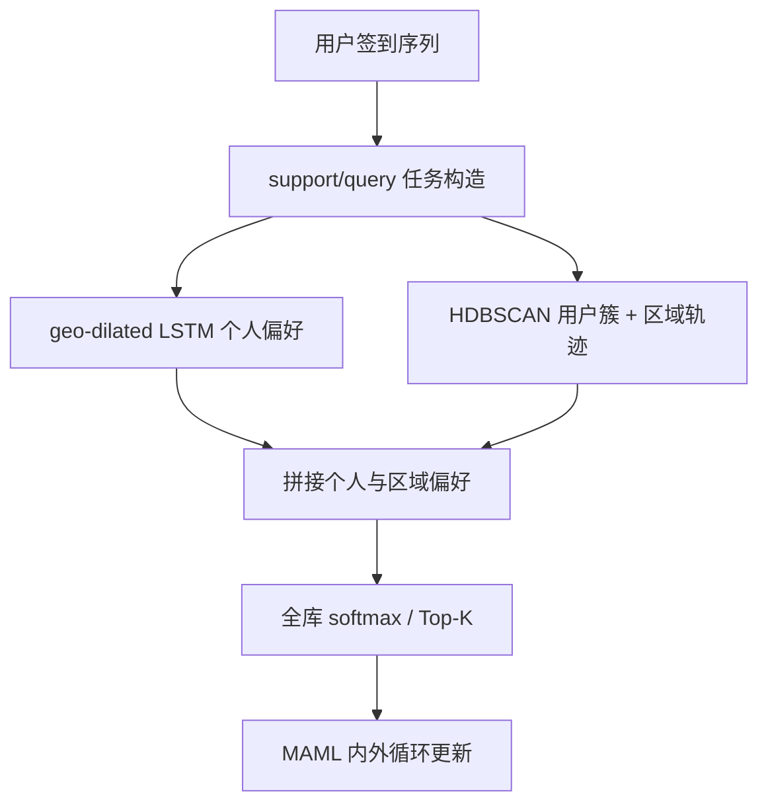
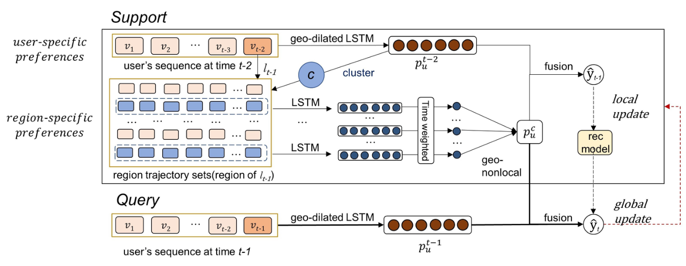

# MFNP: A Meta-optimized Model for Few-shot Next POI Recommendation（面向少样本下一 POI 推荐的元优化模型）

- **会议/期刊**: IJCAI 2021
- **作者与机构**: Huimin Sun, Jiajie Xu, Kai Zheng, Pengpeng Zhao, Pingfu Chao, Xiaofang Zhou；苏州大学、电子科技大学、香港科技大学
- **推荐链路定位**: 精排
- **研究方向**: 冷启动与长尾推荐 / 时空轨迹与 POI 本地生活推荐
- **论文原文**: [论文原文链接](https://www.ijcai.org/proceedings/2021/0415.pdf)
- **开源代码**: 暂未开源

## TL;DR (1分钟核心速览)

针对冷启动用户签到极少且兴趣随区域漂移的矛盾，MFNP 把用户特定与区域特定偏好建模统一进 MAML 元学习：用户侧用 geo-dilated LSTM 学个人偏好，区域侧用 HDBSCAN 聚类相似用户并以时空注意力聚合群体偏好。在 Foursquare/Gowalla 用户级 80:20 划分与全库排序下，Acc@5 较 STGCN 提升 48.0%/45.3%。

## Background & Motivation (背景与核心矛盾)

- **主流范式**: 下一 POI 推荐以 STRNN/T-LSTM/STGCN/LSTPM 等序列模型为主，通过时间门、空间门或 geo-dilated LSTM 捕捉签到序列的时空转移。
- **前人局限**: 冷启动用户签到稀疏，序列模型易过拟合；辅助信息/社交/跨域方法常把相似上下文用户推向同一批 POI，淹没个体真实兴趣。通用元学习 MeLU/MAMO 只做用户级任务，忽略 POI 场景的兴趣漂移——同一用户在不同区域偏好不同。
- **核心洞察 (Key Insight)**: 相似用户在同一区域会遵循相似行为，区域级偏好可从“同簇用户在该区域的轨迹”迁移，但需按时间槽与地理距离筛选，避免全局热门漂移。
- **本文切入点**: 把每个用户的推荐视为任务，联合学习区域无关个人偏好与区域相关群体偏好，并用自适应融合 + MAML 快速适配少样本用户。

## Method (核心方法设计)

### 1. 整体框架 (Overall Architecture)

MFNP 以用户签到序列为输入，先按前缀/扩展构造 support/query；基础推荐器包含三块：用户特定模块用标准 LSTM 与 geo-dilated LSTM 双通道取平均得到区域无关个人偏好 $p_u^{t-1}$；区域特定模块用 HDBSCAN 按$p_u^{t-1}$聚类用户，定位当前 POI 所在区域后，仅聚合同簇用户在该区域的轨迹，经 48 时间槽 Jaccard 权重与地理距离 non-local 注意力得到$p_u^{r}$；预测模块拼接$p_u^{t-1}\oplus p_u^{r}$后全库 softmax。训练采用 MAML：support 上内循环更新$\theta_u,\theta_g,\theta_r$，query 上外循环更新元参数$\phi_u,\phi_g,\phi_r$，并周期性重聚类。

<figure class="paper-figure" markdown="span">
  <figcaption>图 1：MFNP 模型的总体架构。我们将每个用户的签到序列划分为支持集和查询集。使用元参数初始化局部参数后，通过基础推荐系统建模用户偏好。在用户特定偏好建模模块中，我们根据用户个人签到记录，使用 geo-detailed LSTM 建模其区域无关偏好。在区域特定偏好建模模块中，我们首先定位该用户所属的相应用户群组。然后学习区域相关的群体偏好。</figcaption>
</figure>

### 2. 关键设计拆解 (Key Designs)

1. **双任务元优化（用户特定 + 区域特定）**：痛点在于通用元学习只按用户任务初始化，无法编码兴趣漂移。MFNP 将用户、区域群体、预测三组参数都纳入内外循环：$\theta^*\leftarrow\theta^*-\rho\nabla_{\theta^*}\mathcal{L}(y,\hat{y})$，$\phi^*\leftarrow\phi^*-\lambda\sum_{u\in U_{train}}\sum_{q\in Q}\nabla\mathcal{L}(\hat{R}_{\theta^*})$。内循环让少样本用户快速个性化，外循环从暖用户抽取可迁移初始化，因此比单任务 MAML 更适合区域异构偏好。

2. **聚类自适应区域群体偏好**：若直接平均全区域轨迹，热门 POI 会淹没个体兴趣。MFNP 先按个人表示 $p_u^{t-1}$用 HDBSCAN 得用户簇$c_u$，仅聚合同簇用户在区域$r$的轨迹；轨迹先按时间槽 Jaccard 相似度$\tau_{i,j}=|G_i\cap G_j|/|G_i\cup G_j|$加权池化，再做地理 non-local 聚合$p_u^r=\frac{1}{C(S)}\sum_m f(S_u,s_m)g(s_m)$，其中$f(S_u,s_m)=\exp(\frac{1}{d_{u,m}}S_u^\top s_m)$，$g(s_m)=W_r s_m$。同簇保证偏好同质，距离与时间权重抑制“全城热门”漂移。

3. **融合预测、损失与推理**：预测为 $\hat{y}=\mathrm{softmax}(W_p(p_u^{t-1}\oplus p_u^r))$，损失用下一 POI 交叉熵$\mathcal{L}=-\log\hat{y}_{v_t}$；无负采样，直接对全库$|V|$做 softmax。推理先在 support 上少量梯度步适配，再全库打分取 Top-K；训练 batch=1、Adam lr=$10^{-4}$，适配开销高于普通序列模型。

## Experimental Setup & Evaluation Protocol (实验设置与评估协议)

- **数据集与预处理**: 剔除被少于 10 个用户访问的 POI；每个用户截断/保留 10 条签到以强制少样本；Foursquare 为纽约 LBSN，Gowalla 为全球 LBSN。

| 数据集 | #Users | #POIs | #Interactions | 稀疏度/密度 | 特征/场景说明 |
| :--- | :---: | :---: | :---: | :---: | :--- |
| Foursquare | 824 | 38,336 | 227,428 | 0.72% | 纽约，2009.02–2010.10 |
| Gowalla | 18,737 | 32,510 | 1,278,274 | 0.21% | 全球，2009.02–2010.10 |

- **数据划分与防穿越 (Splitting Strategy)**: 用户级 80:20 随机划分训练/测试用户；元学习模型在单用户序列内以前缀为 support、扩展一位为 query 做任务增广（如 $\{v_0,v_1,v_2\}$与$\{v_0,v_1,v_2,v_3\}$）。非全局时间戳切分。
- **排名评测协议 (Ranking Protocol)**: 对全库 $|V|$ 个 POI 做 softmax 后取 Top-K，属无偏 **Full-Ranking**，无采样负例；指标为 Acc@1/5/10、NDCG@5/10。
- **对比基线与超参设置**: 对比 MeLU、MAMO（通用元学习）与 STRNN、T-LSTM、STGCN、LSTPM（时空序列）。Embedding 与 hidden 维度 500，POI 区域簇 K=30，用户簇 C=6，Adam lr=$10^{-4}$，batch=1；未报告显著性检验。

## Key Experimental Results (实验关键数据)

### 1. 主实验对比 (Main Results)

| 方法 | Foursquare Acc@1 | Acc@5 | Acc@10 | NDCG@10 | Gowalla Acc@1 | Acc@5 | Acc@10 | NDCG@10 |
| :--- | :---: | :---: | :---: | :---: | :---: | :---: | :---: | :---: |
| MeLU | 0.0022 | 0.0074 | 0.0108 | 0.0063 | 0.0003 | 0.0019 | 0.0026 | 0.0015 |
| MAMO | 0.0044 | 0.0145 | 0.0212 | 0.0135 | 0.0019 | 0.0034 | 0.0052 | 0.0023 |
| STRNN | 0.0087 | 0.0177 | 0.0230 | 0.0140 | 0.0043 | 0.0053 | 0.0077 | 0.0042 |
| T-LSTM | 0.0075 | 0.0178 | 0.0215 | 0.0137 | 0.0043 | 0.0061 | 0.0068 | 0.0039 |
| LSTPM | 0.0114 | 0.0214 | 0.0295 | 0.0148 | 0.0087 | 0.0206 | 0.0238 | 0.0158 |
| STGCN | 0.0158 | 0.0256 | 0.0297 | 0.0145 | 0.0076 | 0.0212 | 0.0277 | 0.0171 |
| **MFNP** | **0.0255** | **0.0379** | **0.0503** | **0.0292** | **0.0152** | **0.0308** | **0.0381** | **0.0258** |

MFNP 相对各列最优基线的提升：Foursquare Acc@1 **+61.4%**、Acc@5 **+48.0%**、Acc@10 **+69.4%**、NDCG@10 **+97.3%**；Gowalla Acc@1 **+74.7%**、Acc@5 **+45.3%**、Acc@10 **+37.6%**、NDCG@10 **+50.9%**。

### 2. 消融实验 (Ablation Study)

| 变体 | Foursquare Acc@1 | Foursquare Acc@5 | Gowalla Acc@1 | Gowalla Acc@5 |
| :--- | :---: | :---: | :---: | :---: |
| MFNP-User（去掉区域模块） | 0.0174 | 0.0254 | 0.0079 | 0.0175 |
| MFNP-Crowd（平均聚合替代自适应融合） | 0.0219 | 0.0294 | 0.0137 | 0.0278 |
| **MFNP（完整）** | **0.0255** | **0.0379** | **0.0152** | **0.0308** |

### 3. 关键实验发现 (Key Findings)

- 去掉区域模块后，Foursquare/Gowalla 的 Acc@1 降至 0.0174/0.0079，较完整模型下降 31.8%/48.0%；少样本场景下区域群体迁移是主增益源。
- 把时空自适应聚合换成平均后，Acc@5 降至 0.0294/0.0278，完整模型仍高 28.9%/10.8%；说明时间槽 Jaccard 与地理距离 non-local 权重能抑制群体热门漂移。
- 更稀疏的 Gowalla（密度 0.21%）上 Acc@1 为 0.0152，较最优基线 LSTPM 的 0.0087 提升 74.7%；用户簇 C=6 时最优，过大分裂相似群体、过小混入异质兴趣。

## Highlights & Limitations (亮点、对比与审稿批判)

- **与代表作对比 (vs. Prior Work)**: 相比 LSTPM，沿用 geo-dilated LSTM/non-local 思路但把非局部扩展到“同簇用户区域轨迹”，并加入 MAML 冷启动；相比 STGCN，不依赖单用户空间门，而用区域群体迁移；相比 MeLU/MAMO，从通用用户画像元学习转为 POI 时空双任务元学习。
- **可迁移亮点**: “用户聚类 + 时间槽/地理距离加权”的群体偏好聚合，可迁移到冷启动 session 推荐与短序列 POI 推荐；把单用户序列切成 support/query 的任务增广也很轻量。
- **审稿级局限批判**: 每用户仅保留 10 条签到且用户级随机划分，未报告严格 zero-shot 新用户或全局时间切分，冷启动结论有边界；MAML 内外循环 + 每轮 HDBSCAN 重聚类使训练/在线适配成本高，C 值敏感且无开源代码。

## Rating (四维评分)

- **方法创新性 (Novelty)**: ⭐⭐⭐⭐ （首次把用户特定与区域特定双任务元学习用于 few-shot next POI，区域群体偏好融合动机清晰）
- **评估协议与实验扎实度 (Protocol & Experiments)**: ⭐⭐⭐ （两真实数据集、6 基线+消融较完整，但仅用户级随机划分，无显著性检验与开源复现）
- **写作与数学规范度 (Clarity & Rigor)**: ⭐⭐⭐⭐ （公式链与模块职责清楚；损失定义和复杂度分析略省略）
- **工业落地与复现价值 (Industrial & Practical Value)**: ⭐⭐⭐ （思路适合 LBS 冷启动，但 MAML 推理适配与重聚类开销大，无代码增加工程成本）

