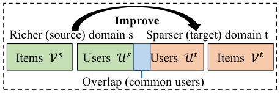
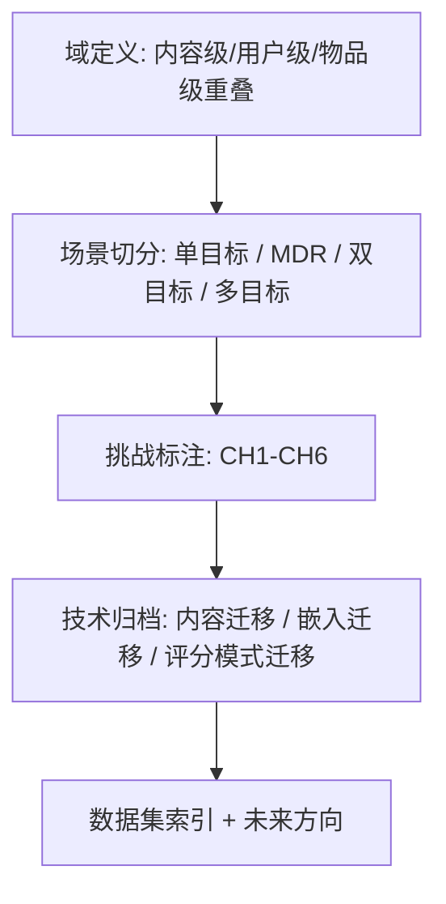

# Cross-Domain Recommendation: Challenges, Progress, and Prospects (跨域推荐：挑战、进展与展望)

- **会议/期刊**: IJCAI 2021 (Survey Track)
- **作者与机构**: Feng Zhu, Chaochao Chen, Jun Zhou, Longfei Li (蚂蚁集团)；Yan Wang, Guanfeng Liu (麦考瑞大学)
- **推荐链路定位**: 召回 / 精排（跨业务场景知识迁移层，端到端建模）
- **研究方向**: 跨域与多场景推荐 / 冷启动与长尾推荐
- **论文原文**: [https://arxiv.org/abs/2103.01696v1](https://arxiv.org/abs/2103.01696v1)
- **开源代码**: [GA-DTCDR (文中 Douban 数据集提供方)](https://github.com/FengZhu-Joey/GA-DTCDR)

## TL;DR (1分钟核心速览)

本文是 CDR 领域的系统性综述。针对"域"概念长期混乱、且前人综述（Fernández-Tobías 2012；Cantador 2014）已无法覆盖双目标/多目标迁移与负迁移等新问题，作者先给出内容级/用户级/物品级三种重叠视角的**域定义**，将 CDR 重构为单目标、多域（MDR）、双目标、多目标四类场景，提炼 CH1–CH6 六项挑战，并把百篇方法按"内容迁移 / 嵌入迁移 / 评分模式迁移"三层全景观分类归档。本文不含统一基准实验（此为综述体例），主要交付物是**问题定义、分类学与数据集索引**。

## Background & Motivation (背景与核心矛盾)

- **主流范式**: 以 CF 为主干，先在源域学习用户/物品嵌入或评分模式，再通过共享实体（共同用户、共同物品、共同内容特征）向稀疏目标域迁移。
- **前人局限一（定义失焦）**: 早期工作把"书籍 vs 电影"视为跨域，也有工作把"教科书 vs 小说"视为跨域，两种做法尺度不一，且只关注物品差异、完全忽略用户差异，导致方法间无法公平比较。
- **前人局限二（目标单向）**: 绝大多数方法只把信息从富域流向贫域（single-target），未考虑"每个域在某一类信息上都可能更富"这一事实，因此无法同时提升两侧性能。
- **核心洞察 (Key Insight)**: 域的差异本质在于**重叠实体的类型**——重叠的是内容、是用户，还是物品——不同重叠类型决定了可行的迁移算子（映射、共享、聚合）与不同的失效模式。
- **本文切入点**: 先用重叠视角统一域定义，再把场景×挑战×技术三维对齐，形成可定位任意新方法的全景观坐标系。

<figure class="paper-figure" markdown="span">
  <figcaption>图1：单目标CDR场景</figcaption>
</figure>

## Method (核心方法设计)

### 1. 整体框架 (Overall Architecture)

综述的"方法论"即其分类学骨架：输入为两域/多域的用户集与物品集及其显式反馈、隐式反馈与边信息；第一层按**场景**切分（单目标、多域、双目标、多目标）；第二层按**挑战**标注（CH1 内容关系构建、CH2 嵌入/评分模式精度、CH3 映射关系学习、CH4 双向框架设计、CH5 嵌入优化、CH6 负迁移规避）；第三层按**技术**归纳为内容迁移、嵌入迁移与评分模式迁移三大族及多任务/迁移学习/聚类/DNN/关系学习等子技术；最终输出为数据集索引与三个待开拓方向（异构 CDR、序列 CDR、隐私保护 CDR）。

### 2. 关键设计拆解 (Key Designs)

1. **三视角域定义（消除定义歧义）**：痛点是不一致的域边界使方法不可比 $\to$作者以重叠实体为唯一判据：内容级（共享标签/关键词但无共同用户物品，如 Amazon Music 与 Netflix）、用户级（共享用户，物品可为 attribute-level 同类不同属性或 type-level 不同类）、物品级（共享物品但用户几乎不重叠，即 cross-system）$\to$ 直觉在于：**重叠实体即迁移通道**，通道类型直接决定算子形态，从而使后续分类具备可判定性。

2. **单目标 CDR 的形式化与迁移算子归纳**：给定富源域 $s$与稀疏目标域$t$，目标为
$\min_{\Theta_t}\ \mathcal{L}_{rec}(\mathcal{D}^t;\Theta_t)\ \ \text{s.t.}\ \ \Theta_t \leftarrow \Phi(\Theta_s, \mathcal{M}_{s\to t})$，
其中 $\mathcal{M}_{s\to t}$ 为两域映射关系。综述据 CH3 指出，朴素做法是直接替换目标域嵌入（简单但粗暴），优雅做法是先学映射再迁移，典型形式为
$\min_{\mathbf{W}}\ \big\|\mathbf{W}\mathbf{E}^{s}_{\mathcal{U}^{o}} - \mathbf{E}^{t}_{\mathcal{U}^{o}}\big\|_F^2 + \lambda\|\mathbf{W}\|_F^2$，
即仅用重叠实体 $\mathcal{U}^{o}$ 监督、把映射外推至非重叠用户。其有效性直觉是：重叠实体提供了跨域"锚点"，残差越小的线性/非线性映射，外推误差越低。

3. **双/多目标共享与负迁移约束**：双目标要求同时提升两侧，故不能单向注入，而应对称共享：
$\mathcal{L}=\mathcal{L}_{1}(\Theta_1)+\mathcal{L}_{2}(\Theta_2)+\lambda\,\mathcal{L}_{share}\big(\mathbf{E}^{1}_{\mathcal{U}^{o}},\mathbf{E}^{2}_{\mathcal{U}^{o}}\big)$，
$\mathcal{L}_{share}$可为固定组合（DTCDR 的多任务加权）、元素级注意力（GA-DTCDR）或正交隐空间双向映射（DDTCDR，约束$\mathbf{W}^{\top}\mathbf{W}\approx\mathbf{I}$以保证信息双向无损）。多目标场景下 CH6 要求额外门控：迁移收益需满足$\Delta_{dom_k} \geq 0$，否则应衰减该项权重，避免更多稀疏域加入后性能倒退。综述未提供统一负采样与推理开销分析，仅定性指出图嵌入类方法（共享异质图）在线开销高于映射类方法。

## Experimental Setup & Evaluation Protocol (实验设置与评估协议)

- **数据集与预处理**: 综述汇总了 CDR 常用数据源（原表 3），未做任何过滤（无 `5-core` 统一规范）：

| 数据集 | 域与重叠类型 | 数据形态 | 规模 | 获取地址 |
| :--- | :--- | :--- | :---: | :--- |
| Arnetminer | 科研域（用户级-属性级） | 论文/作者/会议名 | 1M | aminer.org |
| MovieLens + Netflix | 电影（物品级） | 评分 + 标签 | 25M + 100M | grouplens / kaggle |
| Amazon | 书/音乐/电影（用户级-类型级） | 评分 + 评论 + 边信息 | 100M+ | jmcauley.ucsd.edu/data/amazon |
| Douban | 书/音乐/电影（用户级-类型级） | 评分 + 评论 + 边信息 | 1M+ | GitHub GA-DTCDR/Data |

- **数据划分与防穿越 (Splitting Strategy)**: 本文为综述，**未定义统一划分协议**；被引工作分别采用 `比例划分`、`Leave-One-Out` 与随机切分，彼此不可直接比较——这本身是本领域被作者隐含暴露的方法学缺陷。
- **排名评测协议 (Ranking Protocol)**: 未统一；既有 `Sampled Ranking`（负采样比例各异）也有 `Full-Ranking`，评价指标混杂 MAE/RMSE 与 HR/NDCG，**跨论文数值聚合在本文中不可行**。
- **对比基线与超参设置**: 无统一实验；Embedding 维度 $d$、迁移权重$\lambda$ 等均为各原论文自设，无显著性检验。

## Key Experimental Results (实验关键数据)

### 1. 主实验对比 (Main Results)

原综述无统一基准表，此处以作者**代表性方法横向对比表**（等价于分类学"主表"）替代，按场景/重叠类型/技术/双向性整理，加粗为各技术族的开创性方法：

| 代表方法 | 场景 | 重叠类型 | 核心技术 | 双向 | 负迁移处理 |
| :--- | :--- | :--- | :--- | :---: | :---: |
| **Berkovsky 2007** | 单目标 | 内容级 | 用户/物品属性多源融合 | ✗ | ✗ |
| **Fernández-Tobías 2014** | 单目标 | 内容级 | 评分-标签相似度 | ✗ | ✗ |
| Tan 2014 | 单目标 | 内容级 | 主题模型 + 迁移学习 | ✗ | ✗ |
| **Li 2009a** | 单目标 | 用户级 | 簇级评分模式迁移 | ✗ | ✗ |
| **Singh & Gordon 2008** | 单目标 | 用户级 | 多任务多关系学习 | ✗ | ✗ |
| **EMCDR (Zhu 2018)** | 单目标 | 用户+物品级 | MLP 嵌入映射 | ✗ | ✗ |
| **DTCDR (Zhu 2019)** | 双目标 | 用户级 | 多任务 + 固定组合策略 | ✓ | ✗ |
| **DDTCDR (Li 2020)** | 双目标 | 用户级 | 正交隐空间双向映射 | ✓ | ✗ |
| **GA-DTCDR (Zhu 2020)** | 双目标 | 用户+物品级 | 图嵌入 + 元素级注意力 | ✓ | ✗ |
| **Cui 2020 / MDCDR** | 多目标 | 多域共享 | 共享异质图 / 源域多目标迁移 | ✓ | ✗ |

### 2. 消融实验 (Ablation Study)

原文无消融实验，此处给出**挑战覆盖度矩阵**（据原表 1–2 与第 3 节方法统计），以替代消融视角审视方法族的能力缺口：

| 方法族 | 代表数 | CH1 | CH2 | CH3 | CH4 | CH5 | CH6 |
| :--- | :---: | :---: | :---: | :---: | :---: | :---: | :---: |
| 内容迁移 | ~20 | ✓ | — | — | — | — | ✗ |
| 嵌入迁移 | ~30 | — | ✓ | ✓ | 部分 | ✓ | ✗ |
| 评分模式迁移 | ~4 | — | ✓ | — | — | — | ✗ |
| 双目标 | ~4 | — | ✓ | ✓ | ✓ | ✓ | ✗ |
| 多目标 | ~2 | — | ✓ | ✓ | ✓ | ✓ | **✗ (0)** |

### 3. 关键实验发现 (Key Findings)

1. **研究极度偏斜于单目标**：单目标方法约 54 项（内容 ~20 + 嵌入 ~30 + 评分模式 ~4），而双目标仅 ~4 项、多目标仅 ~2 项，说明"同时提升所有域"的范式仍处萌芽，早期综述已完全无法覆盖。
2. **CH6 负迁移全族零覆盖**：所有双/多目标方法（DTCDR、DDTCDR、GA-DTCDR、Cui 2020、MDCDR）均未显式处理负迁移，而多目标场景要求知识被迁移 ≥2 次，失效风险随域数线性放大——这是本文最尖锐的定量诊断。
3. **链接方式决定技术上限**：内容级迁移止步于 CH1，几乎不触及映射学习；只有用户级/物品级重叠才能支撑映射（EMCDR 类）与双向共享（正交映射/注意力），说明**重叠实体类型是方法选型的硬约束**而非可选设计。

## Highlights & Limitations (亮点、对比与审稿批判)

- **与代表作对比 (vs. Prior Work)**: 相较 Fernández-Tobías 等 (2012) 与 Cantador & Cremonesi (2014) 仅覆盖单目标与内容迁移，本文首次纳入双/多目标场景并把"负迁移"提升为一级挑战；相较 Zhu 等 (2020) 的单一模型论文，本文提供的是可定位任意新方法的坐标系而非一个新算子。
- **可迁移亮点**: ①"重叠实体即迁移通道"的判定法则可直接用于多业务线推荐（电商↔本地生活）的方案选型；②CH6 的验收条件 $\Delta_{dom_k}\geq 0$ 可作为多场景联合建模（STAR/PEPNet 类）上线前的门控指标。
- **审稿级局限批判**: ①**缺乏统一实证**——未在 Douban/Amazon 上重跑基线与统一划分，导致分类学结论（如"图嵌入优于映射"）无数据支撑，仅停留在定性论断；②分类维度重叠且粒度不均（技术族与场景族混杂），同一方法可落入多格；③对工业界最关心的冷启动分桶评估、推理延迟与跨域对齐的样本效率几乎未讨论，"隐私保护 CDR 仅能处理简单社会矩阵分解"的判断也未给出实验依据。

## Rating (四维评分)

- **方法创新性 (Novelty)**: ⭐⭐⭐ （三视角域定义与 CH1–CH6 挑战谱系确为增量贡献，但本质是分类学重构而非新算法）
- **评估协议与实验扎实度 (Protocol & Experiments)**: ⭐⭐ （无统一数据集、划分与 Full-Ranking 协议，无消融与显著性检验，结论缺定量支撑）
- **写作与数学规范度 (Clarity & Rigor)**: ⭐⭐⭐⭐ （定义 1–4 边界清晰、表格索引完备，但公式化程度低，迁移算子多以文字描述）
- **工业落地与复现价值 (Industrial & Practical Value)**: ⭐⭐⭐ （数据集与 GitHub 索引实用、场景选型法则可直接采纳，但缺部署开销与线上 A/B 证据）

