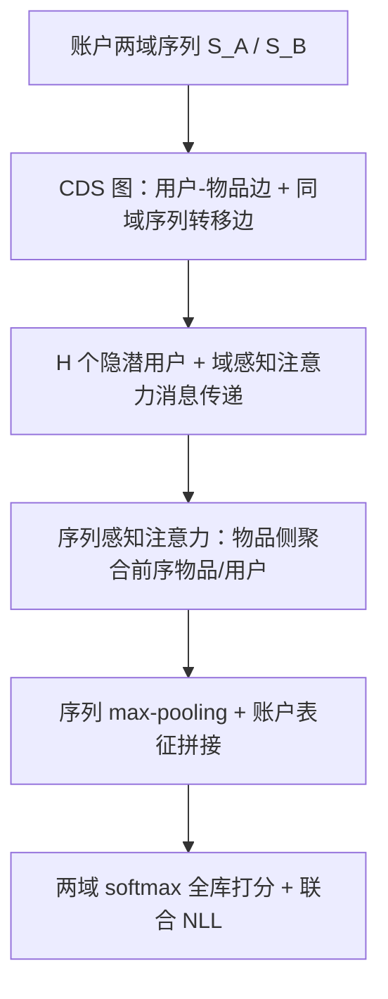
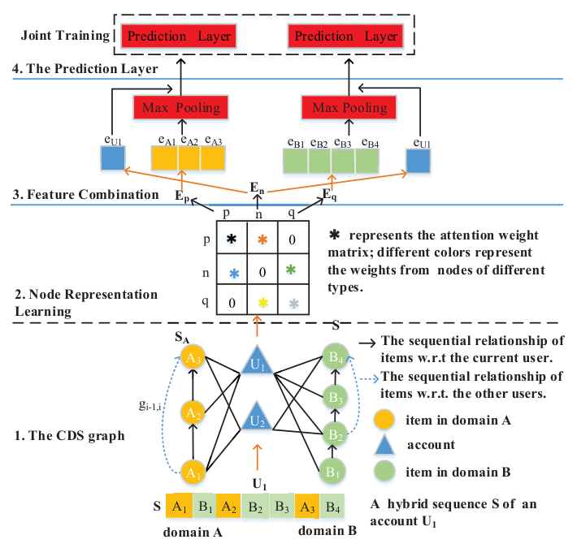

# DA-GCN: A Domain-aware Attentive Graph Convolution Network for Shared-account Cross-domain Sequential Recommendation (域感知注意力图卷积共享账户跨域序列推荐)

- **会议/期刊**: IJCAI 2021
- **作者与机构**: Lei Guo, Li Tang, Lei Zhu (山东师范大学); Tong Chen, Hongzhi Yin (昆士兰大学); Quoc Viet Hung Nguyen (格里菲斯大学)
- **推荐链路定位**: 召回（下一物品预测，全库 softmax 打分）
- **研究方向**: 跨域与多场景推荐 / 图神经网络推荐
- **论文原文**: [https://arxiv.org/abs/2105.03300v1](https://arxiv.org/abs/2105.03300v1)
- **开源代码**: 暂未开源

## TL;DR (1分钟核心速览)

针对共享账户跨域序列推荐 (SCSR) 中「多人兴趣纠缠 + 跨域知识只在隐空间隐式迁移」两大痛点，本文放弃 RNN 范式，把两域的用户-物品与物品序列转移边拼成一张跨域序列图 (CDS graph)，在每个账户下假设 $H$ 个隐潜用户，用域感知/序列感知双注意力 GCN 做消息传递，再以 max-pooling 序列表征 + 账户表征拼接后对全库做 softmax。在 HVIDEO / HAMAZON 上以 75/15/10 比例划分、全库排序协议，E-domain MRR@5 由 16.63% 升至 19.24%（+15.7%），Recall@20 +13.2%。

## Background & Motivation (背景与核心矛盾)

- **主流范式**: SCSR 现有解法（π-net、PSJNet）将任务视为两域并行的序列推荐，用 RNN 挖掘序列依赖，并通过信息共享/拆分-合并策略在隐空间传递跨域知识。
- **前人局限**: (1) RNN 只能刻画序列转移，无法表达「用户-物品-用户」这类多实体关联，学到的表征表达力受限；(2) 跨域桥接只发生在隐向量空间，两域之间显式的图结构（item-user-item 路径）完全被浪费；(3) 现有 GCN 类跨域工作（PPGN 等）依赖显式评分且丢失序列信息，不适用 SCSR。
- **核心洞察 (Key Insight)**: 共享账户噪声的根源是「一个账户 = 多个兴趣各异的真实用户」，若把账户拆成 $H$ 个隐潜用户节点，则同一账户下不同域的物品点击可被指派给不同隐潜用户，跨域信息即成为「消歧」证据而非噪声；且这种指派关系天然可由图上的注意力权重表达。
- **本文切入点**: 用一张显式的 CDS 图 + 两侧注意力 GCN 同时完成「跨域结构建模」与「共享账户兴趣解耦」。

## Method (核心方法设计)

### 1. 整体框架 (Overall Architecture)

输入是账户 $U_k$在两域的序列$S_A,S_B$；先构图：域 A/B 内物品-物品序列转移边、账户-物品交互边四类边共同组成 CDS 图，账户节点被展开为$H$个隐潜用户。GCN 层在图上做带注意力权重的消息传递，用户节点从两域物品聚合（域感知注意力）、物品节点从同域前序物品与关联用户聚合（序列感知注意力），并用矩阵形式一次性更新全部节点。得到物品表征$\mathbf{g}_{A_i}$后，对序列做 max-pooling 得$\mathbf{h}'_{S_A}$，与账户表征$\mathbf{e}_{U_k}$ 拼接后经 softmax 层对全库物品打分，两域各自计算 NLL 并联合训练。

<figure class="paper-figure" markdown="span">
  <figcaption>图1：DA-GCN 概览。有向边 g_{i−1,i} 表示物品 A_i 的点击发生在物品 A_{i−1} 之后。</figcaption>
</figure>

### 2. 关键设计拆解 (Key Designs)

1. **CDS 图上的双向注意力消息传递**：痛点是同一账户的点击来自不同人、同一物品对不同人吸引力不同，均等聚合必然把噪声摊平。用户侧消息为 $\boldsymbol{m}_{U_{k,h}\leftarrow A_i}=\gamma_{U_{k,h}A_i}(\mathbf{W}_1\mathbf{e}_{A_i}+\mathbf{W}_2(\mathbf{e}_{A_i}\odot\mathbf{e}_{U_{k,h}}))$，关键是权重$\gamma$由余弦相似度在**两域物品邻居 + 自连接上做同一次 softmax** 归一化：$\gamma_{U_{k,h}A_i}=\frac{\exp(s_{U_{k,h}A_i})}{\sum_{A_{i'}}\exp(s_{U_{k,h}A_{i'}})+\sum_{B_{j'}}\exp(s_{U_{k,h}B_{j'}})+s_{U_{k,h}U_{k,h}}}$。因此「某隐潜用户在 A 域看过什么」会直接压缩其在 B 域物品上的权重，跨域知识以**竞争式注意力**而非隐向量对齐的方式迁移，物理直觉清晰：一个隐潜用户的时间与兴趣预算有限，两域证据互为约束。
2. **隐潜用户与用户特定物品表征**：账户表征由 $H$个隐潜用户平均得到$\mathbf{e}_{U_k}=\frac{1}{H}\sum_{h=1}^{H}\mathbf{e}_{U_{k,h}}$，物品在第$h$个用户视角下单独聚合为$\mathbf{g}^h_{A_i}$，最终$\mathbf{g}_{A_i}=\frac{1}{H}\sum_h \mathbf{g}^h_{A_i}$。这样账户内部的兴趣分裂不会污染物品表征，$H=1$ 即退化为「账户=虚拟用户」的常规做法，构成可对照的消融点。
3. **训练目标与推理开销**：$\mathcal{L}(\theta)=\mathcal{L}_A(\theta)+\mathcal{L}_B(\theta)$，两域均为对序列内每个位置做下一物品的负对数似然，softmax 覆盖该域**全部物品**（隐式全库负采样，无额外负样本构造）。矩阵形式$\mathbf{E}_l=\sigma((\mathbf{L}+\mathbf{I})\mathbf{E}_{l-1}\mathbf{W}_1+\mathbf{L}\mathbf{E}_{l-1}\odot\mathbf{E}_{l-1}\mathbf{W}_2)$ 使整图更新可批量并行，故训练时间低于 π-net / PSJNet。

## Experimental Setup & Evaluation Protocol (实验设置与评估协议)

- **数据集与预处理**: 直接沿用 PSJNet 发布的两个真实共享账户跨域数据集，未额外 k-core 过滤。

| 数据集-域 | #Items | #Interactions | 场景说明 |
| :--- | :---: | :---: | :--- |
| HVIDEO-E | 3,380 | 177,758 | 教育/教学类视频 |
| HVIDEO-V | 16,407 | 227,390 | 影视剧长视频 |
| HAMAZON-M | 67,161 | 4,406,924 | 电影观看与评分 |
| HAMAZON-B | 126,547 | 4,287,240 | 图书阅读与评分 |

  HVIDEO 共 13,714 个重叠账户、134,349 条序列（训练 102,182 / 验证 18,966 / 测试 13,201）；HAMAZON 共 13,724 个重叠账户、289,160 条序列（204,477 / 49,814 / 34,869）。
- **数据划分与防穿越 (Splitting Strategy)**: 随机 `比例划分` 75% / 15% / 10%（序列级随机，而非全局时间戳切分），每域取序列**最后一个物品**作为测试 ground-truth——因此同一账户的跨域序列之间不保证时间严格对齐，存在轻微穿越风险。
- **排名评测协议 (Ranking Protocol)**: 无偏 `Full-Ranking`，预测层 softmax 覆盖该域全部候选物品，报告 MRR@5、Recall@5、MRR@20、Recall@20；负采样策略为 softmax 内全库隐式负采样。
- **对比基线与超参**: 10 个基线覆盖传统（POP、Item-KNN、BPR-MF）、共享账户（VUI-KNN）、跨域（NCF-MLP++、Conet）、序列（GRU4REC、HGRU4REC）与 SCSR（π-net、PSJNet）四类。嵌入维度 $d=100$(HVIDEO) /$200$(HAMAZON)，batch 128，Adam + 梯度裁剪$[-5,5]$，学习率 0.001，隐潜用户数$H\in[1,5]$ 于验证集调优；未报告显著性检验。

## Key Experimental Results (实验关键数据)

### 1. 主实验对比 (Main Results)

| 方法 | HVIDEO-E MRR@5 | HVIDEO-E R@20 | HVIDEO-V MRR@5 | HVIDEO-V R@20 | HAMZ-M MRR@5 | HAMZ-M R@20 | HAMZ-B MRR@5 | HAMZ-B R@20 |
| :--- | :---: | :---: | :---: | :---: | :---: | :---: | :---: | :---: |
| BPR-MF | 1.34 | 5.83 | 1.21 | 3.38 | 2.90 | 5.50 | 0.88 | 2.15 |
| Item-KNN | 2.11 | 12.11 | 4.43 | 23.93 | 1.28 | 9.00 | 3.23 | 20.94 |
| VUI-KNN | 2.03 | 24.27 | 3.44 | 34.76 | – | – | – | – |
| Conet | 5.01 | 22.71 | 21.25 | 52.72 | 14.64 | 24.46 | 15.85 | 25.56 |
| GRU4REC | 12.27 | 32.16 | 78.27 | 83.04 | 82.01 | 84.06 | 81.34 | 83.76 |
| HGRU4REC | 14.47 | 37.52 | 80.37 | 84.43 | 83.07 | 84.91 | 82.15 | 84.91 |
| π-net | 14.63 | 45.19 | 80.51 | 87.48 | 83.91 | 85.33 | **84.93** | 85.38 |
| PSJNet | 16.63 | 42.20 | 81.97 | 87.75 | 84.01 | 85.28 | 85.10 | **85.38** |
| **DA-GCN** | **19.24** | **47.78** | **83.13** | **88.30** | **84.69** | **85.34** | 84.81 | **85.38** |
| **Improv.%** | +15.7% | +13.2% | +1.4% | +0.6% | +0.8% | +0.1% | −0.3% | 0.0% |

### 2. 消融实验 (Ablation Study)

| HVIDEO 变体 | E MRR@5 | E R@20 | V MRR@5 | V R@20 |
| :--- | :---: | :---: | :---: | :---: |
| GCN$_{OSA}$（去序列边 + 去注意力） | **19.24** | 43.40 | 82.99 | 87.66 |
| GCN$_{OA}$（去双注意力） | 19.11 | 43.78 | 83.09 | 87.88 |
| GCN$_{OS}$（去同域序列转移边） | 19.21 | 47.04 | 83.12 | 88.27 |
| **DA-GCN 完整版** | **19.24** | **47.78** | **83.13** | **88.30** |

### 3. 关键实验发现 (Key Findings)

1. **提升集中在稀疏教育域，稠密域已近饱和**：HVIDEO-V / HAMAZON-M 的 MRR@5 仅 +1.4% / +0.8%，HAMAZON-B 甚至比 PSJNet 低 0.29 个点，且 B 域 Recall@20 与 π-net 完全并列 85.38%；而在物品数最少、最稀疏的 E-domain（3,380 物品）上拿到 +15.7%，说明图结构迁移的收益主要来自「小域靠大域反哺」，大域本身已由 GRU4REC 类序列模型拟合到 82%+ 的天花板。
2. **序列转移边是增益主源，注意力贡献微弱**：去序列边 (GCN$_{OS}$) 使 E-domain Recall@20 从 47.78 掉到 47.04（−0.74），去注意力 (GCN$_{OA}$) 只掉到 43.78（−4.0 的相对损失，但 MRR@5 仅 −0.13），双去 (GCN$_{OSA}$) 时 E 域 MRR@5 仍与完整模型同为 19.24——意味着双注意力在部分指标上并未产生可分辨的正向贡献，其表征收益被 max-pooling 与$H$ 平均抹平。
3. **图范式胜在效率与账户解耦**：$H>1$的验证曲线始终优于$H=1$（把账户当虚拟用户），证实兴趣解耦假设成立；同时在 10%–100% 全部训练比例下，DA-GCN 的单轮训练时间均低于 π-net 与 PSJNet，矩阵形式消息传递对大规模序列数据扩展性更好。

## Highlights & Limitations (亮点、对比与审稿批判)

- **与代表作对比 (vs. Prior Work)**: 与 π-net/PSJNet 的本质区别是把「隐空间跨域对齐 + RNN 序列编码」换成「显式 CDS 图 + 注意力 GCN」——π-net 学的是两域共享/私有的隐向量，PSJNet 进一步做拆分-合并，二者都无法显式建模 item-user-item 路径；而 PPGN 类图方法虽也构图却丢失序列转移边、依赖显式评分。DA-GCN 是首个把「序列边 + 跨域用户边」统一进一张图的工作。
- **可迁移亮点**: (1) 用「同一 softmax 分母混合两个域邻居」实现跨域竞争式注意力，比显式域对齐损失更轻量，可复用到多场景多业务融合；(2) 隐潜用户数 $H$ 展开 + 平均聚合的账户解耦套路，可直接迁移到家庭账户、企业账户、设备级 ID 场景。
- **审稿级局限批判**: (1) 消融增益过小且缺乏显著性检验（多个配置差异 <0.1 个点、E 域 MRR@5 出现 19.24 完全并列），$H$与注意力是否真被使用缺少证据，且公式中自连接项$s_{U_{k,h}U_{k,h}}$未取$\exp$却与指数项同处一个分母，数学上不自洽；(2) 未说明 GCN 层数、冷启动/长尾分桶、线上时延测评，测试集按序列随机划分而非全局时间切分，存在未来信息泄漏隐患，$H$ 平均化物品表征也削弱了「用户特定物品表征」的初衷。

## Rating (四维评分)

- **方法创新性 (Novelty)**: ⭐⭐⭐⭐ （首次将 SCSR 从 RNN 隐空间迁移改写为 CDS 图 + 跨域竞争式注意力，隐潜用户解耦视角有实际洞察）
- **评估协议与实验扎实度 (Protocol & Experiments)**: ⭐⭐⭐ （两数据集 + 10 基线且为无偏全库排序是加分项，但随机切分防穿越不足、无显著性检验、消融差异过小）
- **写作与数学规范度 (Clarity & Rigor)**: ⭐⭐⭐ （矩阵形式传播规则与图 Laplacian 分块定义清晰，但归一化分母自连接项定义不自洽，GCN 层数与聚合顺序等关键实现细节缺失）
- **工业落地与复现价值 (Industrial & Practical Value)**: ⭐⭐⭐⭐ （矩阵形式批量传播训练开销低于 RNN 基线，天然适配家庭/企业共享账户与多业务融合场景，但无开源代码且需为每账户展开 $H$ 份节点）

