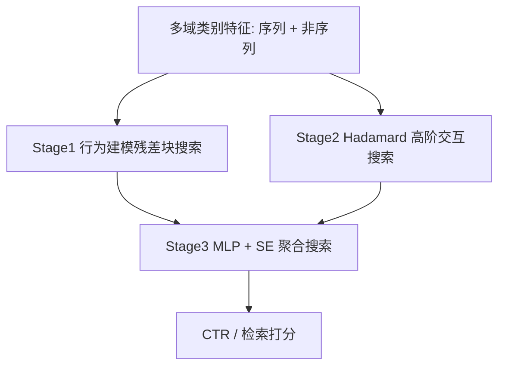
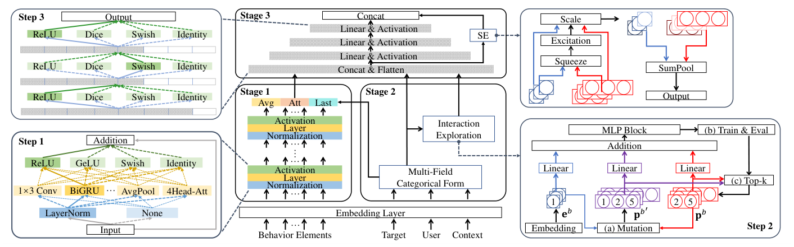

# AMEIR: Automatic Behavior Modeling, Interaction Exploration and MLP Investigation in the Recommender System (自动行为建模、交互探索与MLP搜索的推荐系统)

- **会议/期刊**: IJCAI 2021
- **作者与机构**: Pengyu Zhao, Kecheng Xiao, Yuanxing Zhang, Kaigui Bian, Wei Yan；北京大学、HULU、阿里巴巴
- **推荐链路定位**: 精排（CTR 预估）/ 端到端架构搜索
- **研究方向**: CTR/CVR 预估与特征交叉 / 序列与会话推荐
- **论文原文**: [https://arxiv.org/abs/2006.05933v2](https://arxiv.org/abs/2006.05933v2)
- **开源代码**: 暂未开源

## TL;DR (1分钟核心速览)

针对推荐模型依赖专家手工设计行为建模、特征交互与 MLP，且单一架构难跨场景最优的问题，AMEIR 将完整推荐模型拆为行为建模、交互探索、MLP 聚合三阶段，构建覆盖主流模型的三段搜索空间，并用渐进式 one-shot 随机搜索逐段组装。在 Alimama、Criteo、Avazu、Beauty、Steam 上稳定超越手工 SOTA 与 AutoML 基线，Alimama AUC 达 0.6383，搜索约 0.5 GPU-day。

## Background & Motivation (背景与核心矛盾)

- **主流范式**: 深度推荐通常由行为建模（RNN/CNN/Attention）、特征交互（FM/DCN/xDeepFM）与 MLP 聚合三部分组成，但三部分常由领域专家按场景手工设计。
- **前人局限**: 其一，RNN/CNN/Attention 各有长短期兴趣建模缺陷，手工 MLP 与交叉特征要么欠表达、要么枚举高阶交互引入噪声；其二，AutoCross/AutoFIS/AutoCTR 等 NAS 仅搜索交互或 MLP，忽视行为建模，搜索空间受限。
- **核心洞察 (Key Insight)**: 代表性推荐模型可统一分解为三阶段骨架，且各阶段关键算子可被同一搜索空间覆盖；简单 one-shot 随机搜索配合渐进解耦，可能优于复杂 DARTS/ENAS。
- **本文切入点**: 构建三阶段搜索空间 + 三步 one-shot 搜索流水线，按阶段搜索并组装完整推荐架构。

## Method (核心方法设计)

### 1. 整体框架 (Overall Architecture)

AMEIR 将多域类别特征经 one-hot/multi-hot 与 embedding lookup 后分为序列特征 $x^a$与非序列特征$x^b$。Stage 1 在序列 embedding 上堆叠残差 block，搜索归一化、层算子与激活，并拼接 sum-pooling、末状态与 target-attention；Stage 2 从非序列 embedding 中搜索$M$ 个 Hadamard 高阶交互；Stage 3 将行为表示、非序列 embedding、交互拼接后送入可搜索 MLP，并以 SE shortcut 压缩重标定低阶信息。搜索阶段逐段选择架构，最终继承 one-shot 共享权重重训；CTR 用 logloss，检索用负采样 BCE，推理不引入额外搜索算子。

<figure class="paper-figure" markdown="span">
  <figcaption>图1：AMEIR 的三阶段搜索空间与三步一次性搜索流程。AMEIR 在步骤1-3中从相应搜索子空间搜索构建模块、特征交互和聚合 MLP（以三层为例）。</figcaption>
</figure>

### 2. 关键设计拆解 (Key Designs)

1. **三阶段可覆盖搜索空间**：痛点是把行为建模排除在 NAS 外。Stage 1 用残差 block 统一 CNN/RNN/Attention：$\mathbf{H}_{l}^{a}=\mathrm{Act}_{l}^{a}(\mathrm{Layer}_{l}^{a}(\mathrm{Norm}_{l}^{a}(\mathbf{H}_{l-1}^{a})))+\mathbf{H}_{l-1}^{a}$；Stage 2 以 Hadamard 组合建模$r$阶交互：$\mathbf{p}_{b,i}=\mathbf{e}_{b,i_1}\odot\cdots\odot\mathbf{e}_{b,i_r}$；Stage 3 的 SE shortcut 为$\mathbf{a}^{se}=\sigma(\mathbf{W}_{2}^{se}\mathrm{ReLU}(\mathbf{W}_{1}^{se}\mathbf{Q}^{se}\mathbf{v}^{se}))$，$\mathbf{h}^{se}=\sum_i a_i^{se}\mathbf{q}_i^{se}$，用于低阶记忆与维度压缩。
2. **三步渐进 one-shot 随机搜索**：Step 1 采样 block 搜行为建模；Step 2 以 SMBO/进化方式将 $\mathbf{p}_b$与非序列字段 Hadamard 相交，one-shot 评估后保留 top-$k$，最终取$M=5$；Step 3 预分配最大权重矩阵并按隐藏维度切片$\mathbf{W}^{c}[:h_{in},:h_{out}]$。每次梯度更新均匀采样候选，缓解共享权重偏移；派生模型继承 one-shot 权重加速重训。
3. **训练目标、负采样与推理效率**：CTR 目标为 $\mathcal{L}=-\frac{1}{|S|}\sum_{(x,y)}[y\log\sigma(\mathbf{w}^{\top}\mathbf{h}^{c})+(1-y)\log(1-\sigma(\mathbf{w}^{\top}\mathbf{h}^{c}))]$；序列检索采用负采样 BCE，负样本集为$I_i^{-}$。搜索约 0.5 GPU-day，Alimama QPS 46K，接近 DSIN 43K，参数少于手工基线一半。

## Experimental Setup & Evaluation Protocol (实验设置与评估协议)

- **数据集与预处理**:

| 数据集 | #Users | #Items | #Train/Samples | 密度/点击率 | 特征/场景说明 |
| :--- | :---: | :---: | :---: | :---: | :--- |
| Alimama | 265,443 | 1,027,443 | 5,544,213 | CTR 5.14% | 工业广告，序列+非序列 |
| Beauty | 22,363 | 12,101 | 约 1.98e5 | 0.07% | 序列检索，5-core |
| Steam | 281,210 | 11,961 | 约 3.48e6 | 0.10% | 序列检索，5-core |
| Criteo | - | - | 41,256,555 | CTR 25.62% | 非序列 CTR，39 域 |
| Avazu | - | - | 32,343,173 | CTR 16.98% | 非序列 CTR，24 域 |

- **数据划分与防穿越**: Alimama 用前 7 天训练、最后 1 天测试，训练集 5% 作验证；Beauty/Steam 采用 5-core 与 `Leave-One-Out`，最后两个行为分别为验证/测试；Criteo/Avazu 随机按 90/10、80/20 划分，训练集 10% 作验证。
- **排名评测协议**: Alimama/Criteo/Avazu 为 CTR 全量样本 AUC/LogLoss，非 Top-K 排序；Beauty/Steam 为 next-item HR@5/NDCG@5，训练用负采样 BCE，原文未披露评测候选负样本规模，严格说属 `Sampled Ranking` 且协议披露不足。
- **对比基线与超参设置**: Alimama embedding 维 4、序列长 50、batch 1024、lr 1e-5、预定义 MLP [200,80]，报告 4 次均值±std；序列/CTR 基线按原论文或网格搜索。原文未报告显著性 $p$ 值。

## Key Experimental Results (实验关键数据)

### 1. 主实验对比 (Main Results)

| Alimama 模型 | AUC | QPS |
| :--- | :---: | :---: |
| DNN | 0.6304 | 64K |
| DeepFM | 0.6320 | 58K |
| DIN | 0.6341 | 53K |
| DIEN | 0.6344 | 44K |
| DSIN | 0.6352 | 43K |
| **AMEIR-C** | **0.6383±0.0004** | 46K |
| **Improv. vs DSIN** | **+0.49%** | - |

| 非序列模型 | Criteo AUC | Criteo LogLoss | Avazu AUC | Avazu LogLoss |
| :--- | :---: | :---: | :---: | :---: |
| DNN | 0.7983 | 0.4549 | 0.7746 | 0.3831 |
| DeepFM | 0.8010 | 0.4496 | 0.7753 | 0.3825 |
| xDeepFM | 0.8019 | 0.4497 | 0.7759 | 0.3818 |
| AutoCross | 0.8022 | 0.4494 | 0.7776 | 0.3810 |
| AutoFIS | 0.8015 | 0.4504 | 0.7789 | 0.3801 |
| AutoCTR | 0.8027 | 0.4489 | 0.7791 | 0.3800 |
| **AMEIR-C** | **0.8034±0.0002** | **0.4482±0.0003** | **0.7802±0.0004** | **0.3792±0.0002** |
| **Improv. vs AutoCTR** | **+0.09%** | - | **+0.14%** | - |

| 序列模型 | Beauty HR@5 | Beauty NDCG@5 | Steam HR@5 | Steam NDCG@5 |
| :--- | :---: | :---: | :---: | :---: |
| BPR | 0.301 | 0.227 | 0.527 | 0.369 |
| GRU4REC+ | 0.300 | 0.215 | 0.626 | 0.468 |
| Caser | 0.298 | 0.217 | 0.670 | 0.510 |
| NextItNet | 0.334 | 0.243 | 0.679 | 0.517 |
| BERT4Rec | 0.337 | 0.252 | 0.676 | 0.513 |
| **AMEIR-A** | **0.341±0.004** | **0.257±0.003** | **0.681±0.003** | **0.517±0.002** |
| **Improv. vs BERT4Rec** | **+1.19%** | **+1.98%** | **+0.74%** | **+0.78%** |

### 2. 消融实验 (Ablation Study)

| 消融组 | 设置 | Alimama AUC | Criteo AUC | Avazu AUC | 搜索GPU-days |
| :--- | :--- | :---: | :---: | :---: | :---: |
| NAS | Random | 0.6321 | - | - | 2.9 |
| NAS | RL | 0.6323 | - | - | 3.2 |
| NAS | EA | 0.6338 | - | - | 3.0 |
| NAS | ENAS | 0.6339 | - | - | 0.15 |
| NAS | DARTS | 0.6350 | - | - | 0.2 |
| NAS | One-shot Random | 0.6365 | - | - | 0.3 |
| NAS | **AMEIR 三阶段** | **0.6383** | - | - | 0.5 |
| Backbone | DNN 无交互 | - | 0.7983 | 0.7746 | - |
| Backbone | +MLP | - | 0.8021 | 0.7789 | - |
| Backbone | +MLP+FM | - | 0.8027 | 0.7795 | - |
| Backbone | +MLP+SE | - | 0.8030 | 0.7798 | - |
| Backbone | **AMEIR-C** | - | **0.8034** | **0.7802** | - |

### 3. 关键实验发现 (Key Findings)

1. **三段缺一不可，MLP 搜索在 Alimama 增益最大**：AMEIR-A 0.6357 → AMEIR-B 0.6359 → AMEIR-C 0.6383；C 比 DSIN 0.6352 高 0.0031（+0.49%），说明仅行为建模不足，交互与 MLP 搜索贡献显著。
2. **渐进 one-shot 随机搜索优于复杂 NAS**：AMEIR 0.6383 vs 单次 one-shot 0.6365、DARTS 0.6350，0.5 GPU-day 取得最高 AUC，表明三阶段解耦与随机搜索在推荐空间足够高效。
3. **Backbone 增益正交且不牺牲推理**：Criteo/Avazu 从 DNN 0.7983/0.7746 提升到 AMEIR-C 0.8034/0.7802；SE+搜索 MLP 带来正交增益，Alimama QPS 46K 接近 DSIN 43K，参数少于基线一半。

## Highlights & Limitations (亮点、对比与审稿批判)

- **与代表作对比 (vs. Prior Work)**: AutoCross/AutoFIS/AutoCTR 只搜交互或 MLP，AMEIR 将行为建模纳入同一搜索空间；相比 DIEN/DSIN 的手工序列结构，AMEIR 可按场景组合 GRU/CNN/Attention；相比 DARTS/ENAS，采用更简单的 one-shot 随机搜索并取得更高 AUC。
- **可迁移亮点**: SE shortcut 统一低阶交互与高维拼接，适合任意特征交叉模块；one-shot 权重继承与渐进解耦可迁移到大规模推荐架构搜索。
- **审稿级局限批判**: 搜索空间仍由专家枚举算子集合，未真正开放；Beauty/Steam 的候选排序规模与显著性检验披露不足，三阶段解耦搜索可能错过联合最优；缺少在线 A/B 与全链路部署验证。

## Rating (四维评分)

- **方法创新性 (Novelty)**: ⭐⭐⭐⭐ （三阶段搜索空间覆盖主流模型，渐进 one-shot 搜索实用，但核心组件多为已有算子组合）
- **评估协议与实验扎实度 (Protocol & Experiments)**: ⭐⭐⭐⭐ （5 数据集跨 CTR/序列，4 次均值±std 与消融完整；但序列排序协议与显著性检验披露不足）
- **写作与数学规范度 (Clarity & Rigor)**: ⭐⭐⭐⭐ （公式简洁、搜索流程清晰；部分符号与候选规模置于附录，主文自洽性略弱）
- **工业落地与复现价值 (Industrial & Practical Value)**: ⭐⭐⭐⭐ （0.5 GPU-day、QPS 46K、参数减半，工程价值强；未开源且搜索空间需专家维护）

