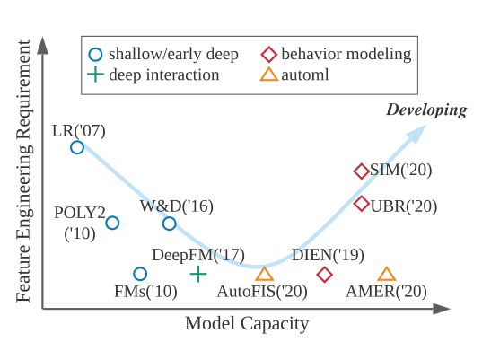
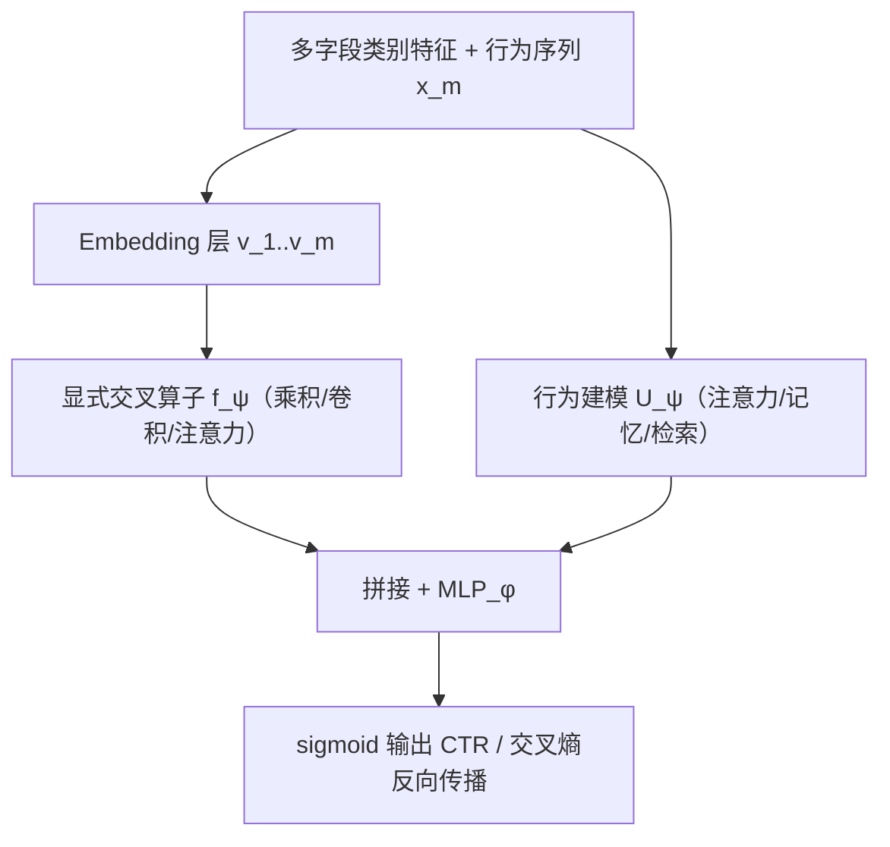
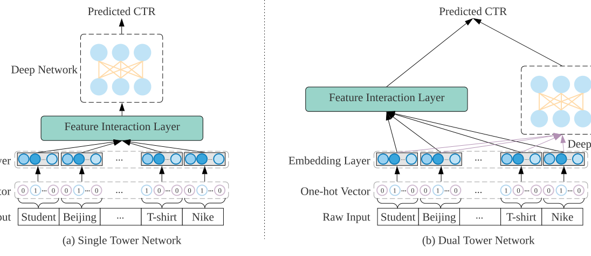

# Deep Learning for Click-Through Rate Estimation (深度点击率预估综述)

- **会议/期刊**: IJCAI 2021 (Survey Track)
- **作者与机构**: Weinan Zhang, Jiarui Qin (上海交通大学)；Wei Guo, Ruiming Tang, Xiuqiang He (华为诺亚方舟实验室)
- **推荐链路定位**: 精排（CTR 预估器，兼及行为序列建模块）
- **研究方向**: CTR/CVR 预估与特征交叉 / 序列与会话推荐
- **论文原文**: [https://arxiv.org/abs/2104.10584v1](https://arxiv.org/abs/2104.10584v1)
- **开源代码**: 暂未开源（综述文章）

## TL;DR (1分钟核心速览)

本文是首篇系统梳理深度学习 CTR 预估的综述。它针对"多字段类别特征交叉难以人工设计 + 长行为序列开销爆炸"两大痛点，把 2015 年后的模型统一改写为**显式交叉算子 $\oplus$ 深度网络**的单塔/双塔范式，并将行为建模按"注意力 → 记忆网络 → 检索"三代演进归纳，最后讨论嵌入维度、交叉结构、整体架构三层 AutoML。文章本身不做实验，而是以统一公式（Eq.5、Eq.6）为 30 余个工业模型给出可比较的坐标，并指出深度学习理论、多字段预训练、多模态交叉、可学习数据处理四个开放问题。

## Background & Motivation (背景与核心矛盾)

- **主流范式**: 输入为多字段类别数据（用户 ID/城市/职业 + 物品 ID/类目/品牌，见图 1），经 Embedding 压缩后逐实例做二分类，损失为交叉熵 $l=-y\log\sigma(f_\Theta(x))-(1-y)\log(1-\sigma(f_\Theta(x)))$；发展主线沿"特征工程复杂度"与"模型容量"二维推进（图 2）。
- **前人局限一**: LR 无法建模组合特征；POLY2 参数 $O(m^2)$且在稀疏共现下权重估不准；FM 用$\boldsymbol{v}_i^\top\boldsymbol{v}_j$ 缓解稀疏但阶数受限；GBDT 难以并行、只能利用少量交叉。
- **前人局限二**: 早期 MLP 型深度模型（DNN/FNN/DeepCross）虽省人力，但 Qu 等指出其存在**梯度不敏感问题——不同规模 DNN 都难以拟合 POLY2 函数**，Rendle 等进一步证明 MLP 学高阶交叉的效率低于 FM 的点积。
- **前人局限三**: 工业平台行为序列长达千级，DIN/DIEN 类注意力模型时间复杂度线性于序列长度，既无法建模超长序列，也会被连续序列中的无关噪声稀释。
- **核心洞察 (Key Insight)**: 深度模型的收益并非来自"更深"，而来自**把交叉结构显式写成算子**（补足 MLP 的归纳偏置）与**把行为序列的取数过程本身作为可学习/可检索模块**（补足算力约束）。
- **本文切入点**: 用统一函数形式（式 5、式 6）切开三条互不重叠的研究线：实例内交叉、实例间行为依赖、以及二者的自动设计。

<figure class="paper-figure" markdown="span">
  <figcaption>图2：CTR估计模型的发展趋势。</figcaption>
</figure>

## Method (核心方法设计)

### 1. 整体框架 (Overall Architecture)

综述将全部深度 CTR 模型抽象为同一骨架：多字段 one-hot → 共享 Embedding 层 $\{\boldsymbol{v}_1,\dots,\boldsymbol{v}_m\}$→ **显式交叉函数$f_\psi$**（可选与 MLP 并联）→ 若存在行为特征$x_m=\{b_1,\dots,b_T\}$，则由行为建模函数$U_\psi$先压成定长向量再拼接 → MLP → sigmoid。三条研究线分别对应$f_\psi$的算子设计、$U_\psi$的序列聚合设计、以及$(\psi,\phi)$ 结构的自动搜索；训练始终是端到端交叉熵，检索式行为模型的 query 生成器则用 REINFORCE 单独优化。

### 2. 关键设计拆解 (Key Designs)

1. **单塔 vs 双塔的结构判据**：早期模型把交叉层与 DNN 串联（单塔，如 NFM、PIN），高阶表达强但**低阶交叉信号在后续 DNN 中被淹没**，且易陷局部极小、依赖初始化。综述给出的判据是把交叉层与 DNN 并联（双塔，W&D/DeepFM/DCN/xDeepFM/AutoInt+）：
$f^{\mathrm{FIL}}_{\Theta}(x)=f_{\psi}([\boldsymbol{v}_1,\dots,\boldsymbol{v}_m])+\mathrm{MLP}_{\phi}([\boldsymbol{v}_1,\dots,\boldsymbol{v}_m])$
  双塔中 DNN 只学交叉层的**残差信号**，因此训练更稳、低阶与高阶兼顾——这是理解 DeepFM "Wide 部分不可省" 的统一解释。

<figure class="paper-figure" markdown="span">
  <figcaption>图3：单塔（左）与双塔（右）深度CTR架构示意图。</figcaption>
</figure>

2. **交叉算子的三分类与表达力谱系**：乘积类（IPNN/OPNN 内/外积、NFM bi-interaction、CrossNet 的逐层向量乘、CIN 的有界高阶、KPNN/PIN 的 kernel 与 micro-net）、卷积类（CCPM 受字段顺序敏感、FGCNN 用重组层补非相邻交叉、FiGNN 把字段视作全连接图做传播）、注意力类（AFM 对交叉向量加权、FiBiNET 借 SENET 做特征重要性再双线性、AutoInt 多头自注意力、InterHAt 层级注意力可解释）。核心权衡是**表达力 vs 参数/延迟**：CrossNetV2 用交叉矩阵替换交叉向量正是为突破向量乘的表达上限。

3. **行为建模三代与训练目标**：统一形式为
$f^{\mathrm{UBM}}_{\Theta}(x)=\mathrm{MLP}_{\phi}\big([\boldsymbol{v}_1,\dots,\boldsymbol{v}_{m-1},U_{\psi}(x_m)]\big)$- 注意力代：DIN 用目标物品与行为的注意力$a(\boldsymbol{e}_t,\boldsymbol{e}_a)$加权求和；DIEN 以 AUGRU 建模兴趣漂移并加**辅助损失**用$b_{t+1}$监督第$t$ 步隐状态；BST/DSIN 用自注意力 + 会话切分 + Bi-LSTM。
  - 记忆代：HPMN 多层 GRU 以不同更新频率存"终生"兴趣；MIMN/UIC 把行为建模**离线解耦**，在线只查兴趣向量，是工业可部署的关键。
  - 检索代：UBR4CTR 以目标特征生成 query 检索 top-$k$行为，检索不可导故用 REINFORCE，$\nabla_{\phi}J\approx\frac{1}{K}\sum_{k}R_k\nabla_{\phi}\log p_{\phi}(b_k\mid q)$；SIM 用 ID/类目硬检索与 LSH 软检索。收益是**复杂度从$O(T)$降为$O(k)$ 且滤除长序列噪声**，代价是检索索引的存储与近似误差。

4. **AutoML 三层**：嵌入维度搜索（NIS/ESAPN 离散 RL；DNIS/PEP 连续松弛并用自适应阈值剪枝；AutoEmb/AutoDim 用 DARTS 式软选择加权求和）、交叉搜索（AutoFIS 以 GRDA 稀疏化架构参数但限内积；SIF/AutoFeature 进一步搜交互函数；AutoGroup 用 Gumbel-Softmax 生成特征组以避枚举；BP-FIS 做到用户粒度贝叶斯选择）、整体架构搜索（AutoCTR 以 DAG 抽象 MLP/点积/FM 虚拟块，AMER 同时搜行为建模层与交叉阶）。

## Experimental Setup & Evaluation Protocol (实验设置与评估协议)

- **重要声明**: 本文为 **Survey Track 综述，无自有实验与自有数据集**。下文汇总的是原文所覆盖工作普遍采用的协议惯例，而非本文报告的跑分。
- **常用数据集**: Criteo（千万级、13 数值 + 26 类别字段，最主流）、Avazu（点击日志、纯类别字段）、Amazon/淘宝（含行为序列，用于 DIN/DIEN/UBR4CTR）、MovieLens（小规模交叉验证）。字段统一离散化为多字段类别格式。
- **数据划分与防穿越**: 工业日志原则上按**全局时间戳切分**（前 $N$ 天训练、次日验证/测试），学术论文常用随机比例划分（如 8:1:1），后者存在轻度穿越风险；序列模型需保证行为序列截断于目标样本时间之前。
- **评测协议**: CTR 为逐样本二分类打分，**不适用 Full-Ranking / Sampled Ranking 之分**；指标为 **AUC**（排序能力）与 **LogLoss**（校准），部分工作报 **RelaImpr** $=(\mathrm{AUC}-0.5)/(\mathrm{AUC}_{\text{base}}-0.5)-1$ 作相对提升。
- **基线类别与超参**: 浅层（LR/POLY2/FM/FFM）、深度交叉（W&D/DeepFM/DCN/xDeepFM/AutoInt）、行为（DIN/DIEN/BST/SIM）、AutoML（AutoFIS/AutoCTR）。常规设置：Embedding 维 $d\in\{8,16,32\}$逐字段搜索、Adam、batch 1k–4k、交叉验证重复若干次并做$p<0.05$ 显著性检验。

### 1. 模型谱系对照表（替代主实验）

| 模型 | 年份 | 交叉算子/结构 | 塔型 | 关键增量 |
| :--- | :---: | :--- | :---: | :--- |
| FM / FFM | 2010/16 | 隐向量内积 / 场感知多嵌入 | 浅层 | 稀疏下可估交叉权重 |
| Wide&Deep | 2016 | 手工宽交叉 + MLP | 双塔 | 记忆+泛化并行 |
| **DeepFM** | 2017 | FM + MLP，共享嵌入 | 双塔 | 免人工宽特征 |
| DCN / DCN-V2 | 2017/20 | 逐层向量交叉 / **交叉矩阵** | 双塔 | 显式有界阶、表达力更强 |
| xDeepFM (CIN) | 2018 | 压缩交互网络 | 双塔 | 向量级高阶且有界 |
| AutoInt | 2019 | 多头自注意力 | 双塔 | 可解释交叉权重 |
| DIN / DIEN | 2018/19 | 目标注意力 / AUGRU + 辅助损失 | 双塔 | 兴趣局部激活与漂移 |
| MIMN(UIC) / SIM / UBR4CTR | 2019/20 | 记忆网络 / 硬软检索 / 可学习检索 | 双塔 | 在线解耦、$O(k)$ 长序列 |

### 2. 组件级论证对照（替代消融，原文为引述性证据）

| 论断 | 证据来源 | 结论方向 |
| :--- | :--- | :--- |
| MLP 难以学高阶交叉 | Qu 2018（DNN 拟合 POLY2 失败） | 支持显式交叉层必要性 |
| MLP 效率低于点积 | Rendle 2020 | 支持 FM/内积式交叉 |
| 单塔低阶信号易消失 | NFM/PIN vs W&D/DeepFM 对比 | 支持双塔残差式设计 |
| 长序列需解耦在线计算 | MIMN/UIC 工业部署 | 支持记忆/检索范式 |
| 交叉枚举不可行 | AutoFIS 需预枚举 vs AutoGroup | 支持组生成式搜索 |

### 3. 关键实验发现 (Key Findings)

1. **"更深"不是解药，显式归纳偏置才是**：综述援引的两条反例（DNN 拟合 POLY2 失败、MLP 学交叉效率低于内积）共同说明，双塔结构中并联的交叉层承担了 MLP 学不动的低阶模式，DNN 只做残差——这解释了为何 DeepFM/DCN 类模型在小 Embedding 维下仍稳定优于纯 DNN。
2. **行为建模的瓶颈从"模型表达"转移到"取数与延迟"**：注意力代受 $O(T)$限制，记忆代以离线兴趣向量换取在线常数时间，检索代进一步把复杂度降到$O(k)$ 并顺带滤噪，三代演进的主轴是系统工程而非网络深度。
3. **AutoML 的收益呈"边际递减"分布**：嵌入维度搜索直接压缩参数与内存（PEP 的自适应阈值优于 DNIS 的人工阈值），交叉搜索受限于内积/枚举假设，整体架构搜索则因搜索空间与训练成本过高，工业落地价值尚不及前两者。

## Highlights & Limitations (亮点、对比与审稿批判)

- **与代表作对比 (vs. Prior Work)**: 相较同期 CTR 综述（如仅按"浅层/深层"罗列模型），本文的价值在于给出统一算子式（式 5）与统一行为式（式 6），使 PNN/NFM/CIN/AutoInt 可在"算子类别 × 塔型"二维定位；相较 Rendle 等的批判性工作，本文更偏工业全景而非理论反驳。
- **可迁移亮点**: (i) "单塔 vs 双塔"判据可直接用于诊断自研精排模型是否存在低阶信号淹没；(ii) 行为建模的"离线兴趣解耦 + 在线检索 top-$k$"范式可平移到召回侧长序列建模与多场景序列特征复用。
- **审稿级局限批判**: (i) **无任何自有实验或统一复现基准**，模型优劣完全依赖被引论文各自的划分与调参，跨模型比较缺乏可比性；(ii) 覆盖范围止于 2020 年前的稠密 ID 特征范式，未涉及 later 的对比学习式去偏、生成式召回、LLM 特征增强；(iii) 检索式行为模型未讨论索引更新延迟、LSH 冲突率等工程误差，AutoML 部分亦未给出统一算力成本对比。

## Rating (四维评分)

- **方法创新性 (Novelty)**: ⭐⭐⭐ （综述无新算法，"式 5/式 6 统一框架 + 三分类算子" 的组织方式本身具方法论贡献，但未提出新理论）
- **评估协议与实验扎实度 (Protocol & Experiments)**: ⭐⭐ （Survey Track 无自有实验与统一复现，指标/划分惯例仅作归纳性描述，结论依赖二手证据）
- **写作与数学规范度 (Clarity & Rigor)**: ⭐⭐⭐⭐ （公式极简但抽象到位，三条主线与图 2/3/4/5 呼应清晰，模型归类边界明确）
- **工业落地与复现价值 (Industrial & Practical Value)**: ⭐⭐⭐⭐⭐ （覆盖 DIN/DIEN/MIMN/SIM 等已上线系统，对精排选型、长序列系统设计具有直接的路标价值）

