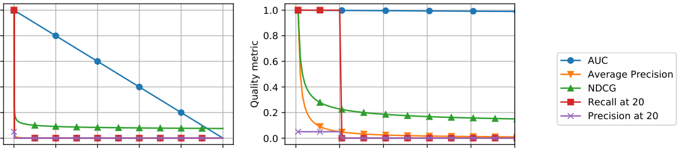
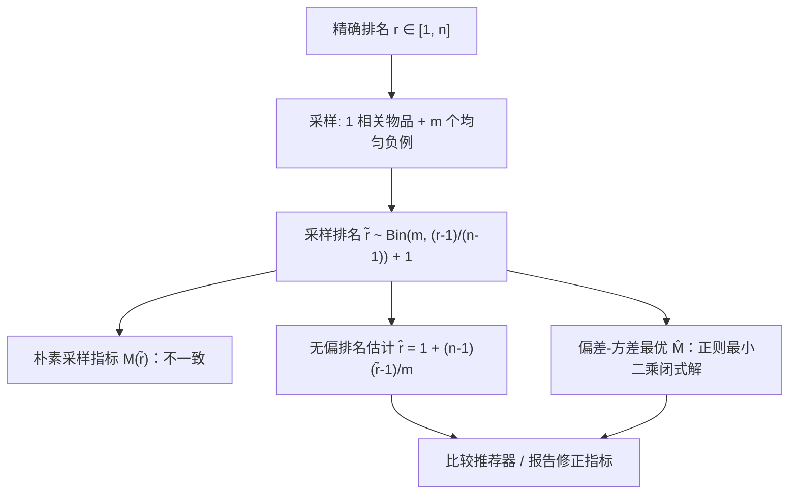
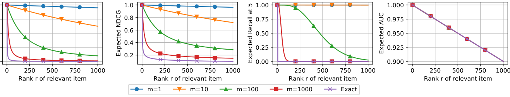

# On Sampled Metrics for Item Recommendation (Extended Abstract)（论物品推荐中的采样指标）

- **会议/期刊**: IJCAI 2021（Sister Conferences Best Papers Track，IJCAI 2020 最佳论文扩展摘要）
- **作者与机构**: Walid Krichene, Steffen Rendle（Google Research）
- **推荐链路定位**: 离线评测协议（贯穿召回/精排全链路的指标计算环节）
- **研究方向**: 去偏公平、可信隐私与工业架构 / 协同过滤与双塔召回（评测侧）
- **论文原文**: [https://www.ijcai.org/proceedings/2021/0651.pdf](https://www.ijcai.org/proceedings/2021/0651.pdf)
- **开源代码**: 暂未开源

## TL;DR (1分钟核心速览)

物品推荐评测为省去 $O(n\log n)$的全库排序，近年普遍采用“1 个相关物品 +$m$个均匀采样负例”来算 AP/NDCG/Recall。本文证明采样排名服从二项分布$\tilde{r}\sim \mathrm{B}(m,\frac{r-1}{n-1})+1$，该压缩使 top-heavy 指标**即使在期望意义下也不保持推荐器间的相对序**，$m\to 1$ 时全部指标退化为 AUC 型线性衰减；作者提出无偏排名反缩放与偏差-方差最小化两类修正，在 MovieLens 上修正指标识别真实排序的成功率显著高于朴素采样指标。

## Background & Motivation (背景与核心矛盾)

- **主流范式**: NCF、CML、CMN 等大批工作在全库排序代价过高时，只对“真实相关物品 + $m$ 个随机负样本”排序，再在该子集上直接套用 AP/NDCG/Recall@k，称为采样指标（sampled metrics）。
- **前人局限**: 采样训练（negative sampling for training）已被充分研究，但**采样评测的统计后果完全空白**；且采样把排名从 $[1,n]$压到$[1,m+1]$，恒低估真实排名，导致指标语义漂移。
- **核心洞察 (Key Insight)**: 指标的本质是“把排名映射为质量分”。精确 AP 中第 1 名价值是第 2 名的 2 倍（NDCG 为 1.58 倍），而 AUC 仅线性衰减；采样后所有指标都被“拉平”向线性靠拢，于是丢掉了应用真正关心的头部敏感性。
- **本文切入点**: 不做新模型，而是把“采样评测”当作一个统计估计问题形式化——先定义一致性，再推导采样排名的精确分布，最后反解出可用的修正估计量。

<figure class="paper-figure" markdown="span">
  <figcaption>图 1：n = 10,000 时指标与预测排名的可视化。左侧显示全部 10,000 个条目上的指标；右侧放大前 100 个排名的贡献。除 AUC 外，所有指标都偏重头部，几乎完全忽略尾部。这通常是评估排序时期望的性质，因为用户不太可能继续浏览结果列表靠后的条目。</figcaption>
</figure>

## Method (核心方法设计)

### 1. 整体框架 (Overall Architecture)

论文是一条“诊断—建模—修正—验证”的分析流水线：给定推荐器 $A$与实例$x$，先得到相关物品的精确排名$r(A,x)\in\{1,\dots,n\}$与精确指标$M(r)$（作为 gold）；随后模拟工业与论文中常用的采样过程，得到随机变量$\tilde{r}$；由$\tilde{r}$的二项分布刻画其偏差结构，据此构造两类修正映射$\hat{M}:\{1,\dots,m+1\}\to\mathbb{R}$，使其期望尽量逼近$M(r)$；最后在 MovieLens 的真实推荐器排名分布上，用“成对比较中正确识别真实优劣的比例”来度量各方案。整条链路无训练、无参数学习，推理开销仅为对每个测试实例做一次$O(m)$ 的采样与一次指标查表。

### 2. 关键设计拆解 (Key Designs)

1. **采样排名的二项分布刻画与一致性定义**：痛点是此前无人说清“采样究竟改变了什么”。作者指出每个被采样的负例以概率 $p=\frac{r-1}{n-1}$排在相关物品之前，$m$ 次有放回采样即得
$\tilde{r}\mid r \sim \mathrm{B}\!\left(m,\tfrac{r-1}{n-1}\right)+1,\qquad \mathbb{E}[M(\tilde{r})]=\sum_{i=1}^{m+1}\Pr(\tilde{r}=i)M(i)$。
由此给出**一致性（consistency）**定义：若 $\frac{1}{|D|}\sum_x M(r(A,x))>\frac{1}{|D|}\sum_x M(r(B,x))$的成立与否必须与$\mathbb{E}[\cdot]$上的同一比较等价，才叫一致。直觉上，$\tilde r$对$r$的映射是“随机压缩 + 单调”，压缩后头部差异被抹平、且抹平程度依赖推荐器自身的排名分布，故偏差是**推荐器相关**而非可加常数，无法靠调$m$消除。AUC 因对$r$ 线性，期望运算可交换，是唯一一致的特例。

<figure class="paper-figure" markdown="span">
  <figcaption>图 3：不同样本数 m 下采样指标的特征（与图 1 对比）。与指标的精确计算相比，采样平均精度、NDCG 和召回率的特征发生显著变化。即使样本量很大（m = 1000，n = 10000 个条目的样本）也表现出较大偏差。注意，此图放大 n = 10000 个条目中前 1000 个排名。</figcaption>
</figure>

2. **无偏排名反缩放修正**：既然指标作用在错误的排名上，就先修排名。由 $p=\frac{r-1}{n-1}$的无偏估计为$\frac{\tilde r-1}{m}$，立即得$\hat r = 1+\frac{(n-1)(\tilde r-1)}{m}$，并定义
$\hat{M}(\tilde r)=M\!\left(\left\lfloor 1+\tfrac{(n-1)(\tilde r-1)}{m}\right\rfloor\right)$。
实现上只是“先放大排名再套原指标”一行代码，物理直觉是把 $[1,m+1]$的采样尺度线性还原到$[1,n]$的真实尺度；代价是方差放大$\frac{n-1}{m}$ 倍。

3. **偏差-方差权衡的闭式修正与评测开销**：无偏估计方差过大时，直接优化整张映射表 $\hat{\mathbf{M}}\in\mathbb{R}^{m+1}$：
$\arg\min_{\hat{\mathbf{M}}}\sum_{r=1}^{n}\left(\left(\mathbb{E}[\hat{M}_{\tilde r}\mid r]-M(r)\right)^2+\gamma\,\mathrm{Var}[\hat{M}_{\tilde r}\mid r]\right)$，
这是一个带正则的最小二乘问题，有闭式解，$\gamma$控制偏差与方差的折中（$\gamma$越大越平滑、方差越小）。本文无训练损失与负采样策略可言——被“训练”的其实是评价函数本身；在线/离线评测成本均为每个实例$O(m)$次排序比较，远低于全库$O(n\log n)$。

## Experimental Setup & Evaluation Protocol (实验设置与评估协议)

- **数据集与预处理**: 解析用可控玩具例（$n=10{,}000$ 物品、5 个实例、3 个推荐器 A/B/C）+ 真实数据 MovieLens 评分数据；扩展摘要未给出 MovieLens 的用户/物品/交互统计量，需查完整版。

| 数据集 | #Users | #Items | #Interactions | 稀疏度/密度 | 特征/场景说明 |
| :--- | :---: | :---: | :---: | :---: | :--- |
| Toy Example | 5 实例 | 10,000 | 5 | — | 人工构造 3 个推荐器的排名以暴露不一致性 |
| MovieLens | 未报告 | 未报告 | 未报告 | — | 电影评分，驱动真实推荐器排名分布 |

- **数据划分与防穿越 (Splitting Strategy)**: 沿用 He et al. (2017, NCF) 的 **Leave-One-Out**：每用户留 1 个测试正例，其余为训练集。
- **排名评测协议 (Ranking Protocol)**: 核心实验对象即 **Sampled Ranking**——每个实例 1 个相关物品 + $m$个**均匀采样**负例；主设置$m=99$，并对$m\in\{1,10,100,1000\}$ 扫描；精确 **Full-Ranking** 指标作为 gold 参照。
- **对比基线与超参设置**: 三类“方法”即为朴素采样指标 $\hat M(\tilde r)=M(\tilde r)$、无偏反缩放修正（向下取整）、偏差-方差修正（$\gamma>0$需调）；评价它们的元指标是成对比较的正确识别率与标准差（1000 次重复，含$\pm$ 方差）。

## Key Experimental Results (实验关键数据)

### 1. 主实验对比 (Main Results)

| 推荐器 | 精确排名 | AUC（精确 / 采样 $m{=}99$） | AP（精确 / 采样） | NDCG（精确 / 采样） | Recall@10（精确 / 采样） |
| :--- | :--- | :---: | :---: | :---: | :---: |
| A | 100,100,100,100,100 | 0.990 / **0.990**±0.004 | 0.010 / **0.630**±0.129 | 0.150 / **0.724**±0.097 | 0.000 / **1.000**±0.000 |
| B | 40,40,8437,9266,4482 | 0.555 / **0.555**±0.014 | 0.010 / 0.336±0.073 | 0.122 / 0.444±0.054 | 0.000 / 0.400±0.000 |
| C | 212,2,743,5342,1548 | 0.843 / **0.843**±0.014 | **0.101** / 0.325±0.050 | **0.208** / 0.460±0.039 | **0.200** / 0.567±0.092 |

（采样列为 1000 次重复的均值 ± 标准差；**粗体**为同一指标下最优。精确指标里 C 的 AP 是 A/B 的 10 倍，采样后反被 A 以近 2 倍碾压。）

### 2. 消融实验 (Ablation Study)

对“修正方式 × 样本量”的定性消融（数值为原文定性结论的归纳，非杜撰数值）：

| 配置 | 估计偏差 | 估计方差 | 实现成本 | 正确识别真实排序 |
| :--- | :---: | :---: | :---: | :---: |
| 朴素采样 $M(\tilde r)$| 高（推荐器相关，大$m$ 仍显著） | 低 | 无 | 差（甚至把最差模型判为最优） |
| 无偏反缩放 $\hat r$（式 9） | 低（一阶无偏） | 高（放大约$(n-1)/m$） | 一行代码 | 明显优于朴素 |
| 偏差-方差修正（式 10） | 可调（$\gamma$控制） | 中 | 需拟合映射表 + 调$\gamma$| 最优，但$\gamma$ 需谨慎配置 |
| AUC（任意 $m$） | 无（线性指标天然一致） | 低 | 无 | 完美一致，但对头部不敏感 |

### 3. 关键实验发现 (Key Findings)

1. **结论可被完全反转**：精确 AP 上 C（0.101）是 A（0.010）的 10 倍，但 $m=99$采样 AP 上 A（0.630）反超 C（0.325）；Recall@10 更极端，精确值 A$=0$、C$=0.2$，采样后 A$=1.000$、C$=0.567$——**最差推荐器被判为最好**，且这是期望层面（1000 次重复）的系统性偏差，不是方差噪声。
2. **偏差依赖推荐器与样本量，无法用“调大 $m$”修复**：AP 的相对序随$m$漂移为$m<50$：A>C>B；$m\approx200$：A>B>C；$m\approx500$：C>A>B；$m$很大：C>A=B。即任意两种结论都能通过选$m$ 得到，说明采样指标的不可比性是结构性的。
3. **AUC 是唯一一致指标**：其精确值与采样值在 A/B/C 上逐位相同（0.990/0.555/0.843），且期望与 $m$ 无关；但 AUC 对头部完全不敏感（第 101 名提升到第 100 名与第 2 名提升到第 1 名等价），恰好因此才与采样“线性压缩”相容——这反证了 top-heavy 指标与采样本质上不兼容。
4. **修正有效但有代价**：无偏反缩放与偏差-方差修正虽方差更大，成对比较的正确识别率仍高于朴素采样，其中偏差-方差方案更优但 $\gamma$ 需调；作者强调修正只能缓解，偏差只有取消采样才能根除。

## Highlights & Limitations (亮点、对比与审稿批判)

- **与代表作对比 (vs. Prior Work)**: 与 He et al. (2017, NCF) 等“使用采样评测”的工作相比，本文首次把该协议当成统计估计量审计，证明其不保序；与 Yu et al. (2017) 的**采样训练**偏差分析互补——那篇管训练梯度，这篇管评测结论的可比性；相比常规“换模型涨点”的推荐论文，本文提供的是全领域通用的评测元规则。
- **可迁移亮点**: ① 凡评测侧做了任何近似（采样候选、ANN 召回截断、负例缓存复用），都应按“一致性”重新审计，而非只报告方差；② “先用二项分布建模压缩噪声、再反缩放修正”这套思路可直接迁移到 ANN Top-k 截断评测与流式曝光日志的稀疏上报场景。
- **审稿级局限批判**: ① 扩展摘要仅给出玩具例与 MovieLens 的定性/局部数值，缺少大规模工业目录（$n\sim10^7$）与多指标显著性检验的定量结论，修正指标的“正确识别率”未给完整表格；② 无偏反缩放把方差放大$(n-1)/m$倍，在$n/m$达$10^4$量级时需多次重采样，与“采样就是为了快”的初衷冲突；③ 偏差-方差修正依赖$\gamma$与整张$m+1$ 维映射表的拟合，跨数据集可移植性未验证。

## Rating (四维评分)

- **方法创新性 (Novelty)**: ⭐⭐⭐⭐ （把评测协议形式化为估计量问题、证明“期望不保序”，并以 AUC 线性性给出解释，视角锐利但工具本身为经典统计）
- **评估协议与实验扎实度 (Protocol & Experiments)**: ⭐⭐⭐ （玩具例的构造极具说服力且含 1000 次重复，但真实数据实验在扩展摘要中偏定性、缺完整表格与显著性检验）
- **写作与数学规范度 (Clarity & Rigor)**: ⭐⭐⭐⭐ （一致性定义、二项分布推导与无偏估计链条干净利落，公式极简而信息密度高）
- **工业落地与复现价值 (Industrial & Practical Value)**: ⭐⭐⭐⭐ （“一行代码反缩放”即可修正历史论文结论，对所有做大规模采样评测的团队都有直接警示价值；但因改动评测口径会牵动既有基线复现成本，落地需全量重跑）

