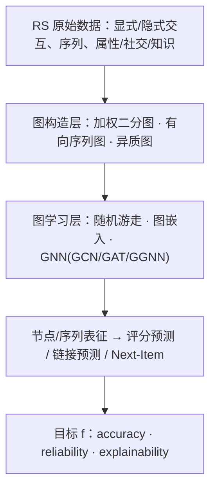
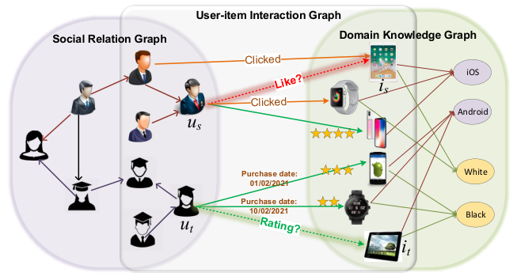

# Graph Learning based Recommender Systems: A Review (基于图学习的推荐系统综述)

- **会议/期刊**: IJCAI 2021 (Survey Track)
- **作者与机构**: Shoujin Wang, Yan Wang, Mehmet A. Orgun, Quan Z. Sheng (Macquarie University)；Xiangnan He (USTC)；Longbing Cao (UTS)；Francesco Ricci (Free University of Bozen-Bolzano)；Philip S. Yu (UIC)
- **推荐链路定位**: 召回（表征学习）为主，兼及序列 Next-Item 预测与知识图谱增强
- **研究方向**: 图神经网络与知识图谱推荐 / 序列与会话推荐
- **论文原文**: [arXiv:2105.06339v1](https://arxiv.org/abs/2105.06339v1)
- **开源代码**: [GLRS 资源库](https://github.com/shoujin88/graph-learning-based-recommender-systems-GLRS-)

## TL;DR (1分钟核心速览)

本文是图学习推荐（GLRS）领域首篇系统综述。针对"推荐数据天然是图、但缺乏统一形式化与横向对照"的痛点，作者提出**数据形态 → 图结构 → 学习范式**三层正交分类体系，把 GLRS 统一写成 $R=\arg\max_\Theta f(M(\Theta)\mid G)$，并把方法分成随机游走、图嵌入、图神经网络（GCN/GAT/GGNN）三大算子族；同时汇总 17 个开源实现与 16 个公开数据集，指出动态图、因果可解释、多路图跨域与大规模在线学习四个空白。本文不含新实验。

## Background & Motivation (背景与核心矛盾)

- **主流范式**: 矩阵分解/内容过滤把交互视作独立条目，侧信息（社交、属性、知识）各自单独建模。
- **前人局限一**: 交互矩阵极稀疏，用户-物品二分图中**同类节点间无直连边**，信息须经"桥接物品"多跳传播，浅层分解无法表达高阶关系。
- **前人局限二**: 序列推荐中的重复点击、非单向跳转产生环路，简单时间序列假设失效；异构图中又难以**选择性**聚合有用属性而抑制噪声。
- **核心洞察 (Key Insight)**: 推荐系统中的用户、物品、属性、上下文本质上"显式或隐式相连"，因此矩阵补全问题可等价转换为图上的**链接预测**问题，稀疏节点的表征可由邻居传播"补全"。
- **本文切入点**: 以数据驱动视角先定图、再定算子、最后定任务，形成可横向比较的三维坐标系。

## Method (核心方法设计)

### 1. 整体框架 (Overall Architecture)

综述的"方法"即其分类学：先把 RS 数据切成三类（一般交互、序列交互、侧信息），各自映射为加权/无权二分图、有向（同质/异质）序列图、异质图或树形本体图；再由三大算子族在该图上抽取表征；最终落到评分预测、点击预测、Next-Item 预测三类任务。核心形式化为：给定图 $G=\{V,E\}$与模型$M(\Theta)$，最优推荐结果$R=\arg\max_\Theta f(M(\Theta)\mid G)$，目标函数$f$可为最大效用或最大成链概率。全文即围绕"$G$怎么建、$M$怎么选、$f$ 怎么定"展开。

<figure class="paper-figure" markdown="span">
  <figcaption>图1：基于图学习的推荐系统展示：对该新兴领域挑战与进展的系统综述。</figcaption>
</figure>

### 2. 关键设计拆解 (Key Designs)

1. **数据→图的三层映射与信息保真**: 痛点是把交互矩阵直接当独立样本会丢掉关系；作者要求每种数据都映射到"最小信息损失"的图：显式评分→带权二分图，隐式反馈→无权二分图，序列→有向路径（$\langle$type, item$\rangle$ 复合节点），属性/社交/知识→异质图或本体树。这样"邻居即证据"，稀疏用户可借二跳邻居获得信号，缺点转化为"多跳传播的聚合方式选择"问题。
2. **三大算子族及其代表公式**: 随机游走以转移概率 $p_{uv}$传播偏好（含重启概率以避免偏离起点上下文），擅长高阶间接关系但**无参数可优化且需对全候选逐步打分**；图嵌入（meta-path 通勤矩阵分解、Skip-gram 分布式表示、神经自编码）轻量高效但受稀疏性拖累；GNN 是当前主力，GCN 做归一化邻域聚合$\boldsymbol{e}_u^{(k+1)}=\sum_{i\in\mathcal{N}_u}\frac{1}{\sqrt{|\mathcal{N}_u||\mathcal{N}_i|}}\boldsymbol{e}_i^{(k)}$，GAT 用注意力$\alpha_{ui}=\mathrm{softmax}_{i}(\mathrm{LeakyReLU}(\boldsymbol{a}^{\top}[\mathbf{W}\boldsymbol{e}_u\|\mathbf{W}\boldsymbol{e}_i]))$ 区分邻居影响强度，GGNN 用 GRU 门控递归吸收邻居影响以建模序列转移。GNN 的增量价值在于**同时利用图结构与节点内容**。
3. **训练目标与推理开销**: 综述归纳的落地范式是 BPR 成对损失 $\mathcal{L}=-\sum_{(u,i,j)\in\mathcal{D}}\ln\sigma(\hat{y}_{ui}-\hat{y}_{uj})+\lambda\|\Theta\|_2^2$，负样本以均匀采样为主、少量工作用硬负采样；推理侧 GNN 依赖 K 跳邻居/子图采样（PinSage、IGMC），随机游走则需在线随机采样近似排序——这正是作者把"大规模在线图学习效率"列为开放方向的原因。

## Experimental Setup & Evaluation Protocol (实验设置与评估协议)

- **数据集与预处理**: 本文为综述，**未做统一实验**，仅盘点 16 个公开真实数据集：

| 数据集 | 领域 | 信息类型 | #Interactions |
| :--- | :--- | :--- | :---: |
| MovieLens-1M | 电影 | 显式评分 | 1,000,209 |
| HetRec | 电影 | 显式评分 | 855,598 |
| Gowalla | POI | 隐式签到 | 1,027,370 |
| Yelp 2018 | POI | 隐式 | 1,561,406 |
| Amazon-book | 电商 | 隐式 | 2,984,108 |
| Yoochoose 1/4 | 电商 | 点击流 | 8,326,407 |
| Diginetica | 电商 | 点击流 | 982,961 |
| Epinions | 电商 | 评分+信任 | 764,352 |

- **数据划分与防穿越**: 综述未规定，被汇总文献混用 `Leave-One-Out`（二分图/序列类）与 `比例划分`（评分预测类）；序列任务多用全局时间戳切分。
- **排名评测协议**: 领域内同时存在 `Full-Ranking`（LightGCN、RecWalk 等）与 `Sampled Ranking`（1:99 或 1:4 负采样），**协议不统一**；本文亦未做归一化，故跨论文数值不可直接横比。
- **对比基线**: 以 Table 2 的 17 个开源实现充当"事实基线集"，覆盖三类数据 × 三类算子；无显著性检验。

## Key Experimental Results (实验关键数据)

### 1. 主实验对比 (Main Results)

原文无定量主表，其"主结果"即代表性算法谱系核查表（选取 6 条最常被引作基线的实现）：

| 算法 | 输入图 | 学习范式 | 任务 | Venue |
| :--- | :--- | :--- | :--- | :--- |
| GC-MC | 带权二分图 | 图自编码器 | 评分预测 | KDD'18 |
| PinSage | 隐式二分图 | GraphSAGE | 点击预测 | KDD'18 |
| LightGCN | 隐式二分图 | GCN(线性) | 点击预测 | SIGIR'20 |
| SR-GNN | 单类型序列图 | GGNN | Next-Item | AAAI'19 |
| KGAT | 交互+属性异质图 | GAT | 点击预测 | KDD'19 |
| GraphRec | 评分+社交图 | GAT | 评分预测 | WWW'19 |

### 2. 消融实验 (Ablation Study)

原文未提供消融（无自建模型）。作为替代，作者给出的"范式对照"可视为定性消融：

| 移除/替换维度 | 后果（综述论断） |
| :--- | :--- |
| 随机游走 → 去掉重启概率 | 易漂离起点上下文，长图上偏好扩散失控 |
| 图嵌入 → 去掉 meta-path 约束 | 异质语义坍缩，跨类型节点不可比 |
| GCN → 去掉邻居归一化 | 高度数节点主导，长尾物品表征被淹没 |
| GAT → 去掉注意力（退化为均值聚合） | 无法区分邻居影响强度，社交/知识噪声直接注入 |
| 二分图 → 退化为独立交互样本 | 稀疏与冷启动问题重新暴露 |

### 3. 关键实验发现 (Key Findings)

1. **数据形态决定算子优劣的分布**：三类数据 × 三类算子构成 9 格，其中 GNN（尤其 GCN 与 GAT）在"隐式二分图"与"异质图"两格占绝对多数，随机游走则主要残留在社交图与好友推荐（TrustWalker 等）——即高阶间接关系场景。
2. **开源生态明显偏向 GNN**：17 个代表实现中 GCN/GraphSAGE/GAT/GGNN 类占 11 个，且集中在 2018–2020 三年，说明该综述写作时领域正从"嵌入+游走"整体迁移到"聚合式神经网络"。
3. **规模与协议是隐性瓶颈**：被汇总数据集从 6.4 万（Amazon-digital music）到 832 万（Yoochoose）交互跨越两个数量级，而评测协议（LOO vs 比例、Full vs Sampled）并不统一，导致"某方法更优"的结论部分来自图构造差异而非算子差异。

## Highlights & Limitations (亮点、对比与审稿批判)

- **与代表作对比**: 相较同期 KG 推荐综述（如 Guo et al. 2020 聚焦知识图谱）与 GNN 推荐综述，本文首次把**序列交互图**与**随机游走/图嵌入**两族旧方法一并纳入同一坐标系；与 SH 类综述相比，其"数据→图→算子"三层映射更具可操作性。
- **可迁移亮点**: ①"最小信息损失构图"准则可反向用于自查模型输入是否丢了序列顺序或交互类型；②异构图上"选择性聚合（GAT/注意力）+ 元路径约束"的组合是抑制 side-info 噪声的通用配方。
- **审稿级局限批判**: ①作为 Survey Track 论文缺乏任何统一实验或元分析（meta-analysis），"哪类算子更好"仅靠文献计数支撑，说服力弱于带受控实验的综述；②分类粒度偏粗——GCN 与 GraphSAGE 被并作一类，线性 LightGCN 与非线性 GCN 的谱域差异、以及 2021 年后才兴起的自监督去噪/对比增广完全缺席；③时间切片止于 2021 年初，动态图与大规模在线学习仅停留在"开放方向"，缺少对训练成本（K 跳邻居采样开销）的定量估算。

## Rating (四维评分)

- **方法创新性 (Novelty)**: ⭐⭐⭐⭐ （三层正交分类体系与统一形式化 $R=\arg\max_\Theta f(M(\Theta)\mid G)$ 是该领域首套可复用坐标系，但各模块均为对已有工作的归纳，无新算子）
- **评估协议与实验扎实度 (Protocol & Experiments)**: ⭐⭐ （无自建实验、无统一划分与打分协议、无显著性检验，仅以 17 个开源实现与 16 个数据集的清单替代实证）
- **写作与数学规范度 (Clarity & Rigor)**: ⭐⭐⭐⭐ （形式化简洁、术语一致，Table 1 的"数据-图-方法"三列对照一目了然；但公式仅停留在高层，缺复杂度与收敛性讨论）
- **工业落地与复现价值 (Industrial & Practical Value)**: ⭐⭐⭐⭐ （开源仓库持续维护、基线选型与数据集清单可直接用作工程落地 checklist，构图与邻居采样开销仍需读者自行评估）

