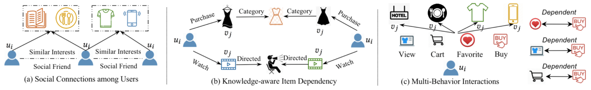
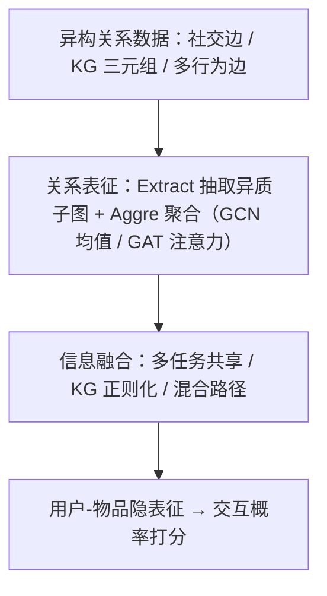
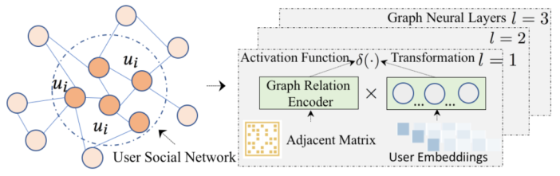

# Recent Advances in Heterogeneous Relation Learning for Recommendation (推荐系统中异构关系学习的最新进展)

- **会议/期刊**: IJCAI 2021
- **作者与机构**: Chao Huang（香港大学）
- **推荐链路定位**: 召回 / 表征学习（用户-物品隐表征建模）
- **研究方向**: 图神经网络与知识图谱推荐 / 社交与群组推荐
- **论文原文**: [arXiv:2110.03455v1](https://arxiv.org/abs/2110.03455v1)
- **开源代码**: 暂未开源

## TL;DR (1分钟核心速览)

首篇聚焦「异构关系学习」的推荐综述：针对用户侧社交边、物品侧知识图谱边、交互侧多行为边三类异构依赖难以统一建模的痛点，作者以「关系表征 + 信息融合」两问为轴，把矩阵分解、注意力、图神经网络归并为统一的消息传递抽象，横向比较社交推荐、KG 增强推荐、多行为推荐三条路线的能力边界，并给出多模态、数据稀缺、时序注入、可解释与实时计算五个方向。全文无自有实验，属框架性梳理而非实证研究。

## Background & Motivation (背景与核心矛盾)

- **主流范式**: CF 以用户-物品二部图上的**同质**交互为核心，演进路线为 MF（SVD/PMF）$\to$神经 CF（NCF/DMF/AutoRec）$\to$ 图卷积 CF（NGCF/PinSage/DGCF），逐级引入非线性与邻居聚合。
- **前人局限**: 其一，**同质假设失效**——真实系统还叠加社交信任边、物品知识图谱边与多类型行为边，单关系二部图无法承载；其二，**融合算子缺位**——即便引入多源关系，也往往被压缩为 MF 线性正则项（SoReg/TrustMF）或依赖领域专家手工设计 meta-path，异质语义无法在同一隐空间内对齐。
- **核心洞察 (Key Insight)**: 三类异构关系在数学上同构为「节点-关系-节点」的消息传递，差异不在模型结构，而在**关系来源**与 **Extract/Aggre 算子**的设计。
- **本文切入点**: 用统一的消息传递公式充当「公分母」，按关系来源（用户域外部边 / 物品域外部边 / 交互内部重数边）而非模型家族切分文献，从而让三条独立发展的研究线可被横向比较。

<figure class="paper-figure" markdown="span">
  <figcaption>图1：推荐系统中关系异质性学习的示意图。</figcaption>
</figure>

## Method (核心方法设计)

### 1. 整体框架 (Overall Architecture)

综述本身不提出新模型，而是给出一个贯穿三条路线的建模闭环：输入为异构关系数据（user-user 社交图、实体-关系-实体知识图谱、带行为类型标签的 user-item 多重图）；核心模块分两步——先把异构关系映射到潜表征空间（关系表征学习），再通过多任务、正则化或混合路径完成跨源知识融合；输出为统一的用户/物品隐向量，用于交互概率打分 $\hat{y}_{i,j}=f(i,j\mid\Theta)$，即原文式 (1)。作者强调该闭环必须回答两个问题：如何从异构结构数据中做关系表征学习，以及如何在自动融合框架下把抽取到的知识注入偏好建模。

### 2. 关键设计拆解 (Key Designs)

1. **统一消息传递抽象**：此前 SoReg/TrustMF 把社交信号压成 MF 的正则项、SAMN 用两级注意力却只限用户域，都无法同时表达 user-user 与 user-item 两类邻居的异质聚合。综述提炼出层间算子 $H^{(l+1)}[u_i]=\mathrm{Aggre}\big(\mathrm{Extract}(H^{(l)}[u_i],H^{(l)}[v_j]),H^{(l)}[u'_i]\big)$，其中$u'_i\in\mathcal{N}^{s}_{u_i}$、$v_j\in\mathcal{N}^{v}_{u_i}$，Extract 负责分域取邻，Aggre 在 GCN 下退化为均值、在 GAT 下变为注意力加权。其物理直觉是：先**分域抽取再合并**，可避免社交补全信号与交互偏好证据在同一层内互相污染。

<figure class="paper-figure" markdown="span">
  <figcaption>图2：消息传递范式下关系聚合的社交推荐图神经网络。</figcaption>
</figure>

2. **知识图谱注入的三条范式**：path-based（meta-path 共注意力，如 (user, meta-path, item) 三元组建模）卡在依赖专家先验、难适配开放 KG；regularization-based（KTUP 用 TransE 式多任务约束）卡在缺高阶连通、长程依赖丢失；hybrid（KGNN-LS 的标签平滑正则、KGAT 的图注意力高阶传播）表达力最强。综述的关键判断是：必须存在一个**主表征空间**桥接推荐与 KG 学习，否则 KG 损失与主任务梯度冲突，正则仅起到弱约束作用。

3. **多行为多重图与行为语义解耦**：与社交/KG 这类「外部辅助边」不同，多行为边是同一 user-item 对上的**关系重数**，建模重点不是加边而是解耦。多任务路线（EHCF 的跨行为迁移）共享 embedding、分行为输出头；图路线（MBGCN 行为感知传播、KHGT 用图结构 Transformer 门控）显式学习「哪种行为对目标行为贡献更大」。

4. **训练目标、负采样与推理效率**：综述未给统一损失，但归纳出共性形式 $\mathcal{L}=\mathcal{L}_{\mathrm{rec}}+\lambda\mathcal{L}_{\mathrm{aux}}$，$\mathcal{L}_{\mathrm{rec}}$为 BPR 或交叉熵，$\mathcal{L}_{\mathrm{aux}}$分别为社交正则、KG 三元组打分或辅助行为预测；负采样以 uniform 与观察到的未交互采样为主。推理侧瓶颈集中于 GNN 的$L$ 跳邻居扩张，跳数增加带来组合爆炸，作者明确把「长程协同知识与模型效率的折中」列为未解难题。

## Experimental Setup & Evaluation Protocol (实验设置与评估协议)

- **数据集与预处理**: 本文明示为综述，**不含自有实验、数据集统计与超参设置**。为保持信息密度，以表 1 替代数据集统计表，给出三类异构关系的结构对照。

| 关系类型 | 图结构形态 | 代表方法 | 核心算子 | 主要瓶颈 |
| :--- | :--- | :--- | :--- | :--- |
| 社交推荐 | user-user 社交图 + user-item 交互图（双图异质） | SoReg, TrustMF, DiffNet, GraphRec, RecoGCN | GCN 影响扩散 / 两级 GAT / 元路径聚合 | 社交边噪声大、冷用户社交稀疏 |
| KG 增强推荐 | 实体-关系-实体三元组 + 交互边 | KTUP, KARN, KGNN-LS, KGAT | meta-path 共注意力 / TransE 正则 / 图注意力高阶传播 | 计算开销大、依赖专家先验 |
| 多行为推荐 | 同一 user-item 对上的多重边（多重图） | 多任务 NCF, EHCF, MBGCN, KHGT | 多任务迁移 / 行为感知传播 / 图 Transformer | 行为语义耦合、辅助行为负迁移 |

- **数据划分与防穿越 (Splitting Strategy)**: 综述**未对划分方式做归一化**，也未区分 `Leave-One-Out`、比例划分与全局时间戳切分；这直接导致跨论文增益不可比，是本文最实质的空缺。
- **排名评测协议 (Ranking Protocol)**: 同样未讨论 `Full-Ranking` 与 `Sampled Ranking` 的口径差异，仅以「性能优越性」定性描述被引工作结论，读者无法据此判断各路线真实强弱。
- **对比基线与超参设置**: 不适用（无统一实验台、无 Embedding 维度 $d$ 与显著性检验）。

## Key Experimental Results (实验关键数据)

### 1. 主实验对比 (Main Results)

原文**未提供任何主实验数值或表格**，故不做虚构复现。以表 2 给出作者对三条路线的定性能力对照（对应原文各小节 Summary 段）：

| 技术路线 | 优势 | 局限 | 适用场景 |
| :--- | :--- | :--- | :--- |
| 社交推荐（GNN 范式） | 天然联合维护 user-user 与 user-item 双结构，生成上下文化表征 | 社交边噪声未建模，冷用户社交稀疏时增益衰减 | 稀疏交互 + 有可信社交链 |
| KG 增强（path-based） | 可解释性强，meta-path 语义显式 | 需领域专家设计路径，难适配开放 KG | 类目/导演等封闭本体 |
| KG 增强（regularization） | 实现简单，与 KG 嵌入无缝复用 | 无高阶连通，长程依赖丢失 | 冷物品语义补全 |
| KG 增强（hybrid GNN） | 表达力最强，可发现复杂知识感知关系 | 递归传播计算成本高 | 语义丰富、算力充足 |
| 多行为（多任务） | 缓解不活跃用户稀疏，迁移成本低 | 行为间负迁移风险 | 电商点击-收藏-购买 |
| 多行为（多重图） | 显式区分行为贡献与高阶结构 | 构图与门控开销大 | 行为类型多且差异显著 |

### 2. 消融实验 (Ablation Study)

不适用：综述无消融实验。可替代的「思想实验」是作者对各范式短板的归因——移除 KG 正则项则退化为纯 CF（KTUP 类工作失去语义补全）、移除行为级门控则 MBGCN/KHGT 等同把辅助行为当噪声堆入同构图，这两条正是原文判定各路线价值来源的核心依据。

### 3. 关键实验发现 (Key Findings)

1. **关系增益与稀疏度成反比**：社交线的梳理显示，SoReg/TrustMF 式线性正则化在交互稠密用户上边际收益有限，而 DiffNet/GraphRec 的收益主要来自对冷用户的信号补全，说明异构关系的价值集中在长尾与稀疏区。
2. **表达力-开销剪刀差是主线矛盾**：path-based 受 meta-path 专家先验限制、regularization 缺高阶连通，hybrid（KGAT）表达力最强但传播代价随跳数增长，综述因此把「长程知识与效率折中」列为跨三线的共同未解问题。
3. **多行为的胜负手是解耦而非加边**：MBGCN 与 KHGT 的差异在于是否显式建模行为贡献权重；若仅把多行为边塞进同构图而不区分语义，等于将辅助行为视作噪声，EHCF 的迁移方案则说明辅助行为对不活跃用户收益最大。

## Highlights & Limitations (亮点、对比与审稿批判)

- **与代表作对比 (vs. Prior Work)**: 相较 NCF 一系的纯 CF 综述，本文把「关系」从辅助特征提升为建模一等公民；相较 KG 专线综述（KGNN-LS/KGAT 所属工作），本文把 KG、社交、多行为置于同一消息传递抽象下，指出三者本质差异是「外部关系 vs 交互关系重数」，而非模型结构。
- **可迁移亮点**: 一是 Extract/Aggre 分域抽取-再聚合的算子拆分，可直接用于工业异构多源图召回的双塔/图召回设计；二是「主表征空间桥接 + 辅助任务正则」的多任务组织方式，可平滑迁移到跨域与多场景联合建模。
- **审稿级局限批判**: 其一，全文零定量元分析、零评测协议归一化，不同论文的增益口径混杂（采样 vs 全库、LOO vs 时间切分），读者无法据此选型；其二，覆盖止于 2021，缺失自监督/对比去噪、生成式语义 ID 与 LLM 增强推荐等后续主线；其三，对工业落地（增量图更新、在线推理延迟、构图成本）仅停留在展望，无任何工程量化。

## Rating (四维评分)

- **方法创新性 (Novelty)**: ⭐⭐⭐⭐ （首篇以「异构关系」为主线统一三条研究线的综述，消息传递抽象作为公分母的组织方式新颖，但缺乏原创理论或谱分析支撑）
- **评估协议与实验扎实度 (Protocol & Experiments)**: ⭐⭐ （无自有实验、无统一评测协议、无定量对比，仅提供定性 Summary，跨论文结论无法相互印证）
- **写作与数学规范度 (Clarity & Rigor)**: ⭐⭐⭐⭐ （三线分类清晰、Extract/Aggre 符号定义干净，但仅两条公式，复杂度与推导展开偏薄）
- **工业落地与复现价值 (Industrial & Practical Value)**: ⭐⭐⭐ （无开源代码；可作为异构图召回选型的路线图，但缺少延迟、内存与增量更新的可执行量化）

