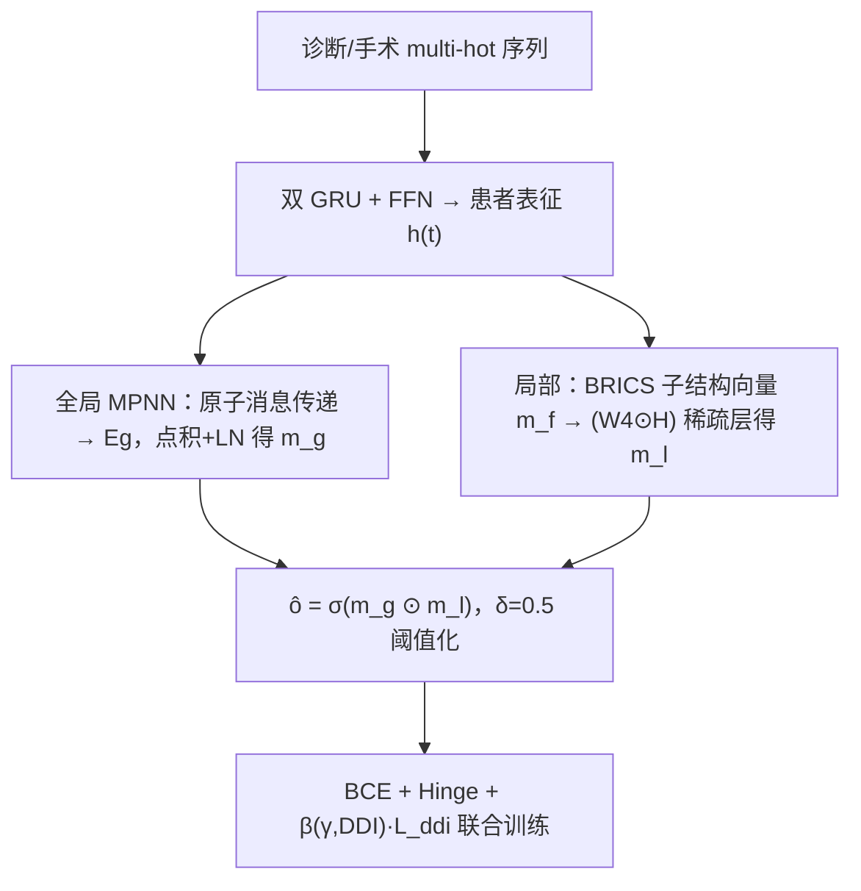
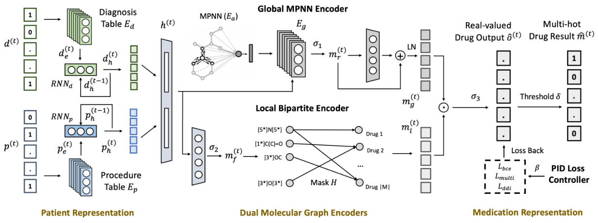
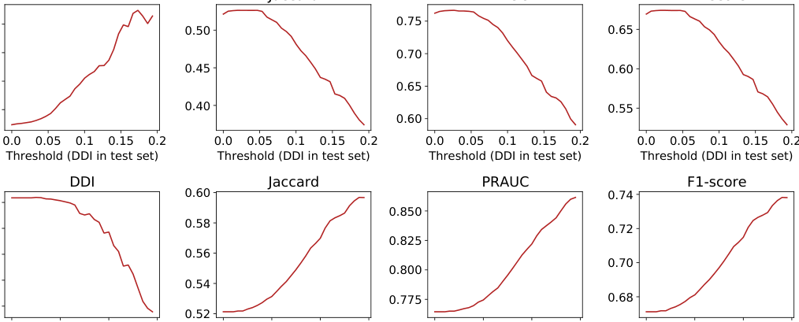

# SafeDrug: Dual Molecular Graph Encoders for Recommending Effective and Safe Drug Combinations (双分子图编码器用于推荐有效且安全的药物组合)

- **会议/期刊**: IJCAI 2021
- **作者与机构**: Chaoqi Yang, Cao Xiao, Fenglong Ma, Lucas Glass, Jimeng Sun（UIUC / IQVIA / Penn State）
- **推荐链路定位**: 端到端多标签集合推荐（一次前向输出全部药物 0/1 组合，无召回-精排级联）
- **研究方向**: 图神经网络与知识图谱推荐 / 多任务学习与列表级重排（多目标损失自适应加权）
- **论文原文**: [https://arxiv.org/abs/2105.02711v2](https://arxiv.org/abs/2105.02711v2)
- **开源代码**: [https://github.com/ycq091044/SafeDrug](https://github.com/ycq091044/SafeDrug)

## TL;DR (1分钟核心速览)

药物组合推荐此前仅用 EHR 中的 one-hot 药物 ID，且把药物相互作用（DDI）当作软约束或 RL 后处理，导致推荐组合不安全、DDI 率不可控。SafeDrug 以「全局 MPNN 原子消息传递 + 局部 BRICS 子结构-药物二部图掩码」双编码器注入分子结构与功能信息，并用 PID 式分段权重显式调控 DDI 损失。在 MIMIC-III（131 药物闭集、多标签阈值判定、bootstrap 采样 10 轮）上，DDI 率相对降低 19.43%、Jaccard 提升 2.88%，参数量仅 325K，推理约 2× 加速。

## Background & Motivation (背景与核心矛盾)

- **主流范式**: 将纵向 EHR（诊断/手术 multi-hot 序列）经 RNN 编码为患者表征，再以多标签二分类预测本次就诊的药物集合（RETAIN、LEAP、DMNC、GAMENet）。
- **前人局限 1——药物编码贫瘠**: 药物被视为不可再分的 one-hot 原子单位，丢弃了分子图结构所携带的疗效/安全药理信息，也无法刻画「共享子结构 ⇒ 相似功能」这一药物化学常识。
- **前人局限 2——DDI 隐式且失控**: DDI 通过知识图谱软约束或强化学习后处理间接引入，最终输出的 DDI 率不可预设；GAMENet 直接从历史组合记忆库检索，而真实处方 DDI 率高达 0.0808，等于把危险共处方当作正确标签继承下来。
- **核心洞察 (Key Insight)**: 监督信号本身「有毒」——若只用 BCE 拟合历史处方，模型必然学到高 DDI 组合；因此安全约束必须在损失层显式建模，且权重需随当前批次的 DDI 水平自适应调节。另一方面，结构高度重叠的两药功能可能截然不同，故仅靠全局图相似不足以规避 DDI。
- **本文切入点**: 一套「全局原子消息传递」+「局部子结构-药物二部掩码」的双视角分子编码，叠加一个带目标上限 $\gamma$ 的 PID 式可控损失。

## Method (核心方法设计)

### 1. 整体框架 (Overall Architecture)

输入为患者截至第 $t$次就诊的诊断、手术 multi-hot 向量序列。两条独立 GRU 分别编码诊断与手术序列，拼接后经一层 FFN 融合为患者健康表征$h^{(t)}\in\mathbb{R}^{64}$。该表征被并行送入两个分子图编码器：全局 MPNN 分支把$h^{(t)}$与药物分子嵌入矩阵做点积检索，给出「健康-药物药理匹配分」；局部二部图分支先把$h^{(t)}$映射为「抗病功能子结构」向量，再经被掩码矩阵约束的稀疏线性层映射回药物空间，给出「功能覆盖分」。两路向量逐元素相乘并经 sigmoid 得到实值输出，以$\delta=0.5$ 阈值化即得最终药物组合。训练端采用 BCE + multi-label hinge + DDI 惩罚三项损失，其中 DDI 项权重由分段比例控制器动态给出。

<figure class="paper-figure" markdown="span">
  <figcaption>图1：SafeDrug模型。我们首先用RNN编码诊断和手术序列，生成患者健康表示h(t)；该表示随后经过双分子图编码器，得到全局和局部分子结构嵌入m(t)</figcaption>
</figure>
图 1：SafeDrug 整体架构——RNN 患者表征分别驱动全局 MPNN 与局部二部图编码器，两路药物向量逐元素相乘后阈值化输出。

### 2. 关键设计拆解 (Key Designs)

1. **全局 MPNN 编码器（可学习原子指纹替代人工描述符）**：前人用原子质量、手性等人工 descriptor 作初始特征，但分子建模中「原子-原子连接性」比单个原子属性更关键。本文为全部出现过的原子建立可学习嵌入表 $E_a$，逐层执行消息传递$z_i^{(l+1)}=\sum_{j:A_{ij}=1}\text{MESSAGE}_l(y_i^{(l)},y_j^{(l)};W^{(l)})$，$y_i^{(l+1)}=\text{UPDATE}_l(y_i^{(l)},z_i^{(l+1)})$，$L=2$层后以均值 readout 汇聚为药物嵌入，堆叠成$E_g\in\mathbb{R}^{|M|\times 64}$。检索与校准为$m_r^{(t)}=\sigma(E_g h^{(t)})$、$m_g^{(t)}=\text{LN}(m_r^{(t)}+\text{NN}_2(m_r^{(t)}))$。物理直觉：把「药理相似性」注入药物表征，使低频/新药也能借邻居原子结构获得合理打分。
2. **局部二部图掩码编码器（子结构-药物稀疏映射）**：用 BRICS 规则将分子切割为保留关键官能团的子结构，构建掩码矩阵 $H\in\{0,1\}^{491\times 131}$（每药平均连 6.84 个子结构，每子结构平均连 1.82 个药）。先由$m_f^{(t)}=\sigma(\text{NN}_3(h^{(t)}))$得到「抗病功能需求」向量，再经参数被$H$逐元素掩码的单层无偏置网络$m_l^{(t)}=\text{NN}_4(m_f^{(t)};W_4\odot H)$映射回药物空间。为什么有效：$H$的稀疏性使该层参数骤减；且共享子结构的药物被强制耦合、无关药物被切断，天然诱导交互药物学得负相关权重（实测$\cos_{\text{interacted}}=-0.0030<0<\cos_{\text{all}}=0.0021$）。
3. **PID 式 DDI 可控损失与训练推理**：总损失
$\mathcal{L}=\beta\big(\alpha\mathcal{L}_{\text{bce}}+(1-\alpha)\mathcal{L}_{\text{multi}}\big)+(1-\beta)\mathcal{L}_{\text{ddi}},\ \mathcal{L}_{\text{ddi}}=\sum_{i}\sum_{j}D_{ij}\hat{o}_i\hat{o}_j$其中$\mathcal{L}_{\text{ddi}}$是 DDI 率在实值输出上的可微松弛（免采样、可直接反传）。关键创新是权重$\beta$不再固定：当批次 DDI 超过接受阈值$\gamma$时$\beta=\max\{0,1-(\text{DDI}-\gamma)/K_p\}$，否则$\beta=1$（纯拟合精度）。即「达标就只追精度，超标就压 DDI」，$K_p=0.05$、$\alpha=0.95$、$\delta=0.5$，无额外负采样（131 药物全标签打分）。

## Experimental Setup & Evaluation Protocol (实验设置与评估协议)

- **数据集与预处理**: MIMIC-III 真实 EHR，按就诊聚合诊断/手术/药物编码，保留全部出现过的药物与原子/子结构。

| 数据集 | #Users(患者) | #Items(药物) | #Interactions(就诊) | 稀疏度/密度 | 特征/场景说明 |
| :--- | :---: | :---: | :---: | :---: | :--- |
| MIMIC-III | 6,350 | 131 | 14,995 | 平均 11.44 药/次，最多 65 | 诊断 1,958 维、手术 1,430 维、平均 2.37 次就诊；448 个 DDI 对、491 个子结构 |

- **数据划分与防穿越 (Splitting Strategy)**: 随机 `2/3 : 1/6 : 1/6` 划分训练/验证/测试（沿用 GAMENet 设置），**非全局时间戳切分**，故同一患者不同就诊可能横跨训练与测试，存在时间信息泄漏风险。
- **排名评测协议 (Ranking Protocol)**: 本质是**闭集多标签分类**而非全库排序——对 131 个药物逐一 sigmoid 打分并以 $\delta=0.5$ 阈值化为 0/1 集合，不使用负采样候选集；指标含 DDI rate、Jaccard、F1、PRAUC、平均药数。
- **统计检验与超参**: 采用 bootstrap 采样 10 轮（每轮从测试集有放回抽 80%），报告均值±标准差，并以双尾 t-test 给出 $p$值（多数$p<0.001$）。嵌入维度$d=64$、GRU 隐层 64、dropout 0.5、MPNN 半径$L=2$、Adam lr$2\times10^{-4}$、50 epochs。

## Key Experimental Results (实验关键数据)

### 1. 主实验对比 (Main Results)

| Model | DDI rate ↓ | Jaccard ↑ | F1 ↑ | PRAUC ↑ | Avg. # Drugs |
| :--- | :---: | :---: | :---: | :---: | :---: |
| LR | 0.0829 | 0.4865 | 0.6434 | 0.7509 | 16.18 |
| ECC | 0.0846 | 0.4996 | 0.6569 | 0.6844 | 18.07 |
| RETAIN | 0.0835 | 0.4887 | 0.6481 | 0.7556 | 20.41 |
| LEAP | 0.0731 | 0.4521 | 0.6138 | 0.6549 | 18.71 |
| DMNC | 0.0842 | 0.4864 | 0.6529 | 0.7580 | 20.00 |
| GAMENet | 0.0864 | 0.5067 | 0.6626 | 0.7631 | 27.21 |
| SafeDrug$_{L}$（仅局部） | 0.0580 | 0.5166 | 0.6670 | 0.7632 | 18.67 |
| SafeDrug$_{G}$（仅全局） | 0.0606 | 0.4862 | 0.6442 | 0.7423 | 19.07 |
| **SafeDrug** | **0.0589** | **0.5213** | **0.6768** | **0.7647** | 19.92 |
| Improv.（vs 最优基线） | **↓19.43%** | **↑2.88%** | **↑2.14%** | ↑0.21% | — |

（真实处方 DDI 率为 0.0808；模型复杂度：SafeDrug 325,473 参数 / 138.77s per epoch / 推理 10.64s，相比 LEAP、DMNC、GAMENet 参数量 ↓24.88%、训练 ↓14.39%、推理 ↓44.21%。）

### 2. 消融实验 (Ablation Study)

| 配置 | 关键变化 | DDI rate ↓ | Jaccard ↑ | F1 ↑ |
| :--- | :--- | :---: | :---: | :---: |
| SafeDrug 完整 | 全局 + 局部 + 可控损失 | 0.0589 | 0.5213 | 0.6768 |
| w/o 全局 MPNN（$L$ only） | 缺药理相似性校准 | 0.0580 | 0.5166 | 0.6670 |
| w/o 局部二部图（$G$ only） | 缺子结构功能覆盖 | 0.0606 | 0.4862 | 0.6442 |
| w/o 掩码 $H$（全连接 NN4） |$\cos_{\text{interacted}}=+0.0036$,$\cos_{\text{all}}=0.0017$ | 0.0652 | — | — |

### 3. 关键实验发现 (Key Findings)

1. **准确率提升主要来自局部子结构分支，DDI 抑制主要来自损失设计**：仅全局 MPNN 的 SafeDrug$_G$ 在 Jaccard（0.4862）上甚至不如 GAMENet（0.5067），而局部掩码分支单独已达 0.5166；两者融合才到 0.5213，说明「子结构→药物」的稀疏映射是精度来源，MPNN 更多起正则是作用。同时所有变体 DDI 均在 0.058–0.061 区间，远低于基线 0.073–0.086，表明安全收益主要由显式 DDI 损失贡献而非结构编码。
2. **掩码 $H$提供了可验证的可解释抑制机制**：带$H$时交互药物权重列的余弦相似度$-0.0030$（负相关）小于全体药物对$0.0021$；去掉$H$后符号反转（$+0.0036$vs$0.0017$），DDI 由 0.0589 升至 0.0652，证明二部图稀疏结构确实在表示层就把「不该同服」的药物推开，而非仅靠损失硬压。
3. **$\gamma$是单调可控的安全-疗效旋钮，但存在下限**：$\gamma$从 0.00 增至 0.08 时，输出 DDI 由 0.0073 升至 0.0722（基本被$\gamma$上界约束），Jaccard 由 0.4198 升至 0.5250、F1 由 0.5743 升至 0.6794；但$\gamma<0.02$ 时药数骤降至 13.8–17.6、F1 断崖式下滑，说明过度压制 DDI 会以牺牲疗效覆盖为代价。

<figure class="paper-figure" markdown="span">
  <figcaption>图2：各种测试场景下关于DDI与药物数量的性能分析</figcaption>
</figure>
图 2：不同测试场景下的性能分析——真实 DDI 越低、单次药数越多时 SafeDrug 表现越好；高 DDI 病例会被迫推荐更少药物而损失精度。

## Highlights & Limitations (亮点、对比与审稿批判)

- **与代表作对比**: 相比 LEAP（多实例多标签、无 DDI 建模）、GAMENet（记忆库检索历史组合，间接继承 8% 真实 DDI）与 DMNC（顺序逐药生成），SafeDrug 首次把**分子结构**接入药物推荐，并把 DDI 从「软约束/后处理」变成「损失层可设上限的硬指标」；同时参数量比三者中最小的 GAMENet 还少 24.88%。
- **可迁移亮点**: (1) 「稀疏二部掩码线性层」可迁移到任意具有显式多对多附属关系的推荐场景（商品-品类、歌曲-曲风、POI-商圈），既降参数又注入结构先验；(2) PID 式分段权重 $\beta$ 是通用的多目标（精度 vs 约束）控制器，可直接替换帕累托加权搜索，在需要「约束上限」而非「约束均值」的业务（如内容安全、多样性下限）中尤其实用。
- **审稿级局限批判**: (1) **评估协议偏弱**：随机按就诊划分而非按患者/时间切分，同一患者后续就诊易泄漏到训练集，Jaccard 绝对值可能被高估；且药物空间固定为 131 个闭集标签、阈值 $\delta=0.5$硬截断，缺少 ranking 视角的指标。(2) **安全建模粒度粗**：DDI 仅用 448 对对称 0/1 邻接矩阵，无剂量、严重度、患者肾肝功能与禁忌症，未覆盖真实 DDI 库的大量未知交互；且每个目标$\gamma$都需**重新训练一个模型**（Table 4 逐$\gamma$ 独立训练），无法在线动态调节，落地成本高。

## Rating (四维评分)

- **方法创新性 (Novelty)**: ⭐⭐⭐⭐ （首次将分子图双视角编码引入药物推荐，并用 PID 式分段权重把 DDI 变成可设上限的显式约束，思路清晰且相互印证）
- **评估协议与实验扎实度 (Protocol & Experiments)**: ⭐⭐⭐ （bootstrap 10 轮 + t-test 规范、基线与双变体消融齐全，但随机就诊划分存在泄漏隐患，且缺少 ranking 类指标与未知 DDI 泛化测试）
- **写作与数学规范度 (Clarity & Rigor)**: ⭐⭐⭐⭐ （四个模块公式衔接清楚，DDI 可微松弛与 $\beta$分段定义简洁；掩码稀疏性、复杂度对比均有量化支撑，仅$\beta$ 的收敛性缺少理论分析）
- **工业落地与复现价值 (Industrial & Practical Value)**: ⭐⭐⭐⭐ （代码开源、325K 参数、推理约 2× 加速，掩码层显著降参易部署；短板是 $\gamma$ 需逐目标重训、DDI 表需人工维护）

