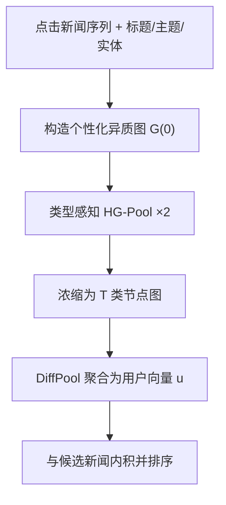

# User-as-Graph: User Modeling with Heterogeneous Graph Pooling for News Recommendation (基于异质图池化的新闻推荐用户建模)

- **会议/期刊**: IJCAI 2021
- **作者与机构**: Chuhan Wu 等；清华大学电子工程系 & BNRist、微软亚洲研究院
- **推荐链路定位**: 精排（候选新闻点击概率排序）
- **研究方向**: 图神经网络与知识图谱推荐
- **论文原文**: [论文原文链接](https://www.ijcai.org/proceedings/2021/0224.pdf)
- **开源代码**: 暂未开源

## TL;DR (1分钟核心速览)

针对新闻推荐中用户点击行为间细粒度关联难以被序列/注意力模型刻画的问题，本文提出 User-as-Graph：把每个用户历史构造成含新闻、主题、实体的个性化异质图，并用类型感知的异质图池化（HG-Pool）逐层浓缩为用户向量。在 MIND 上按曝光内候选排序评估，AUC 69.23、nDCG@10 43.04，较最强基线 GERL 分别提升 1.45% 与 2.21%。

## Background & Motivation (背景与核心矛盾)

- **主流范式**: 新闻推荐通常将点击新闻视为序列或集合，用 GRU、attention、self-attention 学习用户表示，再与候选新闻做内积打分。
- **前人局限**: ①序列/注意力模型只能建模顺序或全局重要性，难以显式利用“时间相邻、同主题、共享实体”的多跳行为关联；②GNewsRec/GERL 等使用全局 user-news-topic 图，用户仅对应一个节点，丢失个体细粒度上下文，且同质图池化无法区分不同类型节点。
- **核心洞察 (Key Insight)**: 相邻点击、同主题新闻、共享实体是重要的行为上下文；若为每个用户单独建图，可将这些关联显式注入用户兴趣建模。
- **本文切入点**: 个性化异质图 + 类型感知异质图池化，一次解决“行为关联建模”和“异质图读出”两个问题。

## Method (核心方法设计)

### 1. 整体框架 (Overall Architecture)

输入用户点击新闻及标题、主题、实体，构造以新闻/主题/实体为节点的个性化异质图：新闻按点击时间相邻连边，新闻连主题，新闻连实体；节点初值分别由 Transformer+attention、主题嵌入、TransE 实体嵌入给出。随后堆叠 2 层 HG-Pool，逐层压缩图并保留类型语义，最后用 DiffPool 汇成用户向量 $\boldsymbol{u}$，与候选新闻向量$\boldsymbol{n}_c$做内积$y=\boldsymbol{u}^\top \boldsymbol{n}_c$ 排序。训练用同一次曝光内的未点击新闻作负样本。

### 2. 关键设计拆解 (Key Designs)

1. **个性化异质图构建（把行为上下文显式化）**：前人把用户行为压成序列或全局图节点，丢失多关系上下文。本文为每个用户建图：节点含新闻、主题、实体，边集 $E=E_{NN}\cup E_{NC}\cup E_{NE}$；$E_{NN}$连时间相邻点击，$E_{NC}$连新闻-主题，$E_{NE}$ 连新闻-实体。新闻用 Transformer+attention 编码标题词，主题用类别嵌入，实体用 TransE 预训练并微调。这样把“连续阅读、同类兴趣、关注实体”三种线索显式注入图结构，为池化提供高阶行为上下文。

2. **类型感知 HG-Pool（避免异质节点被混合聚类）**：同质图池化会把不同语义节点混在一起，破坏异质性。HG-Pool 对第 $i$类节点独立学习池化矩阵：$S_i^{(l)}=\mathrm{PoolGNN}_i(A^{(l)},X^{(l)};\Theta_i^{(l)})$，再压缩为$T_i^{(l)}=\mathrm{softmax}(W_i^{(l)}S_i^{(l)}+B_i^{(l)})$，零填充得$P_i^{(l)}$。分块聚合：$A_{i,j}^{(l+1)}=P_i^{(l)\top}A^{(l)}P_j^{(l)}$，$X_i^{(l+1)}=P_i^{(l)\top}X^{(l)}$。$P_i^\top A P_j$保留跨类型边，$P_i$ 独立避免主题/实体被新闻节点淹没。

3. **训练目标、负采样与推理效率**：以点击预测训练，候选新闻编码器用注意力多视图融合标题/主题/实体，得分 $y_i=\boldsymbol{u}^\top \boldsymbol{n}_{c,i}$。每个点击从同一 impression 随机取$P$个未点击新闻作负样本：$\mathcal{L}=-\frac{1}{|S|}\sum_{i=1}^{|S|}\log\frac{\exp(y_i)}{\exp(y_i)+\sum_{j=1}^{P}\exp(y_{i,j})}$。GAT 实现图网络，Adam 优化，HG-Pool 2 层，5 次重复；在线只需对用户图算一次$\boldsymbol{u}$，再对候选新闻批量内积，图规模随点击历史增长。

## Experimental Setup & Evaluation Protocol (实验设置与评估协议)

- **数据集与预处理**: MIND 大规模新闻推荐基准，含 6 周 MSN 新闻日志；统计如下：

| 数据集 | #Users | #Items | #Interactions | 稀疏度/密度 | 特征/场景说明 |
| :--- | :---: | :---: | :---: | :---: | :--- |
| MIND | 1,000,000 | 161,013 | 24,155,470 clicks / 15,777,377 impressions | 点击/用户-新闻约 0.015% | 20 个主题；3,299,687 个实体；6 周新闻曝光日志 |

- **数据划分与防穿越 (Splitting Strategy)**: 最后一周作测试，前 5 周用于训练与验证，按时间切分。
- **排名评测协议 (Ranking Protocol)**: 在每次 impression 的曝光候选内排序，非全库 Full-Ranking；训练对每个点击从同一次曝光采 $P$ 个未点击负样本；报告全部 impression 上的平均 AUC、MRR、nDCG@5、nDCG@10。
- **对比基线与超参设置**: 对比 FM 类 LibFM，深度模型 EBNR、DKN、NPA、NAML、LSTUR、NRMS，图模型 GNewsRec、GERL；GAT 实现图网络，GloVe 初始化词向量，HG-Pool 层数为 2，Adam 优化，5 次重复，显著性 $p<0.05$。论文未在正文显式给出统一 embedding 维度，按验证集调参。

## Key Experimental Results (实验关键数据)

### 1. 主实验对比 (Main Results)

| 方法 | AUC | MRR | nDCG@5 | nDCG@10 |
| :--- | :---: | :---: | :---: | :---: |
| EBNR | 65.42 | 31.24 | 33.76 | 39.47 |
| DKN | 64.60 | 31.32 | 33.84 | 39.48 |
| NPA | 66.69 | 32.24 | 34.98 | 40.68 |
| NAML | 66.86 | 32.49 | 35.24 | 40.91 |
| LSTUR | 67.73 | 32.77 | 35.59 | 41.34 |
| NRMS | 67.76 | 33.05 | 35.94 | 41.63 |
| GNewsRec | 67.53 | 32.68 | 35.46 | 41.17 |
| GERL | 68.24 | 33.46 | 36.38 | 42.11 |
| **User-as-Graph** | **69.23** | **34.14** | **37.21** | **43.04** |
| **Improv. vs GERL** | **+1.45%** | **+2.03%** | **+2.28%** | **+2.21%** |

### 2. 消融实验 (Ablation Study)

| 图节点配置 | AUC | MRR | nDCG@5 | nDCG@10 |
| :--- | :---: | :---: | :---: | :---: |
| 仅 News | 68.10 | 33.37 | 36.30 | 42.01 |
| News + Topic | 68.69 | 33.84 | 36.77 | 42.53 |
| News + Entity | 68.78 | 33.90 | 36.85 | 42.61 |
| **News + Topic + Entity** | **69.23** | **34.14** | **37.21** | **43.04** |
| **Δ vs 仅 News** | **+1.13** | **+0.77** | **+0.91** | **+1.03** |

### 3. 关键实验发现 (Key Findings)

1. **整体最优且收益稳定**：UaG 取得 69.23 AUC / 43.04 nDCG@10，较 GERL 高 0.99 / 0.93 绝对值（+1.45% / +2.21%），说明个性化异质图比序列模型和全局图模型更能利用行为关联。
2. **主题与实体节点互补**：仅 News → 加 Topic → 加 Entity，AUC 从 68.10 → 68.69 → 68.78；两者合并达 69.23。Topic 贡献 +0.59，Entity 贡献 +0.68，主题提供粗粒度类别，实体提供细粒度兴趣锚点。
3. **提升集中在头部排序**：News → 全图时 MRR 33.37 → 34.14（+0.77），nDCG@5 36.30 → 37.21（+0.91）。这说明实体/主题节点增加的高阶路径被 HG-Pool 聚成可判别兴趣簇，对前几位推荐更有效。

## Highlights & Limitations (亮点、对比与审稿批判)

- **与代表作对比 (vs. Prior Work)**: NRMS 用 self-attention 建模点击新闻间交互但无图结构；GNewsRec/GERL 在全局 user-news-topic 图上学习，用户仅为一个节点；UaG 为每个用户建个性化异质图，并用类型感知池化读出，粒度更细。
- **可迁移亮点**: ①按节点类型独立学池化矩阵、再做零填充与分块邻接聚合，可直接迁移到其他异质图推荐读出；②“个性化子图 + 图池化”适合把用户多行为关系压成单向量，用于召回或精排。
- **审稿级局限批判**: ①仅在 MIND 单数据集验证，评测为曝光候选内排序而非全库 Full-Ranking，且无线上 A/B；②每用户建图带来构图与池化开销，历史很长时图规模膨胀，冷启动用户图过小；未开源代码，复现与工程评估受限。

## Rating (四维评分)

- **方法创新性 (Novelty)**: ⭐⭐⭐⭐ （首次系统提出异质图池化，个性化用户图建模有新意，但 HG-Pool 仍建立在 DiffPool 软聚类框架上）
- **评估协议与实验扎实度 (Protocol & Experiments)**: ⭐⭐⭐⭐ （MIND 大规模、5 次重复、$p<0.05$ 显著性，但仅单数据集且非全库排序）
- **写作与数学规范度 (Clarity & Rigor)**: ⭐⭐⭐⭐ （HG-Pool 公式清晰、模块边界明确，但缺少复杂度与超参敏感性分析）
- **工业落地与复现价值 (Industrial & Practical Value)**: ⭐⭐⭐ （构图和池化可落地，但无开源代码，用户图随历史增长，线上需控制图规模）

