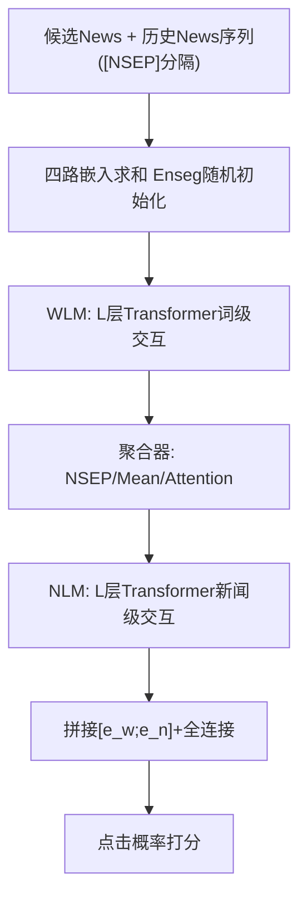
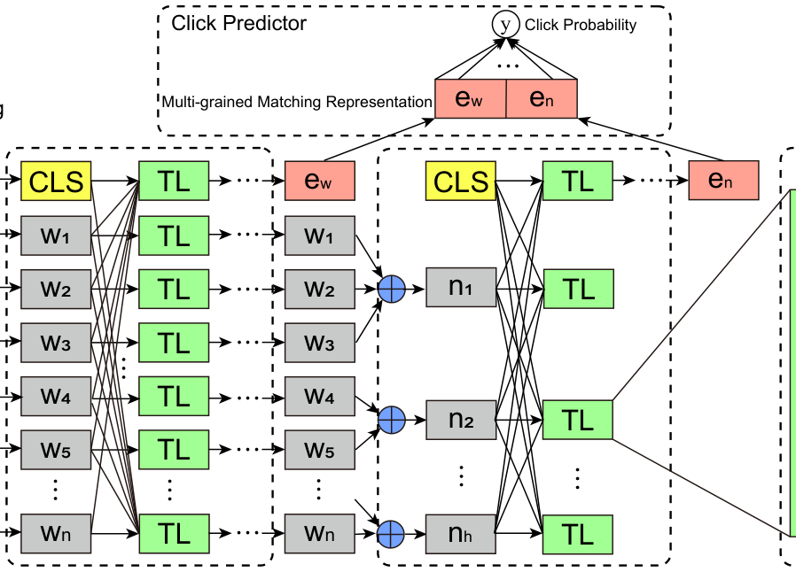

# UNBERT: User-News Matching BERT for News Recommendation (用户-新闻匹配 BERT 新闻推荐)

- **会议/期刊**: IJCAI 2021
- **作者与机构**: Qi Zhang, Jingjie Li, Qinglin Jia, Chuyuan Wang, Jieming Zhu, Zhaowei Wang, Xiuqiang He (华为诺亚方舟实验室)
- **推荐链路定位**: 精排 (点击率预估)
- **研究方向**: 大语言模型推荐 / 序列推荐
- **论文原文**: [IJCAI 2021 PDF](https://www.ijcai.org/proceedings/2021/0462.pdf)
- **开源代码**: 暂未开源

## TL;DR (1分钟核心速览)

新闻更新极快导致冷启动严重，且主流做法把用户历史聚合成单向量再与候选向量内积，丢失了词级细粒度匹配信号。本文提出 UNBERT：用预训练 BERT 直接在**原始文本级**把用户历史序列与候选新闻拼接成一对句对，经 WLM（词级）+ NLM（新闻级）两级 Transformer 输出多粒度匹配表征再打点。在 MIND-small/large 上采用 impression 内候选排序协议（训练负采样比 4），AUC 相对最优基线 FIM 提升 2.12%/2.81%，并稳居 MIND 榜单首位。

## Background & Motivation (背景与核心矛盾)

- **主流范式**: 以 NAML/NRMS 为代表，先用 CNN/Attention 独立编码新闻、聚合成用户向量，再与候选新闻向量做内积/匹配打分；部分工作用 Word2Vec/GloVe 初始化词嵌入缓解冷启动。
- **前人局限**: ①预训练词向量是**上下文无关**的，且被随机初始化的下游模型在训练中进一步削弱；仅用域内新闻数据，泛化到每天海量新新闻能力差。②用户与新闻**分别独立编码**，把新闻压成单一向量，丢失词级匹配信号——如图 1 反例，候选「Japan」与历史中的「Florida」「American」在词级错配，但新闻级（都讲电影）看似匹配，模型误判点击。
- **核心洞察 (Key Insight)**: 新闻点击本质是文本对匹配问题，词级与新闻级信号互补；Web 规模预训练语言知识能直接缓解新新闻冷启动，前提是让用户与候选在**同一文本流里交叉注意力式交互**。
- **本文切入点**: 直接把用户点击历史拼成一句「User Sentence」，与候选「News Sentence」拼成 BERT 句对，让自注意力天然地在词级捕获跨新闻匹配。

<figure class="paper-figure" markdown="span">
  <figcaption>图1：一个负例：用户浏览的若干新闻（上方框）和一条候选新闻（下方框）。橙色条表示与绿色条相关且应被捕获的重要信号。</figcaption>
</figure>

## Method (核心方法设计)

### 1. 整体框架 (Overall Architecture)

输入为「News Sentence [SEP] User Sentence」的 token 序列，其中历史每条新闻前插入特殊 `[NSEP]` 作分隔信号；输入嵌入由 token/segment/position/news-segment 四路求和而成（实测去掉 position 更优）。经 WLM 词级 Transformer 得到逐词隐表征，再按新闻做聚合得到新闻表征，喂入 NLM 新闻级 Transformer 捕获新闻间匹配，最后拼接词级与新闻级表征喂入 Click Predictor 输出点击概率。训练采用 pretrain-finetune：加载 `bert-base-uncased`，在域内新闻数据上端到端微调。

<figure class="paper-figure" markdown="span">
  <figcaption>图3：我们的 UNBERT 方法的总体架构。</figcaption>
</figure>

### 2. 关键设计拆解 (Key Designs)

1. **文本级用户表征 + news-segment 嵌入**：痛点是把用户压成单向量丢失细粒度信息 $\to$直接把历史新闻原文拼成 User Sentence，并新增随机初始化的新闻段嵌入区分每条历史新闻，最终$E_t = E_{token}+E_{seg}+E_{pos}+E_{nseg}$。直觉：让自注意力在词级就能"看到"候选与哪条历史句子相呼应；news-segment 嵌入给模型提供边界感，避免多新闻串味。
2. **双粒度匹配（WLM + NLM）**：WLM 用多头自注意力逐词交互，输出词级匹配表征 $e_w$；随后把每条新闻的单词隐表征聚合为新闻向量$n_j$，NLM 再做一次 Transformer 捕获新闻级匹配得$e_n$。聚合器对比三种，最优为轻量注意力$n_j=\sum_{i\in S_j} f_i w_i / \sum_{i\in S_j} f_i$，其中$f = \tanh(wW_h+b_h)W_o+b_o$。直觉：词级匹配抓细节错配，新闻级匹配抓宏观主题一致性，二者拼接互补。
3. **训练目标与推理效率**：点击标签二分类交叉熵，负采样比 4 与其他基线对齐；$y=\text{softmax}([e_w;e_n]W_c+b_c)$。每对 (用户, 候选) 需一次 BERT 前向，推理开销与候选数线性相关，工程上需依赖召回预筛。

## Experimental Setup & Evaluation Protocol (实验设置与评估协议)

- **数据集与预处理**: MIND（MSN News 日志），small 版为 large 等概率日采样；全部方法只用新闻标题，取前若干词。

| 数据集 | #Users | #Items | #Impressions (Train) | 稀疏度/说明 |
| :--- | :---: | :---: | :---: | :--- |
| MIND-small | 162,898 | 76,904 | 199,998 | 采样自 large，正样本 300,357，负样本 7,060,083 |
| MIND-large | 711,222 | 101,527 | 2,232,748 | 正样本 3,383,656，负样本 80,123,718 |

- **数据划分与防穿越 (Splitting Strategy)**: 官方按用户 impression 日志预划分 train/dev/test，非时间切分；冷启动实验另行把 MIND-small 按日分 7 组，前 3 天训练、后 4 天逐日测试。测试集不提供标签（large 榜提交）。
- **排名评测协议 (Ranking Protocol)**: **Impression 内候选排序**（每条 impression 含若干候选新闻及点击标签），非全库 Full-Ranking；训练阶段负采样比 4。
- **对比基线与超参设置**: LibFM、DeepFM（TF-IDF）、DKN、NPA、NAML、LSTUR、NRMS、FIM；`bert-base-uncased`，batch 128，lr 2e-5，训练 2 epoch，负采样比 4，超参在验证集调优。

## Key Experimental Results (实验关键数据)

### 1. 主实验对比 (Main Results)

| 方法 | Small AUC | Small MRR | Small nDCG@5 | Large AUC | Large MRR | Large nDCG@5 |
| :--- | :---: | :---: | :---: | :---: | :---: | :---: |
| LibFM | 0.5974 | 0.2633 | 0.2795 | 0.6185 | 0.2945 | 0.3145 |
| DeepFM | 0.5989 | 0.2621 | 0.2774 | 0.6187 | 0.2930 | 0.3135 |
| DKN | 0.6175 | 0.2705 | 0.2890 | 0.6407 | 0.3042 | 0.3292 |
| NPA | 0.6321 | 0.2911 | 0.3170 | 0.6592 | 0.3207 | 0.3472 |
| NAML | 0.6550 | 0.3039 | 0.3308 | 0.6646 | 0.3275 | 0.3566 |
| LSTUR | 0.6438 | 0.2946 | 0.3189 | 0.6708 | 0.3236 | 0.3515 |
| NRMS | 0.6483 | 0.3001 | 0.3252 | 0.6766 | 0.3325 | 0.3628 |
| FIM | 0.6502 | 0.3026 | 0.3291 | 0.6787 | 0.3346 | 0.3653 |
| **UNBERT** | **0.6762** | **0.3172** | **0.3475** | **0.7068** | **0.3568** | **0.3913** |
| Improv.% | +2.12 | +1.33 | +1.67 | +2.81 | +2.22 | +2.60 |

（UNBERT 融合版 UNBERT-en 在 MIND-large 榜单上达到 0.7183 AUC / 0.4020 nDCG@5。）

### 2. 消融实验 (Ablation Study)

| 配置 | AUC | MRR | nDCG@5 | nDCG@10 |
| :--- | :---: | :---: | :---: | :---: |
| UNBERT_word（仅词级） | 0.6733 | 0.3138 | 0.3429 | 0.4058 |
| UNBERT_news（仅新闻级） | 0.6735 | 0.3147 | 0.3455 | 0.4079 |
| **UNBERT（双粒度）** | **0.6762** | **0.3172** | **0.3475** | **0.4102** |
| NSEP 聚合器 | 0.6746 | 0.3162 | 0.3460 | 0.4088 |
| Mean 聚合器 | 0.6758 | 0.3151 | 0.3453 | 0.4079 |
| Attention 聚合器 | **0.6762** | **0.3172** | **0.3475** | **0.4102** |

### 3. 关键实验发现 (Key Findings)

1. **双粒度确实互补而非常规消融噪音**：仅词级 0.6733 / 仅新闻级 0.6735 都明显低于双粒度 0.6762，且新闻级略优于词级（后者难以刻画新闻结构），证明拼接 $[e_w;e_n]$ 不只是简单堆叠参数。
2. **聚合器选择揭示注意力重要性**：Attention(0.6762) > Mean(0.6758) > NSEP(0.6746)，NSEP 与 Mean 差距极小说明 [NSEP] 隐状态已能粗略替代均值，但词间相关度建模（Attention）仍是新闻表征的关键增量。
3. **冷启动鲁棒性是本方法最大卖点**：图 4 显示，随测试日 unseen news 占比从 11/13 到 11/14 上升，其他基线 AUC 明显下滑，而 UNBERT 保持领先且曲线平稳，直接验证 Web 域外语言知识对缓解新闻冷启动的实证价值。

## Highlights & Limitations (亮点、对比与审稿批判)

- **与代表作对比 (vs. Prior Work)**: NRMS/NAML 独立编码 + 用户向量聚合，无法建模词级交互；FIM 虽引入段级细粒度匹配但仍是「分别编码再匹配」的 CNN 结构，且受限于域内词向量；UNBERT 通过统一句对 + 预训练语言模型一次性解决「细粒度 + 域外知识」两件事。
- **可迁移亮点**: ①用 `[NSEP]` 新闻段嵌入在单一 BERT 句对里编码「一对多」历史序列的做法，可直接迁移到电商/短视频的 query-item 精排；②按日切分做「unseen item 占比」分桶观察性能衰减，是一种值得借鉴的冷启动评测视角。
- **审稿级局限批判**: ①每条候选都要跑一次完整 BERT 前向，精排阶段计算开销巨大，论文未给出延迟/吞吐量数据，工业落地的可行性存疑；②仅用标题文本、丢弃正文与用户 ID/时间等协同信号，且评测停留在 impression 内候选集，未做全库 Full-Ranking，与真实线上分布仍有差距；③对 position 嵌入的负向发现仅一句脚注，缺乏深入分析。

## Rating (四维评分)

- **方法创新性 (Novelty)**: ⭐⭐⭐⭐ （首次将预训练 BERT 以句对+双粒度匹配方式引入新闻推荐，思路清晰但增量偏工程化）
- **评估协议与实验扎实度 (Protocol & Experiments)**: ⭐⭐⭐⭐ （MIND small/large 双数据集 + 8 基线 + 榜单第一 + 冷启动逐日实验，但缺少 Full-Ranking 与显著性检验）
- **写作与数学规范度 (Clarity & Rigor)**: ⭐⭐⭐⭐ （结构清楚、公式简洁，但符号偏基础、复杂度与延迟分析缺失）
- **工业落地与复现价值 (Industrial & Practical Value)**: ⭐⭐⭐ （无开源代码，推理延迟高，需依赖召回预筛方可上精排）

