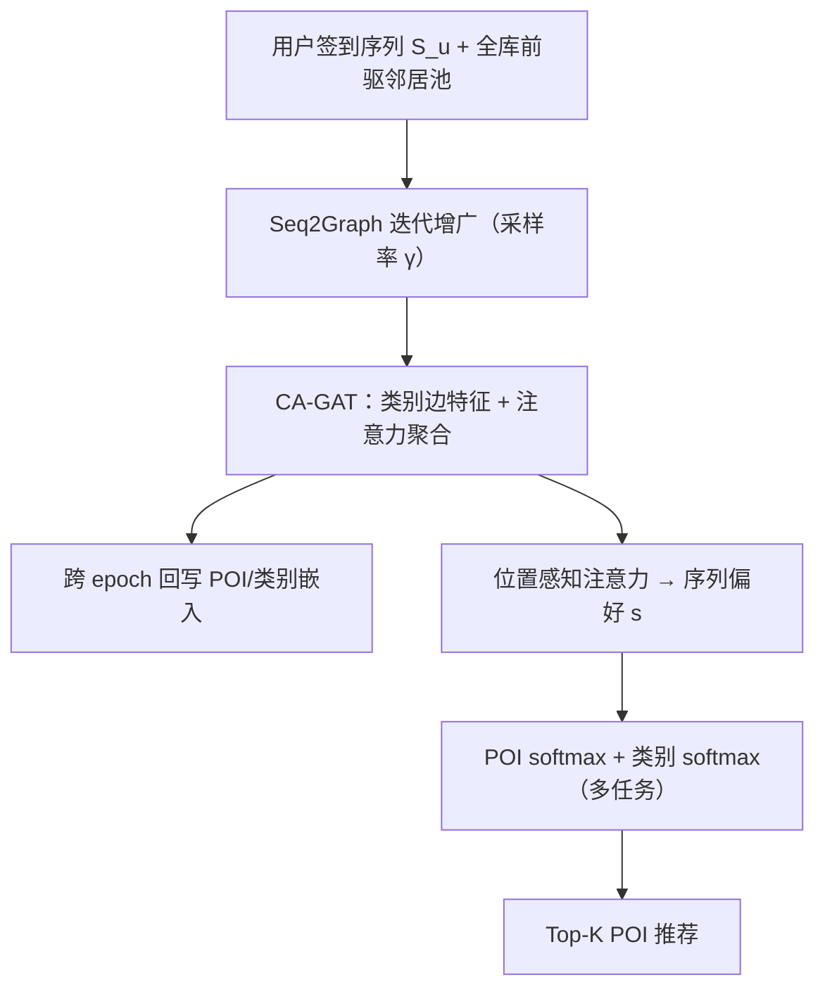
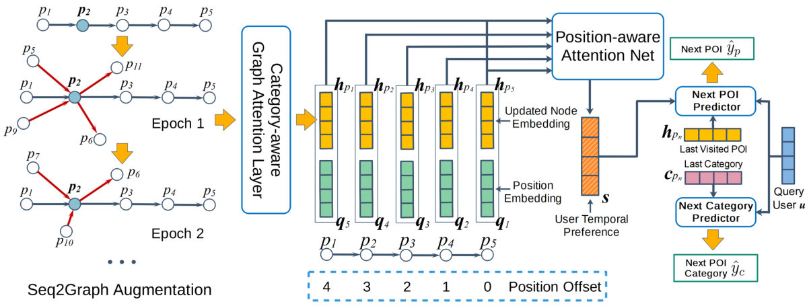

# Discovering Collaborative Signals for Next POI Recommendation with Iterative Seq2Graph Augmentation (基于迭代序列转图增广的下一个兴趣点推荐)

- **会议/期刊**: IJCAI 2021
- **作者与机构**: Yang Li, Tong Chen, Yadan Luo, Hongzhi Yin, Zi Huang（The University of Queensland）
- **推荐链路定位**: 精排（序列级 Next-POI 打分，全库 softmax）
- **研究方向**: 时空轨迹与 POI 本地生活推荐 / 图神经网络推荐
- **论文原文**: [https://arxiv.org/abs/2106.15814v2](https://arxiv.org/abs/2106.15814v2)
- **开源代码**: 暂未开源

## TL;DR (1分钟核心速览)

现有 Next-POI 模型把签到数据当作**相互孤立**的序列，既丢失了跨序列的高阶协同信号（"多个序列共同指向同一 POI"），又受困于 POI-POI 转移极度稀疏。本文提出 **Seq2Graph** 增广：把每个序列中每个 POI 的一跳前驱邻居从全库序列中采样拼成图，用 **CA-GAT**（把类别转移嵌入作为边特征）聚合邻居，再以位置感知注意力编码短期偏好，并用 POI 类别预测作为辅助多任务。在 Foursquare/Gowalla 上按 HR@K、nDCG@K 全库排序评估，较最优基线 Gowalla HR@5 提升 49.37%、nDCG@5 提升 41.67%。

## Background & Motivation (背景与核心矛盾)

- **主流范式**: 从 FPMC-LR 的马尔可夫链+矩阵分解，到 GRU/TMCA/ST-CLSTM 等 RNN 序列模型，均在**单条**用户签到序列内部挖掘时序转移；SR-GNN 虽引入图结构，但图仅由**本序列内**共现节点构成。
- **前人局限**: ① 序列独立性假设割裂了跨序列协作信号，稀疏 POI 的嵌入表达力被严重压制；② POI 级转移过稀（Foursquare 仅 4,018 条关系 vs. 2,876 个 POI），难以学出稳定序列模式。
- **核心洞察 (Key Insight)**: 同一 POI 会反复出现在多个用户的序列中（图 1(a)：$p_1,p_4,p_7$都转向$p_2$），这些一跳邻居天然构成该 POI 的"上下文描述"；而类别转移远比 POI 转移稠密（181 类 vs. 2,876 POI），可作为稠密的辅助监督源。
- **本文切入点**: 不做纯图模型（会丢时序），而是"序列→图"增广：在原序列骨架上挂载邻居节点，**同时**保留顺序结构与协同信号。

## Method (核心方法设计)

### 1. 整体框架 (Overall Architecture)

输入用户 $u$在 24h 内的签到序列$S_u$；每一步训练先对序列内每个 POI 从其全库前驱邻居中均匀采样比例$\gamma$的节点，构成增广图$G_s$（序列节点的时序边保留为 backbone）。$G_s$送入堆叠的 CA-GAT 层，节点表征 = POI 向量与类别向量的拼接，边表征 = 类别转移向量，聚合结果$\mathbf{h}_p$**跨训练轮次回写**嵌入表（迭代增广）。随后位置感知注意力把各时刻 POI 压成序列向量$\mathbf{s}$，与末位 POI 即时表征、用户长期向量融合做 POI 概率预测，并行预测下一 POI 类别。推理阶段只做 POI softmax 取 Top-K，且**不再施加增广**（只用已学好的嵌入）。

<figure class="paper-figure" markdown="span">
  <figcaption>图2：所提出的 SGRec 示意图。为简洁起见，这里仅在节点 p2 上展示 Seq2Graph 增强。实际中，每个训练轮次中序列里的每个节点都会与各种相关邻居相连。</figcaption>
</figure>

### 2. 关键设计拆解 (Key Designs)

1. **Seq2Graph 迭代增广 + 类别感知边注意力 (CA-GAT)**：痛点在于"POI 序列短且互不相通、异构类别边被普通 GAT 忽略"。做法是把节点定义为 $\mathbf{v}_p=[\boldsymbol{p};\boldsymbol{c}_p]\in\mathbb{R}^{2D}$，并把边特征$\mathbf{r}_{c_q\to c_p}$注入邻居再做注意力打分：$\tilde{\mathbf{v}}_q=\mathbf{W}_a[\mathbf{v}_q+\mathrm{MLP}([\mathbf{v}_q;\mathbf{r}_{c_q\to c_p}])]$，$a(\mathbf{v}_p,\mathbf{v}_q)=\mathbf{W}_{gat}^\top[\mathbf{W}_b\mathbf{v}_p;\tilde{\mathbf{v}}_q]+b_{gat}$，$\mathbf{h}_p=\sum_{q\in N(v_p)}\alpha_q\Phi\mathbf{v}_q$。直觉：同一对 POI 若由"餐厅→酒店"和"景点→酒店"两类关系连入，语义应不同，边条件化让聚合具备关系分辨力。聚合后按$\boldsymbol{p}\leftarrow\mathbf{h}_p(1{:}D)$、$\boldsymbol{c}_p\leftarrow\mathbf{h}_p(D{+}1{:}2D)$ 回写嵌入，使高阶拓扑逐轮传播。
2. **位置感知的用户时序偏好编码**：普通注意力对全部历史 POI 一视同仁，无法刻画"越久远影响越弱"。为每个偏移量分配位置向量 $\mathbf{q}_{n-i+1}$，打分改为$b(\mathbf{v}_{p_i},\mathbf{v}_{p_n})=\mathbf{W}_{patt}^\top\tanh(\mathbf{W}_{h1}^\top\mathbf{h}_{p_n}+\mathbf{W}_{h2}^\top\mathbf{h}_{p_i}+\mathbf{W}_{q}^\top\mathbf{q}_{n-i+1})$，$\mathbf{s}=\sum_i\beta_i\mathbf{h}_{p_i}$。相对位置显式进入打分，短序列中近邻 POI 自然获得更大权重。
3. **训练目标、负采样与推理效率**：预测端 $\hat{\mathbf{y}}_{poi}=\mathrm{softmax}(\mathbf{W}_p([\mathbf{h}_{p_n}\circ\mathbf{s};\boldsymbol{u}])+b_p)$，类别端$\hat{\mathbf{y}}_{cat}=\mathrm{softmax}(\mathbf{W}_c([\boldsymbol{c}_{p_n};\boldsymbol{u}])+b_c)$；总损失$\mathcal{L}=-\frac{1}{M}\sum_{m}[{\mathbf{y}_{poi}^\top\log\hat{\mathbf{y}}_{poi}}+\eta\,{\mathbf{y}_{cat}^\top\log\hat{\mathbf{y}}_{cat}}]+\lambda\|\Psi\|^2$。**无需负采样**（全库 softmax 交叉熵，等价于全库排序训练），推理仅一次前向 + 排序，增广图只用于训练。

## Experimental Setup & Evaluation Protocol (实验设置与评估协议)

- **数据集与预处理**: 过滤签到 <10 的用户与被 <10 人访问的 POI；相邻签到间隔超过 1 天（Foursquare）/ 3 天（Gowalla）即切分为新序列，丢弃长度 <10 的序列，长序列截断至 $n=20$。

| 数据集 | #Users | #Items(POI) | #Interactions | 稀疏度/密度 | 特征/场景说明 |
| :--- | :---: | :---: | :---: | :---: | :--- |
| Foursquare | 2,203 | 2,876 | 332,077 | 密度 0.052 | 东京地区签到，181 类，6,860 序列 |
| Gowalla | 24,399 | 55,715 | 1,699,087 | 密度 0.001 | 全球签到，370 类，15,213 序列 |

- **数据划分与防穿越 (Splitting Strategy)**: 对每个用户的**序列集合**随机按 80%/10%/10% 划分 train/valid/test（非全局时间戳切分，存在同用户未来序列入训练的隐患）。
- **排名评测协议 (Ranking Protocol)**: 每条测试序列以最后一个签到为 ground truth，其余前缀输入模型；**Full-Ranking**（对全部 POI 做 softmax 打分排序，无采样候选集），报告 HR@K 与 nDCG@K（$K\in\{1,5,10,20\}$）。
- **对比基线与超参设置**: FPMC-LR、GRU、TMCA、ST-CLSTM、SR-GNN；$D=120$、$\gamma=0.2$、$\eta=0.2$（正文设置）、CA-GAT 层数 2（Foursquare）/3（Gowalla）、Adam，batch 64，lr 0.005，$\lambda=10^{-5}$。

## Key Experimental Results (实验关键数据)

### 1. 主实验对比 (Main Results)

| Method | FSQ HR@5 | FSQ nDCG@5 | FSQ HR@10 | FSQ nDCG@10 | GOW HR@5 | GOW nDCG@5 | GOW HR@10 | GOW nDCG@10 |
| :--- | :---: | :---: | :---: | :---: | :---: | :---: | :---: | :---: |
| FPMC-LR | 0.135 | 0.123 | 0.141 | 0.143 | 0.050 | 0.060 | 0.062 | 0.068 |
| GRU | 0.240 | 0.181 | 0.287 | 0.194 | 0.069 | 0.054 | 0.087 | 0.059 |
| TMCA | 0.246 | 0.191 | 0.289 | 0.205 | 0.068 | 0.056 | 0.078 | 0.059 |
| ST-CLSTM | 0.337 | 0.258 | **0.395** | 0.276 | 0.079 | 0.060 | 0.096 | 0.066 |
| SR-GNN | 0.316 | 0.250 | 0.370 | 0.268 | 0.066 | 0.054 | 0.079 | 0.058 |
| **SGRec** | **0.351** | **0.277** | 0.388 | **0.290** | **0.118** | **0.085** | **0.137** | **0.103** |
| S2GRec† | 0.362 | 0.299 | 0.402 | 0.319 | 0.118 | 0.085 | 0.137 | 0.103 |
| **Improv.** | +4.15% | +7.36% | −1.77% | +5.07% | +49.37% | +41.67% | +42.71% | +51.47% |

† 原文同表列出的扩展变体，正文未给出说明；`Improv.` 为 SGRec 相对该列最优基线的相对提升。

### 2. 消融实验 (Ablation Study)

| 变体 | FSQ HR@20 | FSQ nDCG@20 | GOW HR@20 | GOW nDCG@20 |
| :--- | :---: | :---: | :---: | :---: |
| Full SGRec | **0.448** | **0.307** | **0.151** | **0.105** |
| SGRec$_{ns}$（去 Seq2Graph 增广） | 0.414 | 0.297 | 0.143 | 0.103 |
| SGRec$_{nc}$（去类别辅助任务） | 0.441 | 0.299 | 0.145 | 0.107 |
| SGRec$_{w/o.\ cagat}$（退化为普通 GAT） | 0.387 | 0.279 | 0.143 | 0.105 |
| SGRec$_{w/o.\ pemb}$（去位置嵌入） | 0.435 | 0.302 | 0.139 | 0.104 |
| SGRec$_{w/o.\ pattn}$（去位置感知注意力） | 0.434 | 0.300 | 0.141 | 0.104 |

### 3. 关键实验发现 (Key Findings)

- **稀疏数据是最大受益场景**：Gowalla 密度仅 0.001，SGRec 的 HR@5 从 0.079 跃至 0.118（+49.37%），而 Foursquare（密度 0.052）同指标仅 +4.15%，说明跨序列协同信号的边际收益与数据稀疏度强正相关。
- **"图"和"边信息"贡献最大**：把 CA-GAT 退化为普通 GAT 后 Foursquare HR@20 从 0.448 掉到 0.387（−13.6%），去 Seq2Graph 增广掉到 0.414（−7.6%），二者损失同源（都丢弃协作信号），但边条件化注意力的价值高于增广本身。
- **辅助任务与位置建模是"低成本增益"**：去掉类别预测 FSQ HR@20 降 1.6%、位置嵌入/位置注意力各降约 1.5%，而采样率 $\gamma$从 0%→10% 即带来主要涨幅，$\gamma\ge30\%$ 反而在 Foursquare 上掉点——证明少量邻居已够用，过多邻居会稀释原序列信息。

## Highlights & Limitations (亮点、对比与审稿批判)

- **与代表作对比 (vs. Prior Work)**: 相比 ST-CLSTM（时间/距离门控 LSTM）与 TMCA（序列内多层注意力），SGRec 的关键差别是**信息源从单序列扩展到全库邻居**；相比 SR-GNN（图结构但只在本序列内建图、且丢弃时间序），SGRec 保留时序骨架并给边赋予类别语义，因此在稀疏的 Gowalla 上优势被放大一个量级。
- **可迁移亮点**: ① "序列骨架 + 外部邻居采样 + 跨 epoch 回写嵌入"是一种低成本增量式图增强范式，可直接移植到电商会话推荐、短视频行为序列；② 用稠密的高层标签（类别）做辅助多任务来正则化稀疏底层 ID 学习，是通用缓解长尾的技巧。
- **审稿级局限批判**: ① 划分是**同用户序列随机 80/10/10**，非全局时间切分，未来序列可能进入训练，指标存在乐观偏差；② 原文称"Gowalla 上较 ST-CLSTM 提升 4.15%/7.36%"，与表中 49.37%/41.67% 矛盾（该句数据实为 Foursquare 结果），且正文超参 $\eta=0.2$与图 3(c) 最优$\eta=0.4$ 不一致；③ 每 epoch 重新采样邻居 + 全库 softmax 训练开销较大，论文未给出训练/推理时延与参数量对比，且无开源代码。

## Rating (四维评分)

- **方法创新性 (Novelty)**: ⭐⭐⭐⭐ （Seq2Graph 把序列与图两种归纳偏置缝合成"带边语义的时序图"，迭代回写嵌入的设计有巧思，但注意力算子本身仍是 GAT 的常规变体）
- **评估协议与实验扎实度 (Protocol & Experiments)**: ⭐⭐⭐ （两个数据集、Full-Ranking、消融与超参分析齐备，但随机序列划分存在时间穿越风险，且无显著性检验、无开源复现）
- **写作与数学规范度 (Clarity & Rigor)**: ⭐⭐⭐ （公式与符号定义清晰完整，但 S2GRec 变体未解释、数据集归属与提升幅度描述自相矛盾，超参前后不一致）
- **工业落地与复现价值 (Industrial & Practical Value)**: ⭐⭐⭐⭐ （增广仅作用于训练、推理零额外开销，工程友好；但需维护全库前驱邻居索引，冷启动新 POI 无邻居可用，且代码未开源）

