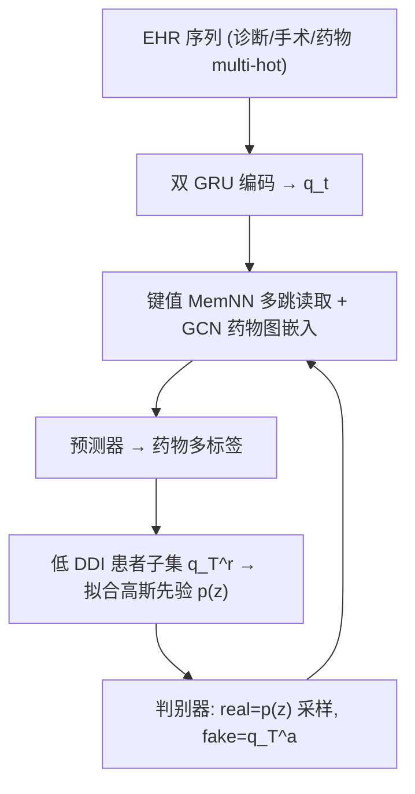
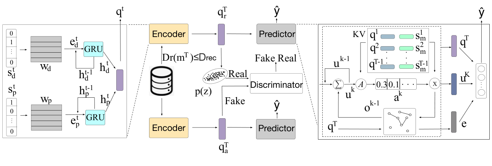

# Self-Supervised Adversarial Distribution Regularization for Medication Recommendation (面向用药推荐的自监督对抗分布正则化)

- **会议/期刊**: IJCAI 2021
- **作者与机构**: Yanda Wang, Weitong Chen, Dechang Pi, Lin Yue, Sen Wang, Miao Xu（南京航空航天大学 / 昆士兰大学 / 东北师范大学）
- **推荐链路定位**: 端到端预测（多标签药物组合生成，非级联排序）
- **研究方向**: 自监督对比学习与交互去噪 / 图神经网络与知识图谱推荐
- **论文原文**: [论文原文链接](https://www.ijcai.org/proceedings/2021/0431.pdf)
- **开源代码**: [https://github.com/yanda-wang/SARMR](https://github.com/yanda-wang/SARMR)

## TL;DR (1分钟核心速览)

用药推荐的致命痛点是药物相互作用（DDI）副作用，而现有方法要么外挂 DDI 知识图谱使模型臃肿，要么把 DDI 率差异极大的患者混为同质队列训练。SARMR 用「自监督」思路：先只用低 DDI 率患者记录训练推荐器，把其患者表征拟合为高斯先验 $p(z)$，再把全体患者表征作为 fake 样本、$p(z)$ 采样作为 real 样本做对抗分布正则。MIMIC-III 上（6,350 患者、153 种药物、末次入院留一预测）取得 F1 0.6608、Jaccard 0.5039，并将 ΔDDI 从 GAMENet 的 +3.06% 降至 **-2.72%**。

## Background & Motivation (背景与核心矛盾)

- **主流范式**: Leap / RETAIN / DMNC 等以 GRU、双层注意力或记忆增强网络编码纵向 EHR，输出药物多标签预测；GAMENet 进一步把 DDI 图以 GCN + 记忆模块形式显式注入模型。
- **前人局限**: ① 引入 DDI 外部知识需要额外的知识抽取与融合组件，模型复杂且带来偏差；② 把 DDI 率分布完全不同的患者当作**单一队列**训练，表征之间相互负迁移，对模型泛化提出苛刻要求。
- **核心洞察 (Key Insight)**: DDI 率不是表征的直接输出，而是由推荐药物组合算出——因此无法直接对隐空间做属性回归；但「低 DDI 率患者」在特征空间中的分布本身就是一个可自监督获取的**先验**。
- **本文切入点**: 不做知识注入，改为**分布对齐**：让所有患者表征都被对抗地拉向低 DDI 率先验，从而在保持可解释映射的同时自然产出更安全的处方。

## Method (核心方法设计)

### 1. 整体框架 (Overall Architecture)

模型分两阶段串行。**阶段一**：以 DDI 率阈值 $D_{rec}=0.4$（由 DDI 率核密度估计的均值确定）筛出安全患者子集，训练「GRU 编码器 + 键值 MemNN 多跳读取 + GCN 药物嵌入 + 预测器」的 MedRec 主分支；该分支末层患者表征$q_T^r$的均值与协方差拟合为高斯先验$p(z)$。**阶段二**：放开全量患者，编码器输出$q_T^a$作为 GAN 的 fake 样本，$p(z)$ 采样作为 real 样本，判别器（MLP）与 MedRec 交替更新，使表征分布向低 DDI 先验收敛，同时预测器仍保证「表征→药物」的可解码性。

<figure class="paper-figure" markdown="span">
  <figcaption>图1：SARMR 的框架。首先，使用 DDI 率 Dr(mT ) ≤Drec 的患者记录训练上分支所示的用药推荐编码器和预测器。然后，相应的患者表示 qT</figcaption>
</figure>

### 2. 关键设计拆解 (Key Designs)

1. **键值记忆多跳读取（MemNN + 药物图 GCN）**：GAMENet 只有单次键值检索，无法推理「医生-患者」多轮交互中的上下文。SARMR 以历史入院表征 $q_t$为 key、真实处方$s_m^t$为 value，第$k$跳做注意力读取并残差更新查询：$a^k=\mathrm{softmax}\big(q^{*}W_a(u^{k-1})^\top\big)$，$o^k=a^k s_m^{*}Z^k$，$u^k=u^{k-1}+o^k$。其中 value 侧用药物共现图$D_G$上的两层 GCN 生成$Z=\hat{A}\tanh(\hat{A}W_e)W_1$（$\hat{A}=\hat{D}^{-1/2}(D_G+I)\hat{D}^{-1/2}$），使药物嵌入携带临床共处方语义，再把$q_T,u_K$与注意力加权药物嵌入$e$拼接打分$\hat{y}=\sigma(f([q_T,u_K,e]))$。
2. **自监督对抗分布正则（核心贡献）**：不引入任何外部 DDI 知识，直接用「数据自身的安全子集」定义先验。判别目标为 $\min_{G}\max_{D}\ \mathbb{E}_{z\sim p(z)}[\log D(z)]+\mathbb{E}_{q_T^a}[\log(1-D(q_T^a))]$。其物理直觉是：低 DDI 率患者表征与高 DDI 率患者表征原本分属$p(z)$与$p_f(z)$，被同质化训练后互相污染（$q_T^{r'}$被$q_T^f$带偏）；对抗对齐把$q_T^f$与$q_T^{r'}$一并「纠回」$p(z)$，等价于在隐空间做**分布层面的去噪/去偏**，而非在输出层打补丁。
3. **训练目标、负采样与推理效率**：预测损失为加权多标签损失 $L=\alpha_1 L_b+\alpha_2 L_m$（$\alpha_1+\alpha_2=1$），$L_b$为逐药物的 sigmoid 交叉熵，$L_m$为多标签 margin 排序损失$L_m=\sum_i\sum_j\frac{\max(0,1-(\hat{y}[\hat{Y}_j]-\hat{y}[i]))}{L}$，迫使真药物概率比非真药物大至少 1 个 margin。**无负采样**（153 类全 label 空间上逐维 sigmoid），训练按 mini-batch 内「预测相 → 正则相」交替，推理只需一次前向，无候选检索开销。

## Experimental Setup & Evaluation Protocol (实验设置与评估协议)

- **数据集与预处理**: MIMIC-III v1.4，仅保留**至少两次入院**的患者，诊断/手术映射到固定词表，入院前 24 小时处方作为标签；使用 top-100 严重 DDI 类型构图 $I_G$。

| 数据集 | #Users | #Items | #Interactions | 稀疏度/密度 | 特征/场景说明 |
| :--- | :---: | :---: | :---: | :---: | :--- |
| MIMIC-III v1.4 | 6,350 | 153 (药物) | 每患者≥2 次入院 | 诊断 1,960 / 手术 1,432 维 multi-hot | 诊断、手术、药物三视图时序 EHR |

- **数据划分与防穿越 (Splitting Strategy)**: 采用**末次入院留一（Leave-Last-Visit-Out）**：用 $t<T$的诊断、手术及历史药物预测第$T$次入院处方；低 DDI 子集筛选依据标签侧 DDI 率$D_r(m_T)\le D_{rec}$，仅用于阶段一与先验拟合（论文未明确报告验证集比例，属复现风险点）。
- **排名评测协议 (Ranking Protocol)**: 不做采样排序，直接在 153 维药物全标签空间上计算 Jaccard、PRAUC、Average F1，并额外定义安全性指标 $\Delta DDI=\frac{1}{N}\sum_i\frac{\text{DDIrate}(\hat{Y}^i)-\text{DDIrate}(Y^i)}{\text{DDIrate}(Y^i)}$，值 <0 即相对真实处方更安全。
- **对比基线与超参设置**: Leap / RETAIN / DMNC / GAMENet，以及自身去掉判别器的 MedRec；嵌入维度经高斯过程搜得，PyTorch + TITAN Xp 实现，开源代码可复现。

## Key Experimental Results (实验关键数据)

### 1. 主实验对比 (Main Results)

| 方法 | ΔDDI ↓ | Jaccard ↑ | PRAUC ↑ | F1 ↑ |
| :--- | :---: | :---: | :---: | :---: |
| Leap | 7.80% | 0.4484 | 0.6457 | 0.6109 |
| RETAIN | 10.43% | 0.4897 | 0.7499 | 0.6494 |
| DMNC | 5.93% | 0.4933 | 0.7269 | 0.6511 |
| GAMENet | 3.06% | 0.4970 | 0.7589 | 0.6544 |
| MedRec | 3.04% | 0.4945 | 0.7635 | 0.6519 |
| **SARMR** | **-2.72%** | **0.5039** | **0.7688** | **0.6608** |
| Improv. (vs 最优基线) | -5.78 pp | +1.39% | +1.30% | +0.98% |

### 2. 消融实验 (Ablation Study)

| 变体 | ΔDDI ↓ | Jaccard ↑ | PRAUC ↑ | F1 ↑ |
| :--- | :---: | :---: | :---: | :---: |
| w/o 双 GRU (S-GRU) | 0.75% | 0.4923 | 0.7670 | 0.6499 |
| w/o MemNN (S-Encoder) | 5.34% | 0.4961 | 0.7646 | 0.6534 |
| w/o GCN (No-GCN) | -0.15% | 0.5026 | 0.7613 | 0.6559 |
| w/o 判别器 (MedRec) | 3.04% | 0.4945 | 0.7635 | 0.6519 |
| **SARMR** | **-2.72%** | **0.5039** | **0.7688** | **0.6608** |

### 3. 关键实验发现 (Key Findings)

1. **对抗正则才是降 DDI 的主因，而非外部知识**：MedRec（同结构、仅去判别器）ΔDDI 为 +3.04%，加回对抗正则后骤降至 -2.72%（相对改善 5.76 pp），且 DDI 率核密度曲线整体左移、在低 DDI 区密度最高；对照 GAMENet（+3.06%）说明「分布对齐」比「DDI 图记忆注入」更有效。
2. **多跳读取与 GCN 提供精度底座**：去 MemNN 的 S-Encoder 精度掉到 F1 0.6534 且 ΔDDI 反升到 5.34%——表征不可解码时正则反而有害；No-GCN 精度次优（F1 0.6559，Jaccard 0.5026）但 ΔDDI 仅 -0.15%，证明临床药物图嵌入是把「分布正则」转化为「安全处方」的必要桥梁。
3. **DDI 类型数变化下的鲁棒性独一档**：把 DDI 图从 top-100 缩到 top-40/60/80，SARMR 的 ΔDDI 恒为负（-4.15% / -0.60% / -3.27% / -2.72%），而 GAMENet 仅在 top-40 侥幸为 -1.08%，其余全为正；Leap 在 top-40 剧烈波动到 -17.80%，说明该基线对 DDI 词表规模极度敏感。

## Highlights & Limitations (亮点、对比与审稿批判)

- **与代表作对比 (vs. Prior Work)**: 相较 GAMENet（DDI 图作记忆模块、知识外挂）与 DMNC（记忆增强但忽略药物关系），SARMR 把「安全」从**输入端的知识约束**改写为**隐空间分布约束**；相较分子生成中的对抗自编码正则（Makhzani、Kadurin、Pan 等），它无需额外的属性回归/搜索任务，先验直接由数据子集定义。
- **可迁移亮点**: ① 「用低风险子群体表征拟合先验 + GAN 拉齐」的范式可迁移到推荐系统的假阳性噪声过滤、流行度/曝光去偏；② 双 GRU 分离建模诊断与手术再线性融合，比单 GRU 更稳（F1 0.6499 → 0.6608），是低成本 trick。
- **审稿级局限批判**: ① **评估单薄**：仅一个数据集、未报告训练/验证/测试划分比例与显著性检验，ΔDDI 的方差与置信区间缺失；② **训练稳定性与可扩展性**：GAN 交替训练在 6 千级患者上可行，但判别器与预测器目标冲突易震荡，跳数 $K$对所有患者固定（作者自承），对长度差异极大的 EHR 序列并非最优；③ 先验由阈值$D_{rec}=0.4$ 一刀切，若临床 DDI 分布偏移，先验失配风险未被讨论。

## Rating (四维评分)

- **方法创新性 (Novelty)**: ⭐⭐⭐⭐ （把「安全性」重构为隐空间先验对齐问题，自监督获取先验、免外部知识，思路干净且有分布层面的理论直觉）
- **评估协议与实验扎实度 (Protocol & Experiments)**: ⭐⭐⭐ （末次入院的防穿越设计与 ΔDDI 指标合理，但仅 MIMIC-III 单数据集、缺划分细节与显著性检验）
- **写作与数学规范度 (Clarity & Rigor)**: ⭐⭐⭐ （MemNN 多跳与 GCN 公式清晰，但 Eq.1 的 DDI 率求和符号书写有误、GAN 目标仅文字描述未给出显式 min-max 公式）
- **工业落地与复现价值 (Industrial & Practical Value)**: ⭐⭐⭐⭐ （代码开源、推理无额外检索开销；但 GAN 训练调参与阈值 $D_{rec}$ 需按医院处方分布重标定）

