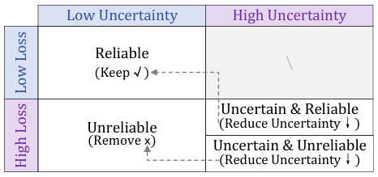
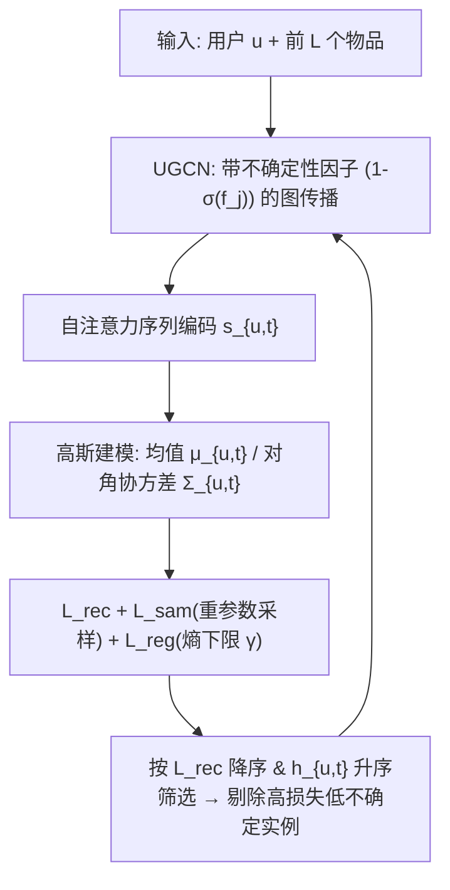

# Does Every Data Instance Matter? Enhancing Sequential Recommendation by Eliminating Unreliable Data (每个数据实例都同等重要吗？通过剔除不可靠数据增强序列推荐)

- **会议/期刊**: IJCAI 2021
- **作者与机构**: Yatong Sun, Bin Wang, Zhu Sun, Xiaochun Yang（东北大学、麦考瑞大学）
- **推荐链路定位**: 召回（Next-Item 序列召回 / 训练数据治理）
- **研究方向**: 序列与会话推荐 / 自监督与交互去噪
- **论文原文**: [https://www.ijcai.org/proceedings/2021/0218.pdf](https://www.ijcai.org/proceedings/2021/0218.pdf)
- **开源代码**: 暂未开源

## TL;DR (1分钟核心速览)

序列推荐（SRS）默认「输入序列 → 下一物品」的每个训练实例都是可靠的，但误点击、他人代点等会制造「目标与输入不匹配」的不可靠实例。本文首次实证：剔除这类实例可让 7 个 SOTA SRS 的 NDCG 最高提升 5.71%。据此提出 BERD：把实例输入建模为高斯分布，用均值算损失、协方差表不确定性，配合不确定性感知图卷积 UGCN 降低模糊序列的不确定性，端到端过滤「高损失 + 低不确定性」实例。在 ML-1M/Steam/CD/Elect 四数据集 1:100 采样排序下，NDCG@10 相对最优基线提升 6.53%–11.98%。

## Background & Motivation (背景与核心矛盾)

- **主流范式**: 以 SASRec/BERT4Rec/HGN 为代表，用自注意力或门控网络从长度为 $L$ 的历史序列中抽取动态偏好，并以 BPR 式成对排序损失拟合下一物品，**默认每个实例的输入与其目标相关**。
- **前人局限**: (i) 真实日志中存在误点击/社交影响导致的「输入-目标错配」，模型会把噪声当成真实偏好拟合，从而系统性偏移表征；(ii) 已有的噪声评分研究面向静态评分预测任务，无法处理序列推荐中「整段前缀 vs 单目标」的匹配关系。
- **核心洞察 (Key Insight)**: 作者用属性/共现双视角可靠性度量（式 1–2）标注实例后发现两类现象：**Obs.1** 不可靠实例损失普遍更高，但高损失实例中混有可靠的；**Obs.2** 高损失的另一来源是「可靠但不确定」的实例——其序列模式模糊，与偏好漂移的用户或语义多义的物品强相关（ML-1M 上约 6% 用户、4% 物品不确定度 > 0.3）。故**只用损失无法区分噪声与歧义**。
- **本文切入点**: 同时建模「损失 + 不确定性」二维信号（图 1 的四象限），并主动降低不确定实例的歧义，使真正不可靠的实例从高不确定区「落入」高损失低不确定区后被剔除。

<figure class="paper-figure" markdown="span">
  <figcaption>图1：基于损失与不确定性的实例分类。</figcaption>
</figure>

## Method (核心方法设计)

### 1. 整体框架 (Overall Architecture)

BERD 由四模块闭环构成：UGCN 在用户-物品异构图（含用户-物品交互边与物品-物品邻接边）上带不确定性因子传播，得到「歧义被补偿」的用户/物品表征；序列模块将 $L$个物品表征加位置编码后过自注意力，与用户一般偏好拼接得序列模式$s_{u,t}$；不确定性建模把$s_{u,t}$映射为对角高斯$(\mu_{u,t},\Sigma_{u,t})$，用采样损失 + 不确定性正则联合训练；每个 epoch 末按实例损失降序与不确定性升序排名，剔除「损失 top-$\alpha$且不确定性处于后 50%」的实例，其梯度不回传，下一轮继续在更高不确定区挖掘。推理时不需要采样与过滤，仅用均值$\mu_{u,t}$ 与物品内积打分。

### 2. 关键设计拆解 (Key Designs)

1. **不确定性感知图卷积 UGCN（让歧义节点「少输出、多吸收」）**: 痛点在于高不确定用户/物品会把噪声扩散给邻居。UGCN 对每个节点携带不确定性因子 $f_u,f_i$，传播时抑制高不确定邻居的贡献，聚合时反向补偿自身：
$$e_u^k=\sum_{j\in\mathcal{M}_u}\frac{1-\sigma(f_j)}{\sqrt{|\mathcal{M}_u|}\sqrt{|\mathcal{M}_j|}}e_j^{k-1},\quad e_u=(1-\sigma(f_u))e_u^0+\sigma(f_u)\sum_{k=1}^{K}\tfrac{1}{k+1}e_u^k$$
直觉：$\sigma(f_u)$ 越大，自身表征越依赖邻居「投票」，用群体信号抵消个体漂移，从而使序列模式更确定。

2. **实例不确定性建模与扩展目标（把歧义写成方差）**: 由 $s_{u,t}$ 生成对角高斯：
$$\mu_{u,t}=W_1s_{u,t}+b_1,\quad \Sigma_{u,t}=\mathrm{ReLU}(W_2s_{u,t}+b_2)\,\sigma(\mathrm{avg}(f_u,f_{i_{t-L}},\dots,f_{i_{t-1}}))$$
不确定性取多元高斯熵 $h_{u,t}=\frac12\sum_{j=1}^{d}\log(2\pi e(\Sigma_{u,t})_j)$。训练用重参数化采样$p_{u,t}^z=\mu_{u,t}+\Sigma_{u,t}^{1/2}\odot\epsilon$构造$\mathcal{L}_{sam}$，并加熵下限正则$\mathcal{L}_{reg}=\sum\max(0,\gamma-h_{u,t})$，防止模型把所有协方差压成 0 的平凡解。物理直觉：可靠实例的均值已贴近目标，压小方差即可降损失；不可靠实例均值远离目标，压小方差反而升高采样损失，故模型只能给「歧义实例」保留高方差——不确定性与可靠性因此被解耦。

3. **训练目标、过滤策略与推理开销**: 总损失 $\mathcal{L}=\mathcal{L}_{rec}+\mathcal{L}_{sam}+\mathcal{L}_{reg}$，其中$\mathcal{L}_{rec}$为成对 BPR 式排序损失，负样本按**均匀/未交互采样**（每目标 1 个负例）；$\lambda$平衡采样损失，$\gamma$ 控制保留不确定性程度，无需额外正则系数。推理零额外开销（仅均值打分）。

## Experimental Setup & Evaluation Protocol (实验设置与评估协议)

- **数据集与预处理**: 丢弃交互数 < 7 的非活跃用户；实例为「滑动窗口 $L=5$ 前缀 + 下一物品」。

| 数据集 | #Users | #Items | #Interactions | 稀疏度/密度 | 特征/场景说明 |
| :--- | :---: | :---: | :---: | :---: | :--- |
| ML-1M | 6,040 | 3,416 | 925,542 | 5.253% | 电影，含 actor/genre/tag 等属性；U-Ratio 13.45% |
| Steam | 60,575 | 5,970 | 3,903,109 | 1.079% | 游戏，含 publisher/tag；U-Ratio 7.34% |
| CD | 12,871 | 10,078 | 209,159 | 0.161% | Amazon CD 评论；U-Ratio 5.79% |
| Elect | 22,502 | 10,649 | 201,973 | 0.084% | Amazon 电子产品；U-Ratio 10.68% |

- **数据划分与防穿越 (Splitting Strategy)**: 每个用户最后两次交互分别作验证/测试，其余训练（`Leave-Last-Two-Out`），严格按时间序，无未来信息穿越。
- **排名评测协议 (Ranking Protocol)**: `Sampled Ranking`——每个测试目标配 100 个用户未交互负例（按**物品流行度分布**采样，1:100），在 101 候选中排序；指标 HR@10 / NDCG@10 / MRR。
- **对比基线与超参设置**: 8 个基线（BPRMF、FPMC、GRU4Rec、Caser、SASRec、BERT4Rec、GC-SAN、HGN）；$d=50$、Adam、lr=0.01、batch=8192、$K=2$、$L=5$、$Z=4$、$\lambda=0.01$、$\gamma=1$、注意力头数 2、过滤比例$\alpha=0.05$（Steam/CD）、$0.1$（ML-1M/Elect）；配对 t 检验（$**\,p\le0.01$,$***\,p\le0.001$）。

## Key Experimental Results (实验关键数据)

### 1. 主实验对比 (Main Results)

| 模型 | ML-1M HR@10 | ML-1M NDCG@10 | Steam NDCG@10 | CD NDCG@10 | Elect NDCG@10 |
| :--- | :---: | :---: | :---: | :---: | :---: |
| FPMC | 0.6319 | 0.4126 | 0.4263 | 0.3936 | 0.1543 |
| GRU4Rec | 0.6453 | 0.4215 | 0.4567 | 0.3185 | 0.1318 |
| Caser | 0.6503 | 0.4251 | 0.4608 | 0.3889 | 0.1457 |
| SASRec | 0.6673 | 0.4359 | 0.4636 | 0.4059 | 0.1706 |
| GC-SAN | 0.6639 | 0.4217 | 0.4604 | 0.3943 | 0.1601 |
| BERT4Rec | 0.6958 | 0.4811 | 0.4694 | 0.4135 | 0.1771 |
| HGN | 0.6935 | 0.4769 | 0.4874 | 0.4202 | 0.1839 |
| **BERD** | **0.7437** | **0.5125** | **0.5458** | **0.4555** | **0.2023** |
| **Improv.** | **+6.88%** | **+6.53%** | **+11.98%** | **+8.40%** | **+10.01%** |

### 2. 消融实验 (Ablation Study)

| 变体 | ML-1M HR@10 | ML-1M NDCG@10 | CD HR@10 | CD NDCG@10 |
| :--- | :---: | :---: | :---: | :---: |
| (a) UGCN + $\mathcal{L}_{rec}$（无不确定性建模） | 0.7225 | 0.4913 | 0.6772 | 0.4238 |
| (b) UGCN + $\mathcal{L}_{rec}$+$\mathcal{L}_{sam}$（去正则） | 0.7246 | 0.4942 | 0.6825 | 0.4267 |
| (c) 经典 GCN 替代 UGCN | 0.7312 | 0.5007 | 0.6849 | 0.4372 |
| (d) GCN + UGCN 传播算子（式3） | 0.7359 | 0.5053 | 0.6916 | 0.4489 |
| (e) GCN + UGCN 融合算子（式4） | 0.7395 | 0.5066 | 0.6927 | 0.4501 |
| (f) **BERD（完整）** | **0.7437** | **0.5125** | **0.6995** | **0.4555** |

### 3. 关键实验发现 (Key Findings)

1. **噪声真实存在且危害显著**：用属性+共现可靠性度量（$r_a,r_c<0.9$ 判为不可靠）过滤后重训 7 个 SRS，Train-Filter / Test-Origin 下 NDCG 最高 +3.88%、双端过滤下 +5.71%；且 BERD 在 **Train-Origin**（不删数据）下即超越所有基线在 **Train-Filter** 下的结果，说明端到端「损失+不确定性」判别优于依赖辅助信息的启发式度量。
2. **两个模块缺一不可**：去掉不确定性建模 (a) 使 ML-1M NDCG 掉 0.0212（0.5125→0.4913，−4.1%），而 (b) 去掉熵正则几乎回落到 (a)，证明单纯采样不足以分配不确定性；UGCN 相对经典 GCN (c) 带来 +1.71% HR / +2.36% NDCG（ML-1M），且传播算子与融合算子分别贡献约 1.0%/0.5% NDCG，二者互补。
3. **过滤是渐进收敛过程**：可视化显示随 epoch 从 1→50，检出不可靠实例比例由 5.04% 升至 5.88%，最大实例不确定性 $h_{u,t}$从 20 降至 10，即 UGCN 先把高不确定实例「降噪」再由过滤器精准摘除；过滤器比例$\alpha$最优区间 0.05–0.10（过大伤及可靠样本），采样数$Z\ge3$即饱和，$\lambda\in[0.01,0.1]$均可，$\gamma$ 最不敏感。

## Highlights & Limitations (亮点、对比与审稿批判)

- **与代表作对比 (vs. Prior Work)**: 与 BERT4Rec/HGN 相比，本文不改序列编码器主干，而是把「数据可靠性」作为可学习信号注入训练过程；与 GC-SAN 相比，图卷积的边权由**学习到的不确定性因子**动态决定而非固定归一化；与传统噪声评分过滤（Burke/Li 等）相比，本文处理序列级「前缀-目标错配」而非静态评分噪声，且不依赖人工阈值或属性信息。
- **可迁移亮点**: (i) 「均值算相关性、方差算可靠性」的对角高斯 + 熵下限正则，可直接嵌入任意 BPR/Softmax 序列模型作置信度学习；(ii) 用「高损失 ∧ 低方差」作为样本筛选规则，比单一 loss-based 难例挖掘更抗噪，可用于 CTR/多任务中的样本重加权。
- **审稿级局限批判**: (i) 评测采用 1:100 流行度采样排序，未做 Full-Ranking，采样负例偏向热门，实际增益在无偏全库排序下可能收窄；(ii) 每 epoch 需对全量实例计算损失并做两次排序（$O(N\log N)$）且训练中需$Z$ 次采样前向，训练开销明显高于 SASRec，论文未给出训练时长/内存对比；(iii) 可靠性度量与 U-Ratio 依赖属性辅助信息，在无属性的稀疏域（如纯 ID 场景）只能退化为纯损失信号，泛化边界未讨论。

## Rating (四维评分)

- **方法创新性 (Novelty)**: ⭐⭐⭐⭐ （首次定义序列推荐「目标-输入错配」并以损失+不确定性二维判据解耦噪声与歧义，高斯均值/方差分工的设计有清晰物理直觉）
- **评估协议与实验扎实度 (Protocol & Experiments)**: ⭐⭐⭐⭐ （4 个跨域数据集、8 基线、6 组消融 + 超参/可视化分析齐全，唯一遗憾是采样排序而非全库排序）
- **写作与数学规范度 (Clarity & Rigor)**: ⭐⭐⭐⭐ （式 1–13 推导链条完整，从损失到熵到过滤规则层层递进；但 UGCN 中 $f$ 的初始化与更新方式交代不足）
- **工业落地与复现价值 (Industrial & Practical Value)**: ⭐⭐⭐ （推理零额外开销、可直接套在已有 SRS 上，但训练期逐 epoch 全量排序过滤成本高，且暂未开源）

