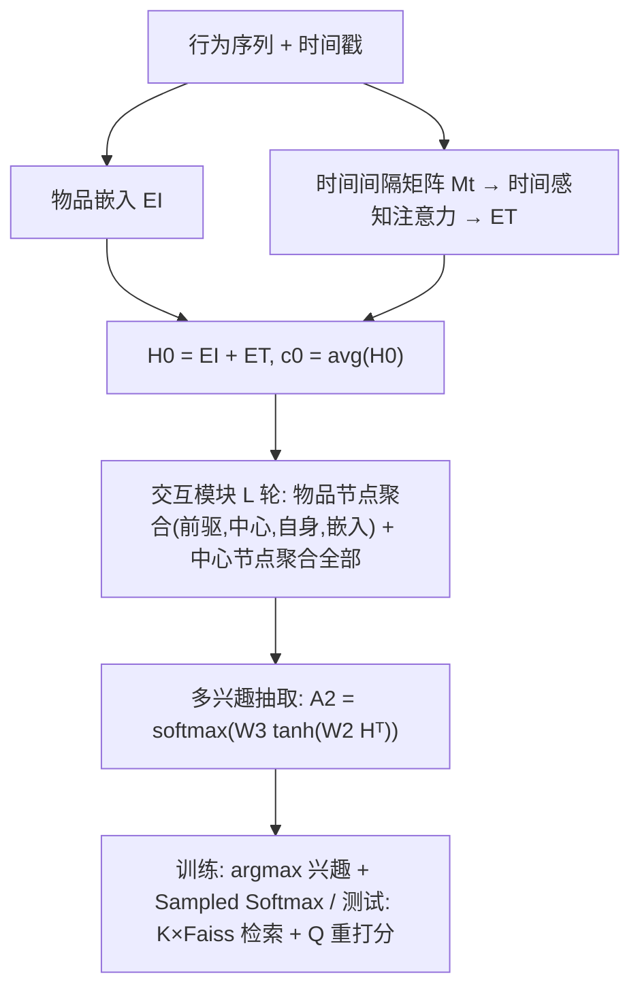
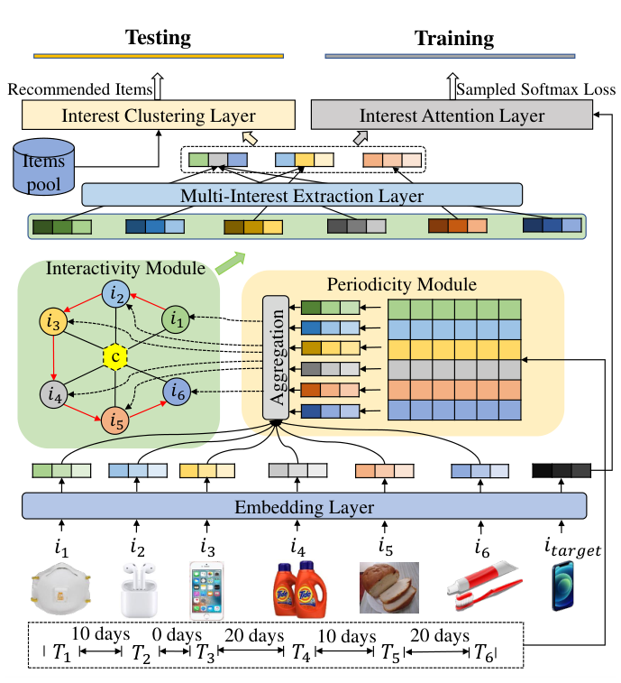
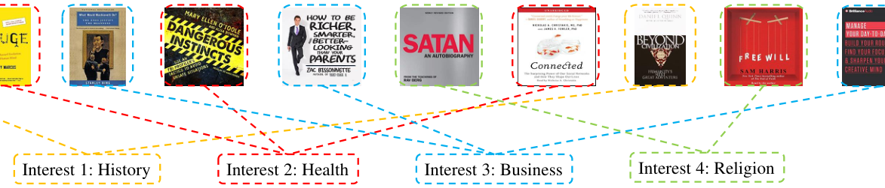

# Exploring Periodicity and Interactivity in Multi-Interest Framework for Sequential Recommendation (面向序列推荐的多兴趣框架中周期性���交互性探索)

- **会议/期刊**: IJCAI 2021
- **作者与机构**: Gaode Chen, Xinghua Zhang, Yanyan Zhao, Cong Xue, Ji Xiang（中科院信息工程研究所 / 中国科学院大学网络空间安全学院）
- **推荐链路定位**: 召回（多兴趣向量 + Faiss 近邻检索）
- **研究方向**: 序列与会话推荐 / 图神经网络与知识图谱推荐
- **论文原文**: [https://arxiv.org/abs/2106.04415v1](https://arxiv.org/abs/2106.04415v1)
- **开源代码**: 暂未开源

## TL;DR (1分钟核心速览)

多兴趣序列推荐（MIND/ComiRec）把用户历史软聚类成 $K$个兴趣向量，但只用时间戳排序、忽略了两件事：不同兴趣的**行为时间间隔周期性**不同，以及序列内物品之间缺乏**交互**（软聚类质量受限）。PIMI 用时间间隔矩阵 + 时间感知注意力注入周期性，用一个"虚拟中心节点 + 顺序边"的图让任意两物品成为二跳邻居以聚合全局/局部交互，再由自注意力抽取$K$ 个兴趣向量。在 Amazon Books 与 Taobao 上按用户 8:1:1 划分、全库排序评估，NDCG@50 相对最强基线 ComiRec 提升 26.0% (Amazon) 与 6.1% (Taobao)。

## Background & Motivation (背景与核心矛盾)

- **主流范式**: GRU4Rec/SASRec 类模型把整条行为序列压成单一用户向量；MIND、ComiRec 改用胶囊动态路由或自注意力抽取多个兴趣向量，缓解单向量表达力不足。
- **前人局限 1**: 时间信息仅用于排序，未显式建模。日用品约每月复购、Apple 新品可能一年一次，不同兴趣的间隔尺度完全不同（图 1），单一时间编码无法表达这种"多周期并存"。
- **前人局限 2**: 只建模相邻物品相关性，忽略非相邻物品交互。多兴趣抽取本质是物品的软聚类，同类物品若不能互相传递信息，聚类边界会漂移；GNN 类方法又反过来丢掉序列顺序。
- **核心洞察 (Key Insight)**: 周期性 = 兴趣粒度的时间尺度信号；交互性 = 聚类所需的物品间信息通路。二者分别提升用户侧与物品侧表征质量，且互补。
- **本文切入点**: 在同一多兴趣框架内并联"时间间隔矩阵注意力"与"序列保持的星型图"，再统一送入兴趣抽取。

## Method (核心方法设计)

### 1. 整体框架 (Overall Architecture)

输入用户行为序列（截断/补齐至长度 $n$）得到物品嵌入$E_I$；周期模块由时间戳构造$n\times n$时间间隔矩阵并编码为$E_T$；二者相加作为图节点初值，进入交互模块做$L$轮"物品节点 ↔ 虚拟中心节点"的多头注意力消息传递；得到的物品特征$H$经自注意力聚成$K$个兴趣向量$M_u$。训练时用 argmax 硬选与目标物品最相关的兴趣做 sampled softmax；测试时每个兴趣各自经 Faiss 全库检索 top-$N$，再用$\max_k$ 打分合并成最终列表。

<figure class="paper-figure" markdown="span">
  <figcaption>图2：我们提出的 PIMI 的架构。PIMI 的输入是用户的行为序列，其中包含一系列物品 ID。物品 ID 被送入嵌入层，以得到每个物品的嵌入表示。同时，我们在周期性模块中构建时间间隔矩阵并引入时间信息。我们聚合每个物品的嵌入表示和时间间隔表示，并将其送入交互性模块。从交互性模块学习到的物品特征用于在多兴趣中生成用户的多兴趣表示。</figcaption>
</figure>

### 2. 关键设计拆解 (Key Designs)

1. **周期模块（Periodicity Module）**：痛点是用绝对时间戳无法表达"同一用户不同兴趣不同周期"。做法是把任意两物品的天数间隔 $d_{ab}=\min(p,d_{ab})$截断成矩阵$M_t$，嵌入为$M_T\in\mathbb{R}^{n\times n\times d}$，用时间感知注意力得到每个物品在时间轴上的位置表征$E_T=\mathrm{softmax}(M_T W_1)^{\top}M_T$。直觉：间隔相近的物品自动获得相似的时间表征，从而在多兴趣聚类中被推向同一簇。
2. **交互模块（Interactivity Module）**：痛点是要同时保留序列顺序与捕捉非局部物品依赖。图结构 = 虚拟中心节点（黑边，使任意两物品成为二跳邻居）+ 相邻物品顺序边（红边，保留局部序信息）。物品更新为 $h_r^{l}=\mathrm{MultiAtt}(Q{=}h_r^{l-1},\,K{=}g_r^{l},\,V{=}g_r^{l})$，其中$g_r^{l}=\mathrm{concat}[h_{r-1}^{l-1};c^{l-1};h_r^{l-1};e_r]$；中心节点更新为$c^{l}=\mathrm{MultiAtt}(c^{l-1},\,\mathrm{concat}[c^{l-1};H^{l}],\,\cdot)$。物品种子嵌入$e_r$ 始终参与，防止深层过平滑。
3. **多兴趣抽取、损失与推理**：$A_2=\mathrm{softmax}(W_3\tanh(W_2H^{\top}))\in\mathbb{R}^{K\times n}$，$M_u=A_2H$。训练用 argmax 选出$m_u$并最小化$\mathcal{L}=-\log\frac{\exp(m_u^{\top}e_o)}{\sum_{v\in\mathrm{Sample}(\mathcal{I})}\exp(m_u^{\top}e_v)}$，采样 10 个负例（sampled softmax，非全库 softmax），省算力但引入采样偏差。测试用$Q(u,R)=\sum_{x\in R}\max_{k}e_x^{\top}m_u^{k}$合并$K$路召回，复杂度与兴趣数$K$ 线性相关。

## Experimental Setup & Evaluation Protocol (实验设置与评估协议)

- **数据集与预处理**（过滤不足 5 次交互的用户/物品即 `5-core`，并剔除非法时间戳）：

| 数据集 | #Users | #Items | #Interactions | 稀疏度/密度 | 特征/场景说明 |
| :--- | :---: | :---: | :---: | :---: | :--- |
| Amazon Books | 459,133 | 313,966 | 8,898,041 | 稀疏；平均时间间隔 76 天 | 书评交互，序列长度上限 20 |
| Taobao | 976,779 | 1,708,530 | 85,383,796 | 稠密；平均时间间隔 1 天 | 点击行为，序列长度上限 50 |

- **数据划分与防穿越**: 按**用户 8:1:1 划分** train/valid/test（"强泛化"设定：测试用户完全不在训练中出现）；训练用滑窗 $(i_{k-n+1},\dots,i_k)\to i_{k+1}$；评估取验证/测试用户序列前 80% 作为输入、预测后 20%，跨用户无泄漏。
- **排名评测协议**: `Full-Ranking`——每个兴趣向量在**全局物品池**上用内积 + Faiss 近邻检索 top-$N$，再按$Q(u,R)$ 重排，非采样负例排序。
- **对比基线与超参设置**: 基线含 YouTube DNN、GRU4Rec、MIND、ComiRec-DR、ComiRec-SA；嵌入维度 $d=64$，Dropout 0.2，学习率 0.001，GNN 层数$L=3$，兴趣数$K=4$，时间间隔阈值 Amazon 取 64 天 / Taobao 取 7 天。原文未报告显著性检验。

## Key Experimental Results (实验关键数据)

### 1. 主实验对比 (Main Results)

| 数据集 / 指标 | Recall@20 | NDCG@20 | HR@20 | Recall@50 | NDCG@50 | HR@50 |
| :--- | :---: | :---: | :---: | :---: | :---: | :---: |
| GRU4Rec (Amazon) | 4.057 | 6.803 | 8.945 | 6.501 | 10.369 | 13.666 |
| YouTube DNN (Amazon) | 4.567 | 7.670 | 10.285 | 7.312 | 12.075 | 15.894 |
| MIND (Amazon) | 4.862 | 7.933 | 10.618 | 7.638 | 12.230 | 16.145 |
| ComiRec-DR (Amazon) | 5.311 | 9.185 | 12.005 | 8.106 | 13.520 | **17.583** |
| ComiRec-SA (Amazon) | 5.489 | 8.991 | 11.402 | 8.467 | 13.563 | 17.202 |
| **PIMI (Amazon)** | **6.996** | **11.221** | **14.377** | **10.934** | **17.094** | **21.619** |
| Improv.% vs 最强基线 | +27.5% | +22.2% | +19.8% | +29.1% | +26.0% | +22.9% |
| GRU4Rec (Taobao) | 5.884 | 22.095 | 35.745 | 8.494 | 29.396 | 46.068 |
| YouTube DNN (Taobao) | 4.205 | 14.511 | 28.785 | 6.172 | 20.248 | 39.108 |
| MIND (Taobao) | 6.281 | 20.394 | 38.119 | 8.155 | 25.069 | 45.846 |
| ComiRec-DR (Taobao) | 6.890 | 24.007 | 41.746 | 9.818 | 31.365 | 52.418 |
| ComiRec-SA (Taobao) | 6.900 | 24.682 | 41.549 | 9.462 | 31.278 | 51.064 |
| **PIMI (Taobao)** | **7.376** | **26.003** | **43.226** | **10.429** | **33.265** | **54.043** |
| Improv.% vs 最强基线 | +6.9% | +5.4% | +3.5% | +6.2% | +6.1% | +3.1% |

### 2. 消融实验 (Ablation Study)

在验证集 Metrics@50 上（%）：

| 变体 | Amazon R / N / HR | Taobao R / N / HR |
| :--- | :---: | :---: |
| PIMI 完整模型 | **11.062 / 17.228 / 21.858** | **10.476 / 33.502 / 54.001** |
| PIMI-P（去周期模块） | 10.758 / 16.823 / 21.155 | 10.076 / 33.025 / 53.076 |
| PIMI-I（去交互模块） | 9.251 / 14.479 / 18.125 | 9.725 / 32.219 / 50.976 |
| PIMI-central node（去虚拟中心节点，仅留顺序边） | 9.896 / 15.734 / 20.146 | — |

### 3. 关键实验发现 (Key Findings)

1. **交互模块贡献远大于周期模块**：去掉交互模块使 Amazon Recall@50 从 11.06 降至 9.25（−16.4%），而去掉周期模块仅降 2.7%；且进一步只保留顺序边（去中心节点）也掉 9.5%，说明"全局二跳交互"而非单纯 GNN 是增益主因——这与多兴趣抽取本质是软聚类的论断一致。
2. **周期性主要改善排序质量而非召回覆盖面**：Amazon 上 NDCG 提升幅度（@50 +26.0%）高于 HR（+22.9%），说明时间间隔编码把"该兴趣下最该出现的物品"排得更靠前；阈值实验显示 64 天最优（10.934），过小（32 天 10.368）学习不足、过大（256 天 10.048）编码稀疏。
3. **稠密数据集收益递减**：Taobao 各项提升仅 3%–7%，因为其平均交互间隔仅 1 天、周期信号极弱；同时 $K=4$、$L=3$ 为最优，层数继续增加带来过平滑与开销，兴趣数过多/过少都偏离真实分布（图 4、图 5）。案例研究（图 3）中该 Amazon 用户的 4 个兴趣被成功分离为历史/健康/商业/宗教，健康类约 5 个月、商业类约半年，验证周期捕获能力。

<figure class="paper-figure" markdown="span">
  <figcaption>图3：一个 Amazon 用户的案例研究。</figcaption>
</figure>

## Highlights & Limitations (亮点、对比与审稿批判)

- **与代表作对比 (vs. Prior Work)**: 相比 MIND（胶囊动态路由、纯序列）、ComiRec（自注意力 + 动态路由、仅相邻相关性），PIMI 显式引入时间间隔核与星型图，把"兴趣聚类"从序列内部推广到全局物品交互；相比 TiSASRec（时间间隔仅用于位置编码打分），本文把间隔信号下沉到表征层，直接服务于多兴趣向量。
- **可迁移亮点**: (1) 用 $n\times n$ 间隔矩阵 + 单头注意力生成"时间位置表征"并与物品嵌入相加，是极低成本的即插即用增强；(2) 虚拟中心节点让任意两物品成为二跳邻居，可在保留序列顺序的前提下把任意序列模型升级为"轻量图模型"，无需构造用户—物品二部图。
- **审稿级局限批判**: (1) 图结构在中心节点聚合时对全部 $n$个物品做多头注意力，$n=50$时尚可，长序列（未来工作自述）会$O(n^2)$ 爆炸；(2) 消融只在验证集上进行、未做多次运行与显著性检验，且 sampled softmax 的 10 个负例使主表数值与全库 softmax 不可直接比较，全库排序评测下的绝对 Recall 偏低（Amazon@20 仅约 7%）也提示任务本身很稀疏。

## Rating (四维评分)

- **方法创新性 (Novelty)**: ⭐⭐⭐⭐ （周期性 + 交互性双模块组合在多兴趣框架中属首次，时间间隔矩阵注意力简洁有效，但缺乏理论/谱分析支撑）
- **评估协议与实验扎实度 (Protocol & Experiments)**: ⭐⭐⭐ （用户级 8:1:1 强泛化 + 全库排序协议规范，但消融仅在验证集、无显著性检验、缺线上或长尾分桶分析）
- **写作与数学规范度 (Clarity & Rigor)**: ⭐⭐⭐⭐ （公式与符号定义清晰、算法伪代码完整，个别记号如 $W_1\in\mathbb{R}^d$与$M_TW_1$ 的维度说明略显松）
- **工业落地与复现价值 (Industrial & Practical Value)**: ⭐⭐⭐ （Faiss 多路召回 + max 合并与工业多兴趣召回范式高度一致，但无开源代码，中心节点 $O(n^2)$ 聚合在长序列上需改造）

