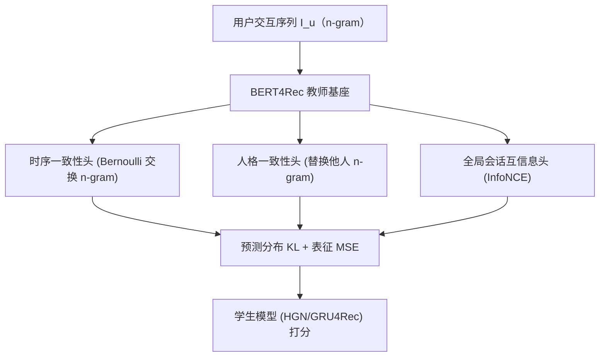
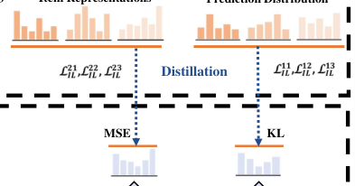
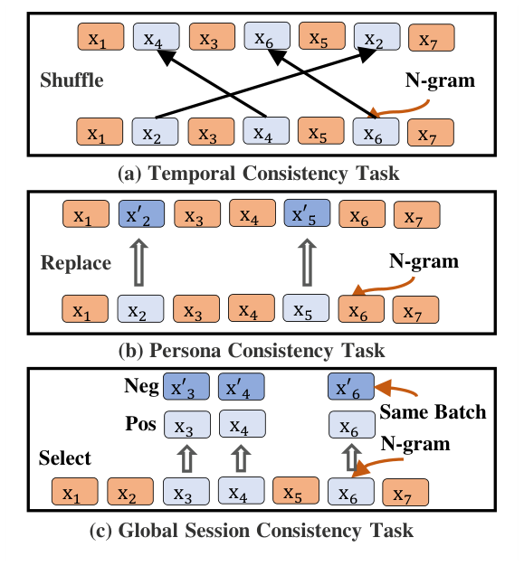

# Improving Sequential Recommendation Consistency with Self-Supervised Imitation (以自监督模仿提升序列推荐一致性)

- **会议/期刊**: IJCAI 2021
- **作者与机构**: Xu Yuan, Hongshen Chen, Yonghao Song, Xiaofang Zhao, Zhuoye Ding, Zhen He, Bo Long（中科院计算所 / 国科大 / 京东）
- **推荐链路定位**: 精排（Next-Item 打分排序），训练阶段外挂预训练-蒸馏
- **研究方向**: 序列与会话推荐 / 自监督与交互去噪
- **论文原文**: [https://arxiv.org/abs/2106.14031v2](https://arxiv.org/abs/2106.14031v2)
- **开源代码**: 暂未开源

## TL;DR (1分钟核心速览)

序列推荐只靠"下一个物品"这一个稀疏监督信号，表征表达力弱、预测抖动大。SSI 先用三条自监督任务（时序一致性、人格一致性、全局会话互信息）各训练一个 BERT4Rec 教师，再用"预测分布 KL + 物品表征 MSE"的模仿学习把三份一致性知识蒸馏进任意学生序列模型（HGN/GRU4Rec）。在 Amazon 四类目、`Leave-Last-Two-Out` + `1:99 采样排序` 协议下，Beauty/Sports/Musical 的 NDCG@10 相对最优基线提升 2.5%/3.8%/3.4%，且弱学生 GRU4Rec 蒸馏后几乎追平强学生。

## Background & Motivation (背景与核心矛盾)

- **主流范式**: Markov 链 → GRU4Rec/HGN 的 RNN 隐状态压缩 → CNN 滑窗 → BERT4Rec 的双向 self-attention + 掩码 cloze 目标，本质都是用"用户-物品动作预测"驱动表征。
- **前人局限**: ①监督信号极稀疏（Musical 类目平均每物品仅 2.2 次交互），物品向量欠学习；②现有模型忽略跨会话的一致性——用户偶发误点击会立刻污染短期兴趣，预测在扰动下不稳定；S³-Rec 虽引入互信息自监督，但没有显式建模"顺序 / 人格 / 全局"三类一致性。
- **核心洞察 (Key Insight)**: 一致性是可自监督构造的免费监督信号——打乱 n-gram 顺序、替换他人 n-gram、掩码后与全局表征做互信息对比，三种扰动天然给出正负样本，且不需要任何物品属性。
- **本文切入点**: 一致性任务必须在整段会话上训练，而推理时只有历史前缀、无法直接优化；于是把一致性知识"预训练成教师 → 蒸馏进学生"，既绕开不可解的一致性目标，又一次性融合三份知识。

## Method (核心方法设计)

### 1. 整体框架 (Overall Architecture)

教师基座为 BERT4Rec（训练随机 `[MASK]` 做 cloze，测试在序列尾追加 `[MASK]` 取其隐状态打分）。在其上分别加挂时序、人格、全局会话三个自监督头，得到三个独立教师；学生是任意序列推荐器（本文默认 HGN）。训练分两阶段：先各自预训练三位教师，再让教师在**训练会话**上产出预测分布与物品表征，学生对二者做 KL 与 MSE 模仿，同时保留自身交叉熵损失。推理阶段只保留学生，输入仅为历史前缀，无额外开销。

<figure class="paper-figure" markdown="span">
  <figcaption>图2：自监督模仿学习框架。教师模型：三个一致性增强模型。学生模型：序列推荐模型。</figcaption>
</figure>

### 2. 关键设计拆解 (Key Designs)

1. **三条自监督一致性任务（构造免费监督）**: 以 n-gram 为单位做扰动，比单物品扰动更保留局部语义。**时序一致性**以 Bernoulli 分布随机交换若干 n-gram 顺序构造负例，序列尾加 `[INT]` token 过 MLP 做二分类，$\mathcal{L}_{temp}=\sum_{i\in\mathcal{D}}[-y^t_i\log h_t(x^t_i)-(1-y^t_i)\log(1-h_t(x^t_i))]$；**人格一致性**把部分 n-gram 替换为其他用户的交互 n-gram，同样二分类判别"是否同一用户"，迫使模型感知跨用户的人格差异；**全局会话一致性**最大化被掩码序列的全局表征$d(\hat{q}_{n:m})$与 n-gram 局部表征$d(q_{n:m})$的互信息，$\mathcal{L}_{global}=-\mathbb{E}\big[d(\hat{q}_{n:m})^{\top}d(q_{n:m})-\log\sum_{\tilde{q}_{n:m}\in\tilde{\mathcal{S}}}\exp(d(\hat{q}_{n:m})^{\top}d(\tilde{q}_{n:m}))\big]$，负样本取自同 batch 其他序列，提供抗噪的全局视角。三教师损失分别为$\mathcal{L}^{i}_{\mathcal{I}}=\mathcal{L}_{MLM}+\lambda_i\mathcal{L}_{\{\cdot\}}$。
2. **双通道模仿学习（把一致性搬进可用模型）**: 只蒸馏 logit 会丢失结构信息，只蒸馏表征又缺排序监督。**预测分布模仿**最小化师生 KL：$\mathcal{L}^{1}_{\mathcal{IL}}(\theta_1,\theta_2)=D_{KL}\big(p(q=Q|\theta_1)\,\|\,p(q=Q|\theta_2)\big)$；**物品表征模仿**约束隐层输出一致：$\mathcal{L}^{2}_{\mathcal{IL}}(\theta_1,\theta_2)=\mathrm{MSE}(g_t(\theta_1),g_s(\theta_2))$，作者称之为"表征提供了一致性蒸馏的 short-cut"。
3. **训练目标、负采样与推理效率**: 学生总目标 $\mathcal{L}'=\mathcal{L}_s+\sum_{i=1}^{n}\lambda_i(\mathcal{L}^{1i}_{\mathcal{IL}}+\mathcal{L}^{2i}_{\mathcal{IL}})$，并把$\lambda_i$设为可学习参数（初始 1），加$\sum_i 1/\lambda_i+(\sum_i 1/\lambda_i)^2$正则实现教师自适应加权，$\mathcal{L}=\mathcal{L}'(+\text{reg})$。训练不使用显式难负采样（教师 MLM 全库 softmax + 全局任务的 in-batch 负例）；推理仅学生一次前向，成本与基座学生相同，教师可离线丢弃。

<figure class="paper-figure" markdown="span">
  <figcaption>图1：自监督一致性预训练任务。(a) 在序列中打乱部分 n-grams 的顺序，用于时序预测任务。(b) 将序列中的部分 n-grams 替换为其他用户的交互 n-grams。(c) 最大化部分 n-grams 与序列其余部分之间的互信息。</figcaption>
</figure>

## Experimental Setup & Evaluation Protocol (实验设置与评估协议)

- **数据集与预处理**: Amazon Review 四个子类目，保留交互数 ≥5 的用户（`5-core`）：

| 数据集 | #Users | #Items | #Interactions | 密度 | 场景说明 |
| :--- | :---: | :---: | :---: | :---: | :--- |
| Beauty | 22,363 | 12,102 | 176,139 | 0.065% | 美妆，人均 7.9 次 |
| Toys | 19,412 | 11,925 | 148,185 | 0.064% | 玩具，人均 7.6 次 |
| Sports | 35,598 | 18,358 | 260,739 | 0.040% | 户外运动，量大 |
| Musical | 10,057 | 36,098 | 77,733 | 0.021% | 乐器，每物品仅 2.2 次，极稀疏 |

- **数据划分与防穿越**: `Leave-Last-Two-Out`——每用户最后两次交互分别作验证/测试，其余训练；教师预训练与学生训练均只用训练集会话。
- **排名评测协议**: `Sampled Ranking`，每条正样本随机配 99 个该用户未交互负样本组成 100 候选，报告 Recall@{5,10,15,20} 与 NDCG@{5,10,15,20}。
- **对比基线与超参**: MostPop、GRU4Rec、BERT4Rec、HGN、GREC、S³-Rec（仅用两条无属性自监督目标以保证公平）；嵌入维度 $d=256$，教师 8 层 self-attention / 4 头，Adam$lr=10^{-3}$，batch 256，$\lambda_1=\lambda_2=\lambda_3=1$。原文未报告显著性检验。

## Key Experimental Results (实验关键数据)

### 1. 主实验对比 (Main Results)

| 模型 | Beauty R@10 | Beauty N@10 | Toys R@10 | Toys N@10 | Sports R@10 | Sports N@10 | Musical R@10 | Musical N@10 |
| :--- | :---: | :---: | :---: | :---: | :---: | :---: | :---: | :---: |
| MostPop | 0.297 | 0.172 | 0.235 | 0.141 | 0.274 | 0.145 | 0.179 | 0.079 |
| GRU4Rec | 0.366 | 0.234 | 0.313 | 0.177 | 0.335 | 0.193 | 0.279 | 0.174 |
| GREC | 0.470 | 0.314 | 0.460 | 0.295 | 0.378 | 0.241 | 0.298 | 0.194 |
| HGN | 0.470 | 0.317 | <u>0.463</u> | <u>0.307</u> | 0.416 | 0.261 | 0.299 | 0.194 |
| BERT4Rec | <u>0.471</u> | 0.320 | 0.459 | 0.302 | <u>0.463</u> | <u>0.290</u> | <u>0.326</u> | 0.204 |
| S³-Rec | 0.470 | <u>0.321</u> | 0.458 | 0.303 | 0.462 | 0.285 | 0.322 | <u>0.206</u> |
| SSI (GRU4Rec 作学生) | 0.473 | 0.326 | 0.465 | 0.308 | 0.467 | 0.296 | 0.328 | 0.202 |
| **SSI (HGN 作学生)** | **0.487** | **0.329** | **0.470** | **0.313** | **0.479** | **0.301** | **0.331** | **0.213** |
| **Improv.% (vs 最优基线)** | **+3.4%** | **+2.5%** | **+1.5%** | **+2.0%** | **+3.5%** | **+3.8%** | **+1.5%** | **+3.4%** |

### 2. 消融实验 (Ablation Study)

Beauty 数据集上的模仿通道消融（表 3）：

| 变体 | Recall@10 | Δ | NDCG@10 | Δ |
| :--- | :---: | :---: | :---: | :---: |
| SSI 完整 | **0.487** | — | **0.329** | — |
| w/o item representation imitation | 0.483 | -0.8% | 0.325 | -1.2% |
| w/o prediction distribution imitation | 0.478 | -1.8% | 0.321 | -2.4% |
| w/o both（退化为基础学生 HGN） | 0.470 | -3.5% | 0.317 | -3.6% |

### 3. 关键实验发现 (Key Findings)

1. **蒸馏通道互补且以 logit 为主干**: 去掉 logit 模仿掉 1.8% Recall@10，远大于去掉表征模仿的 0.8%；但去掉两者性能恰好回到 HGN 基线（0.470/0.317），说明 +3.5% 全部增益来自一致性蒸馏，且表征模仿是把知识"接线"进隐层的加速器。
2. **弱学生收益更大，框架可迁移**: GRU4Rec 单独使用 Sports R@10 仅 0.335，蒸馏后升至 0.467（+39%），几乎追平强学生 HGN 版 SSI；说明一致性知识可从强教师"补平"轻量学生，具备替换 backbone 的通用性。
3. **越稀疏的数据集相对收益越高**: Musical（密度 0.021%、每物品 2.2 次交互）NDCG@10 提升 3.4%，Sports/Beauty 分别 3.8%/2.5%，而 Toys 仅 2.0%——稀疏场景下表征表达力瓶颈最突出，正是自监督一致性发挥作用的区间；同时深教师（8 层）与 1 层浅教师的性能差距在 SSI 中进一步拉大，证明增益来自一致性目标而非单纯堆参数。

## Highlights & Limitations (亮点、对比与审稿批判)

- **与代表作对比 (vs. Prior Work)**: 对比 S³-Rec，本文不是"再加一个互信息自监督目标联合训练"，而是把一致性作为**离线教师知识**与主监督解耦，避免了自监督与 cloze 损失在单模型内的梯度竞争；对比 BERT4Rec/HGN，本文不改动序列编码器结构，纯训练范式增量，可与任意 backbone 正交叠加；对比经典 KD（Hinton 等）的单一强教师，本文是"多教师 + 可学习权重"的一致性集成。
- **可迁移亮点**: ①n-gram 粒度扰动（交换 / 他人替换）比单物品扰动更保局部语义，可直接搬到 SGL/SimGCL 类图增广；②把 $1/\lambda_i+(1/\lambda_i)^2$ 正则用于自适应教师权重，可低成本替换人工调参的多任务权重搜索。
- **审稿级局限批判**: ①评测仅用 `1:99 采样排序`，未做 Full-Ranking，且未报告显著性检验，采样方差可能掩盖 1%–2% 级差异（如 Toys 上 +1.5%）；②三教师需三次 BERT4Rec 级预训练 + 学生联合训练，离线算力约为基线的 4 倍，论文既未给训练时长也未给参数量对比，"教师可离线丢弃"只解决推理不解决训练成本；③人格一致性负例来自"其他用户 n-gram"，在高度同质化类目（如 Beauty）可能构造语义上并不冲突的负例，缺少对该噪声的敏感性分析。

## Rating (四维评分)

- **方法创新性 (Novelty)**: ⭐⭐⭐⭐ （把"一致性"拆成时序/人格/全局三视角并以多教师模仿落地，思路清晰有新意，但三个自监督任务本身均为已有范式重组）
- **评估协议与实验扎实度 (Protocol & Experiments)**: ⭐⭐⭐ （四数据集 + 双学生 + 消融完整，但仅 1:99 采样排序、无全库排序与显著性检验，说服力打折）
- **写作与数学规范度 (Clarity & Rigor)**: ⭐⭐⭐⭐ （公式与三任务定义紧凑清楚、教师权重正则写得规范；但全局一致性中对 $\hat{q}_{n:m}$与$\tilde{\mathcal{S}}$ 的构造细节略含糊）
- **工业落地与复现价值 (Industrial & Practical Value)**: ⭐⭐⭐⭐ （推理零额外开销、可插拔任意学生模型，工程友好；扣分在三次教师预训练的离线成本与暂无开源代码）

