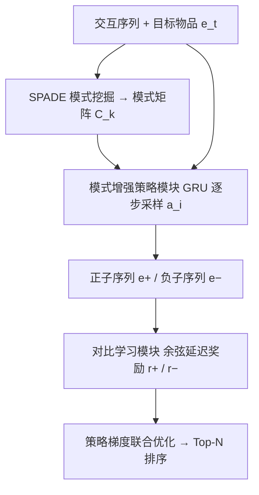

# Pattern-enhanced Contrastive Policy Learning Network for Sequential Recommendation (模式增强的对比策略学习序列推荐网络)

- **会议/期刊**: IJCAI 2021
- **作者与机构**: Xiaohai Tong, Pengfei Wang, Chenliang Li, Long Xia, Shaozhang Niu (北京邮电大学 / 武汉大学 / 百度)
- **推荐链路定位**: 召回（Next-Item 序列建模）
- **研究方向**: 序列与会话推荐 / 自监督对比学习与交互去噪
- **论文原文**: [论文原文链接](https://www.ijcai.org/proceedings/2021/0220.pdf)
- **开源代码**: [开源代码仓库链接](https://github.com/heilsvastika/RAP)

## TL;DR (1分钟核心速览)

针对序列推荐中"并非所有历史物品都与目标物品相关"这一噪声痛点，本文提出 RAP：把序列去噪形式化为马尔可夫决策过程 (MDP)，用随机策略为每个历史物品采样"保留/删除"动作；由于缺乏相关性监督，作者用 SPADE 挖掘频繁序列模式作为先验注入状态表示，并把策略划分出的正/负子序列用延迟奖励做对比学习。在 4 个真实数据集、Leave-One-Out + 1000 负采样排序协议下，HR@10 与 NDCG@10 相对最强基线 BERT4Rec 分别提升 2.08%–3.94% 与 4.50%–4.63%。

## Background & Motivation (背景与核心矛盾)

- **主流范式**: 从 FPMC 马尔可夫链、GRU4Rec 循环网络、Caser 卷积，到 SASRec/BERT4Rec 的自注意力序列建模，均把全部历史交互等权或注意力加权地送入编码器。
- **前人局限**: ①RNN/CNN 类模型对每个物品一视同仁，噪声被直接编码进用户表征；②注意力模型虽给物品打分，但小权重噪声仍参与聚合，且无法**显式剔除**；SASRec+ / HRL 尝试阈值删除，但阈值敏感且删除准则缺乏语义依据；③没有物品级相关性标签可用于监督"该删谁"。
- **核心洞察 (Key Insight)**: 群体行为中反复出现的**频繁序列模式**（如"口红→保湿霜→防晒"共现）隐含了物品间的可信依赖关系，可作为去噪的全局先验；同时，"保留的"与"被删的"子序列本身构成天然的对比正负样本。
- **本文切入点**: 用模式先验引导策略网络做逐步去噪，再用去噪后正负子序列的余弦奖励差构建对比目标，端到端联合优化。

## Method (核心方法设计)

### 1. 整体框架 (Overall Architecture)

输入用户交互序列 $\mathbf{e}^u=\{e_1,\dots,e_n\}$与目标物品$e_t$。先用 SPADE 从全量序列中挖掘长度$\le 5$、支持度$\ge 2$的频繁模式，编译为模式矩阵$C_k$并转为每个物品的上下文向量$C_i$。策略模块以 GRU 逐步扫描序列：状态$s_0=v_{e_t}$由目标物品初始化，每步依据$s_i$采样动作$a_i\in\{1,0\}$，$a_i=1$时用$v_{e_i}\oplus \mathrm{MLP}(C_i)$更新状态，否则状态保持不变，从而把初始序列划分为正子序列$e^+$与负子序列$e^-$。对比模块用另一 GRU 分别编码$e^+,e^-$，计算与$e_t$的余弦相似度作为延迟奖励$r_+,r^-$，以策略梯度式目标联合训练。推理时取每步最大概率动作$a_i^*=\arg\max_{a_i}\pi(a_i|s_i)$得到纯净子序列并计算$r_+$，据此对候选物品排序。

### 2. 关键设计拆解 (Key Designs)

1. **模式增强策略状态 (Pattern-enhanced Policy)**：痛点是相关性无标签、策略难以在稀疏序列上学好。核心改动是把模式共现统计 $C_i$ 经 MLP 拼接到物品嵌入后再送入 GRU：
$$s_i=\mathrm{GRU}\big[s_{i-1},\ \mathbb{I}(a_i=1)\cdot(v_{e_i}\oplus \mathrm{MLP}(C_i))\big]$$
动作概率为 $\pi(a_i=1|s_i)=\sigma(s_i\mathbf{w}_1+b)$。直觉上模式矩阵编码了"从$e_i$出发到各物品的路径频次"，使策略在决策时具备**预见未来序列走向**的能力，无需显式监督即可判定相关性；同时$s_0=v_{e_t}$ 让去噪成为目标条件化 (context-aware)。

2. **正负子序列对比目标 (Contrastive Delayed Reward)**：痛点是仅用 $r_+$会浪费被删物品信息，且错误删除易导致训练崩塌。作者为负子序列也建 GRU 得$v^-$，并令
$$r_+=\frac{v_+\cdot v_{e_t}}{|v_+||v_{e_t}|},\qquad r^-=\frac{v_-\cdot v_{e_t}}{|v_-||v_{e_t}|}$$
$$\mathcal{L}=\sum_{(a_1\cdots a_n)}\prod_i\pi(a_i|s_i)\,r_+-\sum_{(a_1\cdots a_n)}\prod_i\big(1-\pi(a_i|s_i)\big)r^-$$
即"保留正序列得奖励、保留负序列受惩罚"，负项同时构成对比学习，缓解稀疏与错误判别问题。

3. **训练与推理效率**：Adam 优化，GRU 隐层与嵌入维度均 100，学习率 0.001，batch 128；模式挖掘离线完成，训练为目标物品-序列对的端到端 episode；推理仅需一次 GRU 前向 + 候选余弦打分，无负采样、无自回归解码，开销与 SASRec 同级但多一次额外 GRU 编码正子序列。

## Experimental Setup & Evaluation Protocol (实验设置与评估协议)

- **数据集与预处理**: 用户/物品均过滤少于 5 次交互 (`5-core`)，按时间戳排序：

| 数据集 | #Users | #Items | #Interactions | 平均序列长 | 场景说明 |
| :--- | :---: | :---: | :---: | :---: | :--- |
| Beauty | 52,204 | 57,289 | 0.4M | 7.6 | Amazon 美妆 |
| Games | 31,013 | 23,715 | 0.3M | 9.3 | Amazon 游戏 |
| LastFM | 7,694 | 30,658 | 0.2M | 21.11 | 音乐收听 |
| ML-1m | 6,040 | 3,416 | 1.0M | 163.5 | 电影评分 |

- **数据划分与防穿越**: `Leave-One-Out`——最后 1 次交互作测试、倒数第 2 次作验证、其余全部训练，严格按时间戳。
- **排名评测协议**: `Sampled Ranking`——每个测试正样本与 **1,000 个随机未交互负样本**混合排序，报告 HR@10 与 NDCG@10；配对 t 检验 $p<0.05$ 显著。
- **对比基线与超参**: 非序列 BPR/NCF，序列 FPMC/GRU4Rec/Caser/NARM/SASRec/HRL/SASRec+/BERT4Rec；模式最大长度 $k=5$、支持度 2；SASRec+ 注意力阈值 0.015。

## Key Experimental Results (实验关键数据)

### 1. 主实验对比 (Main Results)

| 数据集 | 指标 | GRU4Rec | Caser | NARM | SASRec | HRL | BERT4Rec | **RAP** | Improv.% |
| :--- | :--- | :---: | :---: | :---: | :---: | :---: | :---: | :---: | :---: |
| Beauty | HR@10 | 25.85 | 30.54 | 31.71 | 33.50 | 35.28 | 36.01 | **37.43** | +3.94 |
| | NDCG@10 | 17.10 | 18.25 | 19.39 | 21.37 | 21.60 | 22.70 | **23.75** | +4.63 |
| Games | HR@10 | 36.72 | 45.21 | 48.61 | 56.27 | 56.16 | 58.39 | **60.41** | +3.46 |
| | NDCG@10 | 25.45 | 34.09 | 37.20 | 40.84 | 41.31 | 42.69 | **44.61** | +4.50 |
| LastFM | HR@10 | 28.29 | 31.23 | 32.53 | 34.65 | 34.97 | 36.47 | **37.63** | +3.18 |
| | NDCG@10 | 19.05 | 18.99 | 20.63 | 23.72 | 21.59 | 25.12 | **26.28** | +4.62 |
| ML-1m | HR@10 | 42.54 | 51.89 | 59.29 | 62.01 | 62.30 | 63.04 | **64.35** | +2.08 |
| | NDCG@10 | 34.51 | 42.35 | 47.52 | 51.62 | 49.35 | 52.76 | **55.18** | +4.59 |

### 2. 消融实验 (Ablation Study)

| 变体 | Beauty HR/NDCG | Games HR/NDCG | LastFM HR/NDCG | ML-1m HR/NDCG |
| :--- | :---: | :---: | :---: | :---: |
| RAP$_{-p-c}$ (全去) | 34.56 / 19.56 | 57.08 / 39.03 | 34.79 / 21.31 | 62.12 / 49.03 |
| RAP$_{-p+c}$ (去模式) | 35.69 / 20.23 | 58.23 / 42.46 | 36.05 / 25.57 | 63.13 / 53.09 |
| RAP$_{+p-c}$ (去对比) | 35.38 / 20.01 | 58.04 / 42.04 | 35.66 / 25.35 | 63.30 / 53.32 |
| **RAP (full)** | **37.43 / 23.75** | **60.41 / 44.61** | **37.63 / 26.28** | **64.35 / 55.18** |

### 3. 关键实验发现 (Key Findings)

1. **显式删除优于隐式降权**：HRL(35.28) 与 SASRec+(35.66) 均超过 SASRec(33.50) Beauty HR@10，说明"剔除噪声"比"注意力降权"更有效；RAP 在此基础上再提升 1.8–3.9%，验证了**目标条件化 + 模式先验**的联合价值。
2. **两模块互补而非冗余**：消融中 RAP$_{+p-c}$与 RAP$_{-p+c}$ 互有胜负（如 Beauty 上保留模式 35.38 优于保留对比 35.69，而 LastFM 相反），但完整 RAP 的 NDCG 比任一单模块高 3.5 以上，说明模式提供"删谁"的语义、对比提供"训练信号"的梯度，缺一不可。
3. **NDCG 增益 > HR 增益**：四数据集 NDCG 相对提升 4.50%–4.63%，显著高于 HR 的 2.08%–3.94%，说明去噪主要改善**头部位置精度**（正确的物品被排得更靠前），而非仅仅"命中率"，与案例中 RAP 连续命中面部护理类目而 BERT4Rec 因马尔可夫假设被最近物品"带偏"的现象一致。

## Highlights & Limitations (亮点、对比与审稿批判)

- **与代表作对比 (vs. Prior Work)**: 相比 SASRec/BERT4Rec 的"软注意力加权"，RAP 用 MDP 做**硬性可解释删除**；相比 HRL 的层级用户画像修正，RAP 的创新在于把**频繁模式作为无监督先验注入状态**，缓解了 RL 在推荐中的稀疏与冷启动问题；相比纯对比学习 (SGL 系)，RAP 的对比正负样本由策略动态生成而非随机增广，语义更强。
- **可迁移亮点**: ①用离线模式挖掘 (SPADE) 结果作为状态特征，可低成本嫁接至任意序列编码器；②"正/负子序列各编码一次并做奖励差"的对比目标设计，可直接迁移到对话推荐与序列去噪任务。
- **审稿级局限批判**: ①策略的动作采样不可微，依赖 REINFORCE 式高方差梯度，训练稳定性与收敛速度未做方差分析；②模式挖掘需预设 $k=5$、支持度 2，在长尾/冷启动物品上模式覆盖不足，论文未给出模式覆盖率统计；③评测仅用 1,000 负采样排序而非 Full-Ranking，可能高估绝对值，且推理需两次 GRU 编码，线上延迟未测。

## Rating (四维评分)

- **方法创新性 (Novelty)**: ⭐⭐⭐⭐ （首次将序列去噪形式化为 MDP 并用频繁模式作无监督先验，正负子序列对比奖励设计有新意，但理论分析偏薄）
- **评估协议与实验扎实度 (Protocol & Experiments)**: ⭐⭐⭐⭐ （四数据集跨域验证 + 完整消融 + 配对 t 检验，但仅采样排序、缺少 Full-Ranking 与效率实验）
- **写作与数学规范度 (Clarity & Rigor)**: ⭐⭐⭐⭐ （MDP 与策略梯度推导清晰，公式记号统一，但目标函数中 $\prod_i\pi$ 的连乘近似未严格说明）
- **工业落地与复现价值 (Industrial & Practical Value)**: ⭐⭐⭐⭐ （已开源，离线模式挖掘 + 单次前向推理，工程可行；但依赖 SPADE 挖矿流程与阈值调参）

