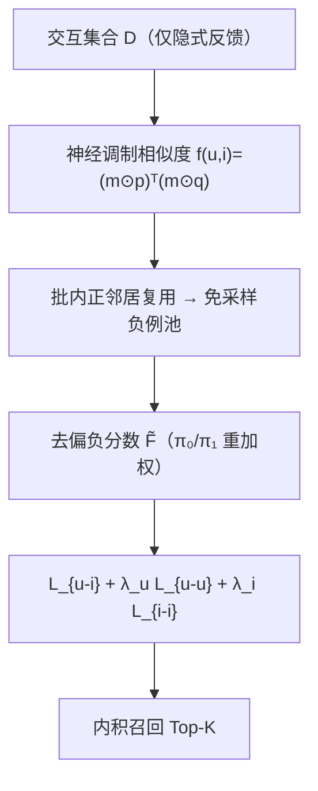
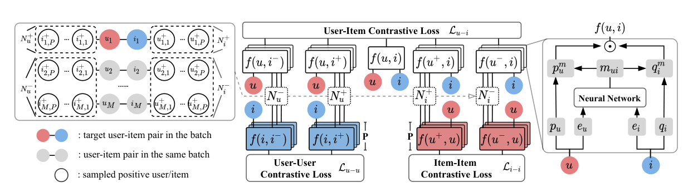

# Trading Hard Negatives and True Negatives: A Debiased Contrastive Collaborative Filtering Approach (权衡硬负例与真负例：一种去偏对比协同过滤方法)

- **会议/期刊**: IJCAI 2022
- **作者与机构**: Chenxiao Yang, Qitian Wu, Jipeng Jin, Xiaofeng Gao, Junwei Pan, Guihai Chen（上海交通大学 MoE 人工智能重点实验室；腾讯）
- **推荐链路定位**: 召回（隐式反馈协同过滤表征学习）
- **研究方向**: 协同过滤与双塔召回 / 自监督对比学习与交互去噪
- **论文原文**: [https://arxiv.org/abs/2204.11752v2](https://arxiv.org/abs/2204.11752v2)
- **开源代码**: 暂未开源

## TL;DR (1分钟核心速览)

隐式反馈 CF 的训练信号几乎全部来自负例，但"挖硬负例"与"避开假负例"天然冲突：BPR 的均匀采样信号太弱，IRGAN/SD-GAR 需 GAN/RL/双层优化且仍把未观测交互当作真负例。本文提出 HDCCF：用 set-wise 对比损失让梯度正比于 $e^{f/\tau}$ 从而自动聚焦硬负例，用批内正邻居复用实现对频次敏感的免采样，并给出对真负例分布的无偏去偏估计。在 ML-100K/ML-1M/Yelp/Gowalla 的 Leave-One-Out 协议下，NDCG@10 相对最优基线 SD-GAR 提升 4.94%–9.09%。

## Background & Motivation (背景与核心矛盾)

- **主流范式**: 点式（PMF）、对式（BPR）与硬负例挖掘（IRGAN、SD-GAR）均从无标签集合中采负例，或以频次先验、或以生成器/强化学习自适应挑选"嵌入近但应远离"的样本。
- **前人局限**: ① *效率 vs 有效性*：自适应硬负例依赖复杂训练技巧（GAN 判别器、策略梯度、双层优化），难以在大规模上稳定复现；② *信息量 vs 可靠性*：所有方法默认"未观测即真负"，而曝光后本会点击的样本被误当负例，噪声信号会系统性拉偏表征。
- **核心洞察 (Key Insight)**: 硬负例与假负例在相关性分数上外观几乎一致（都高分），因此"先区分再剔除"不可行；但若把目标写成一个**集合级 softmax**，则每个负例的梯度天然正比于自身分数，硬度可被自动识别；同时对采样分布做**重要性重加权**即可在期望意义上还原真负例分布，无需显式判别。
- **本文切入点**: 用"集合级对比 + 频次隐式采样 + 无偏去偏项"一次性化解上述两个 trade-off。

## Method (核心方法设计)

### 1. 整体框架 (Overall Architecture)

输入仅为用户-物品交互集合，用户/物品嵌入经神经调制模块生成**样本相关**的调制向量，得到相关性打分 $f(u,i)$。每个 batch 内，正样本自身的邻居用户/物品被复用为其他样本的负例，构成免显式采样的负例池，分别送入用户-物品、用户-用户、物品-物品三个对比损失；其中负分数项先用偏差校正系数$\pi_0,\pi_1$ 重加权（去偏），再与正分数做 softmax。推理阶段退化为标准内积最近邻检索，仅需一次前向。

<figure class="paper-figure" markdown="span">
  <figcaption>图1：硬度感知去偏对比协同过滤（HDCCF）框架概览。</figcaption>
</figure>

### 2. 关键设计拆解 (Key Designs)

1. **集合级硬度自适应目标（免 GAN/RL 的硬负例挖掘）**：对式损失只看单个 (正, 负) 对，梯度大小与负例硬度无关；本文改为把一个正例与 $S$ 个负例放进同一 softmax 分母。其梯度为
$$\frac{\partial\mathcal{L}_{u-i}}{\partial f(u',i')}=\frac{1}{\tau}P(u',i')\propto e^{f(u',i')/\tau},\quad \frac{\partial\mathcal{L}_{u-i}}{\partial f(u,i)}=-\frac{1}{\tau}\sum_{(u',i')}P(u',i')$$
即难负例（分高）自动获得更大梯度，且负例梯度被同批"同伴"归一化——硬度是**相对**的，因而对标签噪声不像 BPR 那样敏感；同时从用户侧与物品侧双向挖负例，避免"某用户的所有负例都太好分"的退化。

2. **频次感知的免采样策略 + 无偏去偏**：显式采样 $2M(S+P)$个候选不可扩展，改为复用 batch 内其他正例的邻居，负例数从$S$扩到$P(M-1)$，开销降至$2M\times P$。可证明
$$\mathbb{E}\left[n^{u-i}_{i'}\right]=\frac{M-1}{|\mathcal{D}|-1}\cdot P\cdot|\mathcal{U}_{i'}|$$
即负例出现次数正比于物品流行度，等价于隐式按频次采样硬负例。为消除假负例，把负分数改为带校正项的**去偏负分数**
$$\tilde{F}_u(\mathcal{N}^-_i,\mathcal{N}^+_i)=\sum_{u^-\in\mathcal{N}^-_i}\pi^u_0(u^-,i)e^{f(u^-,i)}-\sum_{u^+\in\mathcal{N}^+_i\cup\{u\}}\pi^u_1(u^+,i)e^{f(u^+,i)}$$
其中 $\pi_0,\pi_1$由假负例概率$\omega^+_u$ 解析给出（并做下界截断防 log 负值）。定理 1 证明该目标是从**真负例分布**采样的理想损失的**无偏估计**——这是本文最硬的理论增量。

3. **神经调制相似度与训练目标**：固定用户向量无法表达"对不同物品的差异化偏好"，故
$$\boldsymbol{m}_{ui}=\sigma\big(g(\boldsymbol{e}_i\|\boldsymbol{e}_u\|(\boldsymbol{e}_i\odot\boldsymbol{e}_u))\big),\quad f(u,i)=(\boldsymbol{m}_{ui}\odot\boldsymbol{p}_u)^\top(\boldsymbol{m}_{ui}\odot\boldsymbol{q}_i)$$
总损失 $\mathcal{L}=\mathcal{L}_{u-i}+\lambda_u\mathcal{L}_{u-u}+\lambda_i\mathcal{L}_{i-i}$，无显式负采样、无需额外判别器；推理与 MF 等价，成本为$O(d)$ 内积。

## Experimental Setup & Evaluation Protocol (实验设置与评估协议)

- **数据集与预处理**:

| 数据集 | #Users | #Items | #Interactions | 稀疏度/密度 | 特征/场景说明 |
| :--- | :---: | :---: | :---: | :---: | :--- |
| ML-100K | – | – | – | – | 电影评分（正文未给统计） |
| ML-1M | 6,039 | 3,415 | 999,611 | 4.847% | 电影评分，稠密 |
| Yelp | 23,056 | 15,575 | 648,687 | 0.181% | 商户评论，稀疏 |
| Gowalla | 72,454 | 56,173 | 1,360,493 | 0.033% | LBSN 签到，极稀疏 |

- **数据划分与防穿越**: 采用 `Leave-One-Out`：按时间戳升序，每用户最后一个交互为测试、倒数第二个为验证、其余为训练。
- **排名评测协议**: 沿用 NCF 系列常规设定（1 正 + 采样负例的 `Sampled Ranking`，具体负例数原文未明示），指标为 HR@10、NDCG@10、NDCG@50；**未报告 Full-Ranking 全库排序结果**。
- **对比基线与超参设置**: 4 个经典 CF（PMF、BPR、SVD++、NeuMF）+ 1 个免采样方法 ENMF + 2 个硬负例挖掘方法（IRGAN、SD-GAR）；显著性 $p<0.01$。关键超参：温度$\tau$、偏差校正概率$\omega^+_i,\omega^+_u\in[10^{-6},0.2]$、正邻居采样数$P\in[1,6]$、辅助损失权重$\lambda_u,\lambda_i$。

## Key Experimental Results (实验关键数据)

### 1. 主实验对比 (Main Results)

| 模型 | ML-1M HR@10 | ML-1M NDCG@10 | Yelp HR@10 | Yelp NDCG@10 | Gowalla HR@10 | Gowalla NDCG@10 |
| :--- | :---: | :---: | :---: | :---: | :---: | :---: |
| PMF | 0.7109 | 0.4396 | 0.3048 | 0.1609 | 0.7341 | 0.5353 |
| BPR | 0.7162 | 0.4435 | 0.3093 | 0.1644 | 0.7402 | 0.5411 |
| SVD++ | 0.7230 | 0.4496 | 0.3268 | 0.1830 | 0.7303 | 0.5292 |
| NeuMF | 0.6991 | 0.4283 | 0.3230 | 0.1835 | 0.7456 | 0.5498 |
| ENMF | 0.7273 | 0.5193 | 0.3710 | 0.2212 | 0.7895 | 0.6124 |
| IRGAN | 0.7205 | 0.4705 | 0.3197 | 0.1776 | 0.7721 | 0.5894 |
| SD-GAR | 0.7323 | 0.5320 | 0.3459 | 0.1929 | 0.8060 | 0.6321 |
| **HDCCF** | **0.7596** | **0.5788** | **0.3911** | **0.2413** | **0.8311** | **0.6633** |
| Improv. | +3.72% | +8.80% | +5.41% | +9.09% | +3.11% | +4.94% |

NDCG@50 上 HDCCF 同样全面最优（ML-1M 0.6233 / Yelp 0.2983 / Gowalla 0.6895，相对提升 6.69% / 7.96% / 3.98%）；三项数据集平均提升 HR@10 +4.08%、NDCG@10 +7.61%、NDCG@50 +6.21%。

### 2. 消融实验 (Ablation Study)

原文消融仅以 Fig. 2 柱状图给出（未列表数值），下表按文本陈述的性能序关系整理：

| 变体 | 说明 | 相对趋势 |
| :--- | :--- | :---: |
| HDCCF | 完整模型 | 最优 |
| w/o-U | 去掉用户-用户对比损失 $\tilde{\mathcal{L}}_{u-u}$ | 次优（小幅下降） |
| w/o-I | 去掉物品-物品对比损失 $\tilde{\mathcal{L}}_{i-i}$ | 次优（小幅下降） |
| w/o-U&I | 仅保留去偏用户-物品对比损失 | 明显下降 |
| BPR+ | 将对比损失替换为 BPR 损失 | 进一步下降 |
| Biased | 去掉偏差校正（不去偏） | 最差（大幅下降） |

调制模块消融（Fig. 3，ML-100K）：加入神经调制后，负例相关性分数上界左移、正例下界右移，正负分布**重叠区间显著收窄**，判别性提升。

### 3. 关键实验发现 (Key Findings)

1. **去偏收益在稀疏数据上更显著**：Yelp（密度 0.181%）NDCG@10 相对提升 9.09%，高于稠密的 ML-1M（8.80%）与极稀疏但交互量大的 Gowalla（4.94%），说明假负例污染在"中等稀疏 + 短交互序列"场景杀伤最大，去偏项的边际价值随噪声比例上升。
2. **免采样 + 集合级目标 ≥ 复杂硬负例挖掘**：ENMF（免采样、频次加权 pair-wise）NDCG@10 已达 0.5193 / 0.2212，而 HDCCF 进一步到 0.5788 / 0.2413，且显著优于依赖 GAN 的 IRGAN（0.4705）与 SD-GAR（0.5320）——硬负例的关键不在采样器复杂度，而在于损失是否让梯度随硬度自适应分配。
3. **组件贡献可分解且非冗余**：消融呈现 strict ordering（完整 > 单辅助损失 > 仅用户-物品 > 换 BPR > 不去偏），其中"换 BPR"仍低于"仅保留对比损失"，证明增益来自**目标函数形式与去偏**而非调制网络结构本身；$\omega^+$在$[10^{-6},0.2]$内存在明显最优区间，$P$ 从 1 增至 6 单调提升（更多对照样本降方差、稳训练）。

## Highlights & Limitations (亮点、对比与审稿批判)

- **与代表作对比 (vs. Prior Work)**: 相较 IRGAN/SD-GAR 用判别器或"生成-重加权"两阶段挖硬负例，HDCCF 只需一个集合级 softmax 便获得同等甚至更强的硬度自适应能力，且无额外模型与双层优化；相较 ENMF 只靠频次先验加权 pair-wise 损失，本文进一步证明该频次效应可以从"批内正邻居复用"中**隐式涌现**（Prop. 1/2），并以定理 1 补齐了假负例的无偏性保证，这是 ENMF 与 Robinson 等对比学习去偏工作（仅处理单一类型假负例、无 U-U/I-I 项）所不具备的。
- **可迁移亮点**: ①"批内正邻居复用为负例"可作为通用免采样负例池，直接移植到 LightGCN、序列推荐的双塔训练中，几乎零额外开销；② $\pi_0/\pi_1$的偏差校正只需一个标量超参$\omega^+$ 即可落地，便于在工业数据上做敏感性扫描。
- **审稿级局限批判**: ① 评测沿用 1 正 + 采样负例的协议而**未给全库 Full-Ranking**，在采样分布偏移下 HR/NDCG 可能高估真实召回能力，也未与 LightGCN 等图 CF 强基线对比；② 实际开销被低估——每个 batch 需 $2M\times P$次邻居采样且负例池随$P$线性膨胀，$\omega^+$需按数据集手工调参、$\tau$ 亦敏感，文中缺少训练时间/显存与线上延迟的量化报告。

## Rating (四维评分)

- **方法创新性 (Novelty)**: ⭐⭐⭐⭐ （把"硬度自适应"与"真负例无偏估计"统一进一个集合级对比目标，定理 1 给出严格无偏性，理论增量扎实）
- **评估协议与实验扎实度 (Protocol & Experiments)**: ⭐⭐⭐ （三数据集跨稀疏度覆盖 + 7 个基线 + $p<0.01$ 显著性，但仅采样排序、无 Full-Ranking，消融未给数值表）
- **写作与数学规范度 (Clarity & Rigor)**: ⭐⭐⭐⭐ （梯度分析与 Prop.1/2 推导清晰，$\pi_0/\pi_1$ 具体形式下放附录，主线符号自洽）
- **工业落地与复现价值 (Industrial & Practical Value)**: ⭐⭐⭐ （推理退化为内积检索、部署成本极低，但未开源、训练侧批内负例池与 $\omega^+$ 调参带来工程负担）

