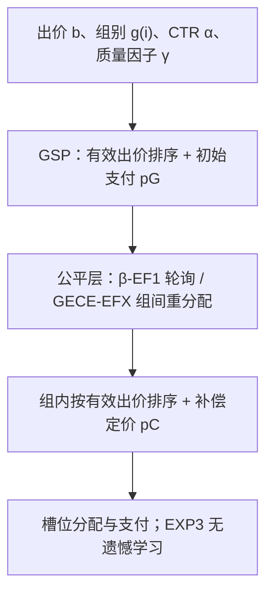

# Fair Equilibria in Sponsored Search Auctions: The Advertisers' Perspective（赞助搜索拍卖中的公平均衡：广告主视角）

- **会议/期刊**: IJCAI 2022
- **作者与机构**: Georgios Birmpas, Andrea Celli, Riccardo Colini-Baldeschi, Stefano Leonardi；Sapienza University of Rome / Bocconi University / Meta
- **推荐链路定位**: 精排（广告位拍卖与定价机制层；非 CTR 模型结构）
- **研究方向**: CTR/CVR 预估与特征交叉（按指定目录归入）/ 去偏公平、可信隐私与工业架构
- **论文原文**: [https://arxiv.org/abs/2107.08271v3](https://arxiv.org/abs/2107.08271v3)
- **开源代码**: 暂未开源

## TL;DR (1分钟核心速览)

本文针对 GSP 广告拍卖只追求效率、忽视广告主群体公平的问题，提出 **β-Fair GSP** 与 **GSP-EFX**：在 GSP 后加一层组级 EF1/EFX 公平分配，并用 GSP 支付补偿因公平重分配而降位的广告主。理论上证明效率下界、预算平衡与无遗憾学习收敛到 BCCE；真实广告日志（20 广告主、$10^4$ 轮）上整体社会福利损失最坏约 10%，补偿约占 GSP 收入 20–40%。

## Background & Motivation (背景与核心矛盾)

- **主流范式**: 赞助搜索普遍用 GSP 按“有效出价 = 质量因子 × CTR × 出价”排序分配槽位，按下一名有效出价计费；效率好，但组间曝光由预算与竞争自然决定。
- **前人局限**: ① 个体 envy-freeness 在不可分槽位上通常不可保证，且只保护单个广告主，难对齐群体公平；② 已有公平拍卖多要求重构机制，难作为后处理层接入既有 GSP，也缺少对受损广告主的经济补偿。
- **核心洞察 (Key Insight)**: 公平可只改“组间槽位分配”，组内仍按 GSP 有效出价排序；这样公平分配不依赖出价，能同时保证对报价与估值的 EF1/EFX。效率损失可用 GSP 支付再分配部分抵消。
- **本文切入点**: 把 GSP 与组级 fair division 组合成“复合机制”，并分析策略学习下的均衡社会福利。

## Method (核心方法设计)

### 1. 整体框架 (Overall Architecture)

每轮拍卖输入广告主出价 $b$、组别$g(i)$、槽位 CTR$\alpha_{j,g(i)}$与质量因子$\gamma_{g(i)}$。先运行标准 GSP 得到初始槽位分配$\nu^G(i)$与支付$p_i^G$；公平层按组标签把槽位在多数组$h$与少数组$\ell$ 之间重分配（β-EF1 轮询或 GECE-EFX）；组内仍按有效出价降序排列；最后按降位幅度调低支付以补偿受损者。重复拍卖中广告主用 EXP3 学习出价，收敛到 BCCE。

### 2. 关键设计拆解 (Key Designs)

1. **组级 β-EF1 轮询分配**：痛点是个体 EF1 不适用于群体且难落地。定义 $\beta=\xi_\ell/\xi_h$（$\xi_\ell=1$），要求对每组对存在一个被移除槽位$j_h$ 使
$\mathrm{ALG}_\ell(J_\ell,b)\ge \beta\,\mathrm{ALG}_\ell(J_h\setminus\{j_h\},b)$。
轮询规则：首槽给 $h$，次槽给$\ell$，之后每轮给$h$共$\xi_h$个、给$\ell$共$1$个。由于组间槽位分配不依赖出价，故对估值也成立；$\beta$ 可调公平强度。

2. **组级 β-EFX 的 GECE 分配**：EF1 只保证“移除一个最差槽位后不嫉妒”，EFX 要求对任意槽位都不嫉妒：
$\forall j_h\in J_h,\ \mathrm{ALG}_\ell(J_\ell,b)\ge \beta\,\mathrm{ALG}_\ell(J_h\setminus\{j_h\},b)$。
GECE 按 CTR 降序逐槽分配：若两组互相嫉妒则交换已有分配；否则若 $\ell$不嫉妒$h$则给$h$，反之给$\ell$。直觉是避免少数组只拿到“被施舍”的低质槽位。

3. **补偿定价与推理开销**：若广告主被降位（$\nu^C(i)>\nu^G(i)$），支付改为
$p_i^C=p_i^G-2b_i\gamma_{g(i)}(\alpha_{\nu^G(i),g(i)}-\alpha_{\nu^C(i),g(i)})$；
否则 $p_i^C=p_i^G$。系数 2 用于覆盖效用损失并维持均衡处个体理性，且不向升位者加价。总损失为$\mathcal{L}=\sum_i(p_i^G-p_i^C)$；无离线训练与负采样，每轮仅需 GSP 排序$O(n\log n)$加公平层$O(m)$，可作在线后处理。

## Experimental Setup & Evaluation Protocol (实验设置与评估协议)

- **数据集与预处理**: 原文无公开 benchmark，使用某大型互联网广告公司真实日志构造模拟环境；无 5-core 过滤。

| 数据集 | #Users/广告主 | #Items/槽位 | #Interactions/拍卖 | 稀疏度/密度 | 特征/场景说明 |
| :--- | :---: | :---: | :---: | :---: | :--- |
| 真实广告日志（私有） | 20 | 20 | $10^4$ 轮 | 不适用（重复拍卖） | 两组各 10；每广告主 101 类估值；组特定 CTR、质量因子与折扣曲线 |

- **数据划分与防穿越 (Splitting Strategy)**: 非传统训练/测试划分；用真实出价分布归一化生成少数组估值，多数组估值固定为 1；折扣曲线来自真实日志，两组分别对应不同转化类型；重复拍卖 $T=10^4$，20 次重复。
- **排名评测协议 (Ranking Protocol)**: 非 Full-Ranking / Sampled Ranking；评估 EXP3 无遗憾学习后的经验频率 $\bar{\sigma}^T$ 是否收敛到 BCCE，报告 20 次运行的均值与标准差。
- **对比基线与超参设置**: 基线为 GSP、真实报价的 SW-OPT、不同 $\xi_h$的 β-Fair GSP，以及 GSP-EFX 的理论界；$\xi_\ell=1$，$\xi_h\in\{1,\dots,9\}$，$\beta=1/\xi_h$，$\gamma=(1,1)$；无 embedding 维度与显著性检验。

## Key Experimental Results (实验关键数据)

### 1. 主实验对比 (Main Results)

原文无传统推荐主实验表；下表汇总机制理论保证与图 1 实证读数（读图近似，非精确表）。

| 机制/配置 | 社会福利下界 | 预算平衡 | PoC | 图 1 实证读数 |
| :--- | :---: | :---: | :---: | :--- |
| GSP（基准） | $1$|$1$|$1$ | SW 基准；补偿 0 |
| β-Fair GSP，$\xi_h=1$（$\beta=1$） |$\ge 1/2$| 2-budget |$1/6$| SW 损失最坏$\approx 10\%$；补偿$\approx 40\%$ |
| β-Fair GSP，$\xi_h=3$（$\beta=1/3$） |$\ge 3/4$| 2-budget |$3/14$| SW 损失较小；补偿趋近$\approx 20\%$ |
| β-Fair GSP，$\xi_h=9$（$\beta=1/9$） |$\ge 9/10$| 2-budget |$9/38$| SW 损失可忽略；补偿$\approx 20\%$ |
| GSP-EFX | $\ge 1/3$| 4-budget |$1/8$ | 公平更强；原文未给完整实证曲线 |

### 2. 消融实验 (Ablation Study)

以公平强度 $\xi_h$ 作为核心消融变量（图 1 读数）：

| $\xi_h$（$\beta$） | 整体 SW 相对 GSP | 少数组 SW | 多数组 SW | 补偿/GSP 支付 |
| :---: | :---: | :---: | :---: | :---: |
| 1（1） | 最坏 $\downarrow\approx 10\%$| 提升最大 | 下降最大 |$\approx 40\%$ |
| 3（1/3） | 小幅下降 | 提升 | 小幅下降 | $\approx 20\%$ |
| 9（1/9） | 近似可忽略 | 略提升 | 略下降 | $\approx 20\%$ |

### 3. 关键实验发现 (Key Findings)

1. **公平强度与效率/收入存在可量化权衡**：$\xi_h=1$时整体 SW 损失最坏约 10%，补偿占 GSP 收入近 40%；$\xi_h$ 增大后补偿稳定在约 20%，SW 差距可忽略，说明公平层可作为“可调旋钮”部署。
2. **分组福利方向符合设计目标**：少数组 SW 随公平约束收紧而提升，多数组相应下降；总 SW 损失被支付再分配部分抵消，实际补偿比例低于 2-budget/4-budget 最坏界，理论界偏保守。
3. **策略学习下机制仍稳健**：EXP3 外部遗憾次线性增长使经验频率收敛到 BCCE；β-Fair GSP 的 PoC 为 $1/(2(2+\beta))$、GSP-EFX 为$1/8$，说明自利广告主不会破坏公平均衡。

## Highlights & Limitations (亮点、对比与审稿批判)

- **与代表作对比 (vs. Prior Work)**: 相比 Ilvento et al. (2020) 的个体公平+envy-free 平台效用最大化、Chawla & Jagadeesan (2020) 的公平-福利权衡，本文把**组级 EF1/EFX** 作为 GSP 后处理层，并首次用 GSP 支付补偿效率损失；相比 Dwork & Ilvento (2019) 的组合公平分析，额外给出无遗憾学习下的 PoC 保证。
- **可迁移亮点**: ① 公平层只改组间槽位、不改组内排序，可低成本嵌入既有 GSP；② 用“降位补偿、升位不加价”的支付再分配把公平约束转化为预算问题，适合其他资源分配场景。
- **审稿级局限批判**: ① 实验仅 20 个广告主、私有日志、无公开代码，GSP-EFX 缺少完整实证；② 理论依赖两组、$|I_h|,|I_\ell|\ge m$、保守出价及 Assumption 1/2，大规模在线收入损失、延迟与多组扩展仍未验证。

## Rating (四维评分)

- **方法创新性 (Novelty)**: ⭐⭐⭐⭐ （组级 EF1/EFX 与 GSP 支付补偿的组合机制较新，且有 PoC 与 semi-smoothness 理论支撑）
- **评估协议与实验扎实度 (Protocol & Experiments)**: ⭐⭐⭐ （真实日志+20 次重复合理，但规模小、私有数据、无公开 baseline，GSP-EFX 实证不足）
- **写作与数学规范度 (Clarity & Rigor)**: ⭐⭐⭐⭐ （定义、定理与证明完整，机制与公平概念链条清晰；符号略密）
- **工业落地与复现价值 (Industrial & Practical Value)**: ⭐⭐⭐ （后处理层易集成，但 20–40% 收入补偿与大规模在线验证仍是落地门槛）

