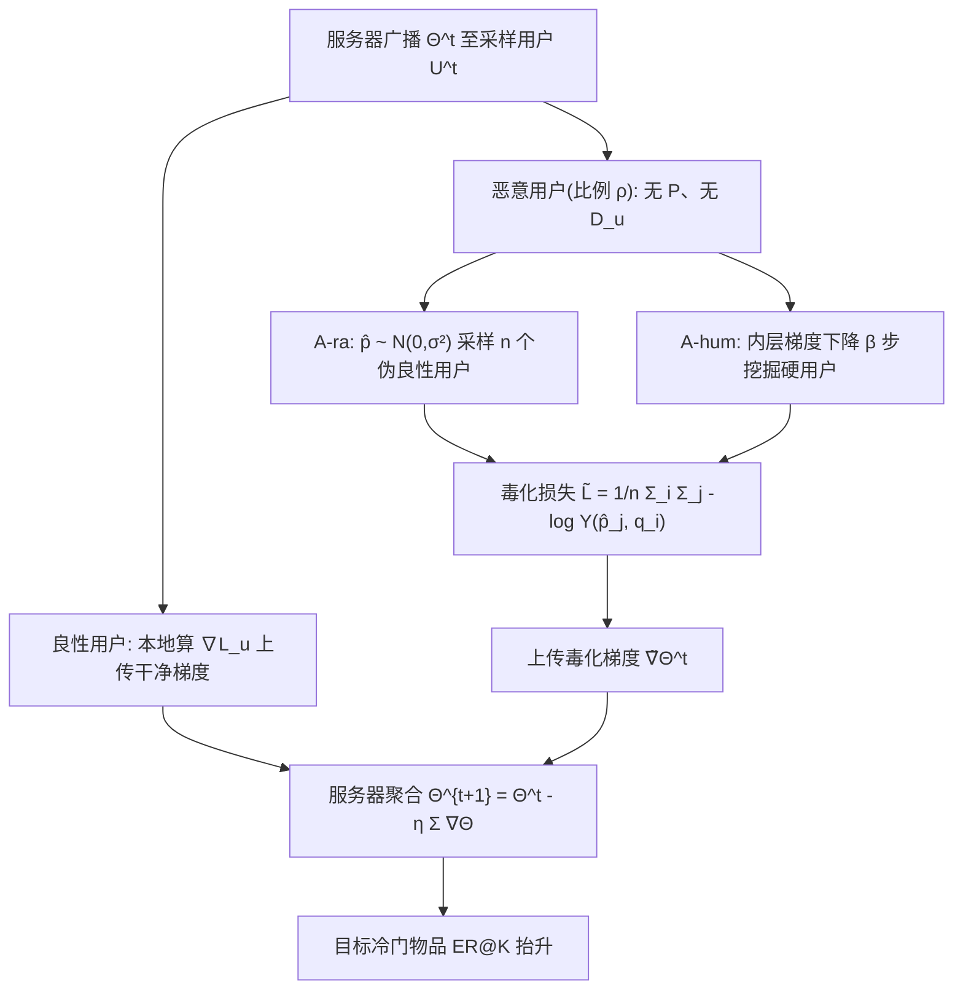

# Poisoning Deep Learning Based Recommender Model in Federated Learning Scenarios (联邦学习场景下深度学习推荐模型的投毒攻击)

- **会议/期刊**: IJCAI 2022 (Main Track)
- **作者与机构**: Dazhong Rong, Qinming He, Jianhai Chen (浙江大学计算机学院)
- **推荐链路定位**: 端到端训练阶段（联邦训练中的梯度聚合环节）
- **研究方向**: 去偏公平、可信隐私与工业架构（联邦推荐安全 / 模型投毒）
- **论文原文**: [https://arxiv.org/abs/2204.13594v2](https://arxiv.org/abs/2204.13594v2)
- **开源代码**: [https://github.com/rdz98/PoisonFedDLRS](https://github.com/rdz98/PoisonFedDLRS)

## TL;DR (1分钟核心速览)

联邦推荐 (FR) 把用户嵌入 $p_u$与交互$D_u$全部留在本地，使得依赖"注入假交互"的数据投毒与依赖"物品流行度/公开交互"的 FedRecAttack、PipAttack 同时失效。本文指出真正的漏洞在于梯度上传通道：恶意客户端只需用$p\sim\mathcal{N}(0,\sigma^2)$近似未知的良性用户嵌入，即可在**零先验知识**下伪造毒化梯度$\tilde{\nabla}_\Theta$。在 ML/AZ 两数据集、全库排序的 ER@K 协议下，仅 **0.1%** 恶意用户（前人方法需 ≥5%）就把最冷门目标物品的 ER@10 稳定推到 1.0，ER@5 终值较随机近似基线相对提升 **+148.8%**。

## Background & Motivation (背景与核心矛盾)

- **主流范式**: 联邦推荐将物品嵌入与 MLP 参数 $\Theta$放在中心服务器，用户仅本地更新$p_u$并上传$\nabla_\Theta L_u$，服务器按$\Theta^{t+1}=\Theta^t-\eta\sum_{u\in U^t}\nabla_{\Theta^t}L_u$ 聚合，以隐私保护为卖点。
- **前人局限一（数据投毒失效）**: Random/Bandwagon 及 Li、Huang 等人的投毒攻击需要真实交互或物品流行度作为先验，而 FR 中攻击者既看不到 $D_u$也看不到$P$，攻击完全无法构造。
- **前人局限二（FL 模型投毒失效）**: Bagdasaryan、Fang 等人的模型投毒要求对完整模型有访问权，但 FR 中用户嵌入矩阵 $P$ 分布式存储、无人持有全量，梯度无法直接反解。
- **核心洞察 (Key Insight)**: 对比学习类工作 (SGL/SimGCL) 已论证受 L2 正则约束的用户嵌入方向近似均匀分布于单位球面，因此**未知的良性用户嵌入可以被各向同性高斯先验无偏代理**；此外，被目标物品标为负样本的"硬用户"其干净梯度与毒化梯度方向相反，是攻击衰减的主因。
- **本文切入点**: 用"分布近似 + 难例挖掘"两步替代先验知识，把攻击目标从不可微的 ER@K 松弛为可微的平均预测分数。

## Method (核心方法设计)

### 1. 整体框架 (Overall Architecture)

以 NCF ($\hat{Y}_{ui}=\Upsilon(p_u,q_i)=a_{out}(h^\top\Phi(p_u\oplus q_i))$，BCE 损失) 为基模型。每轮服务器广播$\Theta^t$给采样用户集$U^t$；良性用户本地更新$p_u$并上传干净梯度$\nabla_{\Theta^t}L_u$；攻击者控制比例为$\rho$的恶意客户端，这些客户端**只**能拿到$\Theta^t$，看不到$P$与任何$D_u$。恶意端先用可微代理重构"虚拟良性用户"，再据此计算毒化损失$\tilde{\mathcal{L}}$的梯度并上传，最终系统实际优化目标等价于$\sum_{u\in U}L_u+\alpha\tilde{\mathcal{L}}$，其中折中系数$\alpha$ 由恶意端学习率隐式调节，从而在提升目标物品曝光的同时保持模型可收敛、不触发异常检测。

### 2. 关键设计拆解 (Key Designs)

1. **攻击目标的两级可微松弛（A-ra 的随机近似）**：ER@K 是高非连续函数且依赖未知的 $P$与$D_u$，无法直接反传。作者先以"目标物品对全体良性用户的平均预测分"替代 ER@K，再把未知的$p_u$替换为随机变量$\hat{p}\sim\mathcal{N}(0,\sigma^2)$的$n$ 次采样，得到
$\tilde{\mathcal{L}}(\Theta)=\frac{1}{n}\sum_{i\in\tilde{\mathcal{I}}}\sum_{j=1}^{n}-\log\Upsilon(\hat{p}_j,q_i).$刻意写成与$L_u$同构的 BCE 形式（把预测分推向 1）以保证隐蔽性；$n$ 越大随机性扰动越小、攻击越稳。
2. **硬用户挖掘（A-hum）**：对满足 $(i,0)\in D_u$的良性用户，其上传梯度会持续压低$\hat{Y}_{ui}$，与毒化梯度正面对抗，导致攻击在训练后期衰减。作者借用 OHEM 思想，对每个目标物品构造内层损失$l_i(p)=-\log(1-\Upsilon(p,q_i))$，从$\mathcal{N}(0,\sigma^2)$出发做$\beta$ 步梯度下降
$\hat{p}_{ij}\leftarrow\hat{p}_{ij}-\xi\,\frac{\partial l_i}{\partial \hat{p}_{ij}}(\hat{p}_{ij}),$把伪嵌入"搬"到最难被推荐的位置，再代入同一$\tilde{\mathcal{L}}$。直觉上这是把攻击梯度预先对齐到"最不利用户"的反向梯度上，实现正面对冲。
3. **训练目标、负采样与推理开销**：良性端沿用 BCE + 负采样比 $r{=}4{:}1$；恶意端无需采样负例（硬用户由内层优化隐式生成），仅需$\Theta$的梯度。额外开销为每轮每目标物品$\beta{=}30$次反向传播，$n{=}10$次前向，相对本地训练可忽略；攻击对 NNCF/ONCF 等任何以 DNN 学习$\Upsilon$ 的模型通用。

## Experimental Setup & Evaluation Protocol (实验设置与评估协议)

- **数据集与预处理**: 隐式化（有评分/评论即正例），ML 保留 ≥20 交互用户，AZ 保留 5-core。

| 数据集 | #Users | #Items | #Interactions | 密度 | 特征/场景说明 |
| :--- | :---: | :---: | :---: | :---: | :--- |
| MovieLens (ML) | 6,040 | 3,706 | 1,000,208 | 4.47% | 中等规模、稠密电影评分 |
| Amazon Digital Music (AZ) | 16,566 | 11,797 | 169,781 | 0.087% | 大规模、极稀疏数字音乐评论 |

- **数据划分与防穿越**: 每个用户交互按 **4:1 比例随机划分**训练/测试（非 Leave-One-Out、非全局时间戳切分），训练负采样比 $r=4{:}1$；恶意用户在训练开始前注入，逐 epoch 评估。
- **排名评测协议**: **Full-Ranking**——在用户全部未交互物品上取预测分 Top-$K$，指标为平均曝光率$\mathrm{ER@}K$（$K=5,10,20,30$），目标物品取**最冷门**的$T=1$ 个物品（最难被抬升，保证公平）。
- **对比基线与超参**: 仅保留零先验下仍可用的两个基线——Random Attack (RA) 与 Explicit Boosting (EB，PipAttack 的无先验组件)；PipAttack/FedRecAttack/集中式投毒因依赖先验被排除。NCF 隐层 $2\times8$，用户/物品嵌入$d=8$，学习率 0.001，训练 30 epoch；$n=10,\sigma=0.01,\xi=0.001,\beta=30$；$\rho=0.5\%$(ML)、$0.1\%$ (AZ)。

## Key Experimental Results (实验关键数据)

### 1. 主实验对比 (Main Results)

原文结果以 30 轮 ER@K 曲线呈现（图 1），下表按"轨迹形态 + 峰值/终值水平"归纳：

| 攻击方法 | ML ER@5 | ML ER@10 | ML ER@20 | ML ER@30 | AZ ER@5 | AZ ER@10 | AZ ER@20 | AZ ER@30 | 稳定性 |
| :--- | :---: | :---: | :---: | :---: | :---: | :---: | :---: | :---: | :--- |
| RA (数据投毒) | ≈0 | ≈0 | ≈0 | ≈0 | ≈0 | ≈0 | ≈0 | ≈0 | 完全失效 |
| EB (显式抬分) | 小幅上升 | 小幅上升 | 小幅上升 | 小幅上升 | 小幅上升 | 小幅上升 | 小幅上升 | 小幅上升 | 过半程后持续下降 |
| A-ra (随机近似) | **→1.0** | **→1.0** | **→1.0** | **→1.0** | **→1.0** | **→1.0** | **→1.0** | **→1.0** | 前期最快，后期回落 |
| A-hum (硬用户挖掘) | **→1.0** | **→1.0** | **→1.0** | **→1.0** | **→1.0** | **→1.0** | **→1.0** | **→1.0** | 上升稍慢但终值最高 |

### 2. 消融实验 (Ablation Study)

ML 上 $\rho=0.1\%$ 时 A-ra 与 A-hum 的对照（消融"硬用户挖掘"模块，原文图 3 明确给出数值）：

| 变体 | ER@5 峰值 | ER@5 终值 | ER@10 峰值 | ER@10 终值 |
| :--- | :---: | :---: | :---: | :---: |
| A-ra (w/o hard user mining) | 0.4514 | 0.2302 | 0.9960 | 0.5900 |
| **A-hum (full)** | **1.0000** | **0.5728** | **1.0000** | **1.0000** |
| Improv. | +121.5% | +148.8% | +0.4% | +69.5% |

### 3. 关键实验发现 (Key Findings)

1. **梯度通道的杠杆远大于数据通道**：RA 在 $\rho=0.5\%$时 ER 全为 0（数据投毒需注入可观假交互），而 A-ra/A-hum 在$\rho$ 降至 **0.1%** 时 ER@10 仍能保持 1.0——把攻击所需的恶意用户比例从既有工作的 ≥5% 压低了近两个数量级。
2. **硬用户是攻击衰减的唯一主因**：A-ra 的 ER@5 从峰值 0.4514 腰斩至终值 0.2302，说明 $(i,0)\in D_u$的良性用户上传的反向梯度会持续侵蚀毒化效果；A-hum 用$\beta=30$ 步内层优化把这批用户"预对齐"，终值 ER@5 提升 +148.8%、ER@10 从 0.5900 拉到 1.0000，且恶意比例越低增益越显著。
3. **隐蔽性与有效性的可调权衡**：$\tilde{\mathcal{L}}$复用 BCE 形式、$\alpha$ 由恶意端学习率隐式控制，模型在 30 轮内不出现推荐有效性崩塌或 ER 曲线断崖；代价是 A-hum 前期上升慢于 A-ra（内层挖掘开销 + 对冲后的保守梯度），属于"以收敛速度换终局强度"。

## Highlights & Limitations (亮点、对比与审稿批判)

- **与代表作对比**: vs **PipAttack/FedRecAttack**——后两者依赖物品流行度或公开交互，本文用高斯先验 + 难例挖掘彻底去掉先验；vs **集中式数据投毒 (Li 2016 / Huang 2021)**——后者需访问真实交互，在 FR 中不可行；vs **FL 模型投毒 (Bagdasaryan 2020 / Fang 2020)**——后者需完整模型访问，而 FR 的 $P$本地化使其失效，本文正是绕开$P$ 的重构难题。
- **可迁移亮点**: (i) 用"嵌入方向均匀分布"这一对比学习性质做**未知用户表征的贝叶斯代理采样**，可迁移到冷启动/隐私受限下的用户侧建模；(ii) A-hum 的"内层梯度挖掘最不利样本"可直接反用为防御端的对抗增广与鲁棒聚合加权。
- **审稿级局限批判**: (i) 实验仅覆盖 NCF ($d{=}8$, 2 隐层) 与两个数据集，未验证 LightGCN/序列模型等更强 backbone，也未给出攻击的 wall-clock 开销（每轮每目标$\beta{=}30$次反传在$T$增大时线性膨胀）；(ii) **完全缺失防御评估**——未测 FedAvg 鲁棒聚合、梯度裁剪/差分隐私、恶意客户端检测，而 ER@K 一旦饱和到 1.0 便丧失区分度，$\sigma,n,\beta$ 的敏感度分析亦付之阙如。

## Rating (四维评分)

- **方法创新性 (Novelty)**: ⭐⭐⭐⭐ （首次在零先验约束下攻击联邦推荐，用分布近似 + OHEM 式硬用户挖掘替代先验知识，问题定义本身即贡献）
- **评估协议与实验扎实度 (Protocol & Experiments)**: ⭐⭐⭐ （全库排序 + 最冷门目标物品的设定公平且有说服力，但基线仅 2 个、结果以曲线呈现、缺防御实验与显著性检验）
- **写作与数学规范度 (Clarity & Rigor)**: ⭐⭐⭐⭐ （两级松弛的动机推导链条清晰、公式与 BCE 同构设计讲得透，唯 $\alpha$ 与学习率的等价关系仅口头说明）
- **工业落地与复现价值 (Industrial & Practical Value)**: ⭐⭐⭐⭐ （代码已开源、攻击仅需少量恶意客户端，对联邦推荐上线前的红队评估与鲁棒聚合设计有直接警示价值）

