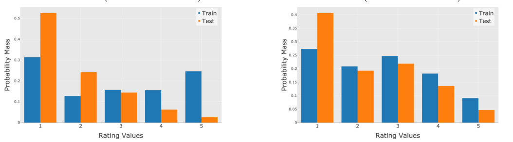
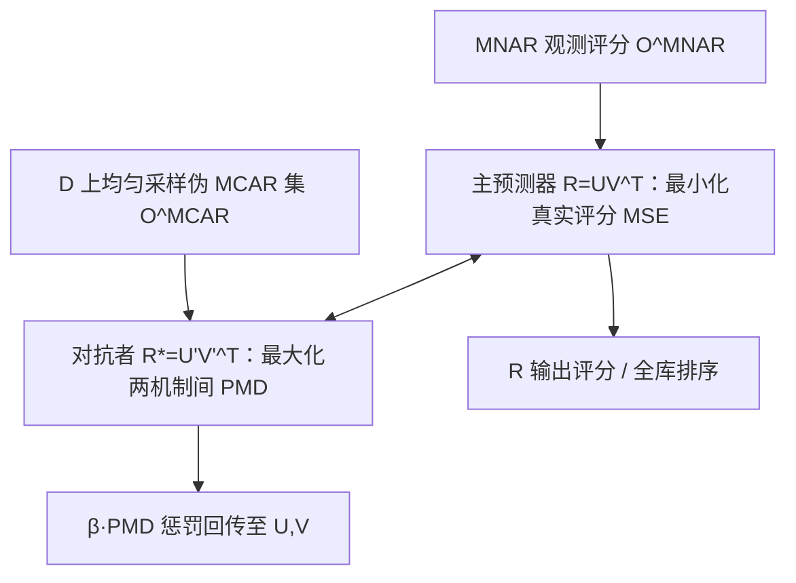
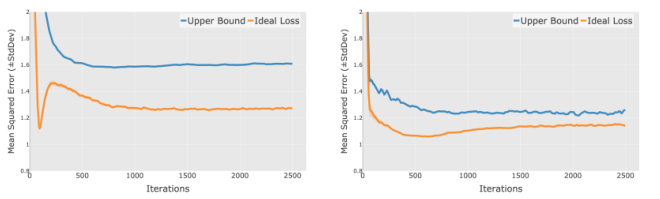

# Towards Resolving Propensity Contradiction in Offline Recommender Learning (破解离线推荐学习中的“倾向性矛盾”)

- **会议/期刊**: IJCAI 2022
- **作者与机构**: Yuta Saito (Cornell University), Masahiro Nomura (CyberAgent, Inc.)
- **推荐链路定位**: 精排（评分预测 / 全库排序）
- **研究方向**: 去偏公平与工业架构 / 协同过滤
- **论文原文**: [论文原文链接](https://arxiv.org/abs/1910.07295v6)
- **开源代码**: 暂未开源

## TL;DR (1分钟核心速览)

真实显式评分数据的缺失机制是 MNAR，IPS 类方法虽可去偏，却依赖额外的 MCAR 数据来估计倾向得分——不用 MCAR 就无效、用了 MCAR 又违背初衷，这就是论文点名的“倾向性矛盾”。本文借无监督域适应（UDA）框架定义两个倾向矩阵之间的差异度量 PMD，推导出**与倾向得分无关**的理想损失泛化上界；进而提出对抗式矩阵分解 DAMF，通过一个“最难预测矩阵”与主预测器在 MCAR/MNAR 两视角下的对抗博弈最小化该上界。在 Yahoo! R3 与 Coat 自带的 MCAR 测试集上，仅用 MNAR 训练时 MSE 相对 MF-IPS 降低 26.3% / 5.59%，NDCG@5 更是首次反超使用**真倾向得分**的 IPS/DR。

## Background & Motivation (背景与核心矛盾)

- **主流范式**: 对 MNAR 显式反馈去偏的主流方案是 IPS/DR，通过 $1/P_{u,i}$ 加权把观测样本的经验风险还原为无偏的理想风险；工程上普遍从训练集中切一小块 MCAR 数据来拟合倾向模型。
- **前人局限**: ①IPS 的无偏性仅在**真倾向可得**时成立，估计误差会直接引入新偏差，估计器选错时甚至劣于朴素 MF；②CausE 引入了域正则，但设计上仍强制需要 MCAR 训练数据，且正则项只是启发式、无理论保证；③1BitMC 虽可免 MCAR 估计倾向，却仍预设下游使用 IPS 加权，遇到 $P_{u,i}=0$ 的配对（如 Coat 中男工不给女装打分）直接失效。
- **核心洞察 (Key Insight)**: 训练（MNAR）与测试（MCAR）两个分布之间的差异**可以用假设空间上的行为差异来度量**，而无监督域适应中的 discrepancy 度量恰好只依赖分布而**不依赖倾向得分**。因此，“去偏”可以从“重加权样本”转为“对齐两个缺失机制下的假设空间”。
- **本文切入点**: 定义 Propensity Matrix Divergence (PMD) 并证明理想损失可被“MNAR 朴素损失 + 经验 PMD + 假设类复杂度 + 置信项”上界，用对抗训练最小化前两项。

<figure class="paper-figure" markdown="span">
  <figcaption>图 2：Yahoo! R3 和 Coat 的训练集与测试集的评分分布。注：两个数据集的训练集与测试集之间的评分分布存在显著差异。注意 KL-div</figcaption>
</figure>

## Method (核心方法设计)

### 1. 整体框架 (Overall Architecture)

模型主体仍是标准 MF，$\hat{R}=UV^{\top}$。训练时交替执行两个角色：主预测器$\hat{R}=UV^{\top}$最小化 MNAR 上的真实评分损失（拟合有标注数据）；判别器/对抗者$\hat{R}^{*}=U'(V')^{\top}$在假设类内**最大化**同一预测器在 MCAR 均匀采样集与 MNAR 观测集上“配对损失”之差，即把两个缺失机制里最难对齐的方向挖出来。主预测器再对此差异做惩罚，于是无需任何倾向得分估计、也无需一张真实的 MCAR 反馈表，就能压小理想损失的泛化上界。推理阶段只保留$U,V^{\top}$ 内积打分。

### 2. 关键设计拆解 (Key Designs)

1. **PMD：不依赖真值的分布差异度量**：IPS 需要 $P_{u,i}$，而 PMD 只需两个**观测矩阵**。定义
$\psi_{\hat{R},\mathcal{H}}(P,P') := \sup_{\hat{R}'\in\mathcal{H}}\{\mathcal{L}_{\ell}(\hat{R},\hat{R}';P)-\mathcal{L}_{\ell}(\hat{R},\hat{R}';P')\}$，
其中 $\mathcal{L}_{\ell}(\hat{R},\hat{R}';P)=\frac{1}{M}\sum P_{u,i}\,\ell(\hat{R}_{u,i},\hat{R}'_{u,i})$是两预测矩阵之间的配对损失。它满足非负性、次可加性与$\psi(P,P)=0$，且**与真实评分矩阵$R$ 无关**——这正是它能替代 IPS 的物理直觉：只需比较“同一对假设在哪类数据上更难区分”，无需知道评分数值本身。

2. **倾向无关泛化上界（Theorem 1）**：以至少 $1-\delta$ 的概率，
$\mathcal{L}^{\mathrm{ideal}}_{\ell}(\hat{R})\le\hat{\mathcal{L}}^{\mathrm{naive}}_{\ell}(\hat{R};O^{\mathrm{MNAR}})+\psi_{\hat{R},\mathcal{H}}(O^{\mathrm{MCAR}},O^{\mathrm{MNAR}})+2L\big(3\mathfrak{R}_{P,M}(\mathcal{H})+2\mathfrak{R}_{P',M}(\mathcal{H})\big)+3\Delta\sqrt{\frac{\log(6/\delta)}{2M}}$。
相比前人用有限 $|\mathcal{H}|$的界（参数连续时$|\mathcal{H}|=\infty$，界失效），这里改用 Rademacher 复杂度，从而在无限假设类下依然有效；$\psi$项出现在右侧而非作为权重，因此**任何$P_{u,i}=0$ 的配对都不再是雷区**，这是相对 IPS 的结构性优势。

3. **对抗优化与训练目标**：把上界中可优化的两项写成
$\min_{\hat{R}\in\mathcal{H}}\ \hat{\mathcal{L}}^{\mathrm{naive}}_{\ell}(\hat{R};O^{\mathrm{MNAR}})+\beta\cdot\{\hat{\mathcal{L}}^{\mathrm{naive}}_{\ell}(\hat{R},\hat{R}^{*};O^{\mathrm{MCAR}})-\hat{\mathcal{L}}^{\mathrm{naive}}_{\ell}(\hat{R},\hat{R}^{*};O^{\mathrm{MNAR}})\}+\lambda\Omega(\hat{R})$，
内层 $\max_{\hat{R}^{*}}$用$k$步梯度上升近似 PMD，外层用$k$步梯度下降，$\Omega(\hat{R})=\|U\|_2^2+\|V\|_2^2$用于间接控制 Rademacher 复杂度项。伪 MCAR 集并非额外标注，只是从全库$[m]\times[n]$ 中**均匀随机采样**得到的未标注配对，故不引入任何人工成本。

## Experimental Setup & Evaluation Protocol (实验设置与评估协议)

- **数据集与预处理**: Yahoo! R3 与 Coat 是当时唯二**自带 MCAR 测试集**的公开数据，训练集本身即天然 MNAR（用户自选择），无需再做 5-core 过滤。

| 数据集 | #Users | #Items | #Interactions | 稀疏度/密度 | 特征/场景说明 |
| :--- | :---: | :---: | :---: | :---: | :--- |
| Yahoo! R3 | 15,400 | 1,000 | ~300,000 (train) | ~1.95% | 五星歌曲评分；测试由部分用户随机评 10 首 |
| Coat | 290 | 300 | 6,500 (train) | ~7.47% | 五星服装评分；测试强制随机评 16 件，性别的自选择导致存在 $P_{u,i}=0$ |

- **数据划分与防穿越 (Splitting Strategy)**: 沿用官方 MNAR 训练 / MCAR 测试切分，并从原训练集中随机抽 10% 作为验证集做超参搜索（Optuna）；测试集全程不参与训练，真倾向亦仅在对照实验中用 5% MCAR 测试数据估计。
- **排名评测协议 (Ranking Protocol)**: 采用 **Full-Ranking**——由预测评分 $\hat{R}$对全部$n$ 个物品排序，在 MCAR 测试集上计算 NDCG@5 与 Recall@5；评分任务用 MSE。训练阶段无需负采样（逐条评分回归）。
- **对比基线与超参设置**: MF、MF-IPS、MF-DR、CausE，以及使用真倾向的 MF-IPS(true)/MF-DR(true) 作为上界参照；倾向估计器覆盖 user / item / user-item / 1BitMC 四种（均只用 MNAR 数据）。隐向量维度 $d\in\{5,10,\dots,40\}$，$\lambda\in[10^{-4},1]$（Coat 低至$10^{-10}$），$\beta\in[10^{-2},1]$，Adam 初始学习率 0.01，全部结果 10 次独立初始化取均值与标准差。

## Key Experimental Results (实验关键数据)

### 1. 主实验对比 (Main Results)

| 方法 | Yahoo! R3 MSE↓ | Coat MSE↓ | Yahoo! R3 NDCG@5↑ | Coat NDCG@5↑ | Yahoo! R3 Recall@5↑ |
| :--- | :---: | :---: | :---: | :---: | :---: |
| MF (naive) | 1.7343 | 1.2166 | 0.7645 | 0.6617 | 0.5616 |
| MF-IPS | 1.7320 | 1.2044 | 0.7645 | 0.6717 | 0.5616 |
| MF-DR | 1.7445 | 1.2108 | 0.7589 | 0.6789 | 0.5602 |
| CausE | 1.7390 | 1.2801 | 0.7645 | 0.6332 | 0.5617 |
| MF-IPS (true) | 1.1281 | 1.0675 | 0.7454 | 0.6772 | 0.5565 |
| MF-DR (true) | **1.0435** | **1.0675** | 0.7629 | 0.6758 | 0.5624 |
| **DAMF (ours)** | 1.2787 | 1.1371 | **0.7904** | **0.6847** | **0.5737** |
| Improv. vs 最佳 MNAR 基线 | **+26.3%** | **+5.59%** | **+3.39%** | **+0.85%** | **+2.15%** |

（true 倾向变体为不可得的参照上界，不参与 “最佳 MNAR 基线” 比较。）

### 2. 消融/敏感性实验 (Ablation & Sensitivity)

原文未提供标准 “w/o 模块” 消融，其等价的组件级验证来自**倾向估计器敏感性**与**上界-理想损失同步性**两处：

| 变体 | Yahoo! R3 MSE (相对 true) | Coat MSE (相对 true) |
| :--- | :---: | :---: |
| MF-IPS + user propensity | 1.8216 (+61.5%) | 1.2171 (+14.0%) |
| MF-IPS + item propensity | 1.8083 (+60.3%) | 1.2161 (+13.9%) |
| MF-IPS + 1BitMC | 1.7343 (+53.8%) | 1.2087 (+13.2%) |
| MF-DR + user propensity | 1.7445 (+67.2%) | 1.2141 (+12.8%) |
| MF-DR + 1BitMC | 1.8953 (+81.6%) | 1.2195 (+13.3%) |
| **DAMF（无倾向估计）** | **1.2787 (+22.7%)** | **1.1371 (+6.5%)** |

### 3. 关键实验发现 (Key Findings)

1. **增益随分布偏移程度单调放大**：Yahoo! R3 的 KL-div 为 0.470、Coat 仅 0.049，DAMF 的 MSE 相对降幅也对应为 26.3% vs 5.59%，说明 PMD 惩罚捕捉的正是“两机制差异越大、收益越大”的量，而非数据集偶然性。
2. **“倾向性矛盾”被量化证实**：表格 2 中，四种**只用 MNAR** 的倾向估计器让 IPS/DR 的 MSE 相对真倾向基准劣化 53.8%–81.6%，最差情形（1.8953）甚至显著差于朴素 MF（1.7343）——即“估计倾向”这一步本身比不去偏更伤模型；而 DAMF 与真倾向基准的差距仅 22.7%/6.5%，是全表最接近上界的免 MCAR 方案。
3. **排序任务上反超真倾向基线**：Yahoo! R3 上 DAMF 的 NDCG@5 达 0.7904，高于 MF-IPS(true) 0.7454 与 MF-DR(true) 0.7629（论文报告相对提升 6.04% / 3.61%），提示对抗正则除了去偏还带来了额外的表征对齐/泛化收益，而不仅是“抵消偏差”。

<figure class="paper-figure" markdown="span">
  <figcaption>图 1：DAMF 训练期间的理论上界与理想损失函数。</figcaption>
</figure>

## Highlights & Limitations (亮点、对比与审稿批判)

- **与代表作对比 (vs. Prior Work)**: 与 MF-IPS/MF-DR 的本质区别是**把“样本重加权”换成“假设空间对齐”**——前者把去偏责任压在不可得的 $P_{u,i}$上，后者把责任压在可观测的两个观测矩阵上；与 CausE 相比，DAMF 训练期完全不需要 MCAR 训练数据且正则项由定理 1 的界严格导出，而非 myopic 启发式；与 1BitMC 相比，DAMF 不预设 IPS 下游、允许$P_{u,i}=0$ 的配对存在。
- **可迁移亮点**: ①“伪 MCAR 集 = 全库均匀采样”这一构造极其廉价，可直接搬到曝光日志去偏或跨场景迁移中作为分布对齐的正则；②对抗者用“两预测矩阵之间的配对损失”而非真实标签，使去偏正则可以无标注地部署到只有曝光日志的业务线上。
- **审稿级局限批判**: ①理论界只覆盖评分预测（逐点）损失，排序型加性指标（NDCG）的倾向无关界尚未建立，排序实验缺乏理论背书；②对抗训练需内外各 $k$步内循环、且对$\beta$在$10^{-2}$–$1$ 量级敏感，训练开销约为 MF 的数倍；③验证数据只有 Coat（290 用户）与 Yahoo! R3 两个**小规模、评测口径依赖其自带 MCAR 测试集**的数据，缺少中等规模工业数据与线上 A/B，泛化性仍有待证实。

## Rating (四维评分)

- **方法创新性 (Novelty)**: ⭐⭐⭐⭐ （借 UDA 的 discrepancy 思想重新定义“去偏”，PMD 与倾向无关上界是真正的问题重构而非技巧叠加）
- **评估协议与实验扎实度 (Protocol & Experiments)**: ⭐⭐⭐⭐ （Full-Ranking + 自带 MCAR 测试集 + 10 次重复与标准差、真倾向上界对照齐全；扣分在缺标准模块消融与数据集规模偏小）
- **写作与数学规范度 (Clarity & Rigor)**: ⭐⭐⭐⭐⭐ （定理、引理、Rademacher 复杂度与证明链条完整自洽，用无限假设类修正前人界的合理性论证到位）
- **工业落地与复现价值 (Industrial & Practical Value)**: ⭐⭐⭐ （伪 MCAR 采样零标注成本是亮点，但对抗双循环训练开销大、无开源代码、且仅验证于 MF 骨架）

