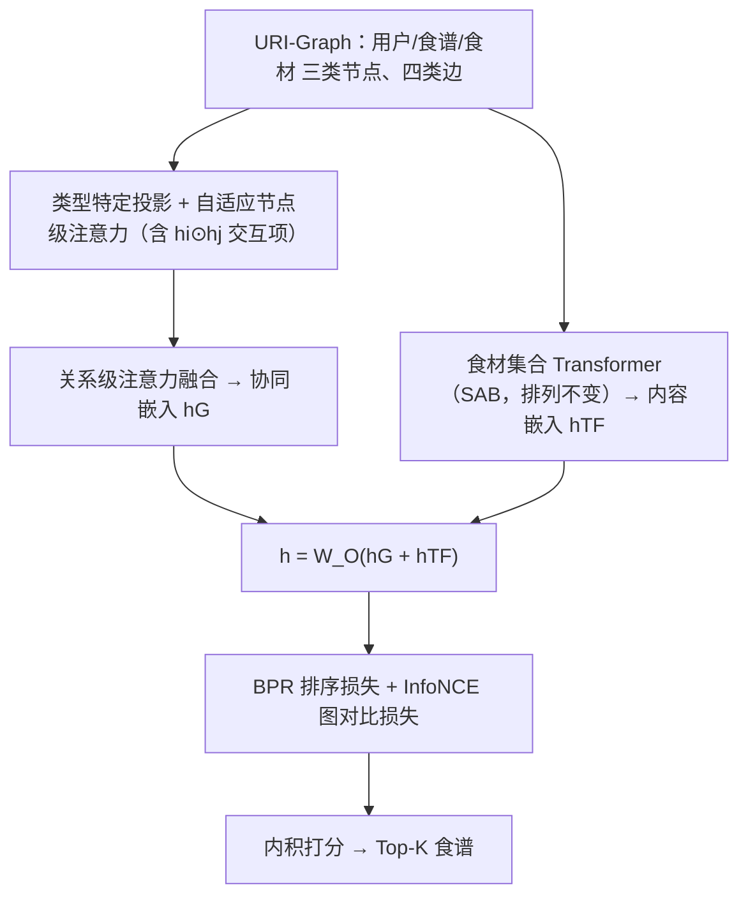
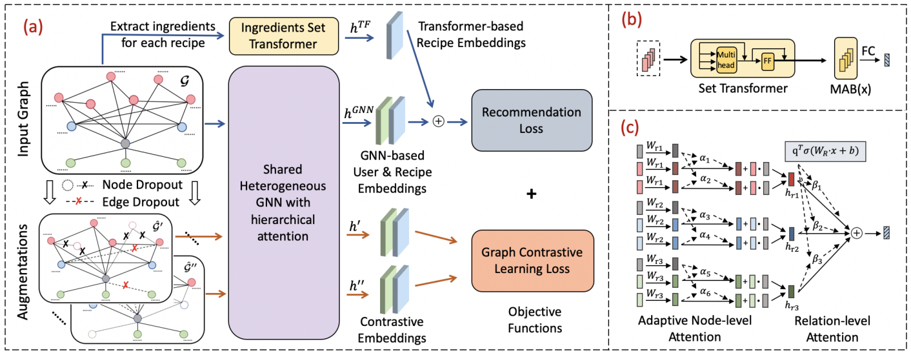

# RecipeRec: A Heterogeneous Graph Learning Model for Recipe Recommendation (面向食谱推荐的异质图学习模型)

- **会议/期刊**: IJCAI 2022
- **作者与机构**: Yijun Tian, Chuxu Zhang, Zhichun Guo, Chao Huang, Ronald Metoyer, Nitesh V. Chawla（University of Notre Dame / Brandeis University / University of Hong Kong）
- **推荐链路定位**: 召回（Top-K 候选生成）
- **研究方向**: 图神经网络与知识图谱推荐 / 自监督对比学习
- **论文原文**: [https://arxiv.org/abs/2205.14005v1](https://arxiv.org/abs/2205.14005v1)
- **开源代码**: [https://github.com/meettyj/RecipeRec](https://github.com/meettyj/RecipeRec)

## TL;DR (1分钟核心速览)

食谱推荐此前停留在「食谱内容相似度」或「用户重叠评分」层面，完全丢弃了用户–食谱–食材之间的高阶协同结构。本文构建大规模异质图 URI-Graph（3 类节点、4 类关系），提出 RecipeRec：用带自适应节点级 + 关系级注意力的异质 GNN 编码协同信号、用食材集合 Transformer 编码食材组合语义，并以图对比增强做自监督正则，最后以排序损失 + InfoNCE 联合优化。在 Leave-One-Out 划分、每用户 1:100 采样排序协议下，K=10 取得 HR 45.70 / NDCG 32.37，在 14 个基线上全面领先（原文图 3）。

## Background & Motivation (背景与核心矛盾)

- **主流范式**: 现有工作分为内容式（食材/营养/指令文本相似度）、协同过滤式（用户重叠评分）与混合式三类，代表为 Reciptor、IngreNet、PopIngre 等。
- **前人局限**: 其一，仅用「共同评过分的食谱」定义相似用户，无法传播二跳以上的协同信号（如"同食材 → 相似食谱 → 同用户"）；其二，食材仅作为加权边或词袋特征，无法刻画食材之间的两两/高阶组合关系（互补、冲突），而这恰恰是用户选菜的核心动因。
- **核心洞察 (Key Insight)**: 用户的食物偏好是多因的——可能因为某食材、某菜系，也可能因为相似食谱的连带效应；因此必须把「内容信号」与「关系结构信号」放进同一个图里联合编码，而非二者择一。
- **本文切入点**: 首次将食谱推荐形式化为异质图上的链接/排序问题，并配套发布 URI-Graph 数据集填补数据空白。

## Method (核心方法设计)

### 1. 整体框架 (Overall Architecture)

模型输入为 URI-Graph：用户、食谱、食材三类节点，user-recipe（评分为边权）、recipe-ingredient（食材权重为边权）、recipe-recipe（FoodKG 相似度）、ingredient-ingredient（NPMI 共现）四类边。首先对每类节点做类型特定线性投影映射到共享 $d$维空间；随后异质 GNN 逐层执行「节点级注意力（关系内聚合）→ 关系级注意力（关系间融合）」，得到协同侧嵌入$\mathbf{h}^G_i$；同时食谱节点额外经过食材集合 Transformer 得到内容侧嵌入$\mathbf{h}^{TF}_i$，二者相加得最终表示$\mathbf{h}_i=\mathbf{W}_O(\mathbf{h}^G_i+\mathbf{h}^{TF}_i)$。训练时对图做双视图增广并联合优化排序损失与对比损失；推理阶段仅需内积打分，无额外解码开销。

<figure class="paper-figure" markdown="span">
  <figcaption>图 2：（a）模型总体框架：首先提出带层次注意力的异质 GNN 与食材集合 Transformer 学习用户和食谱嵌入，再将其输入食谱推荐损失；随后引入图对比增强策略，以自监督方式提取信息丰富的图知识；接着用食谱推荐与图对比学习的联合损失优化模型；（b）食材集合 Transformer：在保持排列不变性的同时编码食材间交互；（c）异质……</figcaption>
</figure>

### 2. 关键设计拆解 (Key Designs)

1. **自适应节点级注意力（把"交互强度"注入注意力）**：HAN/HGT 类模型的注意力只依赖 $(\mathbf{z}^l_i\|\mathbf{z}^l_j)$ 的结构相似度，无法区分"同一用户真实交互过的食谱"与"仅结构邻近的食谱"。本文在聚合式中显式加入逐元素交互项：

$$\alpha^l_{ij}=\mathrm{softmax}_{j\in\mathcal{N}_{i,r}}\Big(\mathrm{LeakyReLU}\big[\mathbf{W}^l_{ij}(\mathbf{z}^l_i\|\mathbf{z}^l_j)\big]\Big),\quad \mathbf{h}^{l+1}_{i,r}=\Big\|_{m=1}^{M}\mathrm{ReLU}\Big(\sum_{j\in\mathcal{N}_{i,r}}\alpha^l_{ij}\mathbf{z}^l_j+\mathbf{W}^l_h(\mathbf{h}^l_i\odot\mathbf{h}^l_j)\Big)\mathbf{W}_a$$

$\mathbf{h}^l_i\odot\mathbf{h}^l_j$ 让注意力对"谁与谁交互"敏感，等价于把 CF 的内积效应嵌入消息传递，物理直觉是让协同过滤信号沿异质边传播而不被结构相似度淹没。

2. **关系级注意力（免元路径的手工权重）**：不同关系对节点的贡献差异极大（食材边稠密、user-recipe 边稀疏），手工设权必然次优。本文以共享非线性变换 + 可学习查询向量打分并 softmax 归一：

$$w_{i,r}=\tfrac{1}{|\mathcal{V}_r|}\sum_{i\in\mathcal{V}_r}\mathbf{q}^\top\tanh(\mathbf{W}_R\mathbf{h}^{l+1}_{i,r}+\mathbf{b}),\quad \mathbf{h}^{l+1}_i=\sum_{r\in\mathcal{R}_i}\beta_{i,r}\mathbf{h}^{l+1}_{i,r}$$

$\beta_{i,r}$可解释为关系$r$对节点$i$ 的贡献度，使模型能自动在"看食材"与"看相似食谱"之间切换。

3. **食材集合 Transformer + 图对比增强 + 联合目标**：食材是无序集合，GNN 的加权边无法表达组合语义，故用 Set Attention Block $\mathrm{SAB}(X)=\mathrm{MAB}(X,X)$ 保持排列不变性地建模食材两两交互，输出与图嵌入相加（内容侧 ⊕ 协同侧）。自监督侧对图做节点 dropout 与边 dropout 生成双视图，同节点跨视图为正、批内异节点（同类型）为负：

$$\mathcal{L}_{con}=\sum_{i\in\mathcal{Y}_T}-\log\frac{\exp(\mathbf{h}'_i\cdot\mathbf{h}''_i/\tau)}{\sum_{j\in\mathcal{B}_T}\exp(\mathbf{h}'_i\cdot\mathbf{h}''_j/\tau)},\qquad \mathcal{L}=\mathcal{L}_{rec}+\lambda\mathcal{L}_{con}$$

其中 $\mathcal{L}_{rec}=\sum_{i\in\mathcal{U},j\in\mathcal{N}_i}\max(0,1-s_{i,j}+s_{i,j'})$，$s$为内积，$j'$为**均匀随机负样本**（每正样本 1 个，非 in-batch/hard negative），$\tau=0.07,\lambda=0.1$。

## Experimental Setup & Evaluation Protocol (实验设置与评估协议)

- **数据集与预处理**: 食谱来自 Reciptor、评分从 food.com 爬取、营养信息对齐 USDA 数据库；原文**未声明 $k$-core 过滤**。

| 数据集 | #Users | #Items(Recipes) | #Ingredients | #Interactions(user-recipe) | 稀疏度 | 关系规模说明 |
| :--- | :---: | :---: | :---: | :---: | :---: | :--- |
| URI-Graph | 7,958 | 68,794 | 8,847 | 135,353 | $\approx 2.47\times10^{-4}$ | recipe-recipe 647,146；recipe-ingredient 463,485；ingredient-ingredient 146,188 |

- **数据划分与防穿越**: `Leave-One-Out`（每用户最后一条交互作测试、倒数第二条作验证，其余训练）。
- **排名评测协议**: `Sampled Ranking`——每用户随机采样 **100 个负样本**（1:100），报告 Pre / HR / NDCG / MAP @K（K=1…10），非全库 Full-Ranking。
- **对比基线与超参**: 14 个基线，覆盖传统 CF（BPR、NeuMF）、食谱表征/推荐（Nutrition、PopIngre、IngreNet、Reciptor）、同质 GNN（GraphSAGE、GAT）、异质 GNN（RGCN、metapath2vec、HAN、HGT）、图推荐（PinSage、NGCF）。实现：lr=0.005，4 头注意力，$d=128$，$\tau=0.07$，$\lambda=0.1$，node/edge dropout=0.1，batch=1024，100 epoch；**原文未报告显著性检验**。

## Key Experimental Results (实验关键数据)

### 1. 主实验对比 (Main Results)

> 说明：原文主结果（图 3）与消融（图 4）均以 Top-K 曲线呈现，未给出逐基线数值表；下表仅保留可核验的绝对数值与图中位次，避免杜撰数字。

| 模型 | 类别 | HR@5 | NDCG@5 | HR@10 | NDCG@10 |
| :--- | :--- | :---: | :---: | :---: | :---: |
| BPR | 传统 CF | 图 3（末位组） | — | — | — |
| NeuMF | 传统 CF | 图 3（末位组） | — | — | — |
| Reciptor | 食谱表征（无用户） | 图 3（偏低） | — | — | — |
| IngreNet / PopIngre | 食材内容 | 图 3（中等） | — | — | — |
| GraphSAGE / GAT | 同质 GNN | 图 3（偏低） | — | — | — |
| HAN / HGT | 异质 GNN | 图 3（较高） | — | — | — |
| NGCF / PinSage | 图推荐 | 图 3（较高） | — | — | — |
| **RecipeRec (λ=0.1)** | 异质图 + 对比 | **32.88** | **28.00** | **45.70** | **32.37** |

K=1 时 RecipeRec 为 **HR 17.33 / NDCG 17.33**；原文结论为所有 K、所有指标上均优于全部 14 个基线。

### 2. 消融与超参实验 (Ablation & Sensitivity)

| 变体 / 设置 | HR@1 | NDCG@1 | HR@5 | NDCG@5 | HR@10 | NDCG@10 |
| :--- | :---: | :---: | :---: | :---: | :---: | :---: |
| RecipeRec-NA（仅节点级注意力 + Rec 损失） | 图 4 最低 | — | — | — | — | — |
| RecipeRec-RA（+ 关系级注意力） | 图 4 次低 | — | — | — | — | — |
| RecipeRec-IT（+ 集合 Transformer，无 CL） | 图 4 次高 | — | — | — | — | — |
| **RecipeRec（完整）** | **17.33** | **17.33** | **32.88** | **28.00** | **45.70** | **32.37** |
| 边 dropout = 0.1 | 17.18 | 17.18 | 32.94 | 27.73 | 45.12 | 31.88 |
| 节点 dropout = 0.1 | 15.49 | 15.49 | 32.34 | 27.29 | 45.13 | 31.67 |
| $\lambda=0.2$ | 15.79 | 15.79 | 31.64 | 26.74 | 44.87 | 31.27 |
| $\lambda=0.5$ | 15.39 | 15.39 | 32.50 | 27.10 | 45.06 | 31.38 |

### 3. 关键实验发现 (Key Findings)

1. **对比项是"增益"而非"主信号"**：$\lambda$ 从 0.1 增至 0.2/0.5 时 HR@1 由 17.33 掉到 15.79/15.39、HR@10 由 45.70 掉到 44.87/45.06，说明 InfoNCE 只在轻量正则位置有效，权重过大会稀释排序损失对交互的重建压力。
2. **边扰动优于节点扰动**：同为 0.1 比例，边 dropout 的 HR@1 为 17.18、节点 dropout 仅 15.49，表明 URI-Graph 的信息载体主要是"关系结构"，保留节点特征、只扰动边得到的双视图更接近真实语义，增广更温和。
3. **模块呈单调增益链**：NA → RA → IT → 完整模型逐级提升（图 4 全 K 一致），说明关系级注意力解决"多关系权重"，集合 Transformer 解决"食材组合语义"，图对比解决"稀疏监督"，三者互补而非冗余；t-SNE 亦显示完整模型能把用户/食谱分成两个紧致簇并得到近似平行的用户–食谱映射向量（图 6）。

## Highlights & Limitations (亮点、对比与审稿批判)

- **与代表作对比 (vs. Prior Work)**: 相比 Reciptor（只学食谱表征、无用户）、IngreNet/PopIngre（食材内容 + 简单关系），本文把用户纳入统一异质图并让高阶协同信号可传播；相比 HAN/HGT（异质图但注意力不含交互项、无内容侧集合建模），本文的 $\mathbf{h}_i\odot\mathbf{h}_j$ 项与食材 SAB 是两个真正带来增益的增量；相比 NGCF（同质二部图、无食材知识），本文多了内容与知识关系两类边。
- **可迁移亮点**: ①「图嵌入 + 集合 Transformer 嵌入相加」是低成本融合内容与协同的通用范式，可直接迁到短视频（图结构 + 封面/标签集合）与电商（行为图 + 属性集合）；②双视图 dropout 对比作为排序损失的轻量正则（$\lambda\approx0.1$）在稀疏场景性价比高。
- **审稿级局限批判**: ①主结果与消融全部以曲线呈现，基线数值不可复核、也无显著性检验，复现时难以严格对齐；②每 epoch 需两次图增广 + 两次前向传播，训练开销约翻倍，且 1:100 采样排序（非 Full-Ranking）会高估模型在长尾负样本上的区分力；③recipe-recipe 相似度与 ingredient 共现权依赖 FoodKG/NPMI 外部先验，完全无交互的新食谱（纯内容冷启动）未单独设实验评估。

## Rating (四维评分)

- **方法创新性 (Novelty)**: ⭐⭐⭐⭐ （首次把食谱推荐建模为异质图问题，交互感知注意力与食材集合 Transformer 的组合有明确增量，但整体仍是 HAN + Set Transformer + GraphCL 的集成式创新）
- **评估协议与实验扎实度 (Protocol & Experiments)**: ⭐⭐⭐ （14 个基线覆盖全面、K=1…10 全谱报告，但主结果仅以图给出、采样排序 1:100 且无显著性检验，可复核性偏弱）
- **写作与数学规范度 (Clarity & Rigor)**: ⭐⭐⭐⭐ （层次注意力与联合损失公式定义清晰、符号一致，缺复杂度分析与增广理论解释）
- **工业落地与复现价值 (Industrial & Practical Value)**: ⭐⭐⭐⭐ （数据集与代码全开源、推理仅内积无额外延迟，构图依赖外部营养/相似度知识库、训练期双前向是主要工程成本）

