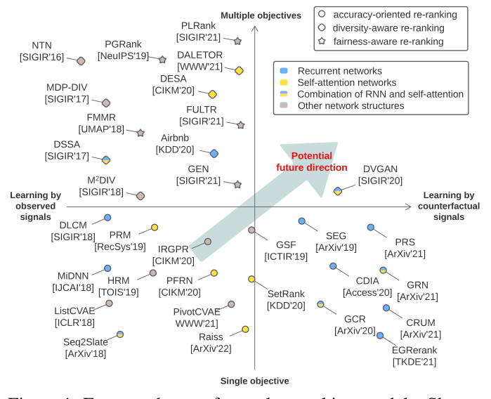
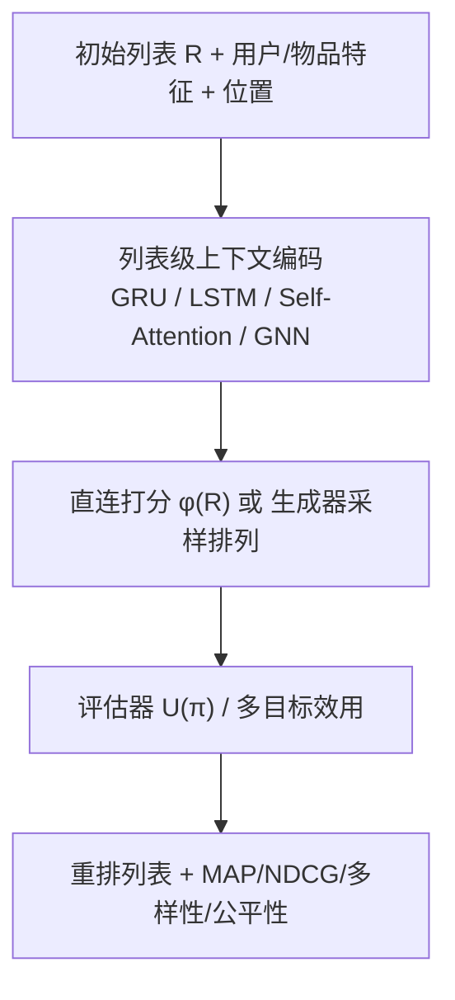
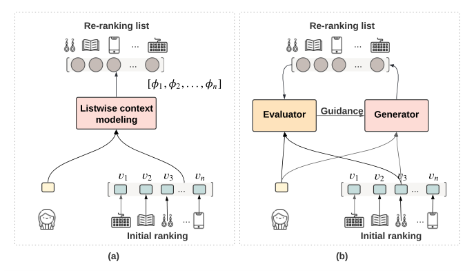

# Neural Re-ranking in Multi-stage Recommender Systems: A Review (多阶段推荐系统中的神经重排综述)

- **会议/期刊**: IJCAI 2022（8 页综述）
- **作者与机构**: Weiwen Liu, Yunjia Xi, Jiarui Qin, Fei Sun, Bo Chen, Weinan Zhang, Rui Zhang, Ruiming Tang（华为诺亚方舟实验室、上海交通大学、中科院计算所）
- **推荐链路定位**: 重排（精排之后、最终曝光之前）
- **研究方向**: 多任务学习与列表级重排 / 强化学习与动态探索推荐
- **论文原文**: [https://arxiv.org/abs/2202.06602v2](https://arxiv.org/abs/2202.06602v2)
- **开源代码**: [https://github.com/LibRerank-Community/LibRerank](https://github.com/LibRerank-Community/LibRerank)

## TL;DR (1分钟核心速览)

重排的核心痛点是：用户对某物品的兴趣取决于同列表内其他物品（列表级上下文），而工业系统只观测到 $n!$种排列中被曝光的那 1 种，监督信号极度稀疏。本文不做新模型，而以“优化目标（单目标精度 vs 多目标）× 监督信号（观测 vs 反事实）”构建四象限分类学，梳理 RNN→自注意力→评估器-生成器（EG）的技术演进，并给出网络结构、个性化方式与$O(n)$/$O(n^2)$ 复杂度对照。作者开源 LibRerank，在 Ad2 与 PRM Public 上以 LambdaMART 初始列表评测：PRM 在 PRM Public 上 MAP@10 相对初始排序提升 68.1%，但 Ad2 上仅 1.7%，揭示“初始排序越弱、重排收益越大”的边界。

## Background & Motivation (背景与核心矛盾)

- **主流范式**: 多阶段推荐（召回→精排→重排）中，重排以整段列表为输入，用多变量打分函数 $\phi(\mathcal{R})$ 替代精排的单物品单变量打分，从而显式建模交叉物品影响。
- **前人局限**: ①仅用被曝光排列的日志标签训练，其余 $n!-1$ 个排列的反馈完全缺失，模型无法评估“换序后”的效用；②精度单目标优化易导致同质化与回声室，而多样性与公平性目标常与精度冲突，缺乏原则性权衡手段。
- **核心洞察 (Key Insight)**: 物品相关性不是物品固有属性，而是排列的函数；因此重排的学习问题本质是“在反事实排列上估计列表效用”，这直接催生 evaluator-generator 范式。
- **本文切入点**: 用统一的经验风险形式 $\phi^{*}=\arg\min_{\phi}\sum_{\mathcal{R},Y}\mathcal{L}(Y,\phi(\mathcal{R}))$把损失设计（目标维度）与$Y$ 的来源（监督维度）解耦，将散落文献映射到同一坐标系。

<figure class="paper-figure" markdown="span">
  <figcaption>图 1：神经重排序模型的四个象限。形状表示不同目标，颜色表示用于重排序的主要网络结构。</figcaption>
</figure>

## Method (核心方法设计)

### 1. 整体框架 (Overall Architecture)

综述把重排统一为“输入初始列表 $\mathcal{R}$（含用户特征、物品特征、位置）→ 列表级上下文编码 → 重排分数或排列生成 → 按 NDCG/MAP 或多样性/公平性效用评估”的闭环。第一象限（观测信号+单目标）走直连架构：先嵌入用户/物品特征，再由 RNN 或自注意力提取交叉物品交互，逐位输出分数，用 pointwise CE、pairwise BPR/Hinge 或 listwise AttRank/KL 训练。第四象限（反事实信号+单目标）走 EG 架构：生成器在评估器指导下搜索可行排列，评估器需满足**顺序敏感性**与**对未见过排列的可泛化性**。多目标分支则在相关性之外叠加子话题覆盖（显式）或物品对不相似度（隐式），以及曝光公平约束。最后讨论融合场景（多渠道混合重排）与端侧重排两类新应用。

<figure class="paper-figure" markdown="span">
  <figcaption>图 2：重排序网络架构。(a) 基于观测信号学习的典型神经重排序架构。(b) 基于反事实信号学习的评估器-生成器范式。</figcaption>
</figure>

### 2. 关键设计拆解 (Key Designs)

1. **双维四象限分类学（本文最大增量）**：以往综述按模型结构罗列，本文改按“目标×监督”切分，使“为何用 EG”和“为何加多样性约束”变成两个正交设计轴。其判定式即 $\mathcal{L}$是否含多样性/公平项，以及$Y$ 来自日志还是评估器；由此可解释 Fig.1 的现象——绝大多数工作挤在“单目标+观测信号”象限，而“多目标+反事实”几乎空白，直接指出未来方向。
2. **列表级上下文算子：从循环到自注意力再到排列不变**：RNN 类（DLCM/GRU、MiDNN/LSTM+beam search）受编码距离衰减与串行开销限制；自注意力类（PRM、PFRN、Raiss）直接建模任意物品对交互
$\boldsymbol{h}_i=\sum_{j=1}^{n}\alpha_{ij}\boldsymbol{W}_V\boldsymbol{x}_j,\ \alpha_{ij}=\mathrm{softmax}_j\!\left(\frac{(\boldsymbol{W}_Q\boldsymbol{x}_i)^{\top}(\boldsymbol{W}_K\boldsymbol{x}_j)}{\sqrt{d}}\right)$
并拼接预训练用户向量实现个性化。SetRank/GSF 则反向去除位置编码，追求**排列不变性**，避免模型记忆曝光位置偏差——这与“重排需顺序敏感”构成一对张力，是本文最有价值的对比洞察。
3. **EG 范式与训练/推理开销**：生成器把重排建模为离散序列决策，奖励为评估器给出的列表效用 $\hat{U}(\pi)$，因排序不可微而采用策略梯度
$\nabla_{\phi}J=\mathbb{E}_{\pi\sim p_{\phi}}\big[\nabla_{\phi}\log p_{\phi}(\pi)\,(\hat{U}(\pi)-b)\big]$其中$b$为基线。GCR 用 PPO-exploration 缓解$O(n!)$动作空间，PRS 用 beam search 直接选优，CRUM 改用 LambdaLoss 训练 MLP 生成器，把推理从$O(n^2)$降到$O(n)$。负采样方面，重排通常不构造随机负例，而是以曝光列表内“点击/未点击”作标签，EG 则靠评估器合成反事实标签；总损失可写为$\mathcal{L}=\mathcal{L}_{\text{rank}}+\lambda\mathcal{L}_{\text{div/fair}}$，$\lambda$ 多为人工调参。

## Experimental Setup & Evaluation Protocol (实验设置与评估协议)

- **数据集与预处理**: 原文未披露用户/物品/交互规模，仅说明来源与重排长度：

| 数据集 | #Users | #Items | #Interactions | 稀疏度/密度 | 特征/场景说明 |
| :--- | :---: | :---: | :---: | :---: | :--- |
| Ad2 | 未披露 | 未披露 | 未披露 | — | 阿里天池广告日志；$n\in\{5,10\}$，指标 MAP/NDCG@5,10 |
| PRM Public | 未披露 | 未披露 | 未披露 | — | Pei et al. 公开电商重排数据；$n\in\{10,20\}$，指标 MAP/NDCG@10,20 |

- **数据划分与防穿越 (Splitting Strategy)**: 采用已处理好的公开重排数据集，按会话/列表组织训练与测试；原文未给出时间戳切分细节，属**固定列表样本划分**而非时间切分。
- **排名评测协议 (Ranking Protocol)**: 由 LambdaMART 产生初始列表，各模型仅对**该候选列表内部**重排，在重排后 Top-$k$ 上计算 MAP@k / NDCG@k；因此是“固定候选列表的 listwise 评测”，**不是全库 Full-Ranking**，也未报告采样负例比例。未做显著性检验。
- **对比基线与超参设置**: 6 个基线 MiDNN、GSF、EGRerank、DLCM、SetRank、PRM，覆盖 RNN、groupwise DNN、EG、自注意力三类；作者声明优先复用官方开源实现、否则按原论文复现，并对每个算法独立调参取最优；嵌入维度等超参统一在 LibRerank 中公开。

## Key Experimental Results (实验关键数据)

### 1. 主实验对比 (Main Results)

| 模型（类型） | Ad2 MAP@5 | Ad2 NDCG@10 | PRM Public MAP@10 | PRM Public NDCG@20 |
| :--- | :---: | :---: | :---: | :---: |
| Init (LambdaMART) | 0.6037 | 0.6990 | 0.1842 | 0.3202 |
| MiDNN (LSTM+beam) | 0.6080 | 0.7021 | 0.3069 | 0.4265 |
| GSF (groupwise DNN) | 0.6090 | 0.7028 | 0.3060 | 0.4241 |
| EGRerank (EG+判别器) | 0.6092 | 0.7029 | 0.3075 | 0.4286 |
| DLCM (GRU) | 0.6126 | 0.7055 | 0.3082 | 0.4287 |
| SetRank (排列不变自注意力) | 0.6132 | 0.7060 | 0.3094 | 0.4297 |
| **PRM (自注意力+个性化)** | **0.6140** | **0.7066** | **0.3096** | **0.4301** |
| Improv. vs Init | +1.71% | +1.09% | +68.08% | +34.32% |

### 2. 消融实验 (Ablation Study)

原文未提供组件级消融，下表按“列表上下文结构 / 监督范式”归并 Table 1–2 结果作对照（含复杂度）：

| 变体（代表） | 上下文建模 | Ad2 MAP@5 | PRM NDCG@20 | 复杂度 |
| :--- | :--- | :---: | :---: | :---: |
| w/o 列表建模（Init） | 无（单物品打分） | 0.6037 | 0.3202 | $O(1)$ |
| DLCM | GRU 循环 | 0.6126 | 0.4287 | $O(n)$ |
| MiDNN | LSTM + beam search | 0.6080 | 0.4265 | $O(n)$ |
| GSF | $m$-排列 groupwise DNN | 0.6090 | 0.4241 |$O(mn!/(n-m)!)$ |
| SetRank | 无位置编码自注意力 | 0.6132 | 0.4297 | $O(n^2)$ |
| **PRM** | 位置编码自注意力 + 用户向量 | **0.6140** | **0.4301** | $O(n^2)$ |
| EGRerank | 评估器-生成器 + 判别器 | 0.6092 | 0.4286 | $O(n^2)$ |

### 3. 关键实验发现 (Key Findings)

1. **重排收益高度依赖初始排序质量**：PRM Public 上初始 NDCG@20 仅 0.3202，重排后达 0.4301（+34.3%，MAP@10 +68.1%）；而 Ad2 初始已达 0.6990，PRM 仅 +1.1%。说明列表级建模主要弥补弱精排留下的效用缺口，精排越强，重排边际收益越接近饱和。
2. **自注意力稳定优于循环结构，但幅度有限**：Ad2 上 PRM/SetRank（0.6140/0.6132）> DLCM（0.6126）> MiDNN（0.6080）；PRM Public NDCG@20 上 0.4301 vs 0.4265。绝对差距仅 0.1–0.4 个千分点，表明“结构红利”小于“是否引入列表上下文”这一根本红利（0.6037→0.61+）。
3. **EG 范式未兑现理论优势**：EGRerank 在 Ad2 MAP@5 为 0.6092，低于直连的 PRM 0.6140；PRM Public 上 0.3075 vs 0.3096。作者归因于生成器性能强依赖评估器质量，而评估器只在离线曝光数据上训练、难以泛化到未见排列；叠加离散策略梯度的高方差，EG 目前更适合作为“排列搜索器”而非独立重排器，CRUM 的 $O(n)$ 推理是其实用化关键。

## Highlights & Limitations (亮点、对比与审稿批判)

- **与代表作对比 (vs. Prior Work)**: 相较 PRM（提出自注意力重排）、SetRank（提出排列不变重排）、SEG/GRN（提出 EG 范式）等单点方法，本文的价值在于把三者放进“监督信号来源”这一维度上对照，首次指出“顺序敏感 vs 排列不变”是设计分歧的根源；相较一般 LTR 综述，本文聚焦重排特有的列表级上下文与 $n!$ 反事实监督，问题定位更锐利。
- **可迁移亮点**: ①“观测/反事实 × 单/多目标”四象限可直接用于评估其他列表生成任务（如捆绑推荐、对话列表重排）的空白点；②用 LibRerank 统一初始列表与调参流程，避免不同论文各自构造候选集导致的不可比，这一基准范式值得迁移到多任务重排实验。
- **审稿级局限批判**: ①作为综述无新算法，实验仅两个数据集、规模与统计信息均未披露，无显著性检验，PRM 与 SetRank 的 0.0008 差异不足以支撑“自注意力更优”的强结论；②多样性/公平性章节只做文献罗列，未纳入基准，与“多目标”标题承诺不匹配；③EG 的评估器偏差、$O(n^2)$ 在线延迟、以及精排-重排联合训练仅停留在展望，缺乏定量分析。

## Rating (四维评分)

- **方法创新性 (Novelty)**: ⭐⭐⭐ （分类学切分有新意，但本质是组织已有工作，未提出新算子或理论证明）
- **评估协议与实验扎实度 (Protocol & Experiments)**: ⭐⭐⭐ （统一 LambdaMART 初始列表利于可比，但仅两数据集、无显著性检验、无组件消融、多目标未评测）
- **写作与数学规范度 (Clarity & Rigor)**: ⭐⭐⭐⭐ （统一经验风险形式与复杂度表清晰，公式极简，符号一致；部分算法细节因 8 页篇幅被压缩）
- **工业落地与复现价值 (Industrial & Practical Value)**: ⭐⭐⭐⭐ （LibRerank 开源且含数据与调参细节，EG/CRUM 的 $O(n)$ 推理与大厂实践总结对重排落地直接可用）

