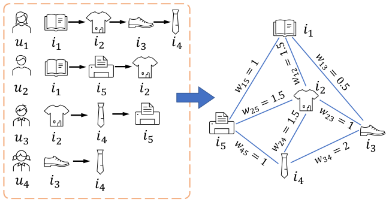
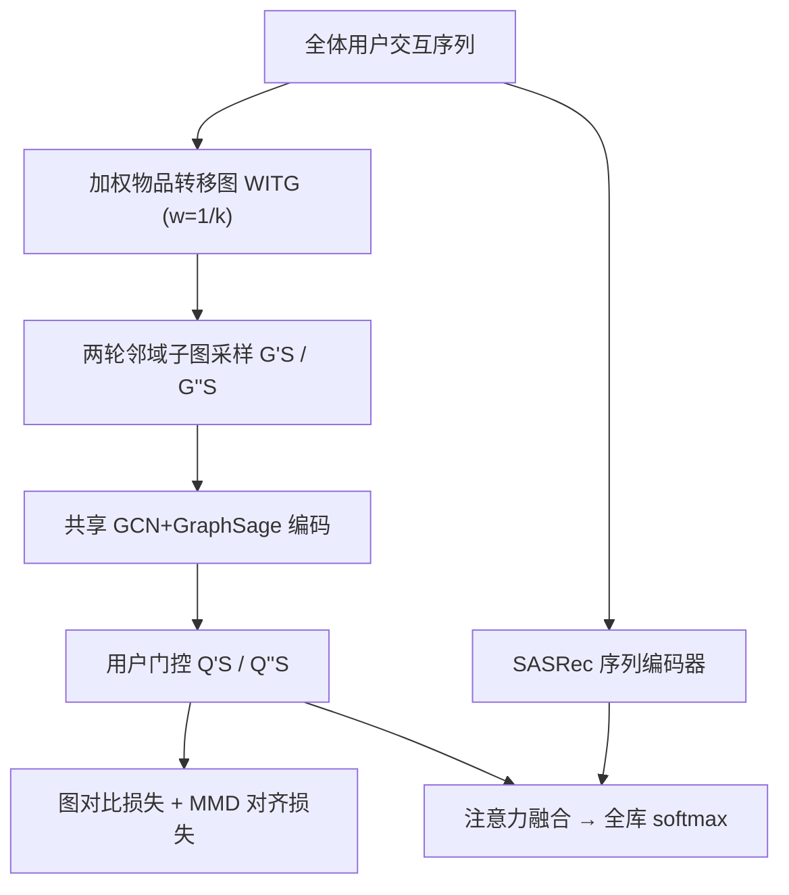

# Enhancing Sequential Recommendation with Graph Contrastive Learning (用图对比学习增强序列推荐)

- **会议/期刊**: IJCAI 2022
- **作者与机构**: Yixin Zhang, Yong Liu, Yonghui Xu, Hao Xiong, Chenyi Lei, Wei He, Lizhen Cui, Chunyan Miao（山东大学、南洋理工大学、阿里巴巴）
- **推荐链路定位**: 召回（Next-Item 序列召回）
- **研究方向**: 序列与会话推荐 / 自监督对比学习与交互去噪
- **论文原文**: [https://arxiv.org/abs/2205.14837v2](https://arxiv.org/abs/2205.14837v2)
- **开源代码**: 暂未开源

## TL;DR (1分钟核心速览)

现有序列推荐只在单条用户序列内建模局部上下文、且仅用下一物品交叉熵训练，导致稀疏场景下序列表征质量差、偶然点击噪声无法抑制。GCL4SR 用全体用户序列构建加权物品转移图（WITG）作为全局上下文，对每条序列采样两张子图经共享 GNN 得到增广视图，并以图对比损失 + MMD 个性化对齐两个辅助目标注入全局信息。在 4 个 5-core 数据集、Leave-One-Out + Full-Ranking 协议下 HR@10/N@20 全面领先 SOTA，Cell Phones HR@10 相对 S³-Rec 提升 12.9%。

## Background & Motivation (背景与核心矛盾)

- **主流范式**: SASRec/BERT4Rec 用自注意力编码单条序列做下一物品预测；SR-GNN/GC-SAN 为每条序列单独构图；GCE-GNN 引入全局图但仅做图上的消息传播，S³-Rec/CL4SRec 用序列级自监督增广（裁剪/掩码/替换）。
- **前人局限**: ① 仅利用单序列局部上下文，忽略行为模式相似用户之间的跨序列关联；② 仅靠 item prediction loss 训练，隐式反馈极度稀疏时序列表征欠拟合。
- **另一重矛盾**: 隐式反馈序列含偶然点击噪声，而局部序列增广（CL4SRec 的 crop/mask）无法区分哪一跳转移是噪声，反而可能放大噪声。
- **核心洞察 (Key Insight)**: 跨全库统计的物品转移频次天然带有"哪些转移是稳定意图"的先验——高频转移是真实偏好路径，低频偶发跳转即为噪声，可用 1/k 折扣的边权显式编码。
- **本文切入点**: 把"全局转移图"同时当作 (a) 表征增广的采样源与 (b) 噪声抑制的加权先验，用对比学习把全局上下文蒸馏进序列表征。

<figure class="paper-figure" markdown="span">
  <figcaption>图1：展示转移图构建过程的示例，其中(a)展示了观察到的用户行为序列，(b)展示了加权转移图。</figcaption>
</figure>

## Method (核心方法设计)

### 1. 整体框架 (Overall Architecture)

输入为用户交互序列 $S=\{v_1,\dots,v_n\}$。先离线汇总所有用户序列构建无向加权转移图$\mathcal{G}$；训练时对每条$S$的每个节点在$\mathcal{G}$上做 2 跳、每跳 20 邻居的两轮独立采样，得两张子图$\mathcal{G}'_S,\mathcal{G}''_S$；共享参数的 GCN+GraphSage 编码得$H'_S,H''_S$，再经用户门控得个性化全局表征$Q'_S,Q''_S$；同时 SASRec 编码原始序列得$H^\ell$。三者拼接经注意力融合后 softmax 全库打分。总损失 = 主预测损失 + 图对比损失 + MMD 对齐损失，端到端联合优化。

### 2. 关键设计拆解 (Key Designs)

1. **加权转移图与 1/k 频次权重（噪声抑制先验）**：痛点是不区分跳距与频次的转移统计会把偶然点击当作等价证据。本文对序列内任意跨度 $k\in\{1,2,3\}$的共现累加$w(v_t,v_{t+k})\leftarrow w(v_t,v_{t+k})+1/k$，再按端点度数归一化$\hat{w}(v_i,v_j)=\frac{w(v_i,v_j)}{1/\mathrm{deg}(v_i)+1/\mathrm{deg}(v_j)}$。直觉：跳距越远、出现越零星，其"意图证据"越弱，权重自然压低，从而在消息传播中弱化噪声边。

2. **双视图图对比损失（同序列一致性）**：同一序列的两次子图采样互为正样本、不同序列为负样本，$\mathcal{L}_{GCL}=-\log\frac{\exp(\cos(z'_S,z''_S)/\tau)}{\sum_{K\in\mathcal{D}}\exp(\cos(z'_S,z''_K)/\tau)}$，其中$z$为$H$的均值池化，$\tau=0.5$。因为两张子图共享同一序列身份但在$\mathcal{G}$ 上采样路径不同，模型被迫学习对采样扰动不变、且保留全局邻域结构的序列表征。

3. **用户门控 + MMD 对齐（个性化全局上下文）**：全局上下文对不同用户应各取所需，故 $Q'_S=H'_S\otimes\sigma(H'_S W_{g1}+W_{g2}p_u^\top)$，用用户嵌入$p_u$生成逐维门控；再用高斯核 MMD 让个性化全局表征回归局部序列表征：$\mathcal{L}_{MM}(S)=\mathrm{MMD}(E^{(0)}_S,Q'_S)+\mathrm{MMD}(E^{(0)}_S,Q''_S)$。作用是防止全局图信息"淹没"用户自身序列偏好，起分布级正则效果。

4. **训练目标与推理开销**：$\mathcal{L}=\mathcal{L}_{main}+\lambda_1\sum_S\mathcal{L}_{GCL}+\lambda_2\sum_S\mathcal{L}_{MM}$，$\mathcal{L}_{main}$为子序列前缀的交叉熵；无显式负采样（softmax 全库）。$\lambda_1,\lambda_2$网格搜索于$\{0.01,\dots,1.0\}$。主要开销是两路 GNN 前向（约 3 倍骨干计算）与离线构图（Home 图 1.6M 边）。

## Experimental Setup & Evaluation Protocol (实验设置与评估协议)

- **数据集与预处理**: Amazon 5-core（Home、Phones）与 Goodreads（Poetry、Comics）；评分视为隐式反馈，去重后按时间戳排序。

| 数据集 | #Users | #Items | #Interactions | 图节点/边 | 特征/场景说明 |
| :--- | :---: | :---: | :---: | :---: | :--- |
| Home | 66,519 | 28,237 | 551,682 | 28,237 / 1,617,638 | 家居电商，最稠密 |
| Phones | 27,879 | 10,429 | 194,439 | 10,429 / 430,940 | 手机配件 |
| Comics | 13,810 | 16,630 | 343,587 | 16,630 / 1,310,952 | 图书评分，物品侧稠密 |
| Poetry | 3,522 | 2,624 | 40,703 | 2,624 / 122,700 | 最稀疏小样本 |

- **数据划分与防穿越 (Splitting Strategy)**: `Leave-One-Out`——每个用户最后 1 个交互作测试、倒数第 2 个作验证，其余训练。
- **排名评测协议 (Ranking Protocol)**: 无偏 `Full-Ranking`，在**全库未交互物品**上排序，不做负采样；指标 HR@10/20、N@10/20，按用户平均。
- **对比基线与超参设置**: 11 个基线，覆盖图 CF（LightGCN）、序列（FPMC/GRU4Rec/Caser/SASRec/HGN）、图序列（SR-GNN/GC-SAN/GCE-GNN）、自监督（CL4SRec/S³-Rec）。$d=64$，2 层自注意力块 2 头，最大序列长 50，L2=$5\times10^{-5}$，Adam lr=$10^{-3}$，batch$\in\{256,512,1024\}$，早停。

## Key Experimental Results (实验关键数据)

### 1. 主实验对比 (Main Results)

| 数据集/指标 | FPMC | GRU4Rec | SASRec | SR-GNN | GC-SAN | GCE-GNN | CL4SRec | S³-Rec | **GCL4SR** | Improv. |
| :--- | :---: | :---: | :---: | :---: | :---: | :---: | :---: | :---: | :---: | :---: |
| Home HR@10 | 0.0162 | 0.0210 | 0.0228 | 0.0201 | 0.0281 | 0.0259 | 0.0266 | 0.0280 | **0.0313** | +11.4% |
| Home N@20 | 0.0111 | 0.0140 | 0.0163 | 0.0146 | 0.0197 | 0.0186 | 0.0186 | 0.0196 | **0.0218** | +10.7% |
| Phones HR@10 | 0.0634 | 0.0835 | 0.0883 | 0.0778 | 0.0881 | 0.0946 | 0.0929 | 0.1037 | **0.1171** | +12.9% |
| Phones HR@20 | 0.0854 | 0.1213 | 0.1213 | 0.1114 | 0.1232 | 0.1304 | 0.1305 | 0.1428 | **0.1666** | +16.7% |
| Phones N@20 | 0.0430 | 0.0554 | 0.0594 | 0.0512 | 0.0588 | 0.0634 | 0.0627 | 0.0693 | **0.0790** | +14.0% |
| Poetry HR@20 | 0.1851 | 0.2104 | 0.2030 | 0.1723 | 0.1936 | 0.2229 | 0.2164 | 0.2277 | **0.2428** | +6.6% |
| Poetry N@20 | 0.0849 | 0.0956 | 0.0980 | 0.0818 | 0.0891 | 0.1035 | 0.1004 | 0.1108 | **0.1112** | +0.4% |
| Comics HR@10 | 0.1382 | 0.1593 | 0.1709 | 0.1481 | 0.1638 | 0.1722 | 0.1751 | 0.1781 | **0.1829** | +2.7% |
| Comics N@20 | 0.1108 | 0.1213 | 0.1374 | 0.1161 | 0.1292 | 0.1325 | 0.1341 | 0.1354 | **0.1417** | +4.7% |

### 2. 消融实验 (Ablation Study)

| 变体 | Poetry HR@20 | Poetry N@20 | Phones HR@20 | Phones N@20 |
| :--- | :---: | :---: | :---: | :---: |
| SASRec（纯骨干） | 0.2030 | 0.0980 | 0.1213 | 0.0594 |
| w/o GM（去对比+MMD） | 0.2138 | 0.0958 | 0.1423 | 0.0713 |
| w/o G（仅去图对比） | 0.2433 | 0.1095 | 0.1607 | 0.0734 |
| w/o W（去边权） | 0.2172 | 0.0979 | 0.1500 | 0.0694 |
| **GCL4SR 完整** | **0.2428** | **0.1112** | **0.1666** | **0.0790** |

**骨干替换（即插即用性，Poetry/Phones HR@20）**：HGN 0.1545/0.0990 → GCL4SR-HGN 0.1712/0.1064；GRU4Rec 0.2104/0.1213 → GCL4SR-GRU 0.2362/0.1622；SASRec 0.2030/0.1213 → GCL4SR-SAS 0.2428/0.1666。

### 3. 关键实验发现 (Key Findings)

1. **增益主体来自"全局图门控表征"而非对比损失本身**：仅保留图采样+门控、去掉两个辅助损失（w/o GM），Phones HR@20 即由 SASRec 的 0.1213 升至 0.1423（+17.3%）；在此之上叠加 MMD 与图对比再推至 0.1666（+17.1%），说明全局上下文与自监督正则是互补的两段式叠加。
2. **转移频次权重是去噪的关键开关**：去掉边权后 Phones HR@20 掉 10.0%（0.1666→0.1500）、Poetry 掉 10.5%（0.2428→0.2172），且降幅大于去掉图对比损失（Phones −3.5%），定量证明 1/k 加权在压低偶然点击噪声上的实质作用。
3. **模块通用但非万能**：同一模块在 GRU4Rec 上带来 +33.7%（0.1213→0.1622）大幅提升，在 HGN 上仅 +7.5%（0.0990→0.1064），且 GRU4Rec 原版已优于 GCL4SR-HGN，说明序列编码器仍主导最终性能，本模块为补充项而非替代项。

## Highlights & Limitations (亮点、对比与审稿批判)

- **与代表作对比 (vs. Prior Work)**: GC-SAN 为单条序列构图、只捕获序列内局部依赖；CL4SRec/S³-Rec 的增广仍限于单序列局部（crop/mask/reorder），无法引入跨用户信号且无噪声判别能力；GCE-GNN 虽用全局图，但仅把全局信息作为图传播输入，未做表征级对比/分布对齐。GCL4SR 的差异在于把全局图同时用于"增广视图生成"与"分布级正则"。
- **可迁移亮点**: ① 1/k 跳距折扣的共现加权可直接搬到会话召回、Next-POI 的转移图去噪；② 用 MMD 约束"外部知识表征"与"本地序列表征"的分布距离，比简单拼接更稳，适合任何引入 side-information 的融合模块。
- **审稿级局限批判**: ① 推理需为每条候选序列在线采样两张子图并跑两路 GNN，相对 SASRec 的时延与显存开销显著上升，论文未给出推理耗时对比；② 仅在 4 个 5-core 稠密子集上评测，无显著性检验、无长尾/冷启动分桶与线上 A/B，且 Poetry 上 N@20 相对 S³-Rec 仅 +0.4%（几乎持平），对稀疏小数据集的优势宣称偏乐观；③ 采样深度最优值在 Poetry(4) 与 Phones(3) 不一致，$\lambda_1,\lambda_2$ 需大范围网格搜索，超参稳健性存疑。

## Rating (四维评分)

- **方法创新性 (Novelty)**: ⭐⭐⭐⭐ （将全库加权转移图同时用作增广源与去噪先验，并以对比+MMD 双目标注入，思路清晰但组件均为已有技术的新组合）
- **评估协议与实验扎实度 (Protocol & Experiments)**: ⭐⭐⭐⭐ （Full-Ranking 无偏评测 + 11 个强基线 + 4 数据集 + 骨干替换实验完整，但缺显著性检验、效率对比与稀疏分桶分析）
- **写作与数学规范度 (Clarity & Rigor)**: ⭐⭐⭐⭐ （WITG 构建、门控、MMD 公式定义明确、符号一致；采样超参与复杂度分析略显简略）
- **工业落地与复现价值 (Industrial & Practical Value)**: ⭐⭐⭐ （构图与双子图前向带来明显训练/推理开销，且未开源、无大规模工业验证，但模块即插即用、迁移成本低）

