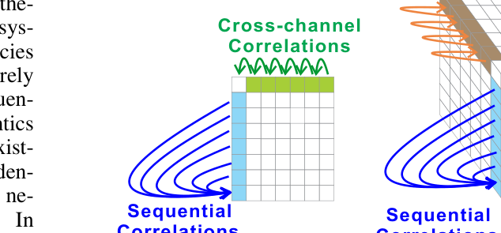
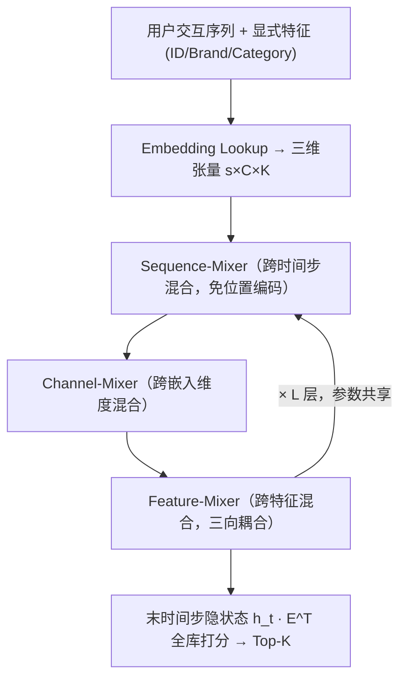
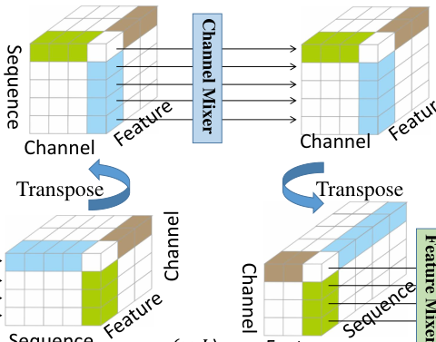

# MLP4Rec: A Pure MLP Architecture for Sequential Recommendations (面向序列推荐的纯 MLP 架构)

- **会议/期刊**: IJCAI 2022
- **作者与机构**: Muyang Li (University of Auckland)、Xiangyu Zhao (CityU HK, 通讯)、Chuan Lyu (ZJU)、Minghao Zhao / Runze Wu (网易伏羲 AI Lab)、Ruocheng Guo (ByteDance AI Lab)
- **推荐链路定位**: 召回（Next-Item 全库检索式打分）
- **研究方向**: 序列与会话推荐 / CTR 特征交叉
- **论文原文**: [https://arxiv.org/abs/2204.11510v1](https://arxiv.org/abs/2204.11510v1)
- **开源代码**: 暂未开源（基于 RecBole 实现，文中声明可复现）

## TL;DR (1分钟核心速览)

自注意力序列推荐存在三大痛点：必须叠加位置编码从而破坏 item embedding 语义、复杂度关于序列长度与维度平方、参数量巨大。MLP4Rec 改以纯 MLP 在 **三维张量（序列 × 通道 × 特征）** 上做 sequence-mixer / channel-mixer / feature-mixer 三向融合，天然顺序敏感且复杂度线性 $O(s+C+K)$。在 MovieLens-100k 与 Amazon Beauty 上按 Leave-One-Out + 100 负采样排序协议评估，Beauty 上 HR@10 相对最优基线提升 6.4%、NDCG@10 提升 3.8%，参数量仅 1.7M（FDSA 为 3.2M）。

## Background & Motivation (背景与核心矛盾)

- **主流范式**: SASRec / BERT4Rec / FDSA 等以 self-attention 建模序列依赖，长期占据 SRS 的 SOTA；CV 侧的 MLP-Mixer / resMLP 已证明纯 MLP 在 token-mixing 上可逼近注意力。
- **前人局限**: 其一，注意力对输入顺序不敏感，需外挂位置编码，而把 item 序列与异质的位置向量拼接会**破坏 item embedding 的潜在语义**；其二，注意力复杂度为 $O(s^2C+C^2s)$ 且参数膨胀，大规模场景训练与过拟合压力大。
- **核心洞察 (Key Insight)**: 现有 MLP-Mixer 系列是**双向 (bi-directional)** 的——只在 token(序列) 与 channel(通道) 两向混合，把 item ID 当作唯一语义载体，**忽略了 brand / category 等显式特征本身也携带序列偏好**（如 A 品牌忠诚用户会持续复购）。三向相关性才完整刻画一次交互（图 1）。
- **本文切入点**: 把 MLP-Mixer 的双向 mixer 扩展到「序列-通道-特征」三向，直接在三维 embedding 张量上反复转置+MLP 融合，让顺序信息由算子自身吸收而非外部编码。

<figure class="paper-figure" markdown="span">
  <figcaption>图1：双向相关性与三向相关性对比</figcaption>
</figure>

## Method (核心方法设计)

### 1. 整体框架 (Overall Architecture)

输入是用户历史序列的 $L$个 item，每个 item 含 ID 与$K-1$个显式特征，经 embedding 层堆叠成三维张量（序列维$s$× 通道维$C$× 特征维$K$）。每层由三个 MLP block 依次作用：sequence-mixer 沿序列轴混合（转置后对每个通道维跨时间步做 FC），channel-mixer 沿通道轴混合（恢复原形后对每个时间步跨维度做 FC），feature-mixer 沿特征轴混合（对同一时间步的$K$个特征向量做 FC）。共$L$层且**层间共享参数**，末层取最后时间步隐状态$\mathbf{h}_t$ 与全部候选 item 嵌入做点积排序。三向融合的关键在于 feature-mixer 位于层末，把已经融合好的序列与通道信息「广播」到其他特征，从而实现相干的三向耦合。

<figure class="paper-figure" markdown="span">
  <figcaption>图2：MLP4rec 的整体框架</figcaption>
</figure>

### 2. 关键设计拆解 (Key Designs)

1. **Sequence-Mixer：用算子结构替代位置编码**：痛点是位置编码在异构语义空间上做加法污染 item 表示。做法是把张量转置，令第 $c$维在各时间步上的取值$\{x_1^c,\dots,x_s^c\}$作为一个「特征通道」输入两层 FC，输出再转置回去：$\mathbf{y}_t=\mathbf{x}_t+\mathbf{W}_2 g_l(\mathbf{W}_1\mathrm{LayerNorm}(\mathbf{x}_t))$，其中$\mathbf{W}_1\in\mathbb{R}^{r_s\times s}$ 作用在**整条序列**上。由于 FC 权重对时间步位置并非置换不变，模型天然感知顺序，无需任何额外位置向量，物理上相当于在时间轴上做一次可学习的全局卷积式重加权。
2. **Feature-Mixer：把「item 语义」从 ID 单点扩展为特征集合**：痛点是 MLP-Mixer 各特征表彼此独立，跨特征相关性缺失。做法是对同一时间步的 $K$个嵌入向量施加 FC：$\mathbf{y}_k=\mathbf{x}_k+\mathbf{W}_6 g_l(\mathbf{W}_5\mathrm{LayerNorm}(\mathbf{x}_k))$，$\mathbf{W}_5\in\mathbb{R}^{r_K\times K}$。因其置于层末，序列/通道信息得以在特征间横向流动，形成三向相干传播；消融显示「只在最后一层混特征」显著劣化，证明**逐层迭代**而非一次性拼接才是有效形式（见实验）。
3. **训练目标、负采样与推理效率**：采用逐时间步的二分类交叉熵 $\mathcal{L}=-\sum_{S_n}\sum_{t}\big[\log\sigma(r_{i_t,t})+\sum_{j\notin S_n}\log(1-\sigma(r_{j,t}))\big]$，对每步采样未交互项作负例（负例数原文未显式给出），无对比/硬负采样设计。推理为内积检索$r_{m,t}=\mathbf{h}_t\cdot\mathbf{E}_m^{\top}$，全库打分取 Top-K。**无需负采样训练加速**也无需位置编码表，时间$O(s+C+K)$、空间$O(K(s+C+1))$，显著低于注意力的平方级。

## Experimental Setup & Evaluation Protocol (实验设置与评估协议)

- **数据集与预处理**: 两数据集均做 `5-core` 过滤（用户与物品交互数 ≥ 5），最大序列长度 50，短序列零填充。

| 数据集 | #Users | #Items | #Interactions | 稀疏度/密度 | 特征/场景说明 |
| :--- | :---: | :---: | :---: | :---: | :--- |
| MovieLens-100k | 943 | 1,682 | 100,000 | 6.30% | 电影评分，平均序列长 106；含类别等特征 |
| Amazon Beauty | 1,210,271* | 249,274* | 2,023,070 | 0.0007% | 美妆评论，平均序列长 8.8；含 brand/category |

*注：原文表 1 的 Beauty 用户/物品量级与交互数明显不自洽（疑为笔误），引用时需二次核对。

- **数据划分与防穿越 (Splitting Strategy)**: `Leave-One-Out`——每条序列最后一个 item 为测试、倒数第二个为验证、其余为训练；历史截断在目标项之前，无未来信息泄露。
- **排名评测协议 (Ranking Protocol)**: `Sampled Ranking`，**1 正 + 100 随机负样本**（SASRec 式），指标为 HR@10 / NDCG@10 / MRR@10，三次随机种子取均值。
- **对比基线与超参设置**: 基线覆盖传统 (PopRec, BPR, FPMC)、RNN (GRU4Rec, GRU4Rec+)、注意力 (SASRec/SASRec+, BERT4Rec)、特征感知 (FDSA)、MLP (MLP-Mixer+)。`+` 后缀表示将 ID 与特征 embedding 拼接，保证与 MLP4Rec 同等输入信息的公平对比。Embedding 维 $d$在 {32,64,128,256} 内网格搜索，层深 {2,4,6,8,10}，Adam + 早停，显著性用双侧 t 检验$p<0.05$。

## Key Experimental Results (实验关键数据)

### 1. 主实验对比 (Main Results)

| 模型 | MLen MRR@10 | MLen NDCG@10 | MLen HR@10 | Beauty MRR@10 | Beauty NDCG@10 | Beauty HR@10 |
| :--- | :---: | :---: | :---: | :---: | :---: | :---: |
| BPR | 0.1479 | 0.1905 | 0.3474 | 0.1479 | 0.3474 | 0.1905 |
| GRU4Rec+ | 0.1880 | 0.2550 | 0.4758 | 0.1848 | 0.2294 | 0.3746 |
| BERT4Rec | 0.1819 | 0.2568 | 0.5061 | 0.1313 | 0.1738 | 0.3135 |
| SASRec+ | 0.2022 | 0.2710 | 0.4970 | 0.2045 | 0.2488 | 0.3930 |
| FDSA | 0.1913 | 0.2625 | 0.4984 | 0.2056 | 0.2522 | 0.4040 |
| MLP-Mixer+ | 0.1987 | 0.2671 | 0.4920 | 0.2089 | 0.2556 | 0.4065 |
| **MLP4Rec** | **0.2027** | **0.2747** | **0.5118** | **0.2139\*** | **0.2654\*** | **0.4326\*** |
| Improv.% | +0.25% | +1.37% | +1.13% | +2.39% | +3.83% | +6.42% |

（`*` 表示对最优基线的双侧 t 检验 $p<0.05$ 显著；Improv.% 相对各列最优基线。原文 BPR 一行 Beauty 列数值与 MovieLens 列发生串位，属排版错误。）

### 2. 消融实验 (Ablation Study)

| 变体（Beauty） | MRR@10 | NDCG@10 | HR@10 |
| :--- | :---: | :---: | :---: |
| MLP-Mixer（无显式特征） | 0.1974 | 0.2401 | 0.3790 |
| MLP4Rec-Linear（特征混合退化为单线性层） | 0.2100 | 0.2586 | 0.4165 |
| MLP4Rec-Simple（仅在末层做特征混合） | 0.1995 | 0.2500 | 0.4143 |
| w/o Sequence-Mixer | 0.1771 | 0.2153 | 0.3396 |
| w/o Channel-Mixer | 0.1933 | 0.2440 | 0.4092 |
| w/o Feature-Mixer | 0.1974 | 0.2401 | 0.3790 |
| **MLP4Rec (Full)** | **0.2139** | **0.2654** | **0.4326** |

### 3. 关键实验发现 (Key Findings)

1. **Sequence-Mixer 是收益主引擎**：移除后 HR@10 由 0.4326 崩至 0.3396（−21.5%），跌幅远超移除 channel-mixer（−5.4%）与 feature-mixer（−12.4%）；且该模块**完全不含位置编码**，说明「FC 权重对时间位置非置换不变」这一结构性质已足够承载顺序信息，验证了"位置编码冗余"的核心假设。
2. **三向融合而非单向拼接才有效**：仅在末层混合特征的 MLP4Rec-Simple 只有 0.4143 HR@10，比逐层三向融合低 4.2%；即便换成同参数量的线性层（0.4165）仍不及其。说明跨特征信息必须在**每一层**与序列/通道信息交替迭代，否则特征语义无法回灌到时间维表示。
3. **参数效率优势明显但小数据收益有限**：Beauty 上 1.7M 参数即超越 FDSA（3.2M）与 SASRec+（2.0M），NDCG@10 提升 5.2%、HR@10 提升 6.4% 且统计显著；但在 MovieLens-100k 上相对 SASRec+ 仅 +1.4% NDCG 且未标注显著，说明该架构的收益随数据规模与特征丰富度放大。

## Highlights & Limitations (亮点、对比与审稿批判)

- **与代表作对比 (vs. Prior Work)**: 相较 SASRec/SASRec+，本文彻底移除位置编码与注意力，把顺序性写进 mixer 的权重结构；相较 FDSA，FDSA 是把特征单独走一条注意力支路再融合，而 MLP4Rec 让**特征与序列在同一张量内共享同一组融合算子**，耦合更彻底；相较 MLP-Mixer+（同为 MLP 系），唯一差别即 feature-mixer，而其 HR@10 仅 0.4065，正是本文三向设计的全部增益来源。
- **可迁移亮点**: (1)「三维张量 + 沿轴转置 + FC」的范式可低成本迁移到多行为/多场景序列（把特征轴换成场景轴）；(2) 层间参数共享 + 线性复杂度，非常适合召回侧全库检索的高吞吐与低显存约束。
- **审稿级局限批判**: (1) 消融表存在**内部不一致**——`w/o Feature-Mixer` 的数值与「无显式特征版 MLP-Mixer」完全相同，而非与 `MLP-Mixer+` 对齐，削弱了特征模块归因的可信度；(2) 评估仅用 100 负采样的 Sampled Ranking，未做 Full-Ranking，且 MovieLens-100k 规模过小、平均序列长达 106 与 Beauty 的 8.8 差异极大，模型的**长序列外推能力**与绝对排序质量未被验证；(3) 缺乏与同期 MOI-Mixer 的实证对比（作者仅以"代码未开源"为由排除），也缺少线上时延实测。

## Rating (四维评分)

- **方法创新性 (Novelty)**: ⭐⭐⭐⭐ （首次提出三向混合 MLP 架构，把特征相关性纳入 mixer 张量并免除位置编码，思路干净但本质是 MLP-Mixer 的轴向扩展）
- **评估协议与实验扎实度 (Protocol & Experiments)**: ⭐⭐⭐ （Leave-One-Out + 100 负采样合规，含 t 检验与参数对比，但仅两数据集、无 Full-Ranking、消融表存在数值不一致）
- **写作与数学规范度 (Clarity & Rigor)**: ⭐⭐⭐⭐ （三向 mixer 公式与复杂度推导清晰，图 2/3 表意明确；但训练负采样数量未明示、数据统计与 BPR 行存在明显排版错误）
- **工业落地与复现价值 (Industrial & Practical Value)**: ⭐⭐⭐⭐ （1.7M 参数 + $O(s+C+K)$ 线性复杂度对召回侧极友好，代码未开源但基于 RecBole 可复现）

