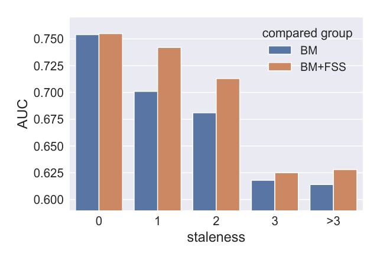
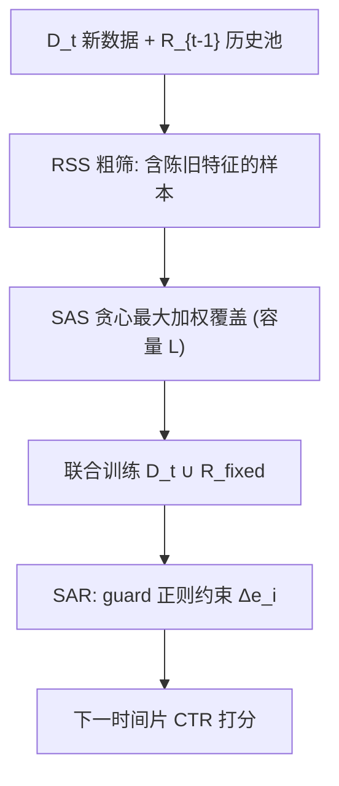
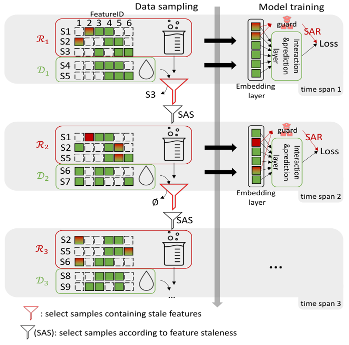

# Feature Staleness Aware Incremental Learning for CTR Prediction (特征陈旧性感知的 CTR 增量学习)

- **会议/期刊**: IJCAI
- **作者与机构**: Zhikai Wang, Yanyan Shen（上海交通大学）；Zibin Zhang, Kangyi Lin（腾讯）
- **推荐链路定位**: 精排（CTR 预估模型的在线增量更新）
- **研究方向**: CTR/CVR 预估与特征交叉 / 去偏与工业架构
- **论文原文**: [https://arxiv.org/abs/2505.02844v1](https://arxiv.org/abs/2505.02844v1)
- **开源代码**: [https://github.com/cloudcatcher888/FeSAIL](https://github.com/cloudcatcher888/FeSAIL)

## TL;DR (1分钟核心速览)

工业 CTR 模型按时间片增量更新时，若某特征在当片数据中缺席，其底层 embedding 就停在旧值，与已更新的高层交互层失配，本文称之为**特征陈旧 (feature staleness)** 问题。作者提出 FeSAIL：以"陈旧度"为权重把回放样本选择建模为**最大加权覆盖问题**（贪心解具 $1-1/e$ 近似比，邻居增量更新降复杂度），并加**陈旧度自适应正则**抑制低频陈旧特征的过度更新。在 Criteo/iPinYou/Avazu/Media 四个数据集、10 个连续时间片的平均 AUC 上相对最强基线 ASMG 分别提升 0.95%、1.38%、0.78%、1.72%。

## Background & Motivation (背景与核心矛盾)

- **主流范式**: 工业界以"新数据 $D_t$+ 固定/受控规模历史回放池$R_t$" 做增量微调（IU/RS/RMFX/GAG/EWC/ASMG），避免全量历史重训。
- **前人局限**: ① 只按"是否陈旧"二值回放（RSS/FSS）会导致回放池随历史累积无限膨胀，且在特征分布高度分散的新闻/短视频场景下随机子采样无法保证陈旧特征覆盖率；② 对所有陈旧特征一视同仁，长期缺席的低频特征被反复更新反而加剧过拟合，而仅缺席 1–2 片的特征本应像新特征一样正常更新。
- **核心洞察 (Key Insight)**: 陈旧度 $s_i$（连续缺席的时间片数）与样本 AUC 呈单调负相关（图 1：$s{=}0$时 AUC≈0.72，$s{>}3$ 时降至≈0.60），且 FSS 的增益主要集中在**小陈旧度**特征上——说明回放应"按陈旧度加权"，而非等权。

<figure class="paper-figure" markdown="span">
  <figcaption>图1：在Avazu上观察到的特征陈旧性问题。</figcaption>
</figure>

- **本文切入点**: 把回放池的固定容量预算当作优化资源，按陈旧度反比赋权做最大覆盖采样；再用归一化陈旧度控制 embedding 的更新步长。

## Method (核心方法设计)

### 1. 整体框架 (Overall Architecture)

FeSAIL 是 model-agnostic 的回放插件，挂在 Embedding&MLP 类骨架上，每个时间片 $t$分两阶段。**采样阶段**：先做 RSS 粗筛（保留含$f_i \notin \mathcal{F}_{D_t}$的样本）得到候选池$\mathcal{R}_t$，再由 SAS 用贪心算法从$\mathcal{R}_t$中挑出固定容量$L$的子集；**训练阶段**：用$D_t \cup \mathcal{R}^{fixed}_t$联合训练，交叉熵之外对每个特征的 embedding 位移$\Delta e_i$ 施加与其陈旧度成正比的 guard 正则。推理阶段无任何额外开销，模型结构与线上打分完全不变。

<figure class="paper-figure" markdown="span">
  <figcaption>图2：FeSAIL概览。当前数据集中出现的所有特征均位于绿色方块中。特征越红表示其陈旧程度越高。</figcaption>
</figure>

### 2. 关键设计拆解 (Key Designs)

1. **陈旧度感知采样 SAS（把回放选择变成加权最大覆盖）**：陈旧度按 $s_i^t = s_i^{t-1}+1$（若$f_i \notin \mathcal{F}_{D_t}$）否则置 0 递推；权重取反相关函数加偏置$w_i = func(s_i^t) + b$。目标是在容量$L$内最大化被覆盖特征的总权重，属经典最大覆盖的推广（NP-hard），故用贪心每轮选出"未覆盖权重和$W_l$最大"的样本，理论上$b_L \ge (1-1/e)\,OPT$。直觉：小陈旧度特征更可能在未来重现，优先覆盖它们等于给"即将复活"的特征买保险，同时天然抑制长期低频特征的重复入选。
2. **邻居增量加速**：朴素贪心复杂度 $O(|\mathcal{R}_t|\cdot L\cdot m)$在百万级池上不可行；由于只有与已选样本共享至少一个陈旧特征的样本其$W_l$才会变化，每轮仅更新邻居集合$\mathcal{N}$，复杂度降为$O(|\mathcal{R}_t|\,m + \bar{|Q|}_N L m)$。Avazu 上$\bar{|Q|}_N$在$10^3$量级而样本/特征规模在$10^8$ 量级，带来数量级加速。
3. **陈旧度正则 SAR 与训练目标**：guard 项对每个特征按归一化陈旧度截断加权：
$g_i = \frac{\min(s_i,\eta)}{\min(s_{max},\eta)}\,\|\Delta e_i\|_2$其中$\eta\in[5,10]$截断极端陈旧值、$s_{max}$归一化以消除数据集整体陈旧程度差异，$\Delta e_i$ 为相邻 mini-batch 间的 embedding 变化。总损失
$\mathcal{L} = \sum_{d\in D_t\cup \mathcal{R}_t}\big(\mathcal{L}_{CE,d} + \lambda \sum_{i=1}^{N} g_i\big)$效果上等价于：$s_i$越大 → 允许的$\Delta e_i$ 越小 → 低频特征被"冻结"，避免其在少数回放样本上过拟合。负采样方面 CTR 场景为全曝光样本的二分类，无需负采样；推理与基线同构，零附加延迟。

## Experimental Setup & Evaluation Protocol (实验设置与评估协议)

- **数据集与预处理**:

| 数据集 | #Users/样本数 | #Fields | #Features | 稀疏度/规模说明 | 特征/场景说明 |
| :--- | :---: | :---: | :---: | :---: | :--- |
| Criteo | 10,692,219 | 26 | 1,849,038 | 高基数类别特征 | 24 天连续广告曝光日志 |
| iPinYou | 21,920,191 | 21 | 4,893,029 | 正样本仅 14.89K | 展示广告竞价，类别特征 |
| Avazu | 40,183,910 | 20 | 10,922,019 | 移动端高散度 | 用户/设备/广告属性 |
| Media | 104,416,327 | 337 | 60,833,522 | 工业级超宽字段 | 某商业媒体平台 48 小时 |

- **数据划分与防穿越 (Splitting Strategy)**: 严格**时间戳切分**——1 个预训练集 $D_0$+ 10 个连续增量集$D_1,\dots,D_{10}$；时间片$t$仅用$D_t$与回放池训练，在$D_{t+1}$ 上测试，指标为 10 个测试片上的平均，杜绝未来信息泄漏。
- **排名评测协议 (Ranking Protocol)**: CTR 二分类预估，报告 **AUC 与 Logloss**（全曝光样本，无负采样、无 sampled ranking），并附两尾配对 t 检验 $p<0.05$（表中 `*`）。
- **对比基线与超参设置**: 6 个基线覆盖样本型（RS、RMFX、GAG）与模型型（EWC、ASMG）两族，另构造 4 个交叉插件变体（RMFX+SAR、GAG+SAR、EWC+SAS、ASMG+SAS）验证模块正交性。回放池容量 $L$与对应$D_t$等大；embedding 32–1024 网格搜索；Adam，lr$10^{-4}\sim10^{-3}$，batch 256–4096；默认$func=1/s_i$，$b=1$。

## Key Experimental Results (实验关键数据)

### 1. 主实验对比 (Main Results)

| Method | Criteo AUC | iPinYou AUC | Avazu AUC | Media AUC | Media Logloss |
| :--- | :---: | :---: | :---: | :---: | :---: |
| IU | 0.7329 | 0.7528 | 0.7210 | 0.6316 | 0.2884 |
| RS | 0.7363 | 0.7585 | 0.7244 | 0.6379 | 0.2842 |
| RMFX | 0.7415 | 0.7621 | 0.7306 | 0.6346 | 0.2844 |
| GAG | 0.7459 | 0.7674 | 0.7352 | 0.6401 | 0.2759 |
| EWC | 0.7391 | 0.7595 | 0.7295 | 0.6374 | 0.2757 |
| ASMG | 0.7502 | 0.7693 | 0.7394 | 0.6432 | 0.2777 |
| ASMG+SAS | 0.7535 | 0.7734 | 0.7407 | 0.6471 | 0.2727 |
| **FeSAIL** | **0.7553** | **0.7788** | **0.7420** | **0.6503** | **0.2712** |
| Improv. vs ASMG | +0.95% | +1.38% | +0.78% | +1.72% | −2.34% |

### 2. 消融实验 (Ablation Study)

以 Avazu / Criteo 的可比数字做正交拆解（RSS/FSS 变体在原文图 4 中以曲线呈现，FeSAIL 全程居首）：

| 配置 | 采样策略 | 正则 | Avazu AUC | Criteo AUC |
| :--- | :---: | :---: | :---: | :---: |
| IU | 无回放 | 无 | 0.7210 | 0.7329 |
| GAG | 图采样 | 无 | 0.7352 | 0.7459 |
| GAG+SAR | 图采样 | SAR | 0.7380 | 0.7498 |
| ASMG | 元学习 | 隐式 | 0.7394 | 0.7502 |
| ASMG+SAS | SAS | 隐式 | 0.7407 | 0.7535 |
| **FeSAIL** | **SAS** | **SAR** | **0.7420** | **0.7553** |
| 训练耗时 (min) | — | — | IU 2519 / FSS 2709 / RSS 1063 / FeSAIL 1415 | — |

### 3. 关键实验发现 (Key Findings)

1. **模块正交、可插拔增益明确**：把 SAR 单独嫁接到 GAG 上带来 Avazu +0.0028、Criteo +0.0039 AUC；把 SAS 单独嫁接到 ASMG 上带来 +0.0013/+0.0033——两模块对异质采样/正则族均有效，说明瓶颈确实是"未按陈旧度差异化处理"。
2. **固定容量池同时优化效果与成本**：FSS 回放池随历史线性膨胀，Avazu 上总耗时 2709 min 却仍不及 FeSAIL；FeSAIL 池容量恒为 $L$，总耗时 1415 min（较 IU 的 2519 min 更省），采样仅占约 400 min，邻居加速使其可承受。
3. **采样器确实偏好小陈旧度特征**：iPinYou 上 SAS 整体特征丢弃率约 10%（远优于理论最坏 30%），且除最初几个时间片外，陈旧度 $>3$的特征组丢弃率显著高于$s{=}0/1$组；参数敏感性上$b\in[0.1,2]$、$func\in\{1/s_i,\exp(s_i)\}$区间内所选样本 Jaccard 相似度高、AUC 稳定（Avazu 0.720–0.745），仅$b$ 过大（弱化陈旧度）才明显掉点。

## Highlights & Limitations (亮点、对比与审稿批判)

- **与代表作对比 (vs. Prior Work)**: 相对 ASMG（元学习生成参数）与 EWC（参数重要性正则）等**模型型**方法，FeSAIL 从**数据侧**解决同一失配问题，二者可叠加；相对 FSS/RSS 等**二值回放**方法，本文首次引入陈旧度连续加权与覆盖预算的形式化（最大加权覆盖 + $1-1/e$ 保证），并用邻居增量更新把 NP-hard 近似做到工业可用。
- **可迁移亮点**: ① "特征缺席时长"作为通用陈旧度信号，可直接复用为序列推荐/多任务场景的样本重加权权重；② 用 $\min(s_i,\eta)/\min(s_{max},\eta)$ 归一化正则强度，把不同数据集整体陈旧程度对齐，是增量学习里防止"正则强度随数据漂移"的通用技巧。
- **审稿级局限批判**: ① SAS 每轮 $O(|\mathcal{R}_t|m)$仍需扫全池构建邻居表，Media 级（337 字段、6000 万特征）真实时延论文只给了 Avazu 数据，缺少线上 QPS 级验证；② 陈旧度定义依赖"时间片对齐"，对不规则到达的事件流与突发流量（如大促）会失真，且$\eta$、$L$、$func$、$b$四个超参虽称不敏感，但$b$ 过大即掉点的边界未量化；③ 主实验仅 AUC/Logloss，缺少校准（Logloss 改善幅度小于 AUC 相对增益）与线上 A/B 的长期留存指标。

## Rating (四维评分)

- **方法创新性 (Novelty)**: ⭐⭐⭐⭐ （问题定义新颖且贴合工业痛点，最大加权覆盖的形式化与 $1-1/e$ 证明扎实，但贪心+正则本身属成熟工具的巧妙组合）
- **评估协议与实验扎实度 (Protocol & Experiments)**: ⭐⭐⭐⭐⭐ （4 数据集含 1 亿级私有工业集、10 个时间片逐步评测、$p<0.05$ 显著性检验、两族基线+四个交叉插件变体消融，协议完整度少见）
- **写作与数学规范度 (Clarity & Rigor)**: ⭐⭐⭐⭐ （陈旧度递推与近似比推导清晰，复杂度分析到位；但 SAR 的 $\Delta e_i$更新粒度与$\lambda$ 的交互缺少理论刻画）
- **工业落地与复现价值 (Industrial & Practical Value)**: ⭐⭐⭐⭐⭐ （model-agnostic 插件、零推理开销、训练总耗时反低于全量增量更新，代码已开源，工程迁移成本极低）

## Related Papers

- **ASMG** (Peng et al., SIGIR 2021): 元学习生成下一时间片参数，本文最强基线。
- **EWC** (Kirkpatrick et al., 2016): 参数重要性正则，本文 SAR 的思想源头。
- **FSS/RSS**: 二值陈旧特征回放，本文直接对照的"朴素回放"上限/下限变体。
- **ADER** (Mi et al., 2020): 自适应蒸馏样本回放，会话推荐中的同类回放思路。

