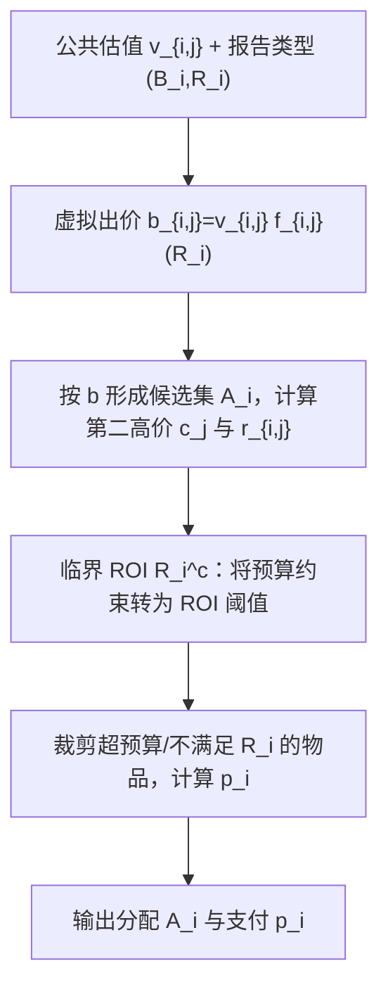
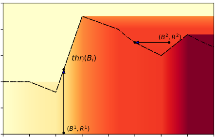

# Truthful Auctions for Automated Bidding in Online Advertising (自动出价在线广告的真实拍卖机制)

- **会议/期刊**: IJCAI 2023
- **作者与机构**: Yidan Xing、Zhilin Zhang、Zhenzhe Zheng 等，上海交通大学 & 阿里巴巴
- **推荐链路定位**: 精排（拍卖分配与计价）
- **研究方向**: CTR/CVR预估与特征交叉（拍卖机制层）/ 强化学习与动态探索推荐
- **论文原文**: [https://arxiv.org/abs/2301.13020v3](https://arxiv.org/abs/2301.13020v3)
- **开源代码**: 暂未开源

## TL;DR (1分钟核心速览)

针对自动出价中平台可估 CTR/CVR（公共估值）、而广告主预算 $B$与 ROI$R$ 为长期私有约束的二维激励问题，本文先刻画 DSIC 可行分配结构，再提出“个性化 rank score + 临界 ROI”的真实拍卖族。合成 i.i.d./混合出价环境中，收入与 liquid welfare 超过重复一价/二价，并达到非真实最优 LP 的 90% 以上。

## Background & Motivation (背景与核心矛盾)

- **主流范式**: 广告主在 auto-bidding 界面报预算与目标 ROI，平台代理按每次曝光估值出价，并在长期多拍卖中累计优化。
- **前人局限**: 传统拍卖假定单次私有估值，难覆盖“跨多拍卖累计约束”；重复一价/二价对 $B$、$R$ 不 IC，最优响应谎报会扭曲收入与公平。
- **核心洞察 (Key Insight)**: 公共估值 + 私有 $(B,R)$下，可行分配可化为预算的非减函数$g_i(B)=thr_i(B)\cdot B$；阈值 ROI 导致不规则 value grouping，闭式目标难求。
- **本文切入点**: 用非增 rank score 把 ROI 折入虚拟出价，以 critical ROI 将预算约束投影到 ROI 维度，构造简单可实现的 DSIC 拍卖。

## Method (核心方法设计)

### 1. 整体框架 (Overall Architecture)

平台已知物品对广告主的公共估值 $v_{i,j}$，广告主报告私有类型$(B_i,R_i)$。每个曝光上，模型计算虚拟出价$b_{i,j}=v_{i,j}f_{i,j}(R_i)$，最高者暂获物品；由第二高虚拟出价反推维持第一名所需 ROI$r_{i,j}$，再求临界 ROI$R_i^c$ 以判断预算可支撑的物品集合，裁剪超预算或不满足真实 ROI 的物品，最后按约束内最大支付计价。

### 2. 关键设计拆解 (Key Designs)

1. **真实性刻画与 value grouping**：预算维要求累计价值对 $B$非减，ROI 维要求对$R$非增；若跨邻域严格增，则必须触发预算/ROI 约束破坏。可行分配压缩为$g_i(B)=thr_i(B)\cdot B$非减；当$R\le g_i(B)/B$时$v_i=g_i(B)$，否则水平左寻至阈值曲线，导致不规则类型分组。<figure class="paper-figure" markdown="span">
  <figcaption>图2：固定其他投标人的类型 t−i 时，从阈值 ROI 函数到累积值的映射示例。</figcaption>
</figure> 这解释了为何收入/福利目标难有闭式解。
2. **Critical ROI + 个性化 rank score**：$f_{i,j}(R)$非增，临界 ROI 定义为$R_i^c=\max\{R\in\mathcal{R}_i:\sum_{j\in A_i}\mathbb{I}(R\le r_{i,j})v_{i,j}/R\ge B_i\}$，即“仍能花完预算的最大 ROI”，从而把预算投影到 ROI 维度。若$R_i\le R_i^c$则删除$r_{i,j}<R_i$的物品；支付为$p_i=\min(\sum_{j\in A_i}v_{i,j}a_{i,j}/R_i,B_i)$。谎报预算/ROI 要么不能增加赢品，要么直接破坏约束，故保持 DSIC。
3. **训练目标、负采样与推理效率**：本文无神经网络训练与负采样；采用 $f_{i,j}(R)=\alpha_{i,j}e^{-\beta R}$，$\alpha_{i,j}$取自截断正态$\mathcal{N}(\mu_i,\sigma_i^2)$，按环境调$\beta,\mu,\sigma$平衡收入与公平。在线每物品排序 + 临界 ROI 计算，复杂度近似$O(nm)$，工程可扩展。

## Experimental Setup & Evaluation Protocol (实验设置与评估协议)

- **数据集与预处理**: 合成广告拍卖环境，含 i.i.d. symmetric 与 8 组 low/high mixed 出价人；每设置 50 次独立运行平均。

| 合成设置 | #Bidders | #Items | 类型分布 | 说明 |
| :--- | :---: | :---: | :--- | :--- |
| Symmetric | 5–65 | 200 / 400–1600 | $v\sim U[1,4]$,$B\sim U[40,80]$,$R\sim U[1,3]$ | i.i.d. |
| Mixed | 40 | 200/1000/1600 | $v,B,R$ 各低/高两档，8 组 | non-i.i.d. |

- **数据划分与防穿越**: 无训练/测试划分；重复拍卖序列模拟，50 次运行平均，不存在监督学习式穿越。
- **排名评测协议**: 全量物品拍卖分配（非采样排序）；指标为 revenue、liquid welfare $LW=\sum_i\min(v_i/R_i,B_i)$、fairness$\min_i\min(v_i/R_i,B_i)$。
- **对比基线与超参设置**: 重复 first-price、second-price（含 best-response 谎报模拟）、非真实最优 LP；DSIC 变体 DSIC-1/2/3。Embedding 维度不适用；未报告显著性检验。

## Key Experimental Results (实验关键数据)

### 1. 主实验对比 (Main Results)

原文主实验以趋势图为主，未给完整精确表；下表按原文报告与图示趋势整理代表结果（DSIC 为本文方法）：

| 设置 | 指标 | OPT(LP) | First-Price | Second-Price | DSIC(本文) | Improv. |
| :--- | :--- | :---: | :---: | :---: | :---: | :--- |
| 对称，200 items，5–65 bidders | Revenue | 100% | 低于 DSIC | 低于 DSIC | **≥90% OPT** | 优于一价/二价 |
| 对称，40 bidders，400–1600 items | Revenue | 100% | 供过于求时明显下降 | 较稳但低于 DSIC | **≥90% OPT** | 供给充足时领先 |
| 对称，40 bidders，600–1200 items | Fairness | 基准 | 低 | 低 | **优于 OPT** | 公平性提升 |
| 混合，S1/S2/S3 | Revenue | 100% | 低 | 低 | **DSIC-n 仅本设置佳** | 强场景依赖 |

### 2. 消融实验 (Ablation Study)

原文无组件消融；以 rank score 跨供给设置的泛化实验替代：

| 变体 | S1: 200 items | S2: 1000 items | S3: 1600 items | 结论 |
| :--- | :---: | :---: | :---: | :--- |
| DSIC-1 | **高** | 低 | 低 | 过配高值低 ROI 投标人 |
| DSIC-2 | 低 | **高** | 低 | 供给充足时需分散 |
| DSIC-3 | 低 | 低 | **高** | 参数强场景依赖 |

### 3. 关键实验发现 (Key Findings)

1. 对称环境中 DSIC 收入/福利达到 OPT 的 **90% 以上**，且高于重复一价/二价；一价在物品过剩时收入与公平明显下滑，原因是 best-response ROI 被抬高，二价受影响较小但仍低。
2. 公平性上，600–1200 items 时 DSIC 的 fairness 可优于 OPT；200/400 items 短缺时为追求收入牺牲公平，$\beta$ 可调节收入-公平权衡。
3. 混合出价中 rank score 不跨设置通用：DSIC-1/2/3 只在各自 Setting 表现最佳，说明需按供给与类型分布自适应调 $f_{i,j}$，否则会过度集中分配。

## Highlights & Limitations (亮点、对比与审稿批判)

- **与代表作对比 (vs. Prior Work)**: Balseiro 等仅处理私有 ROI + 公共预算且仅部分多投标人情形；pacing equilibrium 类工作分析效率但无 DSIC；GSP 式 rank score 被本文用 critical ROI 扩展至预算+ROI 二维私有约束。
- **可迁移亮点**: “critical ROI 将预算投影到 ROI 维度”可迁移到长期约束出价、预算平滑与多约束拍卖；value grouping 刻画可用于诊断多约束机制的可实现分配空间。
- **审稿级局限批判**: 依赖公共 $v_{i,j}$ 与单物品/时隙假设，真实 CTR/CVR 误差会破坏真实性；预算耗尽时可能丢弃物品，rank score 参数敏感，且仅合成实验、无真实 A/B 与显著性检验。

## Rating (四维评分)

- **方法创新性 (Novelty)**: ⭐⭐⭐⭐ （首次联合刻画预算+ROI 二维私有约束，value grouping 与 critical ROI 有理论新意）
- **评估协议与实验扎实度 (Protocol & Experiments)**: ⭐⭐⭐ （合成 i.i.d./mixed 50 runs，缺真实数据、显著性检验与充分消融）
- **写作与数学规范度 (Clarity & Rigor)**: ⭐⭐⭐⭐ （定理链条完整，但阈值/分组记号较密，工程细节略少）
- **工业落地与复现价值 (Industrial & Practical Value)**: ⭐⭐⭐ （算法简单可扩展，但依赖公共估值与参数调优，未开源）

