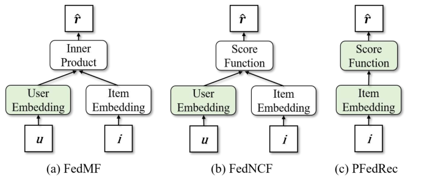
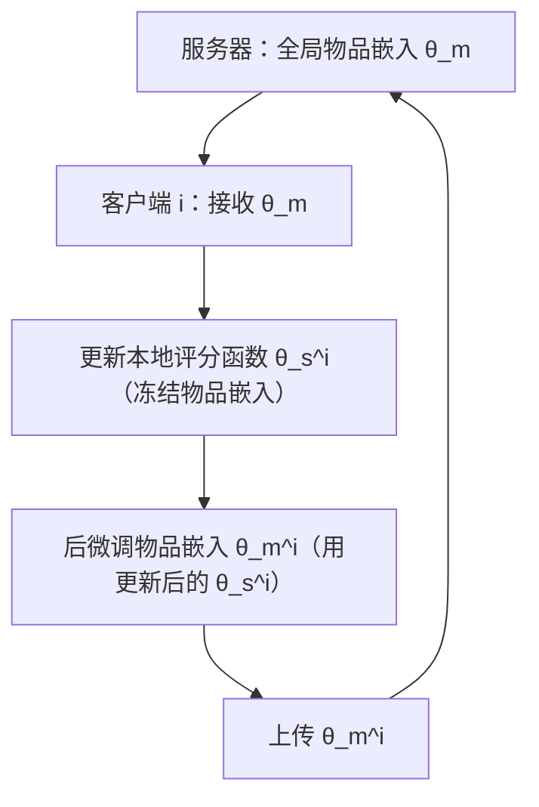

# Dual Personalization on Federated Recommendation (联邦推荐中的双重个性化)

- **会议/期刊**: IJCAI 2023
- **作者与机构**: Chunxu Zhang, Guodong Long, Tianyi Zhou, Peng Yan, Zijian Zhang, Chengqi Zhang, Bo Yang；吉林大学、悉尼科技大学、马里兰大学
- **推荐链路定位**: 精排/端侧推理（交互矩阵打分）
- **研究方向**: 去偏公平、可信隐私与工业架构 / 协同过滤
- **论文原文**: [论文原文链接](https://arxiv.org/abs/2301.08143v2)
- **开源代码**: [开源代码仓库链接](https://github.com/Zhangcx19/IJCAI-23-PFedRec)

## TL;DR (1分钟核心速览)

针对联邦推荐服务器重模型、物品嵌入全局共享忽视用户细粒度偏好的痛点，PFedRec 将评分函数留在端侧、仅聚合物品嵌入，并用“后微调”生成用户专属物品视图；在四个数据集上以 Leave-One-Out + HR@10/NDCG@10 评估，ML-100K/1M 较最强 Fed 基线提升约 8–10%，LDP 噪声下性能仅小幅下降。

## Background & Motivation (背景与核心矛盾)

- **主流范式**: 联邦推荐通常把 MF/NCF 分布到客户端，服务器聚合物品嵌入或梯度，用户嵌入本地保留，评分函数多被全局共享。
- **前人局限**: 一是服务器仍维护重型全局模型与全量物品嵌入，端侧轻量部署受限；二是仅个性化用户嵌入、物品嵌入全局共享，无法表达“同一物品对不同用户语义不同”，稀疏数据下易引入噪声。
- **核心洞察 (Key Insight)**: 用户决策不仅体现在“我是谁”的用户嵌入，也体现在“我如何打分”和“我如何度量物品相似性”；物品嵌入可从全局先验出发做轻微微调，形成用户专属视图。
- **本文切入点**: 删除用户嵌入，评分函数完全本地私有，物品嵌入在全局初始化上做后微调，从而在用户侧与物品侧同时实现个性化。

<figure class="paper-figure" markdown="span">
  <figcaption>图1：个性化联邦推荐的不同框架。绿色块表示个性化模块，其表示模型中用于保留用户偏好的部分。我们提出的模型将在两个模块上保留双重个性化。</figcaption>
</figure>
*图1：不同个性化联邦推荐框架对比；PFedRec 在评分函数与物品嵌入两处保留个性化。*

## Method (核心方法设计)

### 1. 整体框架 (Overall Architecture)

服务器只维护全局物品嵌入 $\theta_m$，每轮随机选客户端下发；客户端先以全局物品嵌入冻结方式更新本地评分函数$\theta_s^i$，再用更新后的评分函数对物品嵌入做后微调，得到用户专属$\theta_m^i$并上传；服务器对$\theta_m^i$ 做 FedAvg。评分函数不上传、不聚合；客户端只保留交互正物品与采样负物品的嵌入子集，推理时用本地评分函数与个性化物品嵌入打分。

### 2. 关键设计拆解 (Key Designs)

1. **双层级个性化目标**：把 FedRec 写成带约束的双层优化 $\min_{\theta_m,\{\theta_i\}}\sum_i\alpha_i\mathcal{L}_i(\theta_i;r,\hat r)$，s.t.$\theta_i=(\theta_m-\nabla_{\theta_m}\mathcal{L}_i,\theta_s^i)$。全局物品嵌入被当作“可快速适应的初始化”，而不是直接在所有客户端共享的最终表示；本地评分函数与物品嵌入共同吸收用户偏好。相比 MAML 式方法，本文不直接对全局模型做本地微调，而是先学评分、再调物品，避免二阶梯度与重型服务器模型。

2. **删除用户嵌入，评分函数完全本地化**：预测为 $\hat r_{ij}=S_i(E_i(e_j))$，$S_i$只存在于客户端，因评分函数已具备保留用户偏好的表征能力，额外用户嵌入被视为冗余且增加隐私暴露面。若$S_i$ 取一层线性网络，PFedRec 可退化为 FedMF；若只做部分层个性化，则可等价于 FedNCF，因此该框架具有“通用容器”性质。

3. **后微调物品嵌入与端侧稀疏存储**：每轮客户端先用全局 $\theta_m$覆盖本地物品嵌入，更新$\theta_s^i$，再以$\eta'$对$\theta_m^i$做本地更新；训练损失为 BCE：$\mathcal{L}_i=-\sum_{(i,j)\in\mathcal{D}_i}\log\hat r_{ij}-\sum_{(i,j')\in\mathcal{D}_i^-}\log(1-\hat r_{ij'})$。负样本从$I\setminus I_i$均匀采样，每个正样本采 4 个负样本；客户端仅维护相关物品子集，通信仅传物品嵌入。可选 LDP：上传前加$\theta_m^i\leftarrow\theta_m^i+\mathrm{Laplace}(0,\lambda)$。

## Experimental Setup & Evaluation Protocol (实验设置与评估协议)

- **数据集与预处理**: MovieLens 每用户至少 20 条评分；Lastfm-2K 与 Amazon-Video 过滤交互少于 5 的用户。

| 数据集 | #Users | #Items | #Interactions | 稀疏度 | 场景 |
| :--- | :---: | :---: | :---: | :---: | :--- |
| MovieLens-100K | 943 | 1,682 | 100,000 | 93.70% | 电影评分 |
| MovieLens-1M | 6,040 | 3,706 | 1,000,209 | 95.53% | 电影评分 |
| Lastfm-2K | 1,600 | 12,454 | 185,650 | 99.07% | 音乐艺术家 |
| Amazon-Video | 8,072 | 11,830 | 63,836 | 99.93% | 视频商品 |

- **数据划分与防穿越**: `Leave-One-Out`，每个用户留一条交互作测试。
- **排名评测协议**: HR@10 与 NDCG@10。原文仅写 Leave-One-Out，未明确 `Full-Ranking` 还是 `Sampled Ranking`；按 NCF 传统应属采样排序（常见 1 正 + 99 负），但测试负样本比例未在正文披露，复现时需核查。
- **对比基线与超参**: 中心化 MF/NCF；联邦 FedMF、FedNCF、FedRecon、MetaMF、FedPerGNN。嵌入维度 32，batch 256，训练负采样 4:1，5 次重复报告均值±方差；未给出显著性检验 $p$ 值。

## Key Experimental Results (实验关键数据)

### 1. 主实验对比 (Main Results)

| 方法 | ML-100K HR | ML-100K NDCG | ML-1M HR | ML-1M NDCG | Lastfm HR | Lastfm NDCG | Amazon HR | Amazon NDCG |
| :--- | :---: | :---: | :---: | :---: | :---: | :---: | :---: | :---: |
| NCF | 64.14 | 37.91 | 64.17 | 37.85 | 82.44 | 67.43 | **60.16** | 38.97 |
| MF | 64.43 | 38.95 | 68.45 | 41.37 | **82.71** | 71.04 | 46.69 | 29.83 |
| FedMF | 65.15 | 39.38 | 67.72 | 40.90 | 81.64 | 69.36 | 59.67 | 38.55 |
| FedNCF | 60.62 | 33.25 | 60.54 | 34.17 | 81.55 | 61.03 | 57.77 | 36.86 |
| FedRecon | 64.45 | 37.78 | 63.28 | 36.59 | 82.06 | 67.58 | 59.80 | 38.87 |
| MetaMF | 66.38 | 40.59 | 45.61 | 25.24 | 80.88 | 64.24 | 57.51 | 37.25 |
| FedPerGNN | 10.50 | 4.92 | 9.69 | 4.37 | 10.19 | 4.83 | 10.72 | 4.90 |
| **PFedRec** | **71.62** | **43.44** | **73.26** | **44.36** | 82.38 | **73.19** | 60.08 | **39.12** |
| 相对最优 | +7.89% | +7.02% | +7.03% | +7.23% | -0.40% | +3.03% | -0.13% | +0.39% |

### 2. 消融实验 (Ablation Study)

原文未做组件移除式消融，表3以“DualPer 可插拔”验证双重个性化增益，下表为相对原基座的提升：

| 设置 | ML-100K HR↑ | ML-100K NDCG↑ | ML-1M HR↑ | ML-1M NDCG↑ | Lastfm HR↑ | Lastfm NDCG↑ | Amazon HR↑ | Amazon NDCG↑ |
| :--- | :---: | :---: | :---: | :---: | :---: | :---: | :---: | :---: |
| FedMF + DualPer | 9.93% | 10.31% | 8.18% | 8.46% | 0.91% | 5.52% | 0.69% | 1.48% |
| FedNCF + DualPer | 13.53% | 18.29% | 12.60% | 15.77% | 0.93% | 17.38% | 3.12% | 5.07% |
| FedRecon + DualPer | 8.92% | 10.72% | 8.87% | 9.43% | 1.77% | 10.73% | 0.72% | 0.85% |

### 3. 关键实验发现 (Key Findings)

- 双个性化在稠密 MovieLens 上增益最大：FedNCF+DualPer 在 ML-100K 的 HR/NDCG 提升 13.53%/18.29%，FedMF+DualPer 为 9.93%/10.31%；本地样本越充足，物品嵌入后微调越能刻画用户专属物品语义。
- PFedRec 在 ML-100K/1M 全面超过所有基线，HR@10 达 71.62/73.26，较最强 Fed 基线 MetaMF/FedMF 分别提升 7.89%/8.18%；但在 Lastfm/Amazon 的 HR 分别低于 MF/NCF 0.40%/0.13%，仅 NDCG 略优，说明极端稀疏下个性化物品嵌入收益有限。
- LDP 噪声 $\lambda=0.4$ 时 ML-100K HR 71.62→70.84、NDCG 43.44→43.14，Lastfm NDCG 73.19→72.39；性能下降可控且仍优于多数 Fed 基线，隐私-效用折中可接受。

## Highlights & Limitations (亮点、对比与审稿批判)

- **与代表作对比**: FedMF/FedNCF 共享物品嵌入与评分函数，FedRecon 用 MAML 式重训用户模型，MetaMF 用 meta-network 但服务器仍持全局参数；PFedRec 只聚合物品嵌入，评分函数完全本地，物品嵌入做“后微调”，且可直接插入 FedMF/FedNCF/FedRecon 取得一致提升。
- **可迁移亮点**: “先更新评分函数、再后微调物品嵌入”可迁移到其他 FedRec 基座；客户端只存交互正物品与负采样物品子集，能显著降低端侧内存与通信开销。
- **审稿级局限**: 评测协议披露不足：仅写 Leave-One-Out，未明确测试负采样比例/是否全库排序，且无显著性检验；FedPerGNN 结果异常低（HR≈10），需核查实现。极端稀疏 Lastfm/Amazon 上 HR 未超最强中心化基线，LDP 加噪、物品子集存储与全库推理的工程权衡也未充分量化。

## Rating (四维评分)

- **方法创新性 (Novelty)**: ⭐⭐⭐⭐ （双个性化把物品嵌入也个性化并删除用户嵌入，思路新；理论/谱分析支撑一般）
- **评估协议与实验扎实度 (Protocol & Experiments)**: ⭐⭐⭐ （四数据集+5 次重复较完整，但测试排序协议与显著性披露不足，FedPerGNN 异常）
- **写作与数学规范度 (Clarity & Rigor)**: ⭐⭐⭐⭐ （框架与算法清晰、公式简洁；部分符号与评测细节略欠展开）
- **工业落地与复现价值 (Industrial & Practical Value)**: ⭐⭐⭐⭐ （开源、端侧轻量、可插拔；全库推理与隐私机制组合仍需工程验证）

