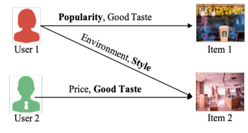
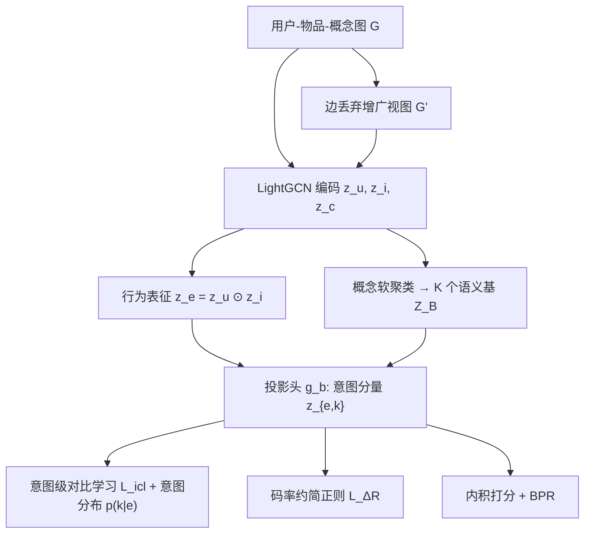

# Intent-aware Recommendation via Disentangled Graph Contrastive Learning (基于解耦图对比学习的意图感知推荐)

- **会议/期刊**: IJCAI 2023 (pp. 2343–2351)
- **作者与机构**: Yuling Wang, Yanhua Yu 等（北京邮电大学）；Xiao Wang（北京航空航天大学）；Xiangzhou Huang, Mengdi Zhang, Wei Wu（美团）；Haoyang Li（清华大学）
- **推荐链路定位**: 召回（表征学习）
- **研究方向**: 图神经网络与知识图谱推荐 / 自监督对比学习与交互去噪
- **论文原文**: [https://arxiv.org/abs/2403.03714v1](https://arxiv.org/abs/2403.03714v1)
- **开源代码**: [RecBole](https://github.com/RUCAIBox/RecBole)（基于 RecBole 统一复现基线，作者自研模块未单列仓库）

## TL;DR (1分钟核心速览)

GNN 推荐把每条交互都压成同一张图的同质边，抹掉了"为什么买"的意图差异；而既有解耦方法（DGCF、MacridVAE）在稀疏交互下缺乏监督信号，且只能靠用户-物品相似度隐式推断意图分布。IDCL 把交互建成**用户-物品-概念**异质图，用概念嵌入软聚类出 $K$个可解释语义基作为意图原型，引导行为向量投影到$K$ 个意图子空间；再用意图级对比学习（正样本=扰动视图同意图分量，原型=语义基）自造监督并同时输出行为意图分布，最后以码率约简正则强制各意图子空间正交。ML-100k、ML-1M、MtBusiness 三数据集全库排序下全面 SOTA，Recall@20 相对最强基线最高提升 **8.52%**。

## Background & Motivation (背景与核心矛盾)

- **主流范式**: LightGCN / NCL 一类工作把交互组织为同质二部图，依靠多层消息传递聚合高阶协同信号，并用图增广对比学习缓解稀疏性。
- **前人局限 1 — 意图不可得**: 大多数 GNN 推荐直接学 user/item 向量，完全不建模意图；少数解耦工作（DGCF、MacridVAE）对用户或物品**单独**解耦，但解耦学习本身高度依赖归纳偏置与监督（Locatello et al., 2018），而真实交互极度稀疏，缺乏监督导致因子纠缠。
- **前人局限 2 — 分布不可信**: 现有方法用用户与物品在各意图子空间的内积相似度当作意图分布，这一分布**不含意图本身的语义**，容易偏离真实意图；且无法保证行为表征被正确划入对应意图子空间，存在模式坍缩风险。
- **核心洞察 (Key Insight)**: 图 1 显示同一条 user–item 边背后可能是"流行度""口味""价格"等完全不同的驱动因素，且同一用户对不同物品的意图权重不同；而物品的**概念属性**（电影类型、商家多面信息）恰是意图的显式语义锚点，可作为免费监督。
- **本文切入点**: 把"意图"实体化为概念聚类得到的语义基，让行为解耦、分布推断与正交约束三者共享同一组语义基。

<figure class="paper-figure" markdown="span">
  <figcaption>图 1：行为分布示意图。每个行为的意图显示在箭头上（主要意图以粗体显示）。</figcaption>
</figure>

## Method (核心方法设计)

### 1. 整体框架 (Overall Architecture)

输入为用户-物品-概念图 $\mathcal{G}=(\mathcal{V},\mathcal{E})$，节点集含用户$\mathcal{U}$、物品$\mathcal{I}$与概念$\mathcal{C}$，边含交互$O^+$与物品归属$P^+$。先用边丢弃（edge dropout）构造增广视图$\mathcal{G}'$；共享的 LightGCN 编码器在两个视图上得到用户、物品、概念嵌入，行为表征取$z_e = z_{u}\odot z_{i}$；同时概念嵌入经软聚类 + 投影头产出$K$个概念感知语义基$Z_B$，行为按语义基投影成$K$ 个意图分量。意图级对比学习用语义基作原型计算意图分布并施加自监督，码率约简正则约束各意图组正交，最终以用户-物品内积 + BPR 排序学习，三个损失联合多任务优化。

### 2. 关键设计拆解 (Key Designs)

1. **概念感知语义基引导的行为解耦**：痛点是对 $z_e$直接切块会得到无语义的因子。做法是先学概念-意图软分配$S=\mathrm{softmax}(Z_c W_1)\in\mathbb{R}^{R\times K}$，再聚合概念得$Z_B = g_s(S^\top Z_c)\in\mathbb{R}^{K\times \Delta d}$（$\Delta d = d/K$），最后把行为与第$k$个语义基拼接投影：$z_{e,k}=g_b^{(k)}(z_e\,\|\,b_k)$，拼回$z_e=[z_{e,1};\dots;z_{e,K}]$。直觉：概念是物品的多面属性，聚类后每一基天然对应"类型/价格/口味"一类可命名语义，因子因此可解释且不塌缩到同一信息。
2. **意图级对比学习（ICL）与分布推断**：痛点是无意图标签。IDCL 把对比任务分解为 $K$个子任务，用语义基作**原型**而非随机初始化计算意图置信度$p_\theta(k|e)=\frac{\exp\phi(z_{e,k},b_k)}{\sum_{k'}\exp\phi(z_{e,k'},b_{k'})}$（$\phi$为带温度余弦相似度），并以期望形式加权子任务损失$\mathcal{L}_{icl}=\sum_{e\in O^+}-\log\mathbb{E}_{p_\theta(k|e)}\left[p_\theta(e'|e,k)\right]$，其中$p_\theta(e'|e,k)$为第$k$子空间上的 NT-Xent 项。直觉：置信度高的意图获得更大对比权重，形成"分布推断 ↔ 解耦强化"的互促闭环，同时$p_\theta(k|e)$ 直接就是所需的行为意图分布。
3. **码率约简正则与训练目标**：痛点是无约束时行为会挤入少数意图（模式坍缩）。借鉴 MCR²，以 $\mathcal{L}_{\Delta R}=-R(Z_e,\epsilon)+R_c(Z_e,\epsilon|\Pi)$最大化整体编码率、最小化组内编码率，其中$R(Z_e,\epsilon)=\frac{1}{2}\log\det\left(I+\frac{d}{F\epsilon^2}Z_e^\top Z_e\right)$，$R_c$用对角隶属矩阵$\Pi_k=\mathrm{diag}(p_\theta(k|e))$分组计算。总损失$\mathcal{L}=\mathcal{L}_{bpr}+\lambda_1\mathcal{L}_{icl}+\lambda_2\mathcal{L}_{\Delta R}+\lambda_3\|\Theta\|_2^2$；负采样为标准 BPR 未观测采样（非难负例、非全库 softmax），mini-batch 内随机抽行为降对比开销，推理为内积 ANN 召回，无额外在线成本。

## Experimental Setup & Evaluation Protocol (实验设置与评估协议)

- **数据集与预处理**: 沿用 MultiVAE / MacridVAE 的划分与预处理，电影类型作为概念；MtBusiness 取自美团到店业务真实购买日志。

| 数据集 | #Users | #Items | #Interactions | 稀疏度/密度 | 特征/场景说明 |
| :--- | :---: | :---: | :---: | :---: | :--- |
| ML-100k | 943 | 1,682 | 100,000 | 6.30% | 电影，类型(genre)作概念 |
| ML-1M | 6,040 | 3,706 | 1,000,209 | 4.47% | 电影，类型作概念 |
| MtBusiness | 11,891 | 20,689 | 52,041 | 0.021% | 美团到店，多面商家属性作概念（极稀疏） |

- **数据划分与防穿越 (Splitting Strategy)**: 按 MultiVAE 协议划分 train/validation/test，并额外抽取 4,000 名 held-out 用户，对每人**随机保留 50% 交互**作为测试目标（其余作为训练历史），属随机比例划分而非全局时间戳切分，存在轻微未来信息穿越风险。
- **排名评测协议 (Ranking Protocol)**: 无偏 **Full-Ranking（全库未交互物品排序）**，指标 Recall@{20,50,100} 与 NDCG@100，报告 5 次运行均值 ± 标准差。
- **对比基线与超参设置**: 5 个 SOTA——NGCF、LightGCN、NCL（图协同过滤/自监督）与 DGCF、MacridVAE（解耦推荐）。统一用 RecBole 实现，所有基线共享相同概念特征、相同嵌入维度与相同 GNN 层数；$K\in\{6,8,10,12,14,16\}$、$\Delta d\in[20,40]$ 网格搜索，Adam + early stopping。

## Key Experimental Results (实验关键数据)

### 1. 主实验对比 (Main Results)

| 数据集 | 方法 | Recall@20 | Recall@50 | Recall@100 | NDCG@100 |
| :--- | :--- | :---: | :---: | :---: | :---: |
| ML-100k | LightGCN | 0.2724 | 0.3878 | 0.5278 | 0.2975 |
| | DGCF | 0.2371 | 0.3847 | 0.5096 | 0.2858 |
| | MacridVAE | 0.2981 | 0.4287 | 0.5378 | 0.3210 |
| | NCL | 0.2347 | 0.3771 | 0.5096 | 0.2796 |
| | **IDCL** | **0.3235** | **0.4450** | **0.5554** | **0.3378** |
| | Improv. | +8.52% | +3.80% | +3.27% | +5.23% |
| ML-1M | LightGCN | 0.2940 | 0.4694 | 0.6125 | 0.4150 |
| | DGCF | 0.2961 | 0.4664 | 0.6073 | 0.4115 |
| | MacridVAE | 0.2981 | 0.4590 | 0.5988 | 0.4104 |
| | NCL | 0.3017 | 0.4754 | 0.6175 | 0.4177 |
| | **IDCL** | **0.3160** | **0.4888** | **0.6268** | **0.4302** |
| | Improv. | +4.74% | +2.82% | +1.51% | +2.99% |
| MtBusiness | LightGCN | 0.2934 | 0.3354 | 0.3597 | 0.2378 |
| | DGCF | 0.2915 | 0.3318 | 0.3541 | 0.2358 |
| | MacridVAE | 0.2887 | 0.3309 | 0.3569 | 0.2333 |
| | NCL | 0.2906 | 0.3353 | 0.3605 | 0.2335 |
| | **IDCL** | **0.2973** | **0.3426** | **0.3697** | **0.2382** |
| | Improv. | +1.33% | +2.15% | +2.55% | +0.17% |

### 2. 消融实验 (Ablation Study)

| 变体 (Recall@20) | ML-100k | ML-1M | MtBusiness |
| :--- | :---: | :---: | :---: |
| **IDCL 完整模型** | **0.3235** | **0.3160** | **0.2973** |
| Variant A: w/o ICL（去意图级对比） | 0.3146 (-2.75%) | 0.3122 (-1.20%) | 0.2907 (-2.22%) |
| Variant B: w/o CR（去码率约简正则） | 0.3166 (-2.13%) | 0.3146 (-0.44%) | 0.2961 (-0.40%) |

### 3. 关键实验发现 (Key Findings)

1. **意图级对比是解耦的主要驱动，码率正则主要负责防坍缩**：去掉 ICL 后 ML-100k Recall@20 掉 2.75%，且图 3(c) 的因子余弦相似度矩阵在**非对角块**也出现高相似区域，说明不同意图被严重纠缠；而去掉 CR 精度仅掉 2.13%，但图 6 显示行为被集中分配到意图 4 与 7、意图 12 几乎无样本，即 CR 的作用是维持意图维度的多样性而非直接抬分。
2. **收益集中在头部排名，符合真实召回诉求**：三个数据集上 Recall@20 的提升（8.52% / 4.74% / 1.33%）普遍高于 Recall@100（3.27% / 1.51% / 2.55% 中除 MtBusiness 外均更低），说明 IDCL 把相关物品推得更靠前；且在极稀疏的 MtBusiness（密度 0.021%）上仍稳定优于 LightGCN，验证概念语义基在稀疏场景下的监督价值。
3. **解耦结构可迁移到用户侧，并可解释**：尽管解耦只作用于行为，图 3(b) 显示用户表征同样呈清晰对角块；图 5 的雷达图显示同一用户看同类型电影（Adventure/Fantasy）时意图分布形状高度相似，而对 Comedy 电影意图 5 置信度显著上升，不同用户看同一电影分布形状不同——说明意图分布同时编码了用户个性与物品属性。

## Highlights & Limitations (亮点、对比与审稿批判)

- **与代表作对比 (vs. Prior Work)**: 相较 DGCF 在**用户/物品**上做因子分解，IDCL 直接在**行为** $z_u\odot z_i$ 上解耦并引入概念语义基，因子可命名；相较 MacridVAE 用 VAE + 高斯先验隐式解耦，IDCL 用原型对比 + MCR² 双约束给出显式正交性；相较 NCL 的图增广对比只学一坨整体表征，IDCL 的对比学习是**意图分量级**的，监督粒度更细。
- **可迁移亮点**: (1) "概念软聚类 → 语义基原型"可低成本替换随机原型/可学习原型，适用于任何异质信息推荐（品类、品牌、作者）；(2) MCR² 作为子空间正交正则，可直接插入现有多兴趣/多行为建模框架防止兴趣坍缩。
- **审稿级局限批判**: (1) 评测对每个测试用户随机保留 50% 交互且未做时间戳切分，存在**未来信息泄漏**，且未使用 5-core 过滤，与主流 LOO/时间切分协议不可直接横比；(2) $K$与$\Delta d$需按数据集网格搜索，MtBusiness 上增益仅 0.4%–2.5% 且 5 次方差极小，需报告显著性检验；同时每行为$K$个投影头 + 对比子任务带来$O(K\cdot B^2)$ 训练开销，且推理期意图分布的解释性展示（雷达图）未做用户调研验证其因果有效性。

## Rating (四维评分)

- **方法创新性 (Novelty)**: ⭐⭐⭐⭐ （把"意图"实体化为概念软聚类语义基并用作对比原型，配合 MCR² 正交约束，机制清晰且有别于 DGCF/MacridVAE 的隐式解耦）
- **评估协议与实验扎实度 (Protocol & Experiments)**: ⭐⭐⭐ （全库排序 + 5 次均值方差算是规范，但随机 50% 留出划分存穿越风险、缺显著性检验、基线仅 5 个且未含近两年 SOTA）
- **写作与数学规范度 (Clarity & Rigor)**: ⭐⭐⭐⭐ （四模块职责边界分明、公式推导完整，MCR² 与隶属矩阵的定义交代清楚；不足是意图分布与对比目标的期望形式省略了采样近似细节）
- **工业落地与复现价值 (Industrial & Practical Value)**: ⭐⭐⭐⭐ （仅需 item 侧概念属性即可上线，推理仍是内积召回零额外延迟；基于 RecBole 复现成本低，但作者自研模块未单独开源，$K$ 调参成本需注意）

