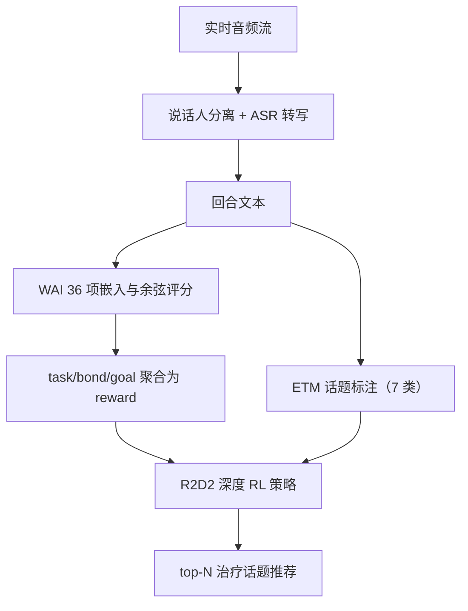
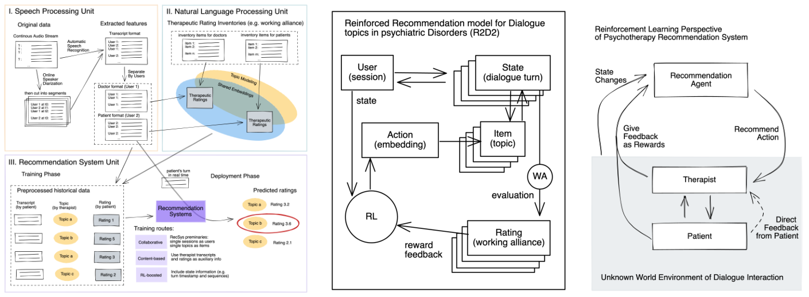

# SupervisorBot: NLP-Annotated Real-Time Recommendations of Psychotherapy Treatment Strategies with Deep Reinforcement Learning (SupervisorBot：基于NLP标注与深度强化学习的心理治疗策略实时推荐)

- **会议/期刊**: IJCAI 2023
- **作者与机构**: Baihan Lin（Columbia University）；Guillermo Cecchi、Djallel Bouneffouf（IBM T.J. Watson Research Center）
- **推荐链路定位**: 实时序列决策推荐（治疗策略/话题推荐）
- **研究方向**: 强化学习与动态探索推荐 / 对话推荐与智能体仿真
- **论文原文**: [论文原文链接](https://arxiv.org/abs/2208.13077v2)
- **开源代码**: 暂未开源

## TL;DR (1分钟核心速览)

针对心理治疗师短缺、缺乏实时督导的问题，本文提出 SupervisorBot：用工作联盟量表（WAI）36 项与患者当前话语的 Doc2Vec 余弦相似度生成回合级治疗联盟评分，再将会话视为用户、治疗话题视为物品，用 DDPG/TD3/BCQ 推荐下一回合治疗策略。在 Alex Street 心理治疗数据集的 219,999 个动作上按 95/5 划分，以 Pearson r 评估，TD3-GOAL 在四类混合数据上最高 0.3765，抑郁 BCQ-TASK 达 0.4042，精神分裂 TD3-GOAL 达 0.4599。

## Background & Motivation (背景与核心矛盾)

- **主流范式**: 心理治疗督导依赖资深治疗师；NLP 已可实时估计工作联盟等临床指标；RL 推荐适合序列决策与长期回报优化。
- **前人局限**: 心理治疗策略推荐没有现成系统，治疗策略难以像商品一样标注偏好；工作联盟是连续、多尺度、强语境相关的隐变量，单回合相似度无法直接优化长期治疗效果。
- **核心洞察 (Key Insight)**: 工作联盟可作为回合级 reward，治疗话题可作为 action，会话可作为 user，从而把“实时督导”转化为一个离线 RL 推荐问题。
- **本文切入点**: 用 WAI 评分清单作为语义锚点，把自由对话映射为可解释的联盟分数，再用深度 RL 在话题空间上做策略推荐。

## Method (核心方法设计)

### 1. 整体框架 (Overall Architecture)

系统先对连续音频做说话人分离，区分治疗师与患者，再经 ASR 转写为回合文本；随后将每个回合与 WAI 的 36 个条目分别做 Doc2Vec 嵌入并计算余弦相似度，得到 36 维工作联盟评分，并按 task/bond/goal 三个量表聚合为 reward。对话帧（10 个回合对）作为 state，ETM 抽取的 7 个治疗话题作为 action，会话 ID 作为 user。RL 智能体输出话题嵌入，经最近邻映射为具体话题并推荐 top-N。训练使用离线会话数据，推理时每回合执行一次 ASR、嵌入与策略前向。

<figure class="paper-figure" markdown="span">
  <figcaption>图1. SupervisorBot的分析框架。(A) 系统的主要组件。(B) R2D2模型流程图。(C) 心理治疗推荐系统问题的强化学习框架。</figcaption>
</figure>
图1：SupervisorBot 分析框架（A 系统组件；B R2D2 流程；C RL 建模）。

### 2. 关键设计拆解 (Key Designs)

1. **WAI 驱动的回合级评分（将临床量表变成 reward）**：痛点是治疗结果难以逐回合标注；本文用 Doc2Vec 嵌入患者当前话语 $u_t$与第$k$个 WAI 条目$w_k$，计算$s_{t,k}=\cos(\boldsymbol{e}(u_t),\boldsymbol{e}(w_k))$，得到$r_t=[s_{t,1},\dots,s_{t,36}]$，再按量表权重聚合：$R_t^{scale}=\sum_{k\in scale}\alpha_k s_{t,k}$。直觉是用临床问卷作为语义锚点，把开放对话投影到任务一致、情感联结、目标一致三个可解释维度。

2. **“会话即用户、话题即物品”的 RL 重构**：前人推荐多把话题当静态物品；本文将 state 设为连续 10 个回合对的对话帧，action 为话题的 Doc2Vec 平均嵌入，reward 为下一回合工作联盟分数。优化目标为 $J(\pi)=\mathbb{E}_{\pi}[\sum_{t=0}^{T}\gamma^t R_t]$。这样 RL 优化的不是单回合语义相似，而是长期联盟质量，且动作嵌入可用最近邻解码为可读话题。

3. **训练目标、负采样与推理效率**：DDPG/TD3 采用 actor-critic，评论家损失为 $\mathcal{L}_Q=\mathbb{E}[(R_t+\gamma Q'(s_{t+1},\pi'(s_{t+1}))-Q(s_t,a_t))^2]$，演员梯度为$\nabla_\theta J=\mathbb{E}[\nabla_a Q(s_t,a)|_{a=\pi_\theta(s_t)}\nabla_\theta\pi_\theta(s_t)]$；BCQ 额外用生成模型约束动作落在行为数据支撑内。训练采用离线 replay buffer，不存在传统负采样；推理开销为每回合一次 ASR、一次 Doc2Vec 嵌入、一次策略前向与 7 类话题最近邻，复杂度$O(7d)$。

## Experimental Setup & Evaluation Protocol (实验设置与评估协议)

- **数据集与预处理**: 使用 Alex Street 心理治疗转写数据集，含 950+ 会话、219,999 个推荐动作、4 类精神障碍（焦虑、抑郁、精神分裂、自杀）。原文未报告 5-core 等过滤，也未报告用户/物品密度。

| 数据集 | #Sessions（用户） | #Items（话题） | #Interactions | 稀疏度/密度 | 特征/场景说明 |
| :--- | :---: | :---: | :---: | :---: | :--- |
| Alex Street | >950 | 7 | 219,999 | 未报告 | 四类精神障碍；治疗师-患者转写对话；WAI 36 项评分 |

- **数据划分与防穿越 (Splitting Strategy)**: 原文仅写 95/5 train-test 划分，未说明全局时间戳切分或会话级切分，存在同一会话回合跨集导致时序泄漏的风险。
- **排名评测协议 (Ranking Protocol)**: 并非 Full-Ranking 或 Sampled Ranking，而是计算测试集推荐动作与真实动作的 Pearson 相关系数；候选动作空间仅 7 个话题，未报告负采样比例。
- **对比基线与超参设置**: 原文声明该应用无外部 SOTA，仅比较 R2D2 的 9 个内部变体（DDPG/TD3/BCQ × task/bond/goal）。动作嵌入使用 300 维 Doc2Vec 均值；另试 36 维 PCA 与 2 维 UMAP，正文未给数值。帧长 10 个回合对，batch size 32，每个智能体训练 50 epochs。

## Key Experimental Results (实验关键数据)

### 1. 主实验对比 (Main Results)

| 模型变体 | Anxi | Depr | Schi | Suic | All |
| :--- | :---: | :---: | :---: | :---: | :---: |
| R2D2-DDPG-TASK | **0.3796** | 0.3376 | 0.1556 | 0.3292 | 0.0578 |
| R2D2-DDPG-BOND | 0.2417 | 0.3838 | 0.1539 | 0.0873 | 0.1455 |
| R2D2-DDPG-GOAL | 0.0761 | 0.3682 | 0.4589 | -0.0210 | 0.2243 |
| R2D2-TD3-TASK | 0.0707 | 0.1310 | 0.0443 | 0.3188 | 0.3357 |
| R2D2-TD3-BOND | 0.2018 | 0.3363 | 0.0908 | 0.3070 | 0.1101 |
| R2D2-TD3-GOAL | 0.0984 | 0.2222 | **0.4599** | 0.2044 | **0.3765** |
| R2D2-BCQ-TASK | 0.1128 | **0.4042** | 0.1401 | 0.1422 | 0.0825 |
| R2D2-BCQ-BOND | 0.0778 | 0.0876 | 0.0987 | **0.4152** | 0.0885 |
| R2D2-BCQ-GOAL | 0.0810 | 0.1231 | 0.0833 | 0.0788 | 0.0780 |

注：原文无外部 SOTA 基线，`Improv.%` 不适用；粗体为各列最优。指标为 Pearson r，非 NDCG/HR。

### 2. 消融实验 (Ablation Study)

以“替换评分信号”为消融，固定 RL 算法，比较三种 WAI 量表在 All 列上的表现：

| 评分信号 | DDPG | TD3 | BCQ |
| :--- | :---: | :---: | :---: |
| TASK | 0.0578 | 0.3357 | 0.0825 |
| BOND | 0.1455 | 0.1101 | 0.0885 |
| GOAL | **0.2243** | **0.3765** | 0.0780 |

### 3. 关键实验发现 (Key Findings)

1. **TD3-GOAL 在异质混合数据上最优**：All 列 0.3765，较 DDPG-TASK 的 0.0578 高 0.3187，说明 twin delayed 机制与“目标一致”信号组合更适合跨病种会话。
2. **最佳评分尺度随病种变化**：抑郁 BCQ-TASK 达 0.4042，精神分裂 TD3-GOAL 达 0.4599，自杀 BCQ-BOND 达 0.4152；单一量表无法覆盖所有临床目标，评分信号应按病种选择。
3. **BCQ 的离线约束未稳定占优**：BCQ 在 All 列仅 0.0780–0.0885，低于 TD3-GOAL 的 0.3765；可能因动作空间仅 7 个话题、行为数据覆盖窄，约束反而限制探索。

## Highlights & Limitations (亮点、对比与审稿批判)

- **与代表作对比 (vs. Prior Work)**: 相比仅做工作联盟预测的 NLP 系统，本文首次把联盟分数变成 RL reward 并输出治疗话题；相比通用对话推荐，本文的动作空间是临床话题而非商品，强调长期联盟而非点击；相比离线 RL 基线 BCQ，本文发现其在临床小数据上并不必然优于 DDPG/TD3。
- **可迁移亮点**: 用领域量表作为语义锚点生成细粒度 reward；把 session 当 user、topic 当 item 的 RL 重构；动作嵌入 + 最近邻解码，兼顾连续策略与可解释输出。
- **审稿级局限批判**: 评估仅用 Pearson r，缺少 HR/NDCG 等排序指标与外部 SOTA；95/5 划分未说明时间切分，存在时序泄漏；实时 ASR 延迟、临床安全性与伦理风险未量化，BCQ 优势不显著且超参敏感。

## Rating (四维评分)

- **方法创新性 (Novelty)**: ⭐⭐⭐⭐ （首次将 WAI 量表评分嵌入 RL 推荐闭环，问题定义新颖，但 DDPG/TD3/BCQ 均为成熟组件）
- **评估协议与实验扎实度 (Protocol & Experiments)**: ⭐⭐ （无外部基线、非标准排序指标、划分细节缺失，仅 9 个内部变体对比）
- **写作与数学规范度 (Clarity & Rigor)**: ⭐⭐⭐ （系统流程清晰，但核心 RL 公式与 BCQ 约束展开不足，符号定义较简）
- **工业落地与复现价值 (Industrial & Practical Value)**: ⭐⭐⭐ （有 Web app 演示与实时链路，但临床部署需解决延迟、隐私与安全性，且未开源）

