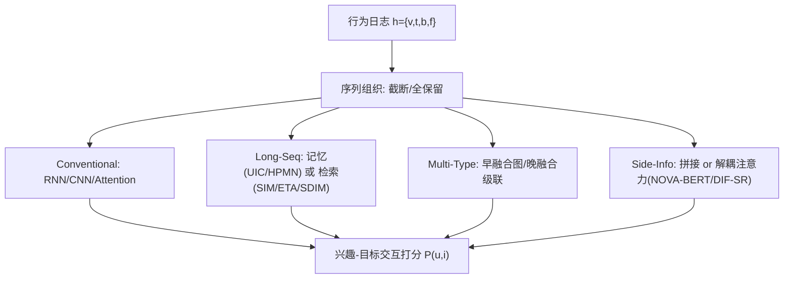
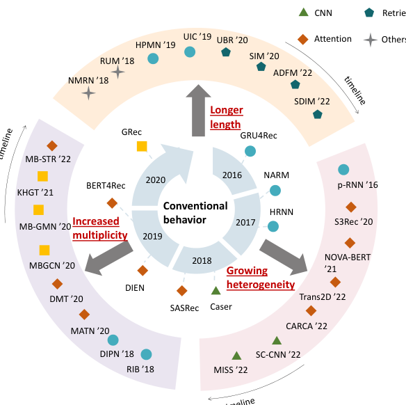

# A Survey on User Behavior Modeling in Recommender Systems (推荐系统中用户行为建模综述)

- **会议/期刊**: IJCAI 2023 (Survey Track, 9 pages)
- **作者与机构**: Zhicheng He, Weiwen Liu, Wei Guo, Jiarui Qin, Yingxue Zhang, Yaochen Hu, Ruiming Tang（华为诺亚方舟实验室深圳/蒙特利尔 + 上海交通大学）
- **推荐链路定位**: 精排为主（长序列路线实质承担"行为级召回/过滤"角色）
- **研究方向**: 序列与会话推荐 / CTR 预估与特征交叉
- **论文原文**: [https://arxiv.org/abs/2302.11087v1](https://arxiv.org/abs/2302.11087v1)
- **开源代码**: 暂未开源

## TL;DR (1分钟核心速览)

本文不复述单个模型，而是抓住隐性反馈"粗且噪"这一根本瓶颈，把十年 UBM（User Behavior Modeling）工作沿三条数据演化轴——**序列变长、行为类型变多、伴随特征异构**——重划为 Conventional / Long-Sequence / Multi-Type / Side-Information 四类范式，给出统一预测式 $P(u,i)=\mathcal{F}_\Theta(u,i,H_u,f_u,f_i,f_c)$ 下各范式的算子差异与代价，并首次系统汇总已发表论文中的**线上 A/B 收益**（如 SIM 较 UIC +7.1% CTR 且最大序列长度 ×53、ADFM 较 SIM +4.7% CTR 同时存储 -70.8%）。结论性洞察是：长序列"检索派"与边信息"解耦注意力派"在效果–延迟–存储在工业上最可落地，而学术热门的 GNN 方案至今无线上部署记录。

## Background & Motivation (背景与核心矛盾)

- **主流范式**: 以行为序列 $H_u$ 替代稀缺显式反馈，用 RNN/CNN/Attention/GNN 抽取兴趣表示后与目标物品交互打分；工程上普遍截断序列长度以控复杂度。
- **前人局限**: ①截断即丢信息——长周期兴趣与周期性行为无法进入模型，而不截断则延迟不可接受且噪声随长度线性增长；②单类型、纯 ID 建模忽略了"点击≠购买"的语义差异与行为发生时的上下文逻辑。
- **核心洞察 (Key Insight)**: 已有综述（Wang 2019、Fang 2020）只覆盖 Conventional UBM，且普遍缺失"效果 vs. RT/存储/模型体积"的代价视角；作者据此提出应以**三条数据演化趋势**而非网络结构作为分类主轴。
- **本文切入点**: 用统一的四元组行为记录 $h_{u,k}=\{v_k,t_k,b_k,f_k\}$ 把四类方法写成同一预测式的不同特例，再以线上部署数据检验哪一类真正可落地。

## Method (核心方法设计)

### 1. 整体框架 (Overall Architecture)

综述以"输入行为日志 → 序列组织 → 依赖/语义抽取 → 兴趣–目标交互 → 打分或多行为输出"为主线，把四类范式嵌入同一骨架：Conventional 只保留受限长度同类型序列 $H^S_u$；Long-Sequence 尽量保留$H^L_u$，靠外部记忆或检索压缩；Multi-Type 在记录中显式启用$b_k\in\mathcal{B}$并追加跨类型融合与多行为输出；Side-Information 引入融合算子$\mathcal{M}(\cdot)$处理$t_k$与多模态$f_k$。三者并非互斥而是可叠加的演进轴，作者在讨论中进一步给出"路线选择取决于延迟预算与标注成本"的工程判据。

<figure class="paper-figure" markdown="span">
  <figcaption>图1：用户行为建模分类体系。每种方法的主要技术用染色形状标记。给定用户u对目标物品i的P(u, i)被预测为</figcaption>
</figure>

### 2. 关键设计拆解 (Key Designs)

1. **长度轴：记忆 vs. 检索的两条正交压缩路径**：痛点是把上万条行为塞进实时请求。记忆派把兴趣"离线写、在线直读"，如 UIC 维护多通道兴趣中心 $\boldsymbol{m}_u^{(t)}=\mathrm{Update}(\boldsymbol{m}_u^{(t-1)},\boldsymbol{e}_{v_t})$，推理时零序列计算但参数量与状态同步成本高；检索派只保留与目标相关的少量行为$H^{R}_u=\mathrm{TopK}_{h\in H^{L}_u}\,\mathrm{sim}(\boldsymbol{e}_h,\boldsymbol{e}_i)$，$|H^{R}_u|\ll|H^{L}_u|$。检索派的关键跃迁是 ETA/SDIM 用 SimHash 把相似度检索变为**二进制签名同桶采样**，使检索函数可端到端训练、在线复杂度近似 O(1)——这正是其能承载 53 倍序列长度的物理原因。
2. **类型轴：早融合 vs. 晚融合的取舍**：晚融合（NMTR/DMT/ZEUS）先各类型独立建模再级联或加权聚合，同类序列同质、可并行，但丢失 item 级跨类型交互；早融合（RIB/MBGCN/MATN）在混合序列或异质图上直接传播，如 $\boldsymbol{h}_i^{(l+1)}=\sum_{b\in\mathcal{B}}\sum_{j\in\mathcal{N}_b(i)}\frac{\boldsymbol{h}_j^{(l)}}{\sqrt{|\mathcal{N}_b(i)||\mathcal{N}_b(j)|}}$，能刻画"点击→加购→购买"的细粒度偏移，代价是图规模与复杂度。多行为联合预测则用 MMoE/PLE 抑制任务冲突，或在类型依赖明确时用级联预测。
3. **边信息轴：从"拼接污染"到"解耦引导"**：早期 p-RNN/SC-CNN/Trans2D 把属性/图像向量与 ID 简单 concat 或加权求和，作者指出这会**冲刷 ID 表征**；NOVA-BERT 改为仅将边信息注入 Key/Value 而不改 Query，即 $\boldsymbol{q}=\boldsymbol{h}W_Q,\ \boldsymbol{k}=[\boldsymbol{h};\boldsymbol{f}]W_K$，注意力分布$\mathrm{softmax}(\boldsymbol{q}\boldsymbol{k}^\top/\sqrt{d})$由纯 ID 查询主导、边信息只作增益；DIF-SR 进一步为每类边信息分配独立注意力分支后融合，避免多源特征在同一矩阵中互相干扰。训练侧通用目标为$\mathcal{L}=-\sum\log\sigma(y\hat{s})$，S3Rec 额外加入关联属性预测与掩码属性预测两项自监督前置任务以补足稀疏监督。

> 说明：本节为该综述对四类范式的**统一算子化抽象**与取舍判据，非单一新模型提出；原文无统一训练负采样设定（各代表模型各自沿用 BPR/交叉熵/采样 softmax）。

## Experimental Setup & Evaluation Protocol (实验设置与评估协议)

- **本综述不含自建实验**：无数据集统计表、无统一划分与排名协议，效果证据全部来自被引论文的**已发表线上 A/B 结果**，作者明确声明"仅采集公开论文中的线上指标以保证数据权威性"，故不存在 Full-Ranking 与 Sampled Ranking 的可比性问题，也**无法做跨模型显著性检验**。

| 范式 | 代表模型 | 部署场景 | 对照基线 | 线上收益（原文数值） | 代价 |
| :--- | :--- | :--- | :--- | :--- | :--- |
| Conventional | DIN | 在线广告 | Embedding&MLP | +10.0% CTR, +3.8% RPM | — |
| Conventional | DIEN | 在线广告 | Embedding&MLP | **+20.7% CTR**, +17.1% eCPM | -3.0% PPC |
| Conventional | BST | 电商 | DIN | +3.02% CTR | +4ms RT |
| Long-Seq | UIC | 在线广告 | DIEN | +7.5% CTR, +6% RPM | 记忆状态维护 |
| Long-Seq | SIM | 在线广告 | UIC | +7.1% CTR, +4.4% RPM | MSL ×53 |
| Long-Seq | ETA | 电商 | SIM | +1.8% CTR, +3.1% GMV | -2ms 推理时延 |
| Long-Seq | SDIM | 在线搜索 | 无长序列 | +2.98% CTR, +2.69% VBR | +1ms 时延 |
| Long-Seq | ADFM | 在线广告 | SIM | +4.7% CTR, +3.1% RPM | **-70.8% 存储** |
| Multi-Type | DMT / ZEUS | 电商 | DIEN / DMT | +4.5% CTR / +6.0% CTR, +9.7% CVR | 多任务开销 |
| Side-Info | SEMI | 电商 | BST | +9.32% NBV, +10.45% DT | 多模态预训练 |
| Side-Info | NOVA-BERT | 应用商店 | BERT | 效果提升但 +0.192×10⁹ FLOPs, +7.1Mb | 模型体积↑ |

### 消融/代价对照分析

原文无组件级消融，作者以"增量 vs. 代价"成对呈现，等价于粗粒度归因：

| 增量来源 | 效果增益 | 对应代价 | 结论 |
| :--- | :--- | :--- | :--- |
| 长程行为（UIC→SIM） | +7.1% CTR | MSL 由百级升至 ×53 | 效果换存储/查表 |
| 检索去噪（ETA/SDIM） | +1.8% / +2.98% CTR | 哈希近似损失精度 | 端到端检索近乎零时延 |
| 对抗过滤（ADFM） | +4.7% CTR | 训练复杂度↑ | 存储大幅下降 |
| 多类型显式建模（ZEUS） | +6.0% CTR, +9.7% CVR | 多任务/级联结构 | 跨场景标签分布需对齐 |
| 边信息解耦（NOVA-BERT） | 优于 BERT 拼接式 | FLOPs 与显存↑ | 解码成本需压缩 |

### 3. 关键实验发现 (Key Findings)

1. **长序列是"部署最多"而非"增益最大"的方向**：UIC/SIM/ETA/SDIM/ADFM 五个模型均已在线上服役，而多类型（DMT/ZEUS/DIPN）与边信息（NOVA-BERT/SEMI）仅各 2–3 例，说明工程可行性而非峰值 CTR 决定了范式扩散速度。
2. **效率约束会反向裁剪模型设计**：BST 虽以 +3.02% CTR 战胜 DIN，但 Transformer 带来 +4ms RT，作者据此判定其在超高吞吐场景受限；ETA 与 SDIM 的时延代价仅 -2ms / +1ms，ADFM 更把存储压到 -70.8%，可见"低代价增益"是该领域真正的竞争力指标。
3. **学术–工业存在明显错位**：GNN 系（SURGE、MBGCN、MB-GMN）在论文层面表现活跃，但**零线上部署**，作者归因于图数据处理的计算资源开销；这提示图结构建模若要落地，必须先解决增量图更新与邻域采样成本。

## Highlights & Limitations (亮点、对比与审稿批判)

- **与代表作对比 (vs. Prior Work)**: 相比 Wang 2019 / Fang 2020 的纯结构罗列，本文以**数据演化三轴**给出可外推的分类坐标，并将"线上指标 + 资源代价"并列，把综述从"模型目录"提升为"选型决策表"；与同期序列推荐综述相比，其独特性在于明确将长序列的记忆与检索两条路线并置比较，并给出记忆派"难部署"、检索派"有信息损失"的对称判断。
- **可迁移亮点**: ①把检索器做成"哈希同桶采样 + 端到端可训练"，可在任意超长上下文场景（会话、多模态历史）复用；②边信息只注入 K/V 而不改 Q 的解耦范式，是低成本改造既有 Transformer 排序模型的通用 trick。
- **审稿级局限批判**: ①**缺乏统一实验**——四类范式横跨不同数据集、不同基线、不同指标口径，跨范式"优劣"结论实际来自异构线上环境，可复现性与可比性均弱；②**线上数据存在发表偏差**，仅统计已公开的正向 A/B 结果，未报告失败或持平案例，且未量化方差与显著性；③全文未给出各模型的复杂度/延迟的**解析式**（如检索派 O(log N) 与记忆派 O(|M|) 的显式对比），使"效率优先"的论断停留在经验层面。

## Rating (四维评分)

- **方法创新性 (Novelty)**: ⭐⭐⭐⭐ （不提出新模型，但"长度–类型–边信息"三轴分类与统一算子化表达具有真正的组织性贡献）
- **评估协议与实验扎实度 (Protocol & Experiments)**: ⭐⭐ （无自建实验、无统一划分与全库排序协议、无显著性检验，仅汇总异构线上结果）
- **写作与数学规范度 (Clarity & Rigor)**: ⭐⭐⭐⭐ （四类范式各配统一预测式与符号一致，行为记录四元组定义清晰；但复杂度分析未公式化）
- **工业落地与复现价值 (Industrial & Practical Value)**: ⭐⭐⭐⭐⭐ （直接给出线上 CTR/GMV/RT/存储四维权衡表，是排序系统选型的稀缺参考；可惜无开源代码）

