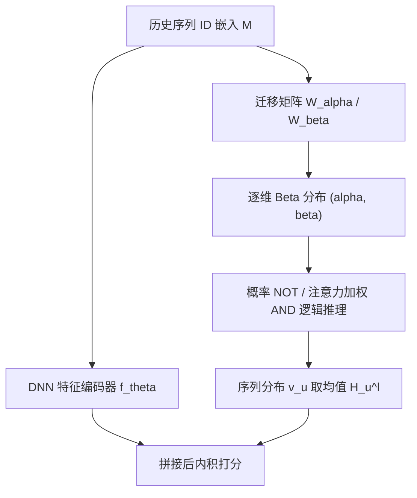
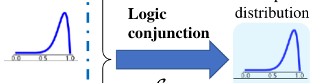

# Sequential Recommendation with Probabilistic Logical Reasoning (基于概率逻辑推理的序列推荐)

- **会议/期刊**: IJCAI 2023
- **作者与机构**: Huanhuan Yuan, Pengpeng Zhao, Xuefeng Xian, Guanfeng Liu, Victor S. Sheng, Lei Zhao（苏州大学、苏州市职业大学、Macquarie University、Texas Tech University）
- **推荐链路定位**: 精排（Next-Item 打分），可即插即用于任意序列编码器
- **研究方向**: 序列与会话推荐 / 协同过滤与双塔召回
- **论文原文**: [https://arxiv.org/abs/2304.11383v2](https://arxiv.org/abs/2304.11383v2)
- **开源代码**: [https://github.com/Huanhuaneryuan/SR-PLR](https://github.com/Huanhuaneryuan/SR-PLR)

## TL;DR (1分钟核心速览)

现有神经符号序列推荐把「特征描述」与「逻辑变量」耦合在同一套 ID 嵌入里，且用确定性向量刻画用户，无法表达兴趣的不确定性与演化。本文提出 SR-PLR：用两个迁移矩阵把 ID 嵌入映射为每维独立的 Beta 分布，定义在 Beta 空间内**闭合**的概率 NOT/AND 算子完成逻辑推理，与 DNN 特征表征拼接后联合打分。在 3 个 5-core 数据集、Leave-One-Out 划分、**全库 Full-Ranking** 协议下，将 GRU4Rec/Caser/SASRec/DuoRec 四种骨干全部提升，Caser 上 Hit@10 相对提升最高达 25.2%。

## Background & Motivation (背景与核心矛盾)

- **主流范式**: DNN 序列模型（GRU4Rec / Caser / SASRec / DuoRec）靠历史物品与目标物品的**表征相似度**排序，本质是「感知」式的模式匹配。
- **前人局限**: ① 神经符号方法（LINN、NCR-I）用 MLP 模拟逻辑算子并靠逻辑正则约束，特征嵌入与逻辑嵌入未解耦，无法判断哪部分潜变量在承担推理；② 用户被嵌入为**确定性点向量**，忽略口味的固有不确定性与随时间演化。
- **核心洞察 (Key Insight)**: 逻辑推理需要「非相似」信号——买过笔记本电脑后应推键盘而非另一台笔记本；而 Beta 分布在 AND（加权乘积）、NOT（参数取倒数）下天然闭合，可用分布运算精确实现逻辑算子，同时用分布方差携带不确定性。
- **本文切入点**: 双路解耦——DNN 只负责特征表征，Beta 概率逻辑网络只负责符号推理，两路表征拼接预测。

## Method (核心方法设计)

### 1. 整体框架 (Overall Architecture)

输入为用户交互序列的 ID 嵌入 $\mathbf{e}_u\in\mathbb{R}^{m\times d}$。**特征路**由任意 DNN 编码器$f_\theta$得$\mathbf{H}_u^f=f_\theta(\mathbf{e}_u)$；**逻辑路**先将同一 ID 矩阵经$\mathbf{W}_\alpha,\mathbf{W}_\beta$映射为 Beta 形状参数，逐维构成物品分布，再用带注意力的合取算子与取倒数否定算子对正/负物品序列做推理，得序列分布$\boldsymbol{v}_u$，取其均值$\mathbf{H}_u^l=\boldsymbol{\alpha}_u/(\boldsymbol{\alpha}_u+\boldsymbol{\beta}_u)$ 作为可微的逻辑表征。两路拼接后与「ID 嵌入 ⊕ 物品分布均值」做内积打分，用交叉熵 + 加权逻辑 BPR 联合训练。因算子闭合，推理链任意组合都不会指数爆炸。

<figure class="paper-figure" markdown="span">
  <figcaption>图1：SR-PLR 的框架。v1、v2、···、vm 是 u 的历史物品，vt 是目标物品，vi 是它们对应的分布。vm+1 和 v− 表示采样的用户未交互物品。</figcaption>
</figure>

### 2. 关键设计拆解 (Key Designs)

1. **概率逻辑嵌入（Beta 而非 Gaussian）**：为让逻辑算子闭合，物品不再是点向量而是每维一个 Beta 分布。给定 ID 嵌入，$\boldsymbol{\alpha}=\mathbf{M}\mathbf{W}_\alpha,\ \boldsymbol{\beta}=\mathbf{M}\mathbf{W}_\beta$，元素截断至$(0,10^9]$。Beta 在$[0,1]$ 有界且共轭于伯努利，正好匹配隐式反馈的「点击/未点击」二值语义，方差即不确定性。

2. **闭合概率逻辑算子（免正则的 NOT 与 AND）**：否定算子直接取倒数 $N(\boldsymbol{v}_i)=[(\alpha_{i,1}^{-1},\beta_{i,1}^{-1}),\dots,(\alpha_{i,d}^{-1},\beta_{i,d}^{-1})]$，天然满足$N(N(\boldsymbol{v}_i))=\boldsymbol{v}_i$且把高密度反转为低密度（即「不喜欢」），无需 LINN 式逻辑正则；合取算子为$\boldsymbol{v}=\mathcal{C}(\{\boldsymbol{v}_i\})=\big[\big(\sum_i \mathbf{w}_i\odot\boldsymbol{\alpha}_i,\ \sum_i \mathbf{w}_i\odot\boldsymbol{\beta}_i\big)\big]$，其 PDF 等于各成员 PDF 的加权幂乘积，权重由$\mathbf{w}_i=\mathrm{softmax}(\mathrm{MLP}(\boldsymbol{\alpha}_i\oplus\boldsymbol{\beta}_i))$ 端到端学习——这解决了平均池化无法区分「买键盘前笔记本比衣服更关键」的痛点。

3. **训练目标、负采样与推理效率**：逻辑路以逐维 KL 和为距离 $\mathrm{Dist}(\boldsymbol{v}_u,\boldsymbol{v}_t)=\sum_{k=1}^{d}\mathrm{KL}(P_k(\boldsymbol{v}_t)\|P_k(\boldsymbol{v}_u))$，配合逻辑 BPR 损失$\mathcal{L}_l=-\log\sigma\big(\mathrm{Dist}(\boldsymbol{v}_u,\boldsymbol{v}_t)-\mathrm{Dist}(\boldsymbol{v}_u,\boldsymbol{v}_-)\big)$；最终$\mathcal{L}=\mathcal{L}_{Rec}+\lambda\mathcal{L}_l$，$\hat{y}=(\mathbf{H}_u^f\oplus\mathbf{H}_u^l)(\mathbf{M}\oplus\mathbf{E})^\top$，其中$\mathbf{E}=\boldsymbol{\alpha}/(\boldsymbol{\alpha}+\boldsymbol{\beta})$。负样本为均匀采样 1–10 个未交互物品（隐式反馈下不宣过多，以免破坏序列语义）；推理时逻辑路零采样开销，仅一次前向 + 一次内积。

## Experimental Setup & Evaluation Protocol (实验设置与评估协议)

- **数据集与预处理**: 全部采用 `5-core` 版本，仅用 ID 信息（不依赖 side information）。

| 数据集 | #Users | #Items | #Interactions | 稀疏度 | 场景说明 |
| :--- | :---: | :---: | :---: | :---: | :--- |
| Amazon Sports | 35,598 | 18,357 | 296,337 | 99.95% | 运动户外，平均序列长 8.3 |
| Amazon Toys | 19,413 | 11,925 | 167,597 | 99.93% | 玩具游戏，平均序列长 8.6 |
| Yelp | 30,499 | 20,068 | 317,182 | 99.95% | 本地商户点评，平均序列长 10.4 |

- **数据划分与防穿越**: `Leave-One-Out`（末位为测试、倒数第二位为验证、其余训练），无时间戳全局切分。
- **排名评测协议**: **全库 Full-Ranking（all-rank）**，对全部未交互物品排序，指标 Hit@5/10、NDCG@5/10，避免采样评测的乐观偏差；LINN 与 NCR-I 因原文用采样指标，本文按统一协议复现。
- **对比基线与超参设置**: DNN 组（GRU4Rec、Caser、SASRec、DuoRec）+ 神经符号组（LINN、NCR-I）；嵌入维度 $d=64$、batch 2048、最大序列长 50、50 epoch、学习率 0.002，$\lambda\in[0,1]$ 步长 0.1，负物品数 1–10；骨干超参保持 RecBole 默认不变，验证框架即插即用性。

## Key Experimental Results (实验关键数据)

### 1. 主实验对比 (Main Results)

| 模型 | Sports H@10 | Sports N@10 | Toys H@10 | Toys N@10 | Yelp H@10 | Yelp N@10 |
| :--- | :---: | :---: | :---: | :---: | :---: | :---: |
| GRU4Rec | 0.0300 | 0.0158 | 0.0519 | 0.0294 | 0.0360 | 0.0189 |
| Caser | 0.0226 | 0.0115 | 0.0302 | 0.0151 | 0.0351 | 0.0202 |
| SASRec | 0.0484 | 0.0226 | 0.0909 | 0.0444 | 0.0595 | 0.0377 |
| DuoRec | 0.0505 | 0.0249 | 0.0929 | 0.0479 | 0.0618 | 0.0378 |
| LINN (logic) | 0.0256 | 0.0132 | 0.0320 | 0.0172 | 0.0355 | 0.0192 |
| NCR-I (logic) | 0.0263 | 0.0146 | 0.0322 | 0.0176 | 0.0354 | 0.0191 |
| **GRU4Rec-L** | 0.0353 | 0.0182 | 0.0557 | 0.0323 | 0.0433 | 0.0220 |
| **SASRec-L** | 0.0515 | 0.0252 | 0.0919 | 0.0452 | **0.0627** | **0.0386** |
| **DuoRec-L** | **0.0522** | **0.0257** | **0.0946** | **0.0484** | 0.0624 | 0.0380 |
| Improv.(骨干相对) | +17.7%~+25.2% | +15.2%~+25.3% | +1.1%~+25.2% | +1.8%~+22.5% | +1.0%~+23.1% | +0.5%~+16.4% |

### 2. 消融实验 (Ablation Study)

| 变体 | 逻辑含义 | 相对 SASRec-L 的趋势 |
| :--- | :--- | :--- |
| w/o att | 合取权重退化为平均池化 | 三数据集一致下降，验证注意力加权的必要性 |
| w/o neg oper | 去掉 $N(\cdot)$，仅对正物品做 AND | 下降，说明否定算子补全了推理的「排除」能力 |
| w/o feat | 仅用逻辑路 $\hat{y}=\mathbf{H}_u^l\mathbf{E}^\top$ 打分 | 下降幅度最大，双路拼接不可替代 |

（原文仅以柱状图给出，未公布具体数值；趋势按图 2 描述。）

### 3. 关键实验发现 (Key Findings)

1. **逻辑增益在弱骨干上更显著**：GRU4Rec/Caser 获得 +15%~+25% 的相对提升，而强骨干 SASRec/DuoRec 仅 +0.3%~+6.4%（Sports 上 SASRec-L 的 N@10 从 0.0226 升至 0.0252，相对 +11.5%）；说明 Beta 逻辑路补的是「表征能力不足」而非「表征冗余」，与注意力骨干已有语义重叠。
2. **纯符号方法全面落后**：LINN/NCR-I 在 Full-Ranking 下 H@10 仅 0.025~0.036，接近甚至低于 GRU4Rec，说明只用嵌入运算做逻辑等式无法刻画交互间的复杂关系，解耦 + 拼接才是关键。
3. **概率建模带来鲁棒性**：训练时以概率 $r$随机遮蔽序列物品，$r=0.5$时 Toys 上 SASRec-L 仍保 H@5 0.0446 / N@10 0.0363，而 SASRec 退化至 0.0384 / 0.0295；分布表征比点向量更能抵御序列残缺。$\lambda\approx0.5$ 与少量负样本（1–10）为推荐区间。

## Highlights & Limitations (亮点、对比与审稿批判)

- **与代表作对比 (vs. Prior Work)**: 相比 LINN（MLP 模拟算子 + 逻辑正则）与 NCR-I（个性化逻辑嵌入），本文是**算子层面的解析构造**，用 Beta 参数倒数/加权和实现 NOT/AND，免正则且严格闭合；相比 DT4SR/STOSA 等高斯分布嵌入，Beta 分布优先保证逻辑算子封闭而非仅刻画不确定性，并直接服务于符号推理。
- **可迁移亮点**: ① 「分布均值当嵌入用」的 $E=\alpha/(\alpha+\beta)$ 技巧，可零成本接入任意内积检索框架；② 用否定算子显式消费未交互物品，为隐式反馈的半监督/负信号利用提供了新口径。
- **审稿级局限批判**: ① 逻辑路引入逐维 KL 与注意力 MLP，参数量与序列长度、负样本数线性相关，长序列线上延迟未做分析；② 增益随骨干变强而衰减（DuoRec 仅 +0.5%~+3.4%），且 $\lambda$ 与负样本数需按数据集调参，工业迁移成本不低；③ 数据划分用 Leave-One-Out 而非时间切分，存在轻度信息泄漏风险，且缺乏显著性检验报告。

## Rating (四维评分)

- **方法创新性 (Novelty)**: ⭐⭐⭐⭐ （以 Beta 分布闭合性保证逻辑算子可解析复合，替代正则化近似，思路清晰且有别于高斯嵌入路线）
- **评估协议与实验扎实度 (Protocol & Experiments)**: ⭐⭐⭐⭐ （Full-Ranking 无偏评测 + 四种骨干即插即用验证 + 鲁棒性实验，但缺显著性检验与时间切分）
- **写作与数学规范度 (Clarity & Rigor)**: ⭐⭐⭐⭐ （算子定义与闭合性说明严谨，符号略密集，消融仅给柱状图未列数值）
- **工业落地与复现价值 (Industrial & Practical Value)**: ⭐⭐⭐ （代码开源、可叠加于现有序列模型，但 Beta 双矩阵与逐维 KL 增加训练开销，线上收益需 A/B 验证）

