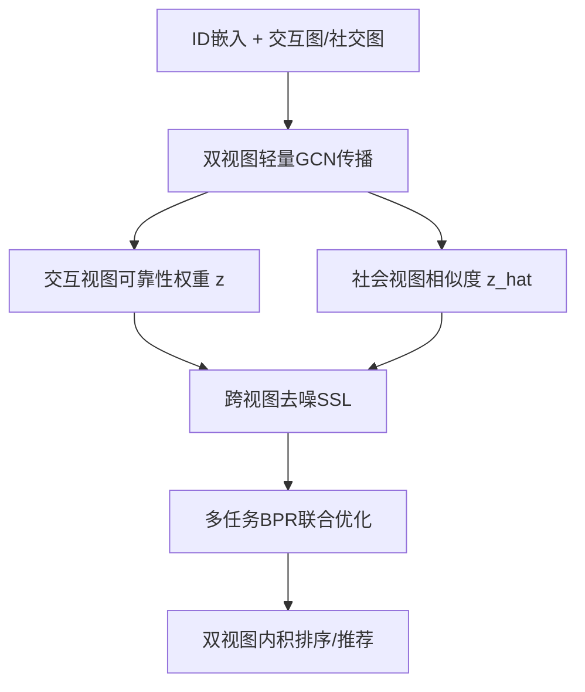

# Denoised Self-Augmented Learning for Social Recommendation (去噪自增强社交推荐)

- **会议/期刊**: IJCAI 2023
- **作者与机构**: Tianle Wang, Lianghao Xia, Chao Huang；University of Hong Kong
- **推荐链路定位**: 召回/精排（端到端表示学习）
- **研究方向**: 社交与群组推荐 / 自监督对比学习与交互去噪
- **论文原文**: [论文原文链接](https://arxiv.org/abs/2305.12685v2)
- **开源代码**: [开源代码仓库链接](https://github.com/HKUDS/DSL)

## TL;DR (1分钟核心速览)

针对社交推荐中同事/同学等兴趣无关社交边污染GNN传播与自监督信号的问题，DSL提出双视图轻量GCN，并以交互视图学习用户对可靠性权重，自适应对齐社会视图，形成去噪跨视图自监督。Ciao/Epinions/Yelp上Leave-One-Out排序显示，HR@10/NDCG@10较最强基线最高提升13.6%/18.9%，原表平均相对提升达76.9%/96.2%。

## Background & Motivation (背景与核心矛盾)

- **主流范式**: 社交推荐通常用GNN在用户-物品交互图与用户-用户社交图上递归传播，并辅以自监督学习（SSL）缓解标签稀疏。
- **前人局限**: MHCN、SMIN等SSL方法盲最大化社交连接用户的一致性，会把“同事/同学但兴趣不同”的噪声社交对拉近；DiffNet/NGCF+直接聚合社交边，也会让无关社交影响污染用户表征。
- **核心洞察 (Key Insight)**: 用户交互行为比被动社交关系更贴近真实偏好，可用交互视图的用户相似性作为社交边可靠性的监督信号，实现自适应去噪而非等权对齐。
- **本文切入点**: 用双视图GCN编码交互/社交语义，并用可学习跨视图对齐损失为每条社交影响分配可靠性权重。

## Method (核心方法设计)

### 1. 整体框架 (Overall Architecture)

DSL以用户/物品ID嵌入为输入，分别在用户-物品交互图与用户-用户社交图上执行轻量GCN传播，得到交互视图嵌入 $\bar{\mathbf E}_r$与社会视图嵌入$\bar{\mathbf E}_s$。核心去噪模块不把社交边直接当作可靠正样本，而是用交互视图学习用户对相似度$z_{i,i'}$，对社会视图相似度$\hat z_{i,i'}$ 做自适应加权对齐；同时保留社交关系预测与交互BPR主任务。训练端以多任务损失联合优化，推理端用双视图聚合嵌入内积排序，无需在线图传播。

### 2. 关键设计拆解 (Key Designs)

1. **双视图轻量图传播**：前人堆叠复杂GNN易过平滑且训练重；DSL对交互图与社交图分别用简化传播，再做跨层平均池化：
$\mathbf E_r^{(l)}=(\mathbf L_r+\mathbf I)\mathbf E_r^{(l-1)},\quad \mathbf E_s^{(l)}=(\mathbf L_s+\mathbf I)\mathbf E_s^{(l-1)}$
$\bar{\mathbf E}_r=\sum_{l=0}^{L}\mathbf E_r^{(l)},\quad \bar{\mathbf E}_s=\sum_{l=0}^{L}\mathbf E_s^{(l)}$这样既保留高阶协同，又把计算压在$O((|\mathcal E_r|+|\mathcal E_s|)d)$，为后续去噪SSL提供轻量双视图表征。

2. **交互引导的跨视图去噪SSL**：痛点是把所有社交连接都当正样本会放大噪声；DSL用交互视图学习标量可靠性权重：
$z_{i,i'}=\mathrm{sigm}(\mathbf d^\top \sigma(\mathbf T[\bar{\mathbf e}_i^r;\bar{\mathbf e}_{i'}^r]+\bar{\mathbf e}_i^r+\bar{\mathbf e}_{i'}^r+\mathbf c))$再以$\mathcal L_{ssl}=\sum_{(u_i,u_{i'})}\max(0,1-z_{i,i'}\hat z_{i,i'})$做自适应对齐，其中$\hat z_{i,i'}$为社会视图相似度。其梯度$\partial\mathcal L_{ssl}/\partial\bar{\mathbf e}_i=\sum_{u_{i'}}-z_{i,i'}\bar{\mathbf e}_{i'}$ 表明：交互越一致的用户对被更强拉近，兴趣不一致的社交边被自动降权，避免InfoNCE式等权正样本带来的噪声放大。

3. **多任务优化与效率**：总损失为
$\mathcal L=\mathcal L_{rec}+\lambda_1\mathcal L_{soc}+\lambda_2\mathcal L_{ssl}+\lambda_3(\|\mathbf E_u\|_F^2+\|\mathbf E_v\|_F^2)$其中$\mathcal L_{rec}$与$\mathcal L_{soc}$均为BPR损失，训练时采样负物品与负社交用户；SSL随机采样用户对，复杂度仅$O(Bd)$，优于vanilla InfoNCE的$O(BId)$。推理只需双视图嵌入内积，适合大规模召回/精排。

## Experimental Setup & Evaluation Protocol (实验设置与评估协议)

- **数据集与预处理**: 原文未明确报告5-core过滤；三个平台均含隐式反馈与社交边，统计如下：

| 数据集 | #Users | #Items | #Interactions | 稀疏度/密度 | 特征/场景说明 |
| :--- | :---: | :---: | :---: | :---: | :--- |
| Ciao | 6,672 | 98,875 | 198,181 | 0.0300% | 社交电商评论，社交边109,503 |
| Epinions | 11,111 | 190,774 | 247,591 | 0.0117% | 社交评论平台，社交边203,989 |
| Yelp | 161,305 | 114,852 | 1,118,645 | 0.0060% | 本地生活/社交，社交边2,142,242 |

- **数据划分与防穿越 (Splitting Strategy)**: 采用 `Leave-One-Out`，每个用户留一个交互作测试；未报告全局时间戳切分。
- **排名评测协议 (Ranking Protocol)**: 报告 HR@10 与 NDCG@10；原文未显式给出采样负例比例，按 `Leave-One-Out` 常用协议理解为对未交互物品做全库排序（Full-Ranking）。
- **对比基线与超参设置**: 对比MF、attention、GNN与SSL四类共10个基线（PMF/TrustMF/EATNN/DiffNet/DGRec/NGCF+/MHCN/KCGN/SMIN/DcRec）。嵌入维度 $d\in[64,512]$，传播层数1–4，batch 1024–8192，lr$5e^{-4}$–$5e^{-3}$，$\lambda_1\in[1e^{-3},1e^{1}]$，$\lambda_2\in[1e^{-6},1e^{-3}]$，$\lambda_3\in[1e^{-7},1e^{-4}]$；未报告显著性检验$p$ 值。

## Key Experimental Results (实验关键数据)

### 1. 主实验对比 (Main Results)

| Model | Ciao HR@10 | Ciao NDCG@10 | Epinions HR@10 | Epinions NDCG@10 | Yelp HR@10 | Yelp NDCG@10 |
| :--- | :---: | :---: | :---: | :---: | :---: | :---: |
| EATNN | 0.4255 | 0.2525 | 0.1576 | 0.0794 | 0.8031 | 0.5560 |
| DiffNet | 0.5544 | 0.3167 | 0.2182 | 0.1162 | 0.8031 | 0.5670 |
| DGRec | 0.4658 | 0.2401 | 0.2055 | 0.0908 | 0.7950 | 0.5593 |
| NGCF+ | 0.5629 | 0.3429 | 0.2969 | 0.1582 | 0.8265 | 0.5854 |
| MHCN | 0.5950 | 0.3805 | 0.3507 | 0.1926 | 0.8571 | 0.6310 |
| KCGN | 0.5785 | 0.3552 | 0.3122 | 0.1721 | 0.8484 | 0.6028 |
| SMIN | 0.5852 | 0.3687 | 0.3159 | 0.1867 | 0.8478 | 0.5993 |
| **DSL** | **0.6374** | **0.4065** | **0.3983** | **0.2290** | **0.8923** | **0.6599** |

Improv. vs 最强基线（HR/NDCG）：Ciao +7.1%/+6.8%，Epinions +13.6%/+18.9%，Yelp +4.1%/+4.6%；原文平均 %Imp（HR/NDCG）：Ciao 26.0/37.2，Epinions 76.9/96.2，Yelp 10.1/15.5。

### 2. 消融实验 (Ablation Study)

| Variant | Ciao HR | Ciao NDCG | Epinions HR | Epinions NDCG | Yelp HR | Yelp NDCG |
| :--- | :---: | :---: | :---: | :---: | :---: | :---: |
| DSL-d（去噪SSL） | 0.615 | 0.399 | 0.354 | 0.207 | 0.887 | 0.658 |
| DSL-s（去社交SSL） | 0.594 | 0.374 | 0.327 | 0.169 | 0.839 | 0.621 |
| DSL-c（对比学习替代） | 0.603 | 0.388 | 0.336 | 0.199 | 0.889 | 0.662 |
| **DSL** | **0.637** | **0.406** | **0.398** | **0.229** | **0.892** | **0.659** |

### 3. 关键实验发现 (Key Findings)

- **去噪SSL是核心增益来源**：去掉跨视图去噪SSL后，Epinions HR从0.398降至0.354（-11.1%），Ciao HR从0.637降至0.615（-3.5%），说明噪声社交边确实经GNN传播误导表征。
- **社交辅助任务有效但必须去噪**：DSL-s去掉社交SSL后Epinions HR进一步降至0.327（-17.8%）；DSL-c用普通对比学习替代自适应权重，Epinions HR为0.336（-15.6%），证明“盲对齐”会放大噪声。Yelp上DSL-c的NDCG 0.662略高于DSL 0.659，但HR 0.889低于0.892，整体仍DSL更稳。
- **鲁棒性与效率兼得**：在10%–30%假边注入下DSL相对HR下降小于MHCN/NGCF+；SSL权重过大或层数超过3会因过平滑掉点。训练耗时Ciao 3.2s、Epinions 6.1s，低于KCGN 26.9/49.4与SMIN 7.8/19.7；Yelp 58.6s略高于MHCN 56.2s，但远低于KCGN 132.5s。

## Highlights & Limitations (亮点、对比与审稿批判)

- **与代表作对比 (vs. Prior Work)**: MHCN/SMIN用互信息或超图SSL最大化社交连接用户一致性，未区分社交边真伪；DiffNet/NGCF+直接聚合社交邻居，易受噪声传播；DSL用交互视图生成逐对可靠性权重，实现“可学习去噪”的跨视图对齐。
- **可迁移亮点**: “用主任务视图监督辅助视图可靠性”的范式可迁移到跨域/多行为推荐；成对SSL的 $O(Bd)$ 复杂度适合大规模训练。
- **审稿级局限批判**: 公式(6)中 $z_{i,i'}$与$\hat z_{i,i'}$ 的标量/拼接定义略含混，复现需对照代码；仅离线Leave-One-Out评估，未报告显著性检验与线上A/B；方法依赖社交图，纯冷启动或无社交用户场景收益有限。

## Rating (四维评分)

- **方法创新性 (Novelty)**: ⭐⭐⭐⭐ （以交互视图监督社交边可靠性，跨视图去噪SSL有明确针对性）
- **评估协议与实验扎实度 (Protocol & Experiments)**: ⭐⭐⭐ （三数据集、消融、鲁棒性与效率分析完整，但缺显著性检验与采样协议明示）
- **写作与数学规范度 (Clarity & Rigor)**: ⭐⭐⭐ （框架清晰，Eq.6的 $z$与$\hat z$ 维度/点积语义略含混）
- **工业落地与复现价值 (Industrial & Practical Value)**: ⭐⭐⭐⭐ （开源、轻量GCN、SSL仅 $O(Bd)$，训练成本低于KCGN/SMIN，易落地）

