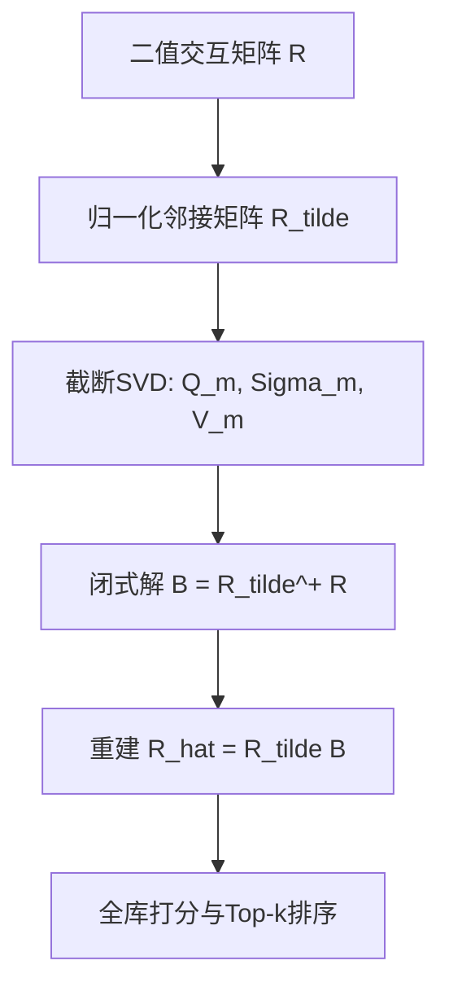
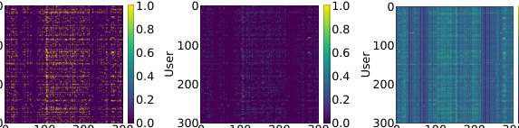

# SVD-AE: Simple Autoencoders for Collaborative Filtering (面向协同过滤的简单自编码器)

- **会议/期刊**: IJCAI 2024
- **作者与机构**: Seoyoung Hong (BKETC), Jeongwhan Choi (Yonsei University), Yeon-Chang Lee (UNIST), Srijan Kumar (Georgia Tech), Noseong Park (KAIST)
- **推荐链路定位**: 召回（全库打分）
- **研究方向**: 协同过滤与双塔召回
- **论文原文**: [论文原文链接](https://arxiv.org/abs/2405.04746v1)
- **开源代码**: [开源代码仓库链接](https://github.com/seoyoungh/svd-ae)

## TL;DR (1分钟核心速览)

针对 EASE/∞-AE 全秩重建易拟合噪声、且需矩阵求逆或核矩阵的痛点，SVD-AE 把截断 SVD 直接作为线性自编码器的闭式解，用低秩平滑重建用户-物品矩阵。在 Gowalla/Yelp2018/ML-1M/ML-10M 全库排序下，HR@10 较最强基线提升 0.6%–2.3%，且 Gowalla 上约快 394 倍于 LightGCN。

## Background & Motivation (背景与核心矛盾)

- **主流范式**: LightGCN 等图协同过滤需迭代训练；GF-CF、EASE、∞-AE 用闭式解降低训练成本，分别走图滤波、岭回归与 NTK 核回归路线。
- **前人局限**: EASE/∞-AE 对 $\mathbf{R}$做全秩重建，靠$\lambda$抑制过拟合，稀疏数据上易放大噪声；同时 EASE 需解$\mathbf{R}^{\top}\mathbf{R}$逆，∞-AE 需构造用户 Gram/NTK 矩阵，$O(|I|^{2.376})$或$O(|U|^{2.376})$ 开销高。
- **核心洞察 (Key Insight)**: 隐式反馈中的假阳性/假阴性对应矩阵局部高频突变；截断 SVD 只保留前 $m$ 个低频分量，可平滑结构并直接去噪。实验也显示 MSE 下降不等于 HR 提升，低秩归纳偏置比单纯最小化重构误差更关键。
- **本文切入点**: 不做 item-item/user-user 相似度，直接用归一化邻接矩阵的截断伪逆求闭式 $\hat{\mathbf{R}}$。

## Method (核心方法设计)

### 1. 整体框架 (Overall Architecture)

输入二值交互矩阵 $\mathbf{R}$，先构造归一化邻接$\tilde{\mathbf{R}}=\mathbf{D}_U^{-1/2}\mathbf{R}\mathbf{D}_I^{-1/2}$；对其做截断 SVD 得$\mathbf{Q}_m,\tilde{\boldsymbol{\Sigma}}_m,\mathbf{V}_m$，由最小范数最小二乘得到$\mathbf{B}=\tilde{\mathbf{R}}^{+}\mathbf{R}$，再一次性重建$\hat{\mathbf{R}}=\tilde{\mathbf{R}}\mathbf{B}$。全程无迭代训练、无负采样，在线仅需一次矩阵乘并为全库物品打分。

### 2. 关键设计拆解 (Key Designs)

1. **闭式线性自编码器（免训练重建）**：目标仍是 $\min_{\mathbf{B}}\|\mathbf{R}-\tilde{\mathbf{R}}\mathbf{B}\|_F^2$，但把约束换成“归一化邻接 + 最小范数解”，得$\mathbf{B}=\tilde{\mathbf{R}}^{+}\mathbf{R}=\mathbf{V}\tilde{\boldsymbol{\Sigma}}^{+}\mathbf{Q}^{\top}\mathbf{R}$。相比 EASE 的零对角岭回归和 ∞-AE 的 KRR，本文避免矩阵求逆与核矩阵构造，且直接输出 user-item 重建。
2. **截断 SVD 低秩去噪**：伪逆对噪声敏感，故只取前 $m$个奇异分量，$\hat{\mathbf{R}}=\tilde{\mathbf{R}}\mathbf{V}\tilde{\boldsymbol{\Sigma}}^{+}\mathbf{Q}^{\top}\mathbf{R}$。归一化后$0\le\sigma_M\le\cdots\le\sigma_1\le1$，大奇异值承载主结构、小奇异值视作噪声；$m=\lfloor\gamma\min(|\mathcal{U}|,|\mathcal{I}|)\rceil$，$\gamma=0.04$ 为唯一超参且全数据集通用。图3的平滑效果表明，低秩重建把尖锐 0/1 结构变为稳定连续表征。  
<figure class="paper-figure" markdown="span">
  <figcaption>图 3：截断 SVD 在降低噪声方面的平滑效果。为便于表示，所有值均归一化到 0 和 1 之间。对于 (a)-(c)，从 ML-1M 中采样 300 个用户和物品；对于 (d) 和 (e)，统计 ML-1M 的所有交互。</figcaption>
</figure>
3. **训练目标、负采样与推理效率**：无迭代损失，等价于求最小范数最小二乘；免负采样。预处理复杂度 $O(|U||I|\log m+(|U|+|I|)m^2)$，重建约$O(|U||I|^2)$；EASE/∞-AE 分别需$O(|I|^{2.376})$、$O(|U|^{2.376})$ 级逆/核运算，故 SVD-AE 在十亿级交互上更易预计算。

## Experimental Setup & Evaluation Protocol (实验设置与评估协议)

- **数据集与预处理**: 沿用公开预处理版本，交互二值化为 0/1；Gowalla/Yelp2018 为常用 10-core 版本，ML 系列保留原始评分并二值化。

| 数据集 | #Users | #Items | #Interactions | 稀疏度/密度 | 特征/场景说明 |
| :--- | :---: | :---: | :---: | :---: | :--- |
| Gowalla | 29,858 | 40,981 | 1,027,370 | 0.084% | 社交签到，极稀疏 |
| Yelp2018 | 31,668 | 38,048 | 1,561,406 | 0.130% | 商户点评，极稀疏 |
| ML-1M | 6,040 | 3,706 | 1,000,209 | 4.47% | 电影评分，较稠密 |
| ML-10M | 69,878 | 10,677 | 10,000,054 | 1.34% | 电影评分，大规模 |

- **数据划分与防穿越 (Splitting Strategy)**: 沿用 LightGCN/GF-CF/EASE 的用户级随机 80/10/10 训练/验证/测试划分，非全局时间戳切分；验证集选 $\gamma$，测试集报结果。
- **排名评测协议 (Ranking Protocol)**: 无偏 `Full-Ranking (全库未交互排序)`，非采样排序；闭式模型无训练负采样。
- **对比基线与超参设置**: 8 个基线 MF-BPR、NeuMF、NGCF、LightGCN、GF-CF、MultVAE、EASE、∞-AE；SVD-AE 无训练嵌入，仅 $\gamma\in[0.01,0.05]$，$\gamma=0.04$全数据集通用。训练型基线按其原文配置（常用$d=64$）；原文未报告显著性$p$ 值。

## Key Experimental Results (实验关键数据)

### 1. 主实验对比 (Main Results)

表中为 `HR@10 / NDCG@10`，**加粗为最优**；“—”表示 NGCF 在 ML-10M 超时。

| 方法 | Gowalla | Yelp2018 | ML-1M | ML-10M |
| :--- | :---: | :---: | :---: | :---: |
| MF-BPR | 12.08/12.09 | 3.86/3.70 | 28.49/29.84 | 33.28/33.58 |
| NeuMF | 8.87/8.27 | 3.25/3.08 | 27.95/29.36 | 25.75/25.32 |
| NGCF | 11.70/11.70 | 3.68/3.50 | 28.40/29.43 | — |
| LightGCN | 14.00/13.77 | 4.32/4.19 | 29.07/30.30 | 34.79/35.60 |
| GF-CF | 14.08/13.50 | 4.87/4.66 | 30.81/32.37 | 35.10/36.02 |
| MultVAE | 11.88/11.30 | 4.31/4.10 | 27.86/28.44 | 34.20/34.48 |
| EASE | 13.67/13.15 | 4.65/4.55 | 30.43/31.90 | 36.30/37.63 |
| ∞-AE | 11.77/10.84 | 4.62/4.48 | 31.15/32.27 | 35.83/36.93 |
| **SVD-AE** | **14.40/13.94** | **4.90/4.74** | **31.79/33.55** | **36.76/37.75** |

相对最强基线：Gowalla HR@10 +2.27%、NDCG@10 +1.23%；Yelp2018 +0.62%/+1.72%；ML-1M +2.05%/+3.65%；ML-10M +1.27%/+0.32%。PSP@10 亦全面最优。

### 2. 消融实验 (Ablation Study)

原文未给传统 `w/o` 模块表，以下用设计变体对照（HR@10）：

| 变体 | 低秩SVD | 重建对象 | Gowalla | Yelp2018 | ML-1M | ML-10M |
| :--- | :---: | :---: | :---: | :---: | :---: | :---: |
| EASE | 否（全秩） | item-item | 13.67 | 4.65 | 30.43 | 36.30 |
| ∞-AE | 否（全秩） | user-user | 11.77 | 4.62 | 31.15 | 35.83 |
| GF-CF | 部分（辅助滤波） | item-item | 14.08 | 4.87 | 30.81 | 35.10 |
| **SVD-AE** | **是（主机制）** | **user-item** | **14.40** | **4.90** | **31.79** | **36.76** |

### 3. 关键实验发现 (Key Findings)

1. **低秩直接重建在稀疏数据上更稳**：Gowalla 上 SVD-AE HR@10=14.40，较 GF-CF 的 14.08 提升 2.27%，较 ∞-AE 的 11.77 提升 22.3%；全秩 EASE 仅 13.67。说明截断 SVD 的低秩归纳偏置比全秩重构更适合极稀疏交互。
2. **精度与效率兼得**：ML-10M 上 SVD-AE 总耗时约 50.7s（预处理 47.59s + 重建 3.06s），低于 EASE 的 58.7s 和 ∞-AE 的 388.4s；论文报告 Gowalla 上约 394 倍快于 LightGCN，且 HR@10/NDCG@10 仍最优。
3. **MSE 不是推荐性能的可靠代理**：随机注入 0.5%–5% 噪声时，SVD-AE 始终维持最高 HR@10/NDCG@10；非 AE 模型下降更明显。$\gamma$ 从 0.04 继续增大时 MSE 下降但 HR@10 回落，验证了“低秩平滑去噪”而非“逼近原矩阵”才是收益来源。

## Highlights & Limitations (亮点、对比与审稿批判)

- **与代表作对比 (vs. Prior Work)**: EASE 用全秩岭回归 + item-item 相似度，需矩阵逆；∞-AE 用 NTK 的用户 Gram 矩阵，模型过参数化且大样本慢；GF-CF 只把截断 SVD 当低通滤波辅助项。SVD-AE 把截断 SVD 作为主重建机制，直接 user-item 推断，结构更简、无需 $\lambda$。
- **可迁移亮点**: 用截断 SVD 的秩 $m$ 作为鲁棒低秩正则，可迁移到图协同过滤的邻居去噪与轻量召回；闭式预计算 + 全库打分适合冷启动/低资源场景的快速基线。
- **审稿级局限批判**: (1) 输出 $\hat{\mathbf{R}}$为$|U|\times|I|$ 稠密矩阵，超大目录下内存与全库打分仍有压力，需分块或稀疏化；(2) 仅验证随机噪声，未覆盖对抗/恶意噪声，且未报告显著性检验，精度提升多为 0.3–2.3 个百分点，需在工业 A/B 中复核。

## Rating (四维评分)

- **方法创新性 (Novelty)**: ⭐⭐⭐⭐ （用截断 SVD 直接定义线性 AE 闭式解，设计极简但低秩去噪视角清楚，理论支撑完整）
- **评估协议与实验扎实度 (Protocol & Experiments)**: ⭐⭐⭐⭐ （4 数据集、8 基线、全库排序较规范；但缺显著性检验与传统 w/o 消融）
- **写作与数学规范度 (Clarity & Rigor)**: ⭐⭐⭐⭐ （定理、伪逆与复杂度分析清晰；数据预处理细节多放附录，正文略简）
- **工业落地与复现价值 (Industrial & Practical Value)**: ⭐⭐⭐⭐ （代码开源、免训练、预计算快；稠密重建矩阵在超大规模场景仍需工程优化）

