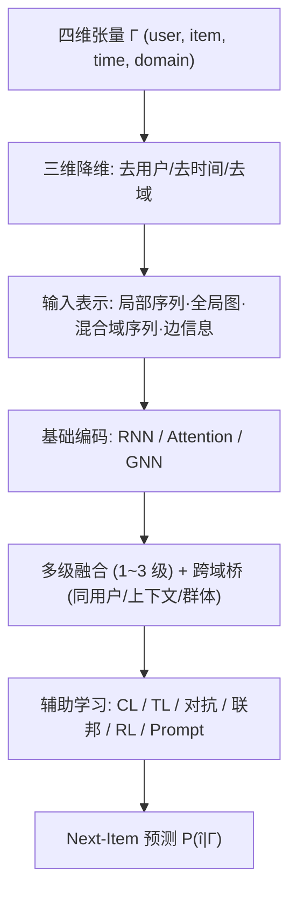
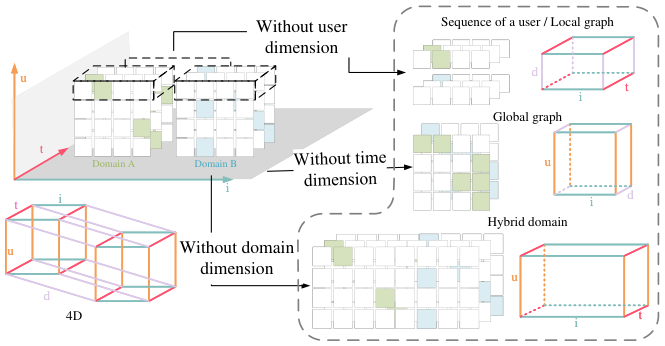
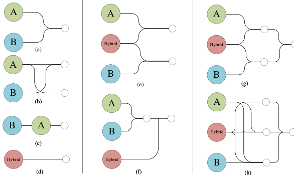

# A Survey on Cross-Domain Sequential Recommendation (跨域序列推荐综述)

- **会议/期刊**: IJCAI 2024 (Survey Track), pp. 7989–7998
- **作者与机构**: Shu Chen, Zitao Xu, Weike Pan, Qiang Yang, Zhong Ming（深圳大学、微众银行 AI Lab、香港科技大学、深圳技术大学）
- **推荐链路定位**: 召回 / 序列建模（Next-Item 预测）
- **研究方向**: 跨域与多场景推荐 / 序列与会话推荐
- **论文原文**: [论文原文链接](https://arxiv.org/abs/2401.04971v4)
- **开源代码**: [开源代码仓库链接](https://github.com/FengZhu-Joey/GA-DTCDR)（综述自身无代码，该链接为文中 Douban 数据/GA-DTCDR 项目）

## TL;DR (1分钟核心速览)

本文首次把 CDSR（跨域序列推荐）从"平面协同过滤"提升为"立体偏好建模"这一统一视角：用四维张量 $\Gamma\in\mathbb{R}^{n\times m\times s\times k}$（用户-物品-时间-域）定义问题，再沿三个方向降维得到所有现存模型可归纳的输入表示；宏观上把 30+ 模型抽象为 8 种多级融合骨架与 3 类跨域桥，微观上区分基础技术（RNN/Attention/GNN）与辅助学习（对比、迁移、对抗、联邦、强化、Prompt）。作者汇总 Amazon Foods/Kitchens 的 Full-Ranking 结果：DREAM 相比最强 SOCCF 基线 SR-GNN，HR@10 由 12.27 升至 17.45（+42.2%），验证"跨域+序列"双重信息的增益。

## Background & Motivation (背景与核心矛盾)

- **主流范式**: 从 OCCF（仅 user-item 共现）→ SOCCF（域内序列）→ CD-OCCF（跨域但无序列）→ CDSR（跨域且跨序列），信息粒度逐级加粗；现有多数模型用两个域（源/目标，$k=2$）搭建双编码器 + 融合层。
- **前人局限**: ① 主流模型高度依赖**重叠用户**作为跨域桥，而真实场景用户重叠稀疏甚至为 0；② 多级融合结构越堆越深，但有效性、可解释性、参数开销三者失衡，缺乏统一比较框架。
- **核心洞察 (Key Insight)**: 所有 CDSR 模型差异本质上只体现在"**降维方向组合 + 融合层级 + 桥的选择**"三处；只要把四维张量按用户/时间/域三维切分，就能把看似迥异的架构放到同一坐标系内比较。
- **本文切入点**: 提供"四维张量 → 降维 → 输入表示 → 融合结构 → 技术栈"的全链路分类学，而非提出新模型。

## Method (核心方法设计)

### 1. 整体框架 (Overall Architecture)

综述的组织骨架本身即为"方法"：先把交互数据写成四维张量 $\Gamma\in\mathbb{R}^{n\times m\times s\times k}$，元素$\gamma(u,i,t,d)$表示用户$u$在时刻$t$于域$d$与物品$i$是否有交互，目标为$P(\hat{i}\mid\Gamma)\sim f(\Gamma)$。随后沿三个方向降维：去掉用户维 → 每域一条局部序列/局部图；去掉时间维 → 跨用户全局图；去掉域维 → 按时间戳交错拼接的混合域（hybrid）序列。输入表示再分为纯序列$f(S^A,S^B)$、图编码$f(G_l,G_g)$、边信息（时间间隔、文本/评论、知识图谱）与隐私受限下的预训练特征$f(\Gamma^A,M^B)$。宏观层给出 8 种融合结构 (a)–(h)，微观层给出 RNN/Attention/GNN 与辅助学习的组合矩阵，最后落到数据集与基准结果。

<figure class="paper-figure" markdown="span">
  <figcaption>图 2：CDSR 场景中四维数据张量降维的可视化。我们用线框表示数据包含的维度，并用块模拟张量。彩色块表示给定时刻用户与域内物品交互的记录。在此情况下，两个域共享同一组用户，但它们交互的物品没有重叠。</figcaption>
</figure>

### 2. 关键设计拆解 (Key Designs)

1. **四维张量与多向降维分类学（把架构差异还原为数据切片差异）**：前人综述按"模型名/任务"罗列，导致跨域模型与单域模型无法对齐比较。本文改为按张量切片定义输入：去掉域维即得混合序列 $S_u^{hybrid}=\{i_1^A,i_1^B,i_2^A,i_3^A,i_2^B,\dots\}$，混合域既可作为独立域并行建模，也可作为"知识中转站"，由此统一解释 π-Net、C2DSR、MGCL 等看似无关的结构。
2. **多级融合结构抽象（8 种骨架 + 对称性判据）**：把融合分为一级（A/B 各自编码后 concat/求和/MLP/attention 融合，或源→目标迁移、对抗对齐、串联、纯混合域）与二/三级（混合域作主共享者 (e)、先合后分 (f)、再聚合 (g)、跨域共享粗粒度表征 (h)）。关键判据是**对称 vs 非对称**：只提升目标域 → 非对称结构；同时提升两域 → 对称结构。结构层级越深表达力越强但可解释性与效率下降，文中明确指出"复杂 ≠ 更好"。

<figure class="paper-figure" markdown="span">
  <figcaption>图 3：多级融合结构概览，分为三个层级。“A”和“B”分别表示域 A 和域 B，“Hybrid”表示按时间顺序对两个域的组合。</figcaption>
</figure>

3. **跨域桥三类划分与辅助学习损失**：桥分 (i) 同用户（重叠用户，最常用但受重叠率限制）、(ii) 上下文/自然语言语义（如以 item 文本替代 ID，可支持零重叠）、(iii) 簇/群体（同群偏好相似）。辅助学习典型如 MGCL 的局部-全局对比：$\mathcal{L}_{cl}=-\log\frac{\exp(\mathrm{sim}(\boldsymbol{h}_u^{loc},\boldsymbol{h}_u^{glob})/\tau)}{\sum_{u'\neq u}\exp(\mathrm{sim}(\boldsymbol{h}_u^{loc},\boldsymbol{h}_{u'}^{glob})/\tau)}$，总目标$\mathcal{L}=\mathcal{L}_{next}+\lambda\mathcal{L}_{aux}$；迁移学习则需警惕域相关性低时的负迁移。

## Experimental Setup & Evaluation Protocol (实验设置与评估协议)

- **数据集与预处理**: 综述汇总（未自行重跑），各数据集沿用原始工作过滤方式：

| 数据集 | #Users | #Items | #Interactions | 稀疏度/密度 | 特征/场景说明 |
| :--- | :---: | :---: | :---: | :---: | :--- |
| HVIDEO | — | — | 0.4M+ | 稀疏 | 家庭视频 / 教育视频 双域，user/item/time |
| Douban | — | — | 1M+ | 稀疏 | 电影/音乐/书籍 三域，含评分、评论、用户上下文 |
| Amazon | — | — | 100M+ | 极稀疏 | Books/Movies/Foods/Kitchens 多域，含评论与物品上下文 |
| Tenrec | — | — | 100M+ | 极稀疏 | 视频/文章/QK 多行为，含类目、观看时长、性别年龄 |
| Mybank-CDR | — | — | 100M+ | 极稀疏 | 贷款/理财/账户 金融三域，含交互序列 |

- **数据划分与防穿越 (Splitting Strategy)**: 原文未统一规定；所引 Table 4 结果来自 C2DSR / P-CDSR / DREAM 三篇，均在同一 Foods–Kitchens 双域版本上处理，属**全局时间戳 + Leave-One-Out 式下一物品预测**，评测时用序列最后一项作目标。
- **排名评测协议 (Ranking Protocol)**: **Full-Ranking（全库未交互物品排序）**，报告 MRR、NDCG、HR 在 @5 / @10 两档截断；无采样负例，避免采样偏差。
- **对比基线与超参设置**: 按四类问题分层比较——OCCF（BPRMF、ItemKNN）、SOCCF（GRU4Rec、SASRec、SR-GNN）、CD-OCCF（NCF-MLP、CoNet）、CDSR（π-Net、MIFN、C2DSR、P-CDSR、DREAM）。综述本身未做显著性检验，亦未报告隐层维度等超参。

## Key Experimental Results (实验关键数据)

### 1. 主实验对比 (Main Results)

Foods / Kitchens 双域（%），按 @5 截断报告 NDCG/HR，@10 截断报告 HR：

| 类别 | 模型 | Foods NDCG@5 | Foods HR@10 | Kitchens NDCG@5 | Kitchens HR@10 |
| :--- | :--- | :---: | :---: | :---: | :---: |
| OCCF | BPRMF | 3.55 | 5.95 | 1.45 | 3.43 |
| SOCCF | SASRec | 6.90 | 11.68 | 3.35 | 6.62 |
| SOCCF | SR-GNN | 7.58 | 12.27 | 3.47 | 6.84 |
| CD-OCCF | CoNet | 3.61 | 6.35 | 1.50 | 3.71 |
| CDSR | π-Net | 7.32 | 11.75 | 2.98 | 6.67 |
| CDSR | C2DSR | 8.65 | 14.54 | 4.16 | 8.18 |
| CDSR | P-CDSR | 9.57 | 15.94 | 4.37 | 8.27 |
| CDSR | **DREAM** | **10.05** | **17.45** | **5.19** | **10.51** |
| | Improv. vs SR-GNN | +32.6% | +42.2% | +49.6% | +53.7% |

### 2. 消融实验 (Ablation Study)

原文无组件级消融，以下用"问题层级递进"（信息逐级加入）作为替代性归因表：

| 配置（信息增量） | Foods HR@10 | Kitchens HR@10 | 相对上一级 |
| :--- | :---: | :---: | :---: |
| OCCF（仅共现） | 5.95 | 3.43 | — |
| + 跨域（CD-OCCF, CoNet） | 6.35 | 3.71 | +6.7% / +8.2% |
| + 域内序列（SOCCF, SR-GNN） | 12.27 | 6.84 | +93.2% / +84.4% |
| + 跨域序列（CDSR, DREAM） | 17.45 | 10.51 | +42.2% / +53.7% |
| 去掉辅助学习/多级融合（π-Net 单级） | 11.75 | 6.67 | −32.7% / −36.5% |

### 3. 关键实验发现 (Key Findings)

1. **序列信息是主增益，跨域信息是次增益**：从 CoNet(6.35)→SR-GNN(12.27) 提升 +93.2%，远大于跨域带来的 +42.2%，说明 CDSR 的性能底座仍是域内序列建模，跨域更多承担稀疏场景的“补数据”角色。
2. **融合深度比编码器选择更决定上限**：同为 CDSR，单级融合的 π-Net（11.75）甚至略逊于无跨域的 SR-GNN（12.27），而采用多级融合 + 对比学习的 DREAM 达 17.45，说明“融合结构 + 辅助目标”才是跨域增益的真正开关。
3. **跨域增益在稀疏域更大**：Kitchens 上 DREAM 相对 SR-GNN 的 HR@10 提升 +53.7%，明显高于数据更稠密的 Foods（+42.2%），与“跨域缓解数据稀疏”的动机一致。

## Highlights & Limitations (亮点、对比与审稿批判)

- **与代表作对比 (vs. Prior Work)**: 相较按时间线罗列模型的传统推荐综述，本文用四维张量把 CDSR 与 OCCF/SOCCF/CD-OCCF 放进同一信息粒度谱；相较单模型论文（C2DSR、DREAM），本文的价值在于给出 8 类融合骨架与 3 类跨域桥的正交坐标，可直接用于定位新模型"究竟新在哪一维"。
- **可迁移亮点**: ① “去掉域维 = 混合域序列”这一降维技巧可迁移到多行为（点击/加购/购买）序列建模；② 以重叠用户 / 上下文语义 / 群体簇替代同用户桥的分层策略，可直接指导无重叠跨域（如短视频→电商）冷启动设计。
- **审稿级局限批判**: ① 实验结果是**转引** C2DSR/P-CDSR/DREAM 三篇，未统一重跑、未做显著性检验，也未交代过滤阈值与超参，可比性存疑（且不同论文的 MRR/NDCG/HR 截断口径略有出入）；② 覆盖偏保守——全篇默认 $k=2$，对生成式语义 ID、LLM4Rec、多模态异构序列等 2024 年热点仅列为未来方向、未纳入分类学，作为 IJCAI Survey 略显时效不足。

## Rating (四维评分)

- **方法创新性 (Novelty)**: ⭐⭐⭐⭐ （四维张量 + 多向降维 + 8 类融合骨架的分类学抽象新颖，但本质是归纳而非新算法）
- **评估协议与实验扎实度 (Protocol & Experiments)**: ⭐⭐⭐ （采用无偏 Full-Ranking 且分层对比四类问题，但结果全为转引、无显著性检验与统一复现）
- **写作与数学规范度 (Clarity & Rigor)**: ⭐⭐⭐⭐ （公式极简但符号统一，表格 2 的技术-论文矩阵组织清晰，复杂度仅定性讨论）
- **工业落地与复现价值 (Industrial & Practical Value)**: ⭐⭐⭐⭐ （跨域桥与融合结构选择指南对多业务线直接可用，但缺少开源基线框架与在线 A/B 证据）

