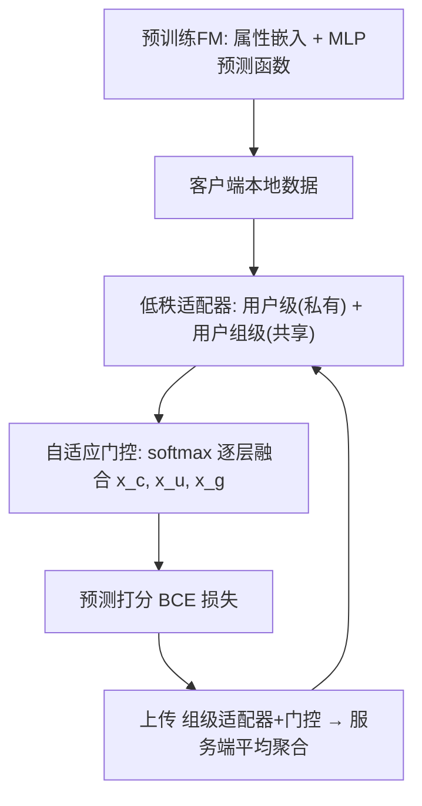
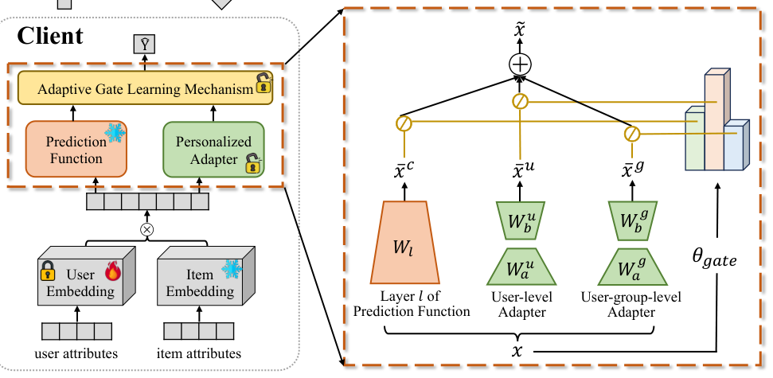

# Federated Adaptation for Foundation Model-based Recommendations (基于基础模型的联邦自适应推荐)

- **会议/期刊**: IJCAI 2024 (Regular Paper)
- **作者与机构**: Chunxu Zhang, Guodong Long, Bo Yang 等；吉林大学、悉尼科技大学 AAII、快手科技、清华大学 AIR
- **推荐链路定位**: 精排（端到端联邦个性化排序）
- **研究方向**: 去偏公平、可信隐私与工业架构 / 大语言模型推荐 (LLM4Rec)
- **论文原文**: [https://arxiv.org/abs/2405.04840v1](https://arxiv.org/abs/2405.04840v1)
- **开源代码**: [https://github.com/Zhangcx19/IJCAI-24-FedPA](https://github.com/Zhangcx19/IJCAI-24-FedPA)

## TL;DR (1分钟核心速览)

痛点：基础模型（FM）推荐依赖集中式用户数据，隐私风险高；联邦推荐（FedRec）则在孤立客户端上从零训练、参数通信开销大，且难以兼顾"公共知识"与"个性化偏好"。
本文提出 **FedPA**：以大规模数据预训练的双塔模型为 warm-start 底座，每个客户端只训练**低秩适配器**（用户级私有 + 用户组级共享）建模个性化，并用**自适应门控**逐层融合公共分支与个性化分支；联邦过程中仅更新用户相关参数。
在 4 个快手工业数据集（KuaiRand-Pure/small、KuaiSAR-S/R）上，按用户时间戳 6:2:2 划分，AUC 相对最佳基线最高 **+3.40%**（KuaiSAR-S 61.99 vs 59.95），Precision 最高 **+9.68%**，可训练参数减少 **40%**（13,649→8,189）。

## Background & Motivation (背景与核心矛盾)

- **主流范式**: 一类工作把 LLM/FM 引入推荐以吸收通用知识（需集中式数据）；另一类工作用联邦学习保护隐私，但仍是 FedNCF、PFedRec 等轻量 ID 模型从零训练。
- **前人局限 1**: 现有联邦个性化靠"把部分模型参数留在本地"，既阻断了与其他客户端的协同上下文，又因单客户端数据稀少而引入偏差，实验中 PFedNCF/PFedRec 甚至**低于朴素 FedNCF**。
- **前人局限 2**: FM 的公共知识与用户个性化**重要性因人而异**，粗暴拼接会造成信息混淆；同时把大模型整套搬到端侧，算力/存储/通信都不可承受。
- **核心洞察 (Key Insight)**: 神经网络解通常位于低维内在空间（intrinsic dimension），因此每个用户的任务特定参数可被一个**低秩子空间**充分刻画，个性化不必微调全模型。
- **本文切入点**: 冻结 FM 的公共知识部分，只在低秩适配器上做联邦聚合，并用可学习门控自动定权，从而同时拿到"共享知识 + 细粒度个性化 + 低通信"。

## Method (核心方法设计)

### 1. 整体框架 (Overall Architecture)

底座为双塔模型：用户属性嵌入拼接得 $\boldsymbol{u}_r$、物品属性嵌入拼接得$\boldsymbol{v}_r$，经 MLP 预测函数输出$\hat{Y}_{uv}=\mathrm{MLP}([\boldsymbol{u}_r,\boldsymbol{v}_r])$，以 BCE 损失训练。FedPA 的流程是：服务端下发预训练（或蒸馏后）模型初始化各客户端；客户端在本地数据上只更新**用户嵌入 + 两层低秩适配器 + 门控参数**，物品嵌入与预测函数 MLP 主权重冻结；上传的共享参数为**用户组级适配器 + 门控参数**（可叠加 LDP 拉普拉斯噪声），服务端做朴素平均聚合后进入下一轮。预测时，每一层 MLP 输出由"公共分支$x_c$+ 用户私有分支$x_u$+ 若干用户组分支$\{x_{g_i}\}$"经门控加权求和得到。

<figure class="paper-figure" markdown="span">
  <figcaption>图1：FedPA 框架。左侧部分表示我们方法的工作流程。每个客户端基于个人数据学习本地推荐模型，并使用预训练模型中的参数对其进行初始化。训练过程中，我们仅更新与用户个性化建模相关的参数，其他参数保持冻结。服务器负责全局聚合共享参数，以在客户端之间传递公共信息。右侧部分展示了采用自适应门控学习机制融合预测各层公共信息的细节。</figcaption>
</figure>

### 2. 关键设计拆解 (Key Designs)

1. **双层低秩个性化适配器（Low-Rank Adapter）**：痛点是把整块参数留在本地会切断协同且易过拟合；本文在 MLP 第 $l$层权重上并联低秩分解$\boldsymbol{W}_l^{r}=\boldsymbol{W}_a\boldsymbol{W}_b$（秩$r\ll\min(d,k)$），前向变为$\boldsymbol{x}=\boldsymbol{W}_l\boldsymbol{x}+\boldsymbol{W}_a\boldsymbol{W}_b\boldsymbol{x}$。用户级分支$\boldsymbol{x}_u=\boldsymbol{W}_a^{u}\boldsymbol{W}_b^{u}\boldsymbol{x}$本地私有，用户组级分支$\boldsymbol{x}_g=\boldsymbol{W}_a^{g}\boldsymbol{W}_b^{g}\boldsymbol{x}$ 组内共享；一个用户可同时属于"活跃度""注册天数"等多个正交分组，从而以极少参数获得多视角互补个性化。

2. **自适应门控知识融合（Adaptive Gate）**：痛点是个性化与公共知识的权重因人而异、手工调参不可行；本文用两层非线性映射按输入动态生成各分支权重并逐元素加权求和：
$$\tilde{\boldsymbol{x}}=\mathrm{Sum}\Big(\mathrm{softmax}\big(\boldsymbol{W}_2\,\mathrm{ReLU}(\boldsymbol{W}_1\boldsymbol{x})\big)\odot\big[\boldsymbol{x}_c,\ \boldsymbol{x}_u,\ \{\boldsymbol{x}_{g_i}\}_{i=1}^{total}\big]\Big)$$
门控梯度与其他参数联合优化，等于让模型自己决定"这位用户该更信公共决策逻辑还是更信自己的低秩修正"，避免融合时的信息混淆。

3. **训练目标、聚合与推理效率**：全局目标为 $\min_{\{\theta^u_{all}\}}\sum_{u=1}^{n}\frac{1}{n}\mathcal{L}_u(\theta^u_{all})$，$\mathcal{L}_u$ 即本地 BCE；**免负采样**框架下直接用隐式反馈 0/1 标签。仅用户嵌入、低秩适配器、门控参与联邦更新，物品嵌入与 MLP 冻结，KuaiRand 上可训练参数从 13,649 降到 8,189（−40%），显著降低端侧算力与上下行通信；部署前可用知识蒸馏把小模型（如 4-(32,8,1)）作为底座，推理时只多一次低秩加法与门控，开销可忽略。

## Experimental Setup & Evaluation Protocol (实验设置与评估协议)

- **数据集与预处理**: 4 个快手工业数据集。原文仅说明先把每个数据集切成"FM 预训练集"与"FedRec 集"两部分，**未报告用户/物品/交互数量与过滤规则**（如 5-core）：

| 数据集 | #Users | #Items | #Interactions | 稀疏度/密度 | 特征/场景说明 |
| :--- | :---: | :---: | :---: | :---: | :--- |
| KuaiRand-Pure | —（未报告） | —（未报告） | —（未报告） | — | 短视频平台，含丰富用户属性（活跃度、注册天数、关注数等） |
| KuaiRand-small | — | — | — | — | 同上，规模更小的子集 |
| KuaiSAR-S | — | — | — | — | 短视频+搜索融合场景 |
| KuaiSAR-R | — | — | — | — | 短视频+搜索融合场景（另一版本） |

- **数据划分与防穿越 (Splitting Strategy)**: 联邦子集按**每个用户的交互时间戳**以 `6:2:2` 比例切分为 train/val/test，属用户内时间序划分，避免未来交互泄漏。
- **排名评测协议 (Ranking Protocol)**: **未采用 Full-Ranking 或 Sampled Ranking**，而是把隐式反馈当二分类，在私有用户测试集上报告 `AUC` 与 `Precision`（单位 1e-2）——这是本文评估的最大短板，未度量真实全库排序能力，也未说明训练负采样比例。
- **对比基线与超参设置**: 基线分两组：(1) `w/o Warm`——FedNCF、PFedNCF、FedRecon、PFedRec 从零训练；(2) `w/ Warm`——上述四者的预训练 warm-start 版本；另有 FedPA 去掉 warm-start 的变体。结果取 5 次独立运行均值，采用双侧 t 检验，$p<0.05$ 标 `*`。用户分组按属性值本地计算，属性值不上传。

## Key Experimental Results (实验关键数据)

### 1. 主实验对比 (Main Results)

| 方法 | KuaiRand-Pure AUC / P | KuaiRand-small AUC / P | KuaiSAR-S AUC / P | KuaiSAR-R AUC / P |
| :--- | :---: | :---: | :---: | :---: |
| FedNCF (w/o Warm) | 68.17 / 73.33 | 69.35 / 65.69 | 55.19 / 81.82 | 70.83 / 65.45 |
| FedRecon (w/o Warm) | 65.21 / 61.72 | 68.81 / 65.32 | 58.56 / 76.57 | 66.65 / 62.68 |
| PFedRec (w/o Warm) | 59.48 / 70.80 | 61.09 / 61.33 | 56.71 / 79.42 | 68.32 / 63.83 |
| Warm FedNCF | 69.90 / 74.15 | 70.54 / 65.83 | 59.95 / 79.03 | 71.47 / 66.38 |
| Warm PFedNCF | 62.78 / 71.75 | 62.58 / 61.59 | 57.86 / 79.24 | 66.82 / 63.43 |
| Warm FedRecon | 70.02 / 74.22 | 70.75 / 66.56 | 55.68 / 78.54 | 65.49 / 61.31 |
| Warm PFedRec | 62.71 / 71.73 | 63.96 / 61.83 | 59.74 / 79.30 | 67.50 / 63.81 |
| **FedPA (w/o Warm)** | 68.44\* / 73.75\* | 69.65\* / 66.69\* | 57.58 / 81.04 | 71.30\* / 65.61\* |
| **FedPA (w/ Warm)** | **70.28\*** / **75.12\*** | **71.14\*** / **66.86** | **61.99\*** / **86.98\*** | **72.21\*** / **66.70\*** |
| **Improv.% (vs 最佳基线)** | +0.37% / +1.21% | +0.55% / +0.45% | **+3.40%** / **+9.68%** | +1.04% / +0.48% |

### 2. 消融实验 (Ablation Study)

**(a) 低秩个性化层级（KuaiRand-Pure，底座 Warm FedNCF）**

| 模型 | Warm FedNCF | w/ UP (用户级) | w/ GP (组级: 活跃度) | w/ GP (组级: 注册天数) | FedPA (UP+GP+门控) |
| :--- | :---: | :---: | :---: | :---: | :---: |
| AUC | 69.90 | 70.01 | 70.05 | 70.17 | **70.28** |
| Precision | 74.15 | 74.26 | 74.18 | 75.00 | **75.12** |

**(b) 冻结模块位置 / 蒸馏规模 / LDP 噪声（KuaiRand-Pure）**

| 设置 | 冻结用户嵌入 (FZ UE) | 冻结物品嵌入 (FZ IE) | 冻结预测函数 (FZ PF) | FedPA | KD 8-(8,1) | KD 4-(32,8,1) | LDP 噪声 0.2 |
| :--- | :---: | :---: | :---: | :---: | :---: | :---: | :---: |
| AUC | 65.55 | 70.31 | 70.28 | 70.28 | 71.41 | 71.12 | 69.93 |
| Precision | 72.67 | 75.16 | 75.27 | 75.12 | 75.47 | **77.49** | 74.35 |

### 3. 关键实验发现 (Key Findings)

1. **既有联邦个性化范式在富属性场景下失效，而低秩双粒度适配有效**：PFedNCF/PFedRec 的 AUC（62.99/59.48）明显低于朴素 FedNCF（68.17），因为"挑一部分参数留本地"在有多维属性输入时反而增大学习难度；而 UP+GP 组合把 Warm FedNCF 从 69.90 推到 70.28 AUC、74.15 推到 75.12 Precision，说明"共享组级低秩 + 私有用户级低秩"是比参数切分更合适的个性化载体。
2. **用户嵌入必须解冻，物品/预测函数冻结几乎无损**：冻结用户嵌入使 AUC 从 70.28 崩到 65.55（−4.73），因预训练与联邦系统的用户集合不一致；而冻结物品嵌入（70.31）与冻结预测函数（70.28）与全量更新持平，这正好支撑"只传用户侧参数"的 40% 通信节省设计。
3. **轻量化与隐私增强不损性能，甚至反增**：蒸馏到 8-(8,1) 反而升到 71.41 AUC，4-(32,8,1) 把 Precision 提到 77.49（+2.37），说明大底座对端侧并非必需；LDP 噪声 0.2 时 AUC 仅从 70.28 掉到 69.93（−0.35），提供了可用的隐私-精度平衡点。另外 FedPA w/o Warm 在 KuaiSAR-S 上（57.58）甚至低于 FedRecon（58.56），说明本文增益主要来自"预训练公共知识 + 门控融合"而非适配器本身。

## Highlights & Limitations (亮点、对比与审稿批判)

- **与代表作对比 (vs. Prior Work)**: 相比 FedNCF/FedRecon 这类从零训练、warm-start 后仅整体微调的联邦模型，FedPA 把"迁移"限定在低秩子空间且区分私有/共享粒度；相比 PFedRec 这类"参数留本地"的个性化方案，它保留跨客户端协同；相比集中式 FM4Rec（如 P5/LLM 微调），它在数据不出端的前提下取得公共知识收益。
- **可迁移亮点**: (1) 「用户级私有低秩 + 用户组级共享低秩」的双粒度适配器可直接搬到跨域/多场景推荐中的场景适配层；(2) 「哪些模块必须解冻」的冻结消融思路（按用户集合是否重叠判断）值得任何 warm-start 迁移工作复用。
- **审稿级局限批判**: (1) **评估协议偏弱**——只用 AUC/Precision 二分类指标，无 Full-Ranking 全库排序，也未说明负采样比例与候选集构造，无法判断真实 Top-K 排序收益；(2) **数据集信息与基线公平性存疑**——未报告任何规模统计，且 FedPA w/o Warm 未在所有数据集上显著优于基线，说明收益对"存在高质量 FM 预训练集"这一前提高度敏感；此外组级适配器与门控参数需上传，LDP 仅在单一噪声强度区间验证，隐私预算 $\epsilon$ 缺乏形式化刻画。

## Rating (四维评分)

- **方法创新性 (Novelty)**: ⭐⭐⭐⭐ （把 LoRA 式低秩适配引入联邦推荐并提出双粒度私有/共享分解 + 逐层门控融合，机制清晰且首次系统化"FM × FedRec"适配范式）
- **评估协议与实验扎实度 (Protocol & Experiments)**: ⭐⭐⭐ （4 个工业数据集 + 5 次运行 + t 检验较扎实，但仅用 AUC/Precision、无全库排序、数据集统计缺失，评估维度偏窄）
- **写作与数学规范度 (Clarity & Rigor)**: ⭐⭐⭐⭐ （框架图与公式链条完整、符号统一，门控与聚合表述清楚；但对组划分方式与复杂度/收敛性分析着墨较少）
- **工业落地与复现价值 (Industrial & Practical Value)**: ⭐⭐⭐⭐⭐ （开源代码，参数减少 40%、蒸馏小模型性能反升、LDP 可调，直接对应快手端侧部署诉求，落地价值突出）

