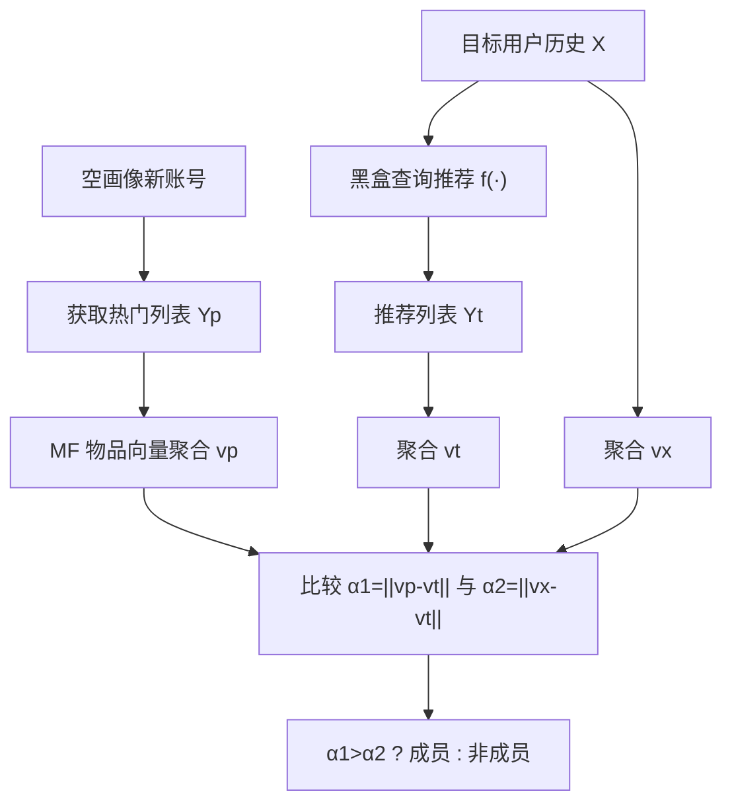
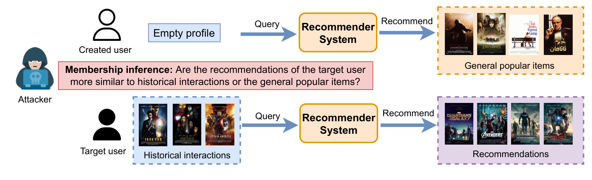
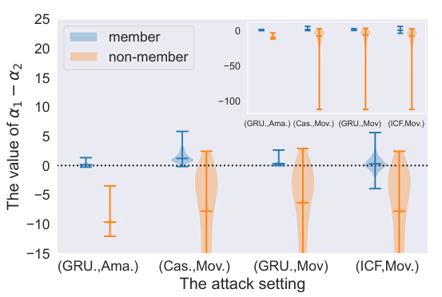

# Shadow-Free Membership Inference Attacks: Recommender Systems Are More Vulnerable Than You Thought (无影子成员推断攻击：推荐系统比你想象的更脆弱)

- **会议/期刊**: IJCAI 2024
- **作者与机构**: Xiaoxiao Chi, Xuyun Zhang, Yan Wang, Lianyong Qi, Amin Beheshti, Xiaolong Xu, Kim-Kwang Raymond Choo, Shuo Wang, Hongsheng Hu；Macquarie University、CSIRO's Data61 等
- **推荐链路定位**: 黑盒推荐输出（召回/排序结果）的隐私评测
- **研究方向**: 去偏公平、可信隐私与工业架构 / 冷启动与长尾推荐
- **论文原文**: [论文原文链接](https://arxiv.org/abs/2405.07018v1)
- **开源代码**: [开源代码仓库链接](https://github.com/XiaoxiaoChi-code/shadow-free-MIAs)

## TL;DR (1分钟核心速览)

针对影子训练型成员推断攻击依赖目标数据分布与模型架构、计算昂贵的痛点，本文提出无影子 SF-MIA：用空画像账号获取热门物品作为锚点，比较目标用户推荐列表更接近其历史还是热门物品，以自适应用户距离判定成员身份。黑盒、免训练，MovieLens-1M 上 Caser/GRU4Rec 准确率 98.6%/98.3%，平均 3.7 秒，较 ST-MIA/DL-MIA 快约 35×/2637×。

## Background & Motivation (背景与核心矛盾)

- **主流范式**: 推荐系统 MIA 主流做法是影子训练：先训练一个模仿目标模型的 shadow recommender，再用其成员/非成员特征训练二分类攻击器。
- **前人局限**: 该范式假设攻击者知道目标训练数据分布与模型架构；在 MLaaS 黑盒场景下该假设常不成立，shadow 数据也难同分布，攻击会跌至随机猜测。其次，shadow 模型与攻击器训练成本高，深度推荐器上尤其昂贵。
- **核心洞察 (Key Insight)**: 成员用户的历史交互被模型用于个性化，推荐结果会向其历史偏好靠拢；非成员因冷启动通常只收到全局热门物品。因此“推荐更像历史还是更像热门”可作为成员信号。
- **本文切入点**: 攻击者注册空画像账号获取热门锚点，完全去掉 shadow training，仅用黑盒推荐输出与辅助矩阵分解物品向量做距离比较。

## Method (核心方法设计)

### 1. 整体框架 (Overall Architecture)

攻击者仅黑盒查询目标推荐系统。先用一个无交互的空画像新账号获取 $n$个热门推荐，视为全局热门锚点$Y_p$；再对目标用户查询其推荐列表$Y_t$，并已知其历史交互$X$。借助辅助评分矩阵做矩阵分解得到物品隐向量，将$X,Y_t,Y_p$分别聚合为$\mathbf{v}_x,\mathbf{v}_t,\mathbf{v}_p$。最后比较推荐列表到热门锚点与历史偏好的距离：若更接近历史则判为成员，否则判为非成员。无攻击分类器训练，无阈值调参。

<figure class="paper-figure" markdown="span">
  <figcaption>图1：无影子成员推断攻击概览。攻击者创建一个具有空画像的用户，以获取推荐系统的一般热门物品。对于目标用户，攻击者检查目标用户的推荐结果与其历史交互更相似，还是与一般热门物品更相似，以判定目标用户的成员身份状态。</figcaption>
</figure>

### 2. 关键设计拆解 (Key Designs)

1. **空画像热门锚点 (Empty-Profile Popularity Anchor)**：解决“黑盒下如何获得全局热门参考”的问题。攻击者创建无历史账号，查询得到 $Y_p$，并用物品隐向量求均值：$\mathbf{v}_p=\frac{1}{n}\sum_{i=1}^{n}\mathbf{w}_{y_i}$。物理直觉是冷启动用户只能收到流行度推荐，故该向量近似系统“无个性化”输出中心。

2. **自适应用户距离比较 (Self-Adaptive Distance Comparison)**：解决固定阈值在跨模型/跨数据下不可迁移的问题。对目标用户计算 $\alpha_1=\|\mathbf{v}_p-\mathbf{v}_t\|_2$与$\alpha_2=\|\mathbf{v}_x-\mathbf{v}_t\|_2$，判定$M(\alpha_1,\alpha_2)=1$当且仅当$\alpha_1>\alpha_2$。阈值被用户自身历史隐式替代：同一用户内比较，避免全局阈值选择；成员推荐越个性化，$\alpha_2$ 越小，信号越强。

<figure class="paper-figure" markdown="span">
  <figcaption>图2：α1 − α2 数据分布的可视化。如图所示，成员用户与非成员用户的分布差异很大。</figcaption>
</figure>

3. **训练目标、负采样与推理效率**：攻击端无训练损失；仅用辅助评分矩阵做 MF 获取物品向量，$\min_{\mathbf{H},\mathbf{W}}\|\mathbf{M}-\mathbf{H}\mathbf{W}\|_2^2$。无负采样、无 shadow 数据、无攻击分类器。单用户推理只需聚合$m+n$个物品向量并算两次 L2 距离，复杂度约$O((m+n)l)$，实测平均 3.7 秒。

## Experimental Setup & Evaluation Protocol (实验设置与评估协议)

- **数据集与预处理**: 三个基准数据集，均按 `5-core` 过滤用户/物品，显式反馈二值化为隐式 0/1。原文正文未给出精确统计量。

| 数据集 | #Users | #Items | #Interactions | 过滤/密度 | 场景说明 |
| :--- | :---: | :---: | :---: | :---: | :--- |
| MovieLens-1M | 未报告 | 未报告 | 未报告 | 5-core，二值化隐式 | 电影评分 |
| Amazon Beauty | 未报告 | 未报告 | 未报告 | 5-core，二值化隐式 | 美妆评论 |
| Ta-feng | 未报告 | 未报告 | 未报告 | 5-core，二值化隐式 | 零售购物 |

- **数据划分与防穿越**: 沿用 Zhang et al. 的三划分：shadow / target / item-feature。SF-MIA 只用 target 与 item-feature，target 内构造成员/非成员。原文未说明全局时间戳切分，存在防穿越信息缺口。
- **排名评测协议**: 非全库/采样排序评测，而是成员推断二分类；报告 Accuracy、TPR、FPR，强调“低 FPR 下高 TPR”的可靠性。
- **对比基线与超参设置**: 攻击基线为 ST-MIA 与 DL-MIA，覆盖多种 shadow 模型/数据集组合；目标推荐器含 ICF、NCF、BERT4Rec、Caser、GRU4Rec。物品向量维度 $l$与推荐数$n$ 在 10–100 做敏感性分析；未报告显著性检验。

## Key Experimental Results (实验关键数据)

### 1. 主实验对比 (Main Results)

MovieLens-1M 上按目标推荐器取“最强基线”对比（ST/DL 中取最高 Acc）：

| 目标推荐器 | SF Acc | SF TPR | SF FPR | 最强基线 Acc (FPR) | Improv. (pp) |
| :--- | :---: | :---: | :---: | :---: | :---: |
| ICF | **0.793** | 0.611 | 0.025 | 0.582 (0.839) | +21.1 |
| NCF | **0.968** | 0.960 | 0.025 | 0.502 (1.000) | +46.6 |
| BERT4Rec | 0.808 | 0.675 | 0.059 | **0.868** (0.266) | -6.0 |
| Caser | **0.986** | 0.997 | 0.025 | 0.984 (0.032) | +0.2 |
| GRU4Rec | **0.983** | 0.999 | 0.033 | 0.950 (0.032) | +3.3 |

Amazon Beauty 与 Ta-feng 上 SF-MIA 多数领先：Amazon GRU4Rec 达 0.923 Acc、0.845 TPR、0 FPR；Ta-feng ICF/Caser/GRU4Rec 达 0.981/0.977/0.991 Acc，TPR 0.961/0.954/0.983 且 FPR 为 0。

### 2. 消融实验 (Ablation Study)

原文“消融”主要考察推荐数量 $n$与物品向量长度$l$ 的敏感性：

| 设置 | 变化范围 | SF-MIA 准确率 |
| :--- | :---: | :---: |
| $n$（GRU4Rec/MovieLens） | 10→100 | 始终 ≥97.5% |
| $l$（GRU4Rec/Ta-feng） | 10→100 | 始终 ≥98.0% |

### 3. 关键实验发现 (Key Findings)

1. **高准确率与近零 FPR 同时成立**：MovieLens-1M 上 Caser/GRU4Rec 达 98.6%/98.3% Acc；GRU4Rec 为 99.9% TPR、3.3% FPR。Amazon Beauty 的 GRU4Rec 为 92.3% Acc、84.5% TPR、0 FPR，说明非成员几乎不被误判；基线 ST-MIA 多数场景 Acc≈0.5 且 FPR 接近 1.0。
2. **效率数量级领先**：SF-MIA 平均 3.7 秒，ST-MIA 约 128.8 秒（≈35×），DL-MIA 约 9,760 秒（≈2,637×）。原因不是工程优化，而是彻底去掉 shadow recommender 与攻击分类器训练。
3. **稳定性强但并非全胜**：$n,l$在 10–100 内准确率仅轻微波动；$\alpha_1-\alpha_2$ 分布显示成员/非成员明显分离。但 BERT4Rec/MovieLens 上 DL-MIA 0.868 高于本文 0.808；Amazon Caser 上 DL-MIA 0.916 高于本文 0.727；Ta-feng NCF 上 DL-MIA 0.947 高于本文 0.856，说明攻击收益依赖目标系统“个性化推荐 vs 热门推荐”的可分程度。

## Highlights & Limitations (亮点、对比与审稿批判)

- **与代表作对比 (vs. Prior Work)**: ST-MIA 需 shadow recommender + 二分类器；DL-MIA 进一步用解耦编码器与权重估计器去偏，但仍依赖 shadow 链路。本文把攻击降为“空画像热门锚点 + 用户自比较”，假设更弱、成本低 2–3 个数量级。
- **可迁移亮点**: 空画像账号可作为获取系统“无个性化基线”的通用探针；用户内自比较可替代跨用户固定阈值，适合黑盒隐私审计与推荐鲁棒性评测。
- **审稿级局限批判**: 第一，攻击依赖目标系统对冷启动采用流行度推荐；若改用社交/内容冷启动，热门锚点可能失真。第二，需辅助评分集做 MF 估计物品向量，隐向量不可得或不准确时距离信号会退化。第三，未评估防御与显著性检验，且 Amazon Caser、Ta-feng NCF 上被 DL-MIA 反超，原文“全面领先”表述需谨慎。

## Rating (四维评分)

- **方法创新性 (Novelty)**: ⭐⭐⭐⭐ （首个无影子推荐 MIA，机制简单但洞察准确；自适应用户距离比较有迁移价值）
- **评估协议与实验扎实度 (Protocol & Experiments)**: ⭐⭐⭐ （3 数据集 × 5 推荐器 × 2 攻击基线较全面，但缺显著性检验、数据统计与防御评估）
- **写作与数学规范度 (Clarity & Rigor)**: ⭐⭐⭐⭐ （威胁模型、三步攻击与公式清晰；部分实验细节下沉附录，表格可读性一般）
- **工业落地与复现价值 (Industrial & Practical Value)**: ⭐⭐⭐⭐ （代码开源，3.7 秒黑盒攻击成本极低，可直接用于推荐系统隐私红队与合规审计）

