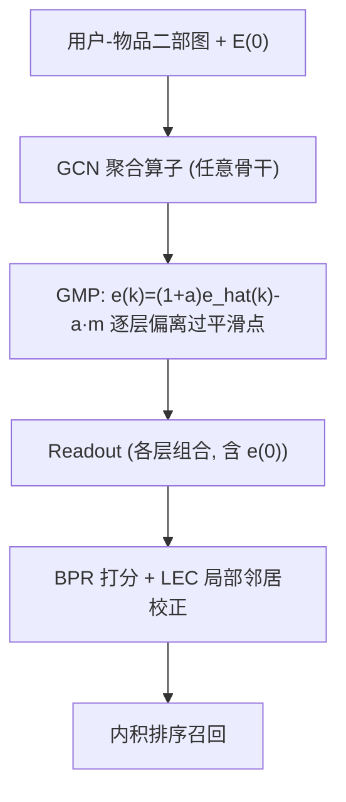
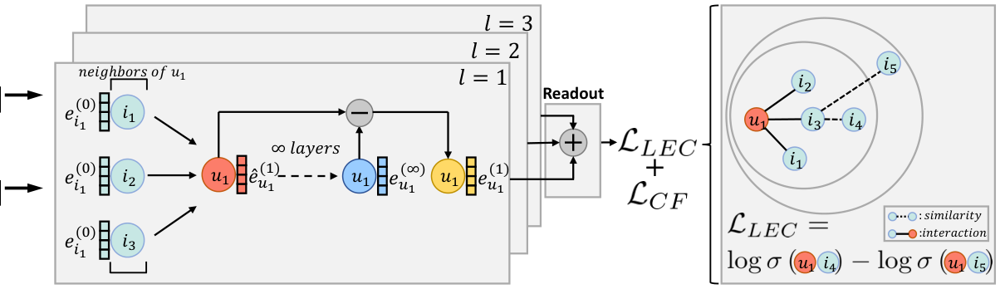

# DGR: A General Graph Desmoothing Framework for Recommendation via Global and Local Perspectives (基于全局与局部视角的通用图去平滑推荐框架)

- **会议/期刊**: IJCAI 2024
- **作者与机构**: Leilei Ding, Tianfu Wang, Yanyong Zhang (USTC)；Dazhong Shen (Shanghai AI Lab)；Chao Wang, Le Zhang (Baidu AI Lab)
- **推荐链路定位**: 召回（GCN 表征学习通用插件）
- **研究方向**: 图神经网络推荐 / 协同过滤
- **论文原文**: [https://arxiv.org/abs/2403.04287v2](https://arxiv.org/abs/2403.04287v2)
- **开源代码**: [https://github.com/me-sonandme/DGR.git](https://github.com/me-sonandme/DGR.git)

## TL;DR (1分钟核心速览)

现有 GCN 推荐模型随层数加深必然收敛到「过平滑点」，用户/物品嵌入坍缩至同一秩一子空间，个性化失效；而既有去平滑手段（残差连接、归一化、DropEdge）只能针对单一模型定制。本文提出 **模型无关** 的 DGR 框架：全局侧在每层消息传递后把嵌入沿「远离过平滑点」方向拉伸（GMP），局部侧用 similar/marginal 邻居对比损失修正读出嵌入（LEC）。插到 LightGCN/SGL/SimGCL/XSimGCL/MixGCF 五种骨干上，5 个数据集全部正增益，最大达 Recall@20 +11.21%、NDCG@20 +16.22%（XSimGCL on MovieLens1M）。

## Background & Motivation (背景与核心矛盾)

- **主流范式**: LightGCN 式线性消息传递 $\mathbf{E}^{(k+1)}=\tilde{A}\mathbf{E}^{(k)}$，读出层对各层嵌入加权求和后做内积打分，BPR 成对训练。
- **前人局限 ①**: 理论上 $\tilde{A}^\infty_{u,i}=\frac{\sqrt{(d_u+1)(d_i+1)}}{2N_{edge}+N_u+N_i}$，$\mathbf{M}=\lim_{k\to\infty}\tilde{A}^k\mathbf{E}^{(0)}$ 各行线性相关（秩坍缩），长尾高热度节点收敛更快、并把稀疏节点一起拖向同一极限。
- **前人局限 ②**: 现有去平滑方案与骨干强耦合——残差类（GCNII）、归一化类（NodeNorm/EGNNZ/PairNorm）无方向性且在浅层 GCN 上反而掉点；拓扑类（DropEdge/AdaEdge）破坏局部协同结构；IMP-GCN 需按兴趣分组独立传播，改动骨干。
- **核心洞察 (Key Insight)**: 图 1 实证显示 $D(\mathbf{E}^{(k)},\mathbf{M})$ 随层数几乎单调下坠，且无交互的 u/i 嵌入轨迹同样向 m 汇聚——过平滑并非"深度专属"，浅层模型同样收敛到瓶颈。因此去平滑应是一个 **与骨干解耦、且带明确方向** 的正则插件。
- **本文切入点**: 全局给"往哪走"（远离 m 的方向向量），局部给"跟谁近"（保留邻域协同、推开边缘节点），二者正交组合。

<figure class="paper-figure" markdown="span">
  ![图1：随着消息传递层数增加，节点嵌入演化的实证分析。左侧展示在层数 k 范围 \[1, 20\] 内 D(E(k), M) 的变化。右侧展示过平滑点 m 的 t-SNE 可视化，以及一个物品和一个用户的嵌入轨迹。](../../../../assets/papers/2403.04287v2/figure_1.png)<figcaption>图1：随着消息传递层数增加，节点嵌入演化的实证分析。左侧展示在层数 k 范围 [1, 20] 内 D(E(k), M) 的变化。右侧展示过平滑点 m 的 t-SNE 可视化，以及一个物品和一个用户的嵌入轨迹。</figcaption>
</figure>

## Method (核心方法设计)

### 1. 整体框架 (Overall Architecture)

输入为用户-物品二部图与随机初始化嵌入 $\mathbf{E}^{(0)}$，训练时先按大幂次近似求解一次全局过平滑点$\mathbf{M}=\tilde{A}^{\infty}\mathbf{E}^{(0)}$（每个节点对应一个 m，全流程复用）。前向阶段沿用任意 GCN 骨干的聚合算子得到$\hat{e}^{(k)}$，随后 GMP 逐层把嵌入沿$m-\hat{e}^{(k)}$方向拉伸；读出层按骨干原有方式（含$e^{(0)}$）组合出$e_u,e_i$，内积打分。训练目标为骨干原损失 + 加权 LEC 局部校正损失。推理解码与骨干完全一致，无额外在线开销。

<figure class="paper-figure" markdown="span">
  <figcaption>图3：DGR 架构示意图。在 Global Desmoothing Message Passing 组件中，用户和物品嵌入被推离过平滑点，以保持节点嵌入的区分性。在 Local Node Embedding Correction 组件中，相似邻居节点（如节点 i4）在局部图中被聚合在一起，而边缘节点（如节点 i5）被分离，以利用协同信号。在读出阶段，也使用了 e(0)，尽管为清晰起见未在图中展示。</figcaption>
</figure>

### 2. 关键设计拆解 (Key Designs)

1. **Global Desmoothing Message Passing (GMP)**：痛点是把 $\hat{e}^{(k)}-e^{(k-1)}$分解后，与$e^{(k-1)}-m$平行的分量$\vec{b}$正是"推向 m"的元凶。作者不做事先正交分解，直接用等向的$m-\hat{e}^{(k)}$ 作为扰动向量：
$$e^{(k)}=(1+\alpha)\hat{e}^{(k)}-\alpha m$$
由 Proposition 1 可证 $\|e^{(k)}-m\|_p>\|\hat{e}^{(k)}-m\|_p$，即每层都以$\alpha$为步长把嵌入推离坍缩点。与 GCNII 的$e^{(k)}=\hat{e}^{(k)}+\alpha(e^{(0)}-\hat{e}^{(k)})$ 相比，扰动方向由"初始嵌入"换成"理论极限点"，方向更明确且与骨干残差解耦。

2. **Local Node Embedding Correction (LEC)**：全局推开会牺牲必要的邻域相似性，LEC 在读出嵌入上补回协同信号。对每个正样本对 $(u,i)$，按共现相似度对$i$的邻居排序，取最近的$K_1$个为 similar 集$S(i)$、最远的$K_2$个为 marginal 集$M(i)$（距离超过阈值$\theta$ 的远节点被过滤，只保留"边界节点"）：
$$\mathcal{L}_{LEC}=\sum_{(u,i)\in\mathcal{N}^+}\sum_{sim\in S(i)}\sum_{mar\in M(i)}\Big[\omega_{u,mar}\log\sigma(e_u^\top e_{mar})-\omega_{u,sim}\log\sigma(e_u^\top e_{sim})\Big]$$
其中 $\omega_{u,x}=\frac{1}{\sqrt{d_u+1}\sqrt{d_x+1}}$ 为度归一化权重。直觉是：相似邻居被拉近、边界节点被推远，从而在稀疏图上把有限的局部拓扑信息"榨干"。

3. **训练目标、负采样与复杂度**：总损失 $\mathcal{L}=\mathcal{L}_{CF}+\lambda\mathcal{L}_{LEC}$，$\mathcal{L}_{CF}$沿用骨干自身的 BPR/CGL 损失，负采样策略与骨干一致（不改动）。空间上仅新增$(\mathbf{N}_u+\mathbf{N}_i)T$的过平滑点矩阵；时间从$O((N_u+N_i)\bar{d}TK)$升到$O((N_u+N_i)(\bar{d}+1)TK)$，即每层多一次向量加法级的线性开销，在线推理零额外成本。

## Experimental Setup & Evaluation Protocol (实验设置与评估协议)

| 数据集 | 领域 | 规模/密度说明 | 特征/场景说明 |
| :--- | :--- | :---: | :--- |
| Gowalla | LBS 签到 | 中大规模、中等稀疏 | 用户-地点隐式反馈 |
| Yelp2018 | 本地生活 | 大规模、密度 0.13% | 极稀疏，考察长尾鲁棒性 |
| MovieLens1M | 电影 | 中规模、密度最高 | 稠密场景 |
| Netflix | 电影 | 大规模 | 老牌 CF 基准 |
| Douban-Book | 图书 | 中大规模 | 主实验 + 消融/超参载体 |

- **数据划分与防穿越**: `比例划分` 4:1（train:test），**未采用** LightGCN 惯用的 Leave-One-Out；训练集内部再划分验证集用于早停，属常规随机比例切分。
- **排名评测协议**: 报告 Recall@20 / NDCG@20，数值量级（如 ML-1M LightGCN 0.2690）与全库排序结果一致，应属 `Full-Ranking`，但原文未显式声明是否过滤训练正例，也未报告采样负例比例——这是可比性上的一处模糊点。
- **对比基线与超参**: 传统 (BPRMF, NGCF) + 去平滑 SOTA (IMP-GCN, LayerGCN) + 五种 GCN 骨干（LightGCN / SGL / SimGCL / XSimGCL / MixGCF）及其 DGR 增强版；嵌入维度、层数与各骨干官方设置对齐；$\alpha$按层独立调优，$\lambda$ 在验证集上搜索；未报告显著性检验。

## Key Experimental Results (实验关键数据)

### 1. 主实验对比 (Main Results)

| 模型 | Gowalla R@20 | Gowalla N@20 | ML-1M R@20 | ML-1M N@20 | Douban R@20 | Douban N@20 |
| :--- | :---: | :---: | :---: | :---: | :---: | :---: |
| NGCF | 0.1602 | 0.1311 | 0.2594 | 0.2676 | 0.1509 | 0.1259 |
| IMP-GCN | 0.1837 | 0.1510 | 0.2793 | 0.3154 | 0.1599 | 0.1349 |
| LayerGCN | 0.1825 | 0.1502 | 0.2798 | 0.3085 | 0.1619 | 0.1363 |
| LightGCN | 0.1832 | 0.1542 | 0.2690 | 0.3014 | 0.1497 | 0.1257 |
| LightGCN+DGR | 0.1880 | 0.1556 | 0.2749 | 0.3065 | 0.1573 | 0.1308 |
| *Improv.* | +2.61% | +0.92% | +2.19% | +1.69% | +5.08% | +4.06% |
| XSimGCL | 0.1681 | 0.1388 | 0.2498 | 0.2669 | 0.1756 | 0.1590 |
| XSimGCL+DGR | 0.1811 | 0.1533 | 0.2778 | 0.3102 | 0.1828 | 0.1633 |
| *Improv.* | +7.73% | +10.49% | +11.21% | +16.22% | +4.10% | +2.70% |
| MixGCF | 0.1852 | 0.1579 | 0.2735 | 0.3025 | 0.1771 | 0.1606 |
| **MixGCF+DGR** | **0.1890** | **0.1604** | **0.2934** | **0.3306** | **0.1922** | **0.1730** |
| *Improv.* | +2.05% | +1.56% | +7.23% | +9.29% | +8.53% | +7.72% |

注：SGL、SimGCL 及其 DGR 版本在同设置下亦全部正增益（如 SimGCL on ML-1M Recall 0.2560→0.2752，+7.50%），受篇幅所限未列出。

### 2. 消融实验 (Ablation Study)

Douban-Book 上逐模块拆解，单元格为 `Recall@20 / NDCG@20`：

| 变体 | LightGCN | SimGCL | XSimGCL | MixGCF |
| :--- | :---: | :---: | :---: | :---: |
| Baseline | 0.1497/0.1257 | 0.1773/0.1562 | 0.1756/0.1590 | 0.1771/0.1606 |
| + GMP | 0.1533/0.1306 (+2.40%) | 0.1786/0.1590 (+0.73%) | 0.1777/0.1599 (+1.20%) | 0.1807/0.1623 (+2.03%) |
| + LEC | 0.1522/0.1279 (+1.67%) | 0.1790/0.1575 (+0.96%) | 0.1814/0.1631 (+3.30%) | 0.1914/0.1716 (+8.07%) |
| + DGR (GMP+LEC) | 0.1573/0.1308 (**+5.08%**) | 0.1811/0.1601 (**+2.14%**) | 0.1828/0.1633 (**+4.10%**) | 0.1922/0.1730 (**+8.53%**) |

过平滑度量 **Row-diff**（越大越不平滑）：LightGCN 2.68→2.80、SGL 2.61→2.85、SimGCL 2.65→3.06、XSimGCL 2.32→2.75、MixGCF 2.38→2.74。

### 3. 关键实验发现 (Key Findings)

1. **增益与骨干"欠协同建模"程度正相关**：XSimGCL 仅靠随机噪声增广、缺少显式拓扑利用，故在 ML-1M 上被 DGR 拉到 Recall +11.21%/NDCG +16.22%；而 LightGCN 本身已强力聚合邻域，提升仅 +2.19%。这说明过平滑并非均匀瓶颈，而是"局部协同信号缺失"模型的短板放大器。
2. **GMP 与 LEC 存在超加性协同，但主导项因骨干而异**：LightGCN 上 GMP(+2.40%) 与 LEC(+1.67%) 之和 4.07% 小于合并后的 5.08%，方向性去平滑与局部校正互补；而 MixGCF 上 LEC 单独即 +8.07%，几乎等于 DGR 的 +8.53%——硬负采样骨干的瓶颈在局部边界节点判别而非全局坍缩。
3. **深堆叠下衰减显著放缓**：层数从 2 增至 12 时，带 DGR 的 LightGCN 曲线下降明显更平缓；Row-diff 全面提升（XSimGCL 2.32→2.75，+18.5%），且最优 $\alpha$逐层不同（LightGCN 为$[0.1,0.8,0.1]$、MixGCF 为$[0,0.4,0.2]$），印证不同层收敛速率不均、需分层控幅。此外训练损失收敛更快（图 4），额外开销并未拖慢收敛。

## Highlights & Limitations (亮点、对比与审稿批判)

- **与代表作对比**: 相比 GCNII 的残差式回拉（扰动源为 $e^{(0)}$），DGR 的扰动源是理论极限点 m，方向更具物理意义且可插拔；相比 NodeNorm/PairNorm 这类无方向归一化，DGR 在浅层 GCN 上依然稳定增益；相比 DropEdge 的随机丢边，DGR 不破坏局部拓扑，因此与 LEC 可协同；相比 IMP-GCN 的分组传播（需改骨干），DGR 仅加一次向量拉伸与一项损失。
- **可迁移亮点**: ① "预计算极限点 m + 逐层定向扰动"可迁移到任何迭代式表征聚合（如序列推荐的多层 Transformer、KG 多跳推理）；② LEC 的 similar/marginal + 边界节点过滤策略，可直接移植为冷启动/稀疏场景的邻域对比正则。
- **审稿级局限批判**: ① 评测协议披露不足——4:1 随机划分与 LightGCN 系常用的 LOO 不可直接横向比较，且未声明是否 Full-Ranking、是否过滤训练正例，也未做显著性检验；② $\alpha$ 逐层独立搜索（3 层即 3 个自由超参，深堆叠时搜索空间爆炸），而 Table 1 中 LightGCN+DGR 在 ML-1M/Douban 上仍低于 IMP-GCN、LayerGCN，说明"模型无关"的普适性与绝对 SOTA 之间存在折衷；③ 过平滑点需一次性幂迭代近似，超长训练/动态图场景下 m 的刷新成本与时效性未讨论。

## Rating (四维评分)

- **方法创新性 (Novelty)**: ⭐⭐⭐⭐ （把"远离过平滑点"这一方向性约束写成一行可插拔算子，并配 Proposition 1 保证距离单调增大，思路简洁且有理论落点）
- **评估协议与实验扎实度 (Protocol & Experiments)**: ⭐⭐⭐ （5 数据集 × 5 骨干的矩阵式验证很充分，但划分/打分协议披露含糊、缺显著性检验，且非所有单元格都超越 SOTA）
- **写作与数学规范度 (Clarity & Rigor)**: ⭐⭐⭐⭐ （GMP/LEC 公式与复杂度分析清晰，与 GCNII、归一化、拓扑方法的定性对比到位；LEC 中 similar/marginal 的构造细节下放附录略显不足）
- **工业落地与复现价值 (Industrial & Practical Value)**: ⭐⭐⭐⭐⭐ （代码开源、零在线推理开销、仅 $O((N_u+N_i)T)$ 额外存储，可作为现成组件接入任意 GCN 召回模型，工程性价比极高）

